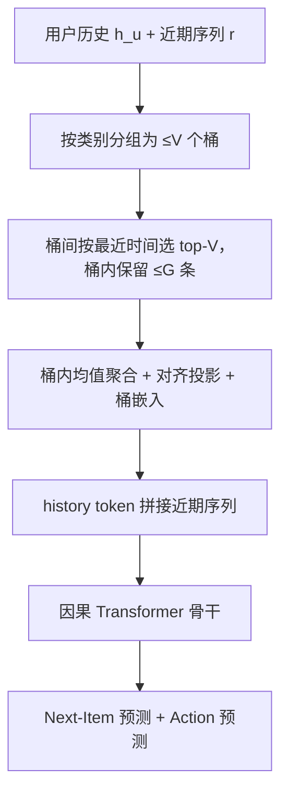
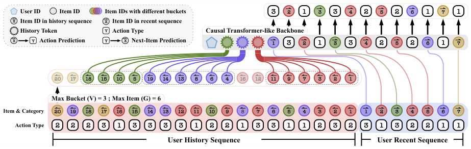

# Accelerating Generative Recommendation via Simple Categorical User Sequence Compression (基于简单类别化用户序列压缩的生成式推荐加速)

- **会议/期刊**: WSDM 2026
- **作者与机构**: Qijiong Liu, Lu Fan, Zhongzhou Liu, Xiaoyu Dong, Yuankai Luo, Guoyuan An, Nuo Chen, Wei Guo, Yong Liu, Xiao-Ming Wu (香港理工大学 & 华为)
- **推荐链路定位**: 召回 / 端到端生成式
- **研究方向**: 生成式推荐 / 序列推荐
- **论文原文**: [https://arxiv.org/abs/2601.19158v1](https://arxiv.org/abs/2601.19158v1)
- **开源代码**: [https://github.com/Genemmender/CAUSE](https://github.com/Genemmender/CAUSE)

## TL;DR (1分钟核心速览)

生成式推荐（GR）虽受益于长序列，但注意力开销随序列长度平方增长，实时部署受阻。本文提出 CAUSE：将用户历史按**物品固有类别**分桶，桶内聚合为紧凑的 history token，与近期序列拼接后送入 HSTU/GenRank 骨干。在 KuaiRand-27K 与 MovieLens-20M 上，相较 HSTU 在同等算力下 nDCG@10 最高提升 **39.14%**，在同等精度下计算开销最高降低 **6 倍**，且模型无关、可插拔。

## Background & Motivation (背景与核心矛盾)

- **主流范式**: 以 HSTU 为代表的 decoder-only 生成式推荐，将用户行为展平为 item/action 交替 token 序列，用因果 Transformer 直接生成下一交互，并已验证序列长度、参数量上的 scaling law。
- **前人局限**: 其一，推荐场景隐藏维 $D$通常很小（如 64），而序列长度$L$极大，单层开销$\mathcal{O}(HL^2D)+\mathcal{O}(HLD^2r)$ 中**注意力项主导**，长序列训练/推理成本平方膨胀；其二，工业方案 TwinV2（层次聚类）、LONGER（token mixer）、GenRank（item-action 聚合）、OneRec（聚类 + Q-Former 多阶段）要么设计复杂、要么未开源，难以复现与横向评测。
- **核心洞察 (Key Insight)**: 用户长期历史中存在大量**同类目重复行为**，其信息冗余度极高；物品类别（如 MusicType、Genres）是天然可得的语义分桶依据，无需学习复杂压缩器即可在保留兴趣分布的前提下大幅缩短输入。
- **本文切入点**: 把长历史按类别分桶、桶内聚合为少量 history token，与近期序列解耦建模，用"分桶 + 聚合"这一极简算子替代复杂压缩网络。

## Method (核心方法设计)

### 1. 整体框架 (Overall Architecture)

将观测序列 $s_{\le t}^u$切分为长期历史$h_u$与近期序列$r_{\le t}^u$，即$s_{\le t}^u=(h_u;r_{\le t}^u)$，并把生成目标改写为$P(i_{t+1},a_{t+1}\mid r_{\le t}^u,\mathrm{CAUSE}(h_u),u)$。历史经"分组—桶间/桶内选择—聚合"三步压缩为$V$ 个 history token；输入序列由 user ID、压缩历史 token、近期序列三段构成，段间以特殊 token 分隔，item 与 action 交替展平（沿用 HSTU 设计）。骨干为 3 层因果 Transformer，同时输出 next-item 与 action 两个预测头，端到端训练。

<figure class="paper-figure" markdown="span">
  <figcaption>图2：所提出的用户序列压缩框架示意图。观测到的用户序列 s≤𝑡</figcaption>
</figure>

### 2. 关键设计拆解 (Key Designs)

1. **类别分桶与双层选择（Grouping + Inter/Inner-Bucket Selection）**：痛点是不加区分地截断历史会丢失兴趣多样性。做法是先把 $h_u$按类别$c\in\mathcal{C}$（$|\mathcal{C}|=V_C$）分入至多$V_C$个桶，桶按**桶内最近交互时间戳**排序，仅保留 top-$V$个最新桶；桶内再按时间保留至多$G$条最近 item。这样压缩后长度恒为$V$，既控制成本又保留"最近兴趣优先"的时序语义，且天然支持一对多/多对多类别映射（一个 item 可入多个桶）。

2. **桶级聚合与对齐投影（Bucket Aggregation）**：直接取桶内均值会混淆不同类别的语义空间。为此对第 $j$ 个桶做对齐后再聚合：
$$\mathbf{e}_j^{(h)}=\frac{1}{|B_j|}\sum_{i\in B_j}\left(\boldsymbol{W}_{\text{align}}\mathbf{E}^{(i)}[i]+\mathbf{b}_{\text{align}}\right)+\mathbf{E}^{(b)}[j]$$
其中 $\boldsymbol{W}_{\text{align}}\in\mathbb{R}^{d'\times d}$将 item 嵌入投影到桶对齐语义空间，$\mathbf{E}^{(b)}[j]$为桶嵌入。直觉是：投影让不同桶的 item 在同一空间可比，桶嵌入则注入类别先验，二者相加使聚合 token 既含内容又含类别身份。最终$\mathbf{E}^{(h)}=[\mathbf{e}_1^{(h)},\dots,\mathbf{e}_v^{(h)}]$ 作为历史 token。

3. **训练目标、负采样与推理效率**：总损失 $\mathcal{L}=\mathcal{L}_{\text{item}}+\mathcal{L}_{\text{action}}$，其中$\mathcal{L}_{\text{item}}$为带负采样的 InfoNCE（温度$\tau$），$\mathcal{L}_{\text{action}}$为 action 词表上的交叉熵。负采样比例固定为 **200**，非 in-batch。推理时输入长度由$L$降至$V+|r|$，注意力开销从$\mathcal{O}(HL^2D)$降为$\mathcal{O}(H(V+|r|)^2D)$，这是 6 倍加速的直接来源；压缩本身仅需一次分桶与均值池化，几乎零额外开销。

## Experimental Setup & Evaluation Protocol (实验设置与评估协议)

- **数据集与预处理**:

| 数据集 | #Users | #Items | #Interactions | 稀疏度/密度 | 特征/场景说明 |
| :--- | :---: | :---: | :---: | :---: | :--- |
| KuaiRand-27K | 27K | 220K | 228K–27K（随 iLen 变化） | 极稀疏 | 短视频，31 天日志；第 1–15 天为长期历史，16–23 天训练，24 天验证/测试；仅保留 click 与 long view 两类 action；类别 MusicType（一对多） |
| MovieLens-20M | 130K | 21K | 130K | 中等 | 电影，跨数十年；5 类 action；类别 Genres（多对多）；沿用 Fuxi-$\alpha$ 预处理 |

- **数据划分与防穿越 (Splitting Strategy)**: KuaiRand-27K 采用**全局时间戳切分**（按天划分历史/训练/验证/测试），严格防穿越；MovieLens-20M 沿用 Fuxi-$\alpha$ 协议。
- **排名评测协议 (Ranking Protocol)**: 采用 **Sampled Ranking**，负采样比固定为 **200**；指标为 nDCG@{1,10,20,100,200} 与 MRR。
- **对比基线与超参设置**: 基线为 HSTU 与 GenRank（含各自 +CAUSE 变体）；Transformer 层数固定 3、隐藏维 $d=64$、8 头；桶数上限$V=8$、桶内上限$G=32$；Adam，学习率网格$\{1\text{e-}3,2\text{e-}3,5\text{e-}3,1\text{e-}2\}$取$5\text{e-}3$；训练 200 epoch 取验证最优。延迟在单卡空闲 GPU 上测得。

## Key Experimental Results (实验关键数据)

### 1. 主实验对比 (Main Results)

| 数据集 | 模型 | iLen / sLen | N@10 | N@100 | MRR | 推理(ms) | 训练(s) |
| :--- | :--- | :---: | :---: | :---: | :---: | :---: | :---: |
| KuaiRand | HSTU (d) | 512 / 1024 | 0.0175 | 0.0364 | 0.0167 | 1.90 | 79.04 |
| KuaiRand | HSTU (f) | 2048 / 4096 | 0.0183 | 0.0383 | 0.0174 | 11.10 | 297.35 |
| KuaiRand | **+CAUSE (g)** | 512 / 1024 | **0.0188** | **0.0384** | **0.0179** | **1.87** | **79.19** |
| KuaiRand | GenRank (h) | 512 / 512 | 0.0121 | 0.0266 | 0.0117 | 1.56 | 64.94 |
| KuaiRand | **+CAUSE (i)** | 512 / 512 | **0.0126** | **0.0277** | **0.0122** | **1.47** | **61.47** |
| ML-20M | HSTU (m) | 256 / 512 | 0.1004 | 0.1791 | 0.0864 | 0.41 | 54.26 |
| ML-20M | HSTU (n) | 512 / 1024 | 0.1030 | 0.1819 | 0.0883 | 0.89 | 114.96 |
| ML-20M | **+CAUSE (o)** | 256 / 512 | **0.1249** | **0.2045** | **0.1066** | **0.42** | **55.11** |
| ML-20M | GenRank (p) | 64 / 64 | 0.0748 | 0.1402 | 0.0664 | 0.15 | 19.08 |
| ML-20M | **+CAUSE (q)** | 64 / 64 | **0.0854** | **0.1549** | **0.0754** | 0.16 | 20.29 |

提升幅度：KuaiRand 上 (g) 相对 (d) N@10 **+7.43%**、相对 (f) 推理 **6×** 加速且 N@10 仍 **+2.73%**；ML-20M 上 (o) 相对 (m) N@10 **+24.40%**、相对 (n) 训练 **2×** 加速且 N@10 **+21.26%**；GenRank 骨干上 (q) 相对 (p) N@10 **+14.17%**。

### 2. 消融实验 (Ablation Study)

| 配置 | KuaiRand N@10 | KuaiRand MRR | ML-20M N@10 | ML-20M MRR |
| :--- | :---: | :---: | :---: | :---: |
| CAUSE + HSTU | **0.0188** | **0.0179** | **0.1168** | **0.1006** |
| w/o $\boldsymbol{W}_{\text{align}},\mathbf{b}_{\text{align}}$ | 0.0180 | 0.0172 | 0.1136 | 0.0982 |
| w/o action prediction | 0.0178 | 0.0168 | 0.1144 | 0.0988 |
| w/o history $h_u$ | 0.0175 | 0.0167 | 0.0965 | 0.0840 |

类别来源消融（KuaiRand, iLen=512）：固有 MusicType 双用 N@10=0.0178；无类别 N/A 仅 0.0127；K-Means 仅用于历史 0.0135；K-Means 双用 0.0144。

### 3. 关键实验发现 (Key Findings)

1. **压缩历史本身即涨点，而非仅省算力**：去掉 $h_u$ 后 ML-20M N@10 从 0.1168 跌至 0.0965（-17.4%），说明桶级聚合 token 提供了近期序列之外的长期兴趣信号，压缩起到了"去噪 + 摘要"的双重作用。
2. **类别质量决定压缩上限**：固有类别（0.0178）显著优于 K-Means 聚类（0.0144）与无类别（0.0127），且 K-Means 同时用于历史与近期序列时收益更大，表明语义一致的桶划分是聚合有效性的前提，无元数据场景可用聚类兜底但存在明显折损。
3. **对齐投影与 action 头是稳定增益项**：移除 $\boldsymbol{W}_{\text{align}}$ 在两个数据集上均造成 N@10 下降（0.0188→0.0180、0.1168→0.1136），移除 action prediction 在 KuaiRand 上 MRR 降至 0.0168，验证了跨桶语义对齐与多任务辅助监督的必要性；同时 CAUSE 在 HSTU 与 GenRank 两种骨干上均一致有效，证明其模型无关性。

## Highlights & Limitations (亮点、对比与审稿批判)

- **与代表作对比 (vs. Prior Work)**: 相较 HSTU，CAUSE 不改骨干、仅在输入端做类别压缩，同等算力下精度更高；相较 GenRank 的 item-action 聚合，CAUSE 保留完整近期序列并额外引入长期兴趣摘要，避免了 GenRank 在 KuaiRand 上 N@10 从 0.0173 跌至 0.0121 的精度塌陷；相较 OneRec 的多阶段聚类 + Q-Former，CAUSE 无需学习压缩器、单阶段可训练且完全开源。
- **可迁移亮点**: 其一，"按元数据分桶 + 时间优先双层截断 + 对齐均值聚合"可作为任意长序列推荐模型的通用前置压缩层；其二，用 K-Means 在已学 item 嵌入上构造伪类别，可低成本迁移到无类别元数据的场景。
- **审稿级局限批判**: 其一，评测仅用 **200 负采样的 Sampled Ranking**，未报告 Full-Ranking 全库排序结果，长尾 item 上的真实收益存疑；其二，压缩效果高度依赖类别粒度，$V=8$、$G=32$ 为固定超参且未给出敏感度分析，类别基数大或长尾极重的场景下桶内均值可能过度平滑、丢失细粒度偏好；此外仅 5 页短文，缺少线上 A/B 与延迟-精度帕累托曲线的完整刻画。

## Rating (四维评分)

- **方法创新性 (Novelty)**: ⭐⭐⭐ （思路朴素但切中 GR 效率痛点，"类别桶 + 对齐聚合"简洁有效，理论新意有限）
- **评估协议与实验扎实度 (Protocol & Experiments)**: ⭐⭐⭐ （双数据集 + 双骨干 + 效率实测较完整，但仅 Sampled Ranking、缺显著性检验与超参敏感度）
- **写作与数学规范度 (Clarity & Rigor)**: ⭐⭐⭐⭐ （公式精简、符号清晰、三步流程与图示对应良好，复杂度分析到位）
- **工业落地与复现价值 (Industrial & Practical Value)**: ⭐⭐⭐⭐⭐ （代码开源、零额外推理开销、6× 加速且精度不降，可直接嵌入现有 GR 流水线）

