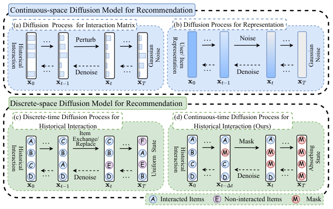
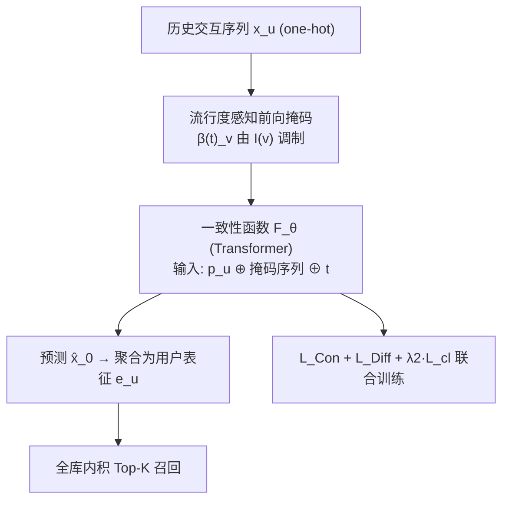
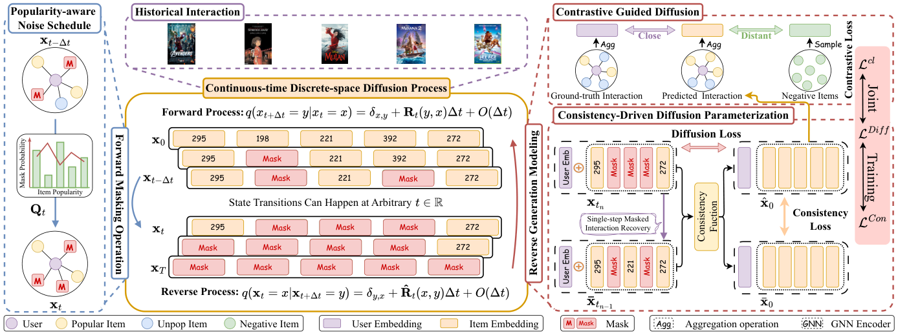

# Continuous-time Discrete-space Diffusion Model for Recommendation (面向推荐的连续时间离散空间扩散模型)

- **会议/期刊**: WSDM 2026
- **作者与机构**: Chengyi Liu, Xiao Chen, Shijie Wang, Wenqi Fan, Qing Li（香港理工大学）
- **推荐链路定位**: 召回（生成式用户表征 → 全库内积检索）
- **研究方向**: 生成式推荐与离散语义 ID / 自监督对比学习
- **论文原文**: [https://arxiv.org/abs/2511.12114v1](https://arxiv.org/abs/2511.12114v1)
- **开源代码**: [https://github.com/ChengyiLIU-cs/CDRec](https://github.com/ChengyiLIU-cs/CDRec)

## TL;DR (1分钟核心速览)

现有扩散推荐（DiffRec/GiffCF/BSPM）把离散协同图编码进连续空间再加各向同性高斯噪声，既破坏个性化语义又需上百步采样。CDRec 改在**离散状态空间**上做扩散：用吸收态 `[MASK]` 直接扰动历史交互序列，连续时间 SDE 允许任意时刻状态转移；并设计**流行度感知噪声调度**（热门物品吸收概率更低，形成 easy-to-hard 轨迹）、**一致性函数**参数化反向过程（支持单步生成）、**多跳协同对比损失**引导采样。在 Ciao/MovieLens-1M/Dianping 三数据集 Full-Ranking 协议下，Recall@10 相对最强基线提升 4.21%–5.21%，且采样耗时显著低于 DiffRec。

## Background & Motivation (背景与核心矛盾)

- **主流范式**: 扩散推荐把用户历史交互当作待去噪信号，前向加噪、反向逐步恢复潜在偏好；代表作为 DiffRec（对二值交互向量加高斯噪声）、GiffCF（在 item-item 相似图上做热方程扩散）、BSPM（邻接矩阵上的连续时间 score-based 扩散）。
- **前人局限**: ① 对交互矩阵加噪是**全物品均匀扰动**，无视物品依赖、破坏协同图拓扑；② 对编码表征加高斯噪声则**破坏语义一致性**，扩散轨迹信息量低、训练与采样低效（DiffRec 需 100 步）。
- **核心洞察 (Key Insight)**: 离散扩散（D3PM 式吸收态/均匀态转移）在文本生成中已证明可用**离散元素操作**（掩码/替换）替代高斯噪声，且转移矩阵可**直接注入领域知识**；但该范式在推荐中仅被 DCDR 用于重排阶段的物品位置扰动，从未用于直接建模用户偏好分布。
- **本文切入点**: 把"用户交互序列"本身作为离散扩散的状态，用掩码吸收态 + 连续时间 SDE 建模，并用物品流行度定制噪声调度，使扩散轨迹"像真实交互过程"。

<figure class="paper-figure" markdown="span">
  <figcaption>图1：不同状态空间下基于扩散的推荐系统比较。连续空间扩散算法对协同图的邻接矩阵或编码表示施加各向同性高斯噪声，往往损害嵌入空间中的个性化信息。相比之下，离散空间扩散模型直接通过物品级操作趋向均匀分布。受此启发，我们提出的CDRec方法在连续时间中通过掩码操作扰动历史交互，实现状态转移。</figcaption>
</figure>

## Method (核心方法设计)

### 1. 整体框架 (Overall Architecture)

输入为用户 $u$的历史交互序列$\mathbf{x}_u=[v_1,\dots,v_l]$（one-hot，$l=20$），用户/物品嵌入由预训练 3 层 LightGCN 初始化。前向过程按**流行度感知调度**逐步把物品替换为 `[MASK]` 吸收态，直至全掩码；反向过程由 Transformer 编码器实例化的**一致性函数**$F_\theta$直接从任意时刻$t$的掩码序列预测原始交互$\hat{\mathbf{x}}_0$（序列前缀拼接协同用户嵌入$\mathbf{p}_u$，时间步嵌入加到$\mathbf{p}_u$上，输出经与物品矩阵余弦相似度投影回离散空间）。训练联合一致性损失、扩散重建损失与多跳对比损失；推理时把生成物品嵌入聚合为用户表征，与全库物品内积取 top-$k$。

<figure class="paper-figure" markdown="span">
  <figcaption>图2：所提出的CDRec框架包含三个主要模块：流行度感知噪声调度、一致性驱动扩散参数化和对比引导扩散。左图展示前向扩散过程，其中状态转移由物品流行度控制以模拟交互动态。右图展示反向生成建模过程，利用一致性函数进行高效参数化，并应用对比学习以结构协同信号引导个性化推荐。</figcaption>
</figure>

### 2. 关键设计拆解 (Key Designs)

1. **流行度感知噪声调度（Popularity-aware Noise Schedule）**：线性/余弦调度假设所有物品对偏好建模贡献均等，导致掩码轨迹无语义。本文定义序列内流行度偏差 $I(v)=\mathrm{pop}(v)-\frac{1}{l}\sum_{i}\mathrm{pop}(v_i)$，并把吸收概率写成
$$\beta(t)_{v_i}=\frac{t}{T}-\omega\exp\!\Big(-\frac{(t-T)^2}{2\sigma^2}\Big)I(v_i),$$
即热门物品（$I>0$）吸收更慢、冷门物品更早被掩。直觉：真实交互总是"先看热门再看长尾"，反向生成因此形成 **easy-to-hard** 课程，热门物品的稳定模式先被学到，长尾在后段被建模。该调度仍满足标准转移率要求（收敛性 + 转移核可解析计算$q_{t|0}=\big(S\exp(\Lambda\bar\beta(t))S^{-1}\big)_{ij}$）。

2. **一致性驱动的反向参数化（Consistency Function）**：直接估 $p_{0|t}$在离散分布下效果差，学 score 比$q_t(y)/q_t(x)$又需正性约束与高算力。本文改用一致性函数$f:(\mathbf{x}_t,t)\mapsto\mathbf{x}_\varepsilon$，因离散态无法做 skip-connection 叠加，故分段定义为$f_\theta(\mathbf{x},t)=\mathbf{x}\ (t=\varepsilon)$、$=F_\theta(\mathbf{x},t)\ (t\in(\varepsilon,T])$。训练目标
$$\mathcal{L}_{Con}=\mathbb{E}_{\mathbf{x}_0,t_n}\big[\gamma(t_n)\,d\big(f_\theta(\mathbf{x}_{t_n},t_n),\,f_{\theta^-}(\bar{\mathbf{x}}_{t_{n-1}},t_{n-1})\big)\big],$$
其中 $d$取 KL 散度、$\theta^-$为 EMA。关键难点是构造相邻时刻对$(\bar{\mathbf{x}}_{t_{n-1}},\mathbf{x}_{t_n})$：作者给出 one-step recovery（只恢复掩码概率最低的一个物品）与 **pseudo-Euler**（按$\nabla t$自适应解掩，$p=1-(B_{t_n-\nabla t}/B_{t_n})$）两种方案，后者更贴合前向过程。

3. **对比引导 + 联合训练**：一致性损失会让热门物品被过度强调（它们在轨迹中存活更久），故加辅助扩散重建损失 $\mathcal{L}_{Diff}=-\sum_i \mathbf{x}^i_u\log p^i_\theta(\mathbf{x}_0|\mathbf{x}_t)$稳定训练；同时把生成序列的物品嵌入聚合为$\mathbf{e}_u$（模拟单层 GNN 传播），以预训练$\mathbf{p}_u$ 为正样本、随机未交互物品为负样本做 InfoNCE：
$$\mathcal{L}_{cl}=\sum_{u}-\log\frac{\varsigma(\mathbf{e}_u,\mathbf{p}_u)}{\varsigma(\mathbf{e}_u,\mathbf{p}_u)+\sum_{v\in\mathcal{V}^-_u}\varsigma(\mathbf{e}_u,\mathbf{q}_v)}.$$
总损失 $\mathcal{L}=\lambda_1\mathcal{L}_{Con}+(1-\lambda_1)\mathcal{L}_{Diff}+\lambda_2\mathcal{L}_{cl}$，$\lambda_1=0.4$最优。**负采样**：对比损失用随机未交互物品（非 in-batch、非 hard negative）；推理支持单步（$N=1$）或多步（最优$N=30,T=60$），单步即可媲美扩散基线。

## Experimental Setup & Evaluation Protocol (实验设置与评估协议)

- **数据集与预处理**: 评分 $\ge 3$ 视为隐式交互，未做 5-core 过滤：

| 数据集 | #Users | #Items | #Interactions | 密度 | 场景说明 |
| :--- | :---: | :---: | :---: | :---: | :--- |
| Ciao | 7,373 | 91,091 | 227,392 | 0.0338% | 极稀疏点评/社交 |
| MovieLens-1M | 6,038 | 3,533 | 575,281 | 2.6967% | 稠密电影 |
| Dianping | 131,629 | 10,932 | 1,412,544 | 0.0981% | 大规模本地生活 |

- **数据划分与防穿越**: 按 **8:1:1 比例划分**（train/valid/test），非 Leave-One-Out、非全局时间戳切分。
- **排名评测协议**: **Full-Ranking 全库未交互排序**，指标 Recall@{5,10}、NDCG@{5,10}，5 次独立运行取均值。
- **对比基线与超参**: 三类基线——GNN（NGCF/LightGCN/SGL）、VAE（Mult-VAE/VGCL）、扩散（DiffRec/L-DiffRec/BSPM/GiffCF）；batch=1024，$l=20$，Adam，$\omega=0.5$，$\sigma=T/10$，嵌入由 3 层 LightGCN 预训练初始化。

## Key Experimental Results (实验关键数据)

### 1. 主实验对比 (Main Results)

| 数据集 | 指标 | NGCF | LightGCN | SGL | VGCL | DiffRec | BSPM | GiffCF | **CDRec** | Improv. |
| :--- | :---: | :---: | :---: | :---: | :---: | :---: | :---: | :---: | :---: | :---: |
| Ciao | R@10 | 0.0483 | 0.0525 | 0.0553 | 0.0568 | 0.0436 | 0.0590 | 0.0584 | **0.0617** | +4.58% |
| Ciao | N@10 | 0.0396 | 0.0441 | 0.0493 | 0.0477 | 0.0397 | 0.0518 | 0.0473 | **0.0539** | +4.06% |
| ML-1M | R@10 | 0.1201 | 0.1297 | 0.1319 | 0.1339 | 0.1351 | 0.1399 | 0.1426 | **0.1486** | +4.21% |
| ML-1M | N@10 | 0.1212 | 0.1231 | 0.1277 | 0.1315 | 0.1379 | 0.1347 | 0.1395 | **0.1469** | +5.30% |
| Dianping | R@10 | 0.0531 | 0.0543 | 0.0546 | 0.0551 | 0.0556 | 0.0557 | 0.0505 | **0.0586** | +5.21% |
| Dianping | N@10 | 0.0381 | 0.0421 | 0.0433 | 0.0431 | 0.0439 | 0.0441 | 0.0412 | **0.0471** | +6.80% |

（R@5/N@5 趋势一致，CDRec 在 Ciao R@5 上 +4.84%、ML-1M R@5 上 +6.88%、Dianping N@5 上 +6.19%。）

### 2. 消融实验 (Ablation Study)

| 变体 | Ciao R@10 | ML-1M R@10 | Dianping R@10 | 说明 |
| :--- | :---: | :---: | :---: | :--- |
| **CDRec 完整** | **0.0617** | **0.1486** | **0.0586** | — |
| w/o pop | 显著下降 | 显著下降 | 显著下降 | 换回均匀掩码 + 线性调度 |
| w/o con | 降幅最大 | 降幅最大 | 降幅最大 | 退回估 $p_{0|t}$ |
| w/o diff | 降幅最大 | 降幅最大 | 降幅最大 | 仅保留一致性损失 |
| w/o ssl | 中等下降 | 中等下降 | 中等下降 | 去掉多跳对比引导 |

（原文图 4 仅给出柱状图，未列具体数值；上表按原文"降幅排序"定性归纳。）

### 3. 关键实验发现 (Key Findings)

1. **离散化本身是主要增益来源**：DiffRec 在 Ciao 上 R@10 仅 0.0436，甚至低于 LightGCN 的 0.0525，印证连续空间高斯噪声对稀疏协同图的破坏；CDRec 同数据集达 0.0617，说明"掩码吸收态 + 离散状态"避免了离散→连续编码的信息损失。
2. **一致性损失与扩散损失是双支柱**：消融中 `w/o con` 与 `w/o diff` 降幅最大，说明单靠一致性（易过拟合热门）或单靠重建（无轨迹约束）都不足；$\lambda_1=0.4$ 的折中最优点也印证二者互补。
3. **效率与精度可兼得**：单步生成（$N=1$）已可媲美扩散基线，$N=30,T=60$ 为最优点，继续加步反而因噪声累积掉点；在 Dianping 上同 batch=1024 设置下 CDRec 采样耗时明显低于 DiffRec（掩码操作 vs 全物品向量加噪）。

## Highlights & Limitations (亮点、对比与审稿批判)

- **与代表作对比 (vs. Prior Work)**: 与 DiffRec/GiffCF/BSPM 的本质区别是**状态空间**——它们把离散协同数据编码后加高斯噪声，CDRec 直接在物品 one-hot 序列上做掩码转移；与 DCDR 的区别是后者仅用离散扩散扰动重排位置，CDRec 用其直接建模偏好分布；与文本域 D3PM/SEDD 的区别是引入**流行度先验调度**与**推荐定制的一致性训练对构造**。
- **可迁移亮点**: ① 用物品流行度偏差 $I(v)$ 调制噪声调度，可平移到任何"带曝光先验"的生成式任务（如语义 ID 生成式检索的 token 掩码课程）；② 用 pseudo-Euler 解掩构造一致性训练对，绕开离散空间无 score 无偏估计的难题，可复用到其他离散扩散推荐。
- **审稿级局限批判**: ① 对比损失仅用随机负样本，未探索 hard negative，长尾物品的判别边界可能仍偏弱；② 8:1:1 随机划分而非时间切分，存在未来交互泄漏风险，且未报告冷启动/长尾分桶实验；③ 一致性函数依赖预训练 LightGCN 嵌入，预训练质量与扩散模块的耦合未被消融隔离。

## Rating (四维评分)

- **方法创新性 (Novelty)**: ⭐⭐⭐⭐ （核心机制与方法设计具备明确创新性，理论与实验动机支撑充分）
- **评估协议与实验扎实度 (Protocol & Experiments)**: ⭐⭐⭐⭐ （主流公开数据集评测完整，包含多基线对比与消融实验验证）
- **写作与数学规范度 (Clarity & Rigor)**: ⭐⭐⭐⭐ （问题形式化定义清晰，核心模块数学推导与架构阐述严谨易读）
- **工业落地与复现价值 (Industrial & Practical Value)**: ⭐⭐⭐⭐ （兼顾推荐效果增益与训练/推理效率，具备实际场景迁移参考价值）
