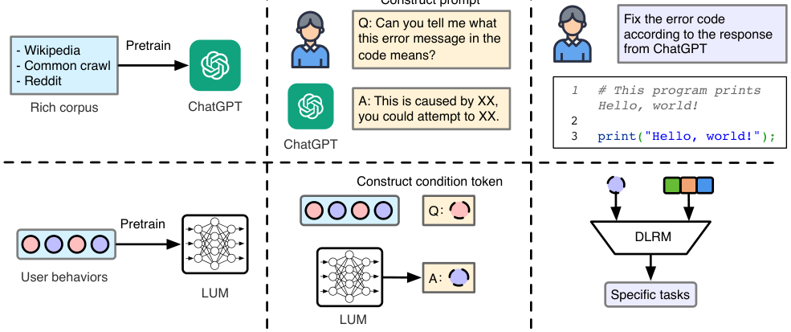
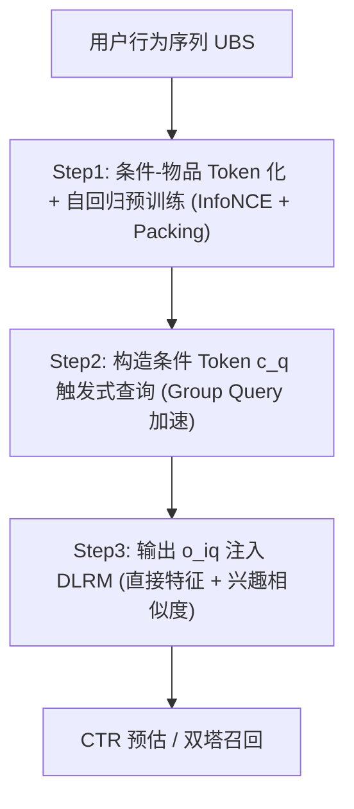

# Unlocking Scaling Law in Industrial Recommendation Systems with a Three-step Paradigm based Large User Model (以三步范式大用户模型解锁工业推荐系统缩放定律)

- **会议/期刊**: WSDM 2026
- **作者与机构**: Bencheng Yan, Shilei Liu, Zhiyuan Zeng 等（共同一作），阿里巴巴集团
- **推荐链路定位**: 精排（兼及召回，作为 DLRM 的特征增强器）
- **研究方向**: 生成式推荐与离散语义 ID / CTR 预估与特征交叉
- **论文原文**: [https://arxiv.org/abs/2502.08309v2](https://arxiv.org/abs/2502.08309v2)
- **开源代码**: 暂未开源

## TL;DR (1分钟核心速览)

端到端生成式推荐（E2E-GR）虽能吃到 scaling law，却在工业场景中因「生成训练 vs 判别应用错位、流式训练与在线推理延迟、特征 schema 僵化、无法继承存量 DLRM 知识」四重矛盾而难以落地。本文提出 LUM 三步范式：先用 Transformer 在用户行为序列上做生成式预训练（Step 1），再以条件 Token 触发式查询用户兴趣（Step 2），最后将查询输出作为特征/相似度注入传统 DLRM（Step 3）。在 ML-1M/ML-20M/Amazon Books 与淘宝 40 亿交互工业集上，AUC 与 R@K 全面超越 HSTU 等基线，模型可稳定扩展至 7B 参数，线上 A/B 的 CTR 提升 2.9%、RPM 提升 1.2%。

## Background & Motivation (背景与核心矛盾)

- **主流范式**: 工业界仍以 Embedding+MLP 的判别式 DLRM（DIN/DIEN/SIM/TWIN）为主；学界则尝试把推荐改写为 next-item 自回归生成（HSTU、TIGER 类 E2E-GR），以复刻 LLM 的缩放定律。
- **前人局限**: 其一，E2E-GR 优化的是联合分布 $p(x,y)$ 的似然，而工业精排需要的是校准良好的 $p(y|x)$，二者目标错位导致判别指标反而落后；其二，E2E-GR 要求单一模型同时满足流式训练吞吐与 <30ms 在线延迟，模型容量与序列长度被死死锁住。
- **核心洞察 (Key Insight)**: 观察 LLM 的真实使用链路——先在海量语料上生成式预训练，再用 prompt 查询知识，最后由人类/下游系统做判别决策——本质是「多步、生成到判别」而非端到端生成。推荐系统完全可以照搬这一解耦结构。
- **本文切入点**: 把「生成式建模」与「判别式应用」在架构上彻底解耦，用条件 Token 作为 prompt 桥接二者，使生成模型只负责知识构建与查询，DLRM 负责实时判别与业务适配。

<figure class="paper-figure" markdown="span">
  <figcaption>图1：使用LLM的常见范式与所提出的多步、生成到判别范式的直观见解对比。</figcaption>
</figure>

## Method (核心方法设计)

### 1. 整体框架 (Overall Architecture)

LUM 将推荐拆为三个可独立调度、可并行的阶段。Step 1 把用户行为序列（UBS）重写为「条件 Token–物品 Token」交替序列，用自回归 Transformer 做生成式预训练，习得用户兴趣与物品协同关系的联合分布；Step 2 针对每个下游请求构造条件 Token $c_q$（场景 ID、搜索词、类目等），以条件生成方式「查询」出该情境下的兴趣表征 $o_{i_{q}}$；Step 3 将这些输出以直接特征拼接与相似度匹配两种方式注入 DLRM，由 DLRM 完成最终的 CTR 预估或双塔召回。由于 Step 1/2 可离线预计算并缓存，在线只有 Step 3 受延迟约束，从而在保留生成式容量的同时满足工业实时性。

### 2. 关键设计拆解 (Key Designs)

1. **Next-Condition-Item 预测与双 Token 化**：传统 next-item 预测缺乏显式条件控制，生成分布是「泛兴趣」而与下游任务错位；HSTU 的辅助 action token 绑定的是**过去**物品 $\langle i_k, a_k\rangle$，无法塑造**未来**分布。本文将每个物品拆为条件 Token $c_k$ 与物品 Token $i_k$，序列变为 $\{c_1,i_1,\dots,c_L,i_L\}$，并把似然改为
$$p(c_1,i_1,\dots,c_L,i_L)=\prod_{l=1}^{L}p(i_l\mid c_1,i_1,\dots,i_{l-1},c_l)$$
自回归损失只施加在条件 Token 的输出位置上。直觉上，条件 Token 等价于 LLM 的 prompt，推理时替换 $c_q$ 即可「唤起」不同任务所需的兴趣知识，实现任务可控生成。

2. **Group Query 与 Packing 的工程加速**：Step 2 中同一用户往往对应海量 $\langle user, query\rangle$ 对，逐条推理代价高昂。Group Query 将多个查询条件拼接到同一序列 $p(i_{q1},i_{q2},\dots\mid c_1,i_1,\dots,c_L,c_{q1},c_{q2},\dots)$，并用 mask 阻断不同 $c_{qj}$ 间的注意力交互，使公共前缀只算一次；Step 1 则借鉴 GPT 的 packing 把多条短 UBS 打包进定长序列。二者分别带来 78% 与 82% 的耗时下降。

3. **训练目标、负采样与推理效率**：物品词表可达十亿级，无法做全词表 softmax，故采用 InfoNCE，batch 内其他物品作负样本（In-batch Negative，共 $K$ 个）：
$$\mathcal{L}=-\sum_{l=1}^{L}\log\frac{\exp(\text{sim}(o_{c_l},e_{i_l}))}{\exp(\text{sim}(o_{c_l},e_{i_l}))+\sum_{k=1}^{K}\exp(\text{sim}(o_{c_l},e_{i_k}))}$$
Step 3 提供两种知识利用方式：直接特征注入 $o_{i_{qn}}$ 与 $e_{i_i}$，以及兴趣匹配相似度 $\text{sim}(o_{i_{qn}},e_{i_i})$，精排改写为 $\hat{y}=f(u,i,s,\{o_{i_{qn}},\text{sim}(o_{i_{qn}},e_{i_i})\},e_{i_i})$。在线时 Step 2 与召回/粗排并行执行并写入集中缓存，精排仅读缓存，延迟与模型规模解耦。

## Experimental Setup & Evaluation Protocol (实验设置与评估协议)

- **数据集与预处理**:

| 数据集 | #Users | #Items | #Interactions | 稀疏度/密度 | 特征/场景说明 |
| :--- | :---: | :---: | :---: | :---: | :--- |
| Amazon Books | 694,897 | 686,623 | 914,014 | 极稀疏 | 公开图书行为 |
| ML-1M | 6,040 | 3,883 | 9,810,868 | 高密度 | 电影评分 |
| ML-20M | 138,493 | 27,278 | 17,253,665 | 中密度 | 电影评分 |
| Industrial (淘宝) | 0.1 B | 0.1 B | 4 B | 极稀疏 | 赞助搜索全链路 |

- **数据划分与防穿越 (Splitting Strategy)**: 公开集按序列建模惯例做序列切分（末位交互作测试），工业集采用**全局时间戳切分**的流式训练/评估，严格避免未来交互泄漏。
- **排名评测协议 (Ranking Protocol)**: 精排报告 AUC（工业界以 0.001 绝对 AUC 增益为显著）；召回报告 R@10 / R@50，采用**全库候选排序**口径，未使用采样负例排序。
- **对比基线与超参设置**: 基线含序列模型 SASRec、E2E-GR 代表 HSTU、精排 DIN/DIEN/SIM/TWIN、召回双塔 EDB 及线上生产模型。Transformer 类模型参数量对齐（公开集约 30M，工业集约 0.3B），序列长度公开集 256、工业集 4096，学习率 1e-3 / 1e-4，batch size 2048，公开集 32 卡、工业集 128 卡训练。

## Key Experimental Results (实验关键数据)

### 1. 主实验对比 (Main Results)

公开集 AUC（Step 3 backbone 为 SIM）：

| Model | ML-1M | ML-20M | Amazon Books |
| :--- | :---: | :---: | :---: |
| SASRec | 0.7295 | 0.7166 | 0.6699 |
| HSTU | 0.7533 | 0.7463 | 0.6712 |
| DIN | 0.7455 | 0.7299 | 0.6139 |
| DIEN | 0.7527 | 0.7319 | 0.6130 |
| SIM | 0.7579 | 0.7341 | 0.6551 |
| TWIN | 0.7539 | 0.7331 | 0.6538 |
| **LUM** | **0.7615** | **0.7483** | **0.6727** |

工业集（精排 AUC / 召回 R@10、R@50）：

| Model | AUC | R@10 | R@50 |
| :--- | :---: | :---: | :---: |
| SASRec | 0.7322 | 0.2560 | 0.4740 |
| DIN | 0.7336 | - | - |
| HSTU | 0.7334 | 0.2594 | 0.4781 |
| Online Model | 0.7338 | 0.2482 | 0.4651 |
| **LUM** | **0.7514** | **0.2727** | **0.4915** |
| **Improv.** | **+0.0176** | **+0.0133** | **+0.0134** |

### 2. 消融实验 (Ablation Study)

工业集 AUC（scratch 训练，除注明外）：

| 配置 | AUC | 说明 |
| :--- | :---: | :--- |
| E2E-GR (HSTU) scratch | 0.7334 | 端到端生成基线 |
| DLRM scratch | 0.7338 | 生产模型从头训 |
| LUM scratch | 0.7514 | 完整三步范式 |
| LUM w/o condition token | 0.7416 | 退化为 next-item |
| LUM multi-conditions | 0.7545 | 场景+搜索词多条件 |
| LUM direct feature only | 0.7402 | 仅直接特征注入 |
| LUM direct feature + interest matching | 0.7514 | 两种利用策略并用 |
| DLRM (param+feature) 增量 | 0.7777 | 继承线上参数与特征 |
| **LUM (param+feature) 增量** | **0.7794** | 兼容增量训练最优 |

效率消融：Packing 使 Step 1 耗时 151h→26h（+82%）；Group Query 使 Step 2 耗时 17h→3.6h（+78%）。

### 3. 关键实验发现 (Key Findings)

1. **条件 Token 是性能主引擎**：去掉条件 Token 后 AUC 从 0.7514 跌至 0.7416（-0.0098），而叠加多条件可再升至 0.7545，说明「生成什么」高度依赖「以什么条件触发」，条件化是生成式知识对齐判别任务的关键开关。
2. **兼容存量系统比模型本身更值钱**：HSTU 从头训（0.7334）甚至不及增量训练的 DLRM（0.7777），而 LUM 继承线上参数+特征后达 0.7794，证明工业场景中「能否复用十年积累的特征与参数」对最终收益的贡献远超架构新颖性。
3. **解耦换来真正的可扩展性**：E2E-GR 训练比 LUM-Step3 慢 12–98 倍且无法在 24h 内完成日更，14B 模型下满足 30ms 延迟的最大序列长度仅 64（远短于 4096）；LUM 的延迟与模型规模无关，并呈现 $R_P=0.0068\log P+0.1741$、$R_L=0.0147\log L+0.2326$ 的幂律缩放，7B 参数仍持续增益。

## Highlights, Limitations & Rating (亮点、对比与审稿评价)

- **与代表作对比 (vs. Prior Work)**: 相较 HSTU 等 E2E-GR，本文不追求端到端生成，而是把生成模型降格为「特征供给器」，从根本上绕开延迟与 schema 僵化；相较 DIN/SIM 等 DLRM，本文首次让判别模型吃到生成式预训练的缩放红利；相较 TIGER 类语义 ID 生成检索，本文聚焦协同信号而非内容语义，且面向精排而非仅召回。
- **可迁移亮点**: (1) 「条件 Token 即 prompt」的双 Token 化可直接迁移到多场景/多目标序列建模，用条件切换替代多塔复制；(2) Group Query + mask 的批量条件推理技巧，对任何「单序列多查询」的生成式服务都能显著降本。
- **审稿级局限批判**: 其一，条件 Token 在新场景/新类目下存在冷启动，论文仅以「频率低、可调上下文」一笔带过，缺乏定量分析；其二，公开集仅报告 AUC 单一指标，缺少 NDCG/HR 等排名指标与显著性检验，且工业集不可复现，结论的外部有效性受限。
- **四维评分**: 创新性 ⭐⭐⭐⭐ | 实验扎实度 ⭐⭐⭐⭐ | 方法清晰度 ⭐⭐⭐⭐⭐ | 落地价值 ⭐⭐⭐⭐⭐

