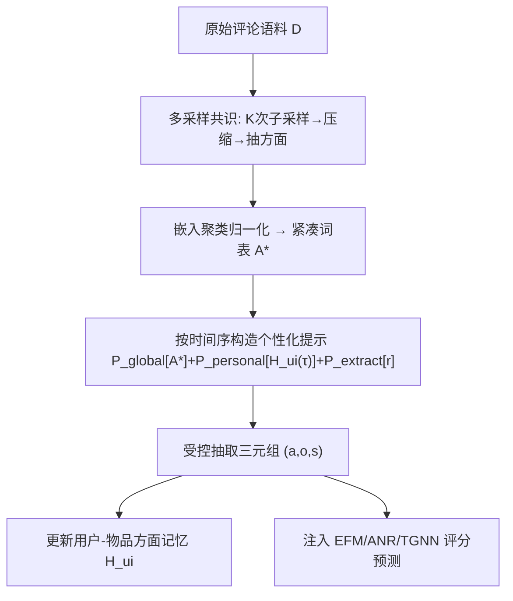
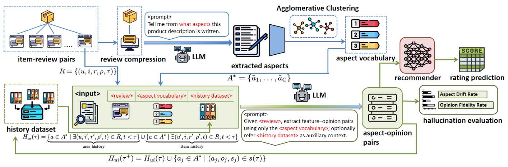

# HADSF: Aspect Aware Semantic Control for Explainable Recommendation (面向可解释推荐的方面感知语义控制框架)

- **会议/期刊**: WSDM 2026
- **作者与机构**: Zheng Nie (NUS), Peijie Sun (南京邮电大学)
- **推荐链路定位**: 召回（评论语义表征增强，可插拔至评分预测器）
- **研究方向**: 大语言模型推荐 / 去偏与可信
- **论文原文**: [论文原文链接](https://arxiv.org/abs/2510.26994v2)
- **开源代码**: [开源代码仓库链接](https://github.com/niez233/HADSF)

## TL;DR (1分钟核心速览)

针对 LLM 从自由评论文本抽取方面-观点时**缺乏范围控制**（冗余、低频噪声、语义重叠标签）与**幻觉无法量化**两大痛点，HADSF 提出两阶段框架：Stage I 用多采样共识+嵌入聚类归纳紧凑的语料级方面词表 $A^*$，Stage II 以 $A^*$ 为显式约束、结合用户-物品历史先验做受控三元组抽取；并首次提出 ADR/OFR 两个幻觉度量，揭示幻觉与评分预测误差的**非单调关系**。在约 300 万条评论、1.5B–70B 模型上，TGNN-aspect 在三个数据集 MSE 全面最优（如 Musical 1.0960 vs. TGNN 1.1289），且 8B 级小模型即可媲美 70B。

## Background & Motivation (背景与核心矛盾)

- **主流范式**: 评论驱动推荐从主题模型（CTR/TIM）→ 神经注意力（NARRE/DAML）→ LLM 抽取结构化偏好表征（EXP3RT/Rec-SAVER），后者语义对齐更强但抽取过程完全自由。
- **前人局限**: ① 无范围控制地挖掘自由文本，同一问题被拆成大量语义重叠的碎片化标签，低频属性沦为统计噪声；② 幻觉评估仅停留在"生成列表里数编造物品"，无法刻画幻觉如何传导为下游推荐误差；③ 模型规模与幻觉、推荐质量之间的成本-质量权衡完全空白。
- **核心洞察 (Key Insight)**: 作者用互信息-泛化界论证——受控表征 $z_{ctrl}$ 满足 $I(z_{ctrl};X)\le I(z_{free};X)$ 且 $\dim(z_{ctrl})=K\ll\dim(z_{free})$，测试风险 $\mathbb{E}_{test}\lesssim \mathbb{E}_{train}+\mathcal{O}(\sqrt{\text{Comp}(z)/n})$，故**先建立紧凑、任务对齐的方面空间再学推荐**可收紧泛化项；同时实证发现幻觉并非越低越好。
- **本文切入点**: 用"语料级方面词表"作为语义控制旋钮，把无约束生成转为受控抽取，并配套可解释幻觉度量做诊断。

## Method (核心方法设计)

### 1. 整体框架 (Overall Architecture)

HADSF 分两阶段闭环：Stage I 对全语料做 $K$ 次独立子采样，每次先让 LLM 压缩长评论为高密度摘要、再抽取方面词，随后用句向量凝聚聚类合并同义项（"ambiance/atmosphere/environment"），按频率归一化相似度选出簇代表，得到紧凑词表 $A^*$；Stage II 按时间戳顺序遍历交互，用 $A^*$ 全局引导 + 用户/物品历史方面记忆 $H_{ui}(\tau)$ 构造个性化提示，抽取 (方面, 观点, 情感) 三元组并回写更新记忆。抽取结果作为结构化特征注入 EFM/ANR/TGNN 等评分预测器。

<figure class="paper-figure" markdown="span">
  <figcaption>图2：框架概览。上半部分对评论进行压缩，抽取全局方面，并选择Top-N个性化方面；下半部分将所选方面与目标评论输入LLM，以抽取细粒度方面-观点对并动态更新用户的方面记忆。</figcaption>
</figure>

### 2. 关键设计拆解 (Key Designs)

1. **多采样共识 + 频率归一化聚类代表选择**：单次 LLM 抽取方差大、同义方面泛滥。对 $K$ 次子采样结果取并集后做凝聚聚类，簇代表按
$$\tilde{a}_c=\arg\max_{a'\in C_c}\sum_{a''\in C_c}\frac{\text{freq}(a'')}{\sum_{x\in C_c}\text{freq}(x)}\,\hat{\phi}(a')^\top\hat{\phi}(a'')$$
选取——即"既高频又与簇内成员语义最居中"的词。直觉：把长尾同义噪声压成 $K$ 个高信息量锚点，直接降低 $I(z;X)$ 与维度，从而收紧泛化界（图 3 显示聚类后方面相似度热图明显更独立）。

2. **时间序动态个性化抽取**：静态词表无法刻画兴趣漂移。维护 $H_{ui}(\tau)=\{a\in A^*\mid \exists(u,i',\cdot,\cdot,t),t<\tau\}\cup\{a\in A^*\mid\exists(u',i,\cdot,\cdot,t),t<\tau\}$，即"用户历史关注方面 ∪ 物品被他人强调的方面"，拼入提示 $P_{dynamic}=[P_{global}[A^*];P_{personal}[H_{ui}(\tau)];P_{extract}[r]]$，抽取后 $H_{ui}(\tau^+)=H_{ui}(\tau)\cup\{a_j\}$。直觉：把协同信号以"方面先验"形式注入 LLM，使抽取既受全局约束又随个体演化。

3. **幻觉度量 ADR/OFR 与训练/推理开销**：ADR 统计抽取方面落在 $A^*$ 外的比例 $\text{ADR}=\frac{1}{|S|}\sum\frac{|\{a\notin A^*\}|}{|s|}$；OFR 用跨度级最大余弦相似度 $\text{SemSim}(o,r)=\max_{r_{s:e}\in\mathcal{S}_{L,\Delta}(r)}\frac{\langle\psi(o),\psi(r_{s:e})\rangle}{\|\psi(o)\|\|\psi(r_{s:e})\|}$ 衡量观点是否有原文依据（$\Delta=2$ 容差）。框架本身**无训练损失**（纯抽取管线），下游沿用各 backbone 原损失；抽取为离线一次性成本，在线仅需查表注入特征，无额外推理延迟。

## Experimental Setup & Evaluation Protocol (实验设置与评估协议)

- **数据集与预处理**: Amazon 两域保留 2021 年后交互 >25 条的用户/物品；Yelp 取 2019 年后餐厅类、交互 >10 条。

| 数据集 | #Users | #Items | #Reviews | 密度 | 场景说明 |
| :--- | :---: | :---: | :---: | :---: | :--- |
| Musical Instruments | 320,689 | 15,273 | 402,326 | 0.183% | 乐器，短评论为主（均长 42.5） |
| Industrial & Scientific | 884,066 | 25,576 | 1,043,019 | 0.078% | 工业品，均长 34.8 |
| Yelp | 599,070 | 44,904 | 1,481,005 | 0.075% | 餐厅，长评论（均长 90.0） |

- **数据划分与防穿越**: 按时间戳排序处理交互，历史记忆 $H_{ui}(\tau)$ 严格只使用 $t<\tau$ 的交互，属**全局时间戳切分**式防穿越。
- **排名评测协议**: 本文任务为**评分预测**而非排序，采用 MSE / MAE 回归误差，非 Full-Ranking 或 Sampled Ranking。
- **对比基线与超参**: 三类基线——传统 CF（PMF/EFM）、评论感知神经模型（ANR/NARRE/DeepCoNN/RGCL/TGNN）、LLM-as-Recommender（GPT-4o/Rec-SAVER/EXP3RT）。抽取用 LLaMA3.3-70B（20% 采样、重复 5 次），细粒度抽取用 LLaMA3.1-8B；LLM 基线用 QLoRA 微调 LLaMA3-8B；5 个随机种子取均值，$p<0.05$ 显著性检验。

## Key Experimental Results (实验关键数据)

### 1. 主实验对比 (Main Results)

| Method | Musical MSE | Musical MAE | Industrial MSE | Industrial MAE | Yelp MSE | Yelp MAE |
| :--- | :---: | :---: | :---: | :---: | :---: | :---: |
| PMF | 2.3767 | 1.2675 | 2.6328 | 1.3831 | 2.6720 | 1.4176 |
| EFM | 1.4842 | 0.7955 | 1.7130 | 0.8592 | 1.8686 | 0.9950 |
| ANR | 1.2960 | 0.8150 | 1.5186 | 0.8735 | 1.4108 | 0.9294 |
| NARRE | 1.3908 | 0.8257 | 1.6726 | 0.9379 | 1.5279 | 0.9655 |
| RGCL | 1.1557 | **0.7096** | 1.3373 | **0.7597** | 1.3537 | **0.8738** |
| TGNN | 1.1289 | 0.7449 | 1.3050 | 0.8368 | 1.3470 | 0.8996 |
| GPT-4o | 1.5324 | 0.8541 | 1.6892 | 0.9023 | 1.7287 | 0.9576 |
| EXP3RT | 1.3791 | 0.7645 | 1.5557 | 0.8373 | 1.6469 | 0.9262 |
| EFM-aspect | 1.3637 | 0.7669 | 1.5741 | 0.8342 | 1.8275 | 0.9858 |
| ANR-aspect | 1.2348 | 0.7953 | 1.4825 | 0.8546 | 1.3958 | 0.9271 |
| **TGNN-aspect** | **1.0960** | 0.7421 | **1.2822** | 0.8314 | **1.3402** | 0.8963 |
| Improv. (vs TGNN) | ↓2.9% | ↓0.4% | ↓1.7% | ↓0.6% | ↓0.5% | ↓0.4% |

### 2. 消融实验 (Ablation Study)

| 配置 | 说明 | 趋势（三 backbone × 三数据集） |
| :--- | :--- | :--- |
| No Aspect | 原始 LLM 抽取，无词表 | 误差最高，冗余噪声主导 |
| Aspect Only | 有词表，无聚类 | 显著下降，约束生成有效 |
| Cluster Only | 有聚类，无动态历史 | 进一步下降，语义归一化增益 |
| Full Steps | 全组件 | 最优，个性化提供互补增益 |

### 3. 关键实验发现 (Key Findings)

1. **架构无关的稳定增益，且弱 backbone 收益更大**：EFM-aspect 相对 EFM 在 Musical 上 MSE 从 1.4842 降至 1.3637（↓8.1%），而强 backbone TGNN 仅 ↓2.9%，说明结构化方面注入本质是"正则化表征学习"，对弱模型补益更明显；TGNN-aspect 全面超越 GPT-4o/EXP3RT 等 LLM 直接推荐器。
2. **幻觉-性能呈非单调关系**：Qwen2.5-32B 的 ADR 极低（Musical 0.0073、Yelp 0.0042）但 MSE 并非最优；LLaMA3.1-8B 的 ADR 反而最高（0.1153）却在 ANR/TGNN 上取得最佳或次佳 MSE——适度"抽象/改写"扩大方面覆盖有益，过度保守抑制语义多样性反而有害。
3. **规模不保证质量，CoT 蒸馏反成噪声**：70B/32B 并不稳定优于 8B/14B 中型模型；DeepSeek-R1 蒸馏版（8B/14B）在所有非蒸馏变体面前**全面落后**，多步 CoT 为语义抽取注入冗余复杂度。此外仅用 20% 评论抽取即可达 CER≈1（Top-20 方面重叠 90%），大幅降低抽取成本。

## Highlights, Limitations & Rating (亮点、对比与审稿评价)

- **与代表作对比 (vs. Prior Work)**: 相较 EXP3RT/Rec-SAVER 的"自由抽取+CoT 推理"，HADSF 的核心差异是**先建词表再受控抽取**，把开放生成转为闭集约束；相较 NARRE/TGNN 的注意力/主题图，本文用 LLM 语义锚点替代启发式主题，且首次给出幻觉与下游误差的定量关联。
- **可迁移亮点**: ① "多采样共识 + 频率归一化聚类代表"可作为任何 LLM 标签体系归纳的通用去噪配方；② ADR/OFR 的跨度级 grounding 度量可直接迁移到 LLM 生成式推荐/解释生成的忠实性评估。
- **审稿级局限批判**: ① 幻觉度量依赖句向量相似度与 $\Delta$ 容差，对长观点与领域术语敏感，且 ADR 以 $A^*$ 为真值基准，词表本身偏差会被继承；② 抽取为离线管线，词表需按域重建，跨域冷启动与在线增量更新成本未评估；③ 主实验仅覆盖评分预测，缺少排序/Top-N 与真实 A/B 验证。
- **四维评分**: 创新性 ⭐⭐⭐⭐ | 实验扎实度 ⭐⭐⭐⭐ | 方法清晰度 ⭐⭐⭐⭐⭐ | 落地价值 ⭐⭐⭐⭐

