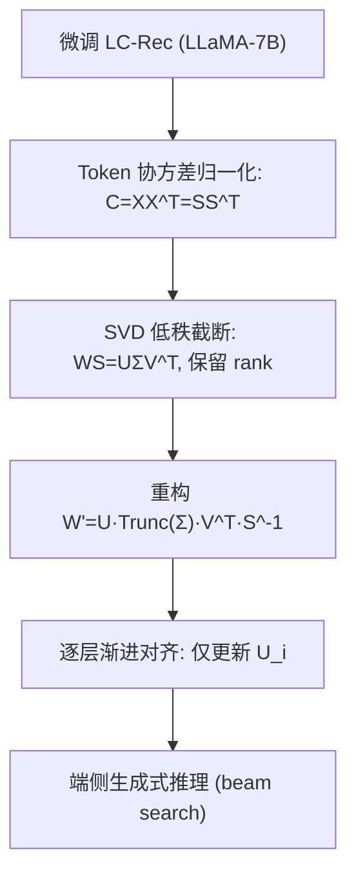

# On-Device Large Language Models for Sequential Recommendation (面向端侧序列推荐的大语言模型压缩)

- **会议/期刊**: WSDM 2026
- **作者与机构**: Xin Xia, Hongzhi Yin, Shane Culpepper（The University of Queensland）
- **推荐链路定位**: 端到端生成式（LLM 生成式序列推荐）
- **研究方向**: 大语言模型推荐 / 序列推荐
- **论文原文**: [https://arxiv.org/abs/2601.09306v1](https://arxiv.org/abs/2601.09306v1)
- **开源代码**: 暂未开源

## TL;DR (1分钟核心速览)

LLM 做序列推荐效果好，但 7B 级参数与显存开销使其难以部署到手机/可穿戴等端侧设备。本文提出 OD-LLM——首个面向序列推荐任务定制的 LLM 压缩框架：先用 Cholesky 白化做 Token 协方差归一化，再对权重做 SVD 低秩截断，最后逐层渐进对齐修复激活偏差。在 Amazon 三数据集、Leave-One-Out + Full-Ranking 协议下，50% 压缩率时 HR@10/NDCG@10 与未压缩 LC-Rec 持平甚至反超（Arts 上 HR@10 相对提升约 14.6%），GPU 推理比 GPTQ 快 3.4 倍。

## Background & Motivation (背景与核心矛盾)

- **主流范式**: 以 LC-Rec、TIGER 为代表的生成式序列推荐，将物品经 RQ-VAE 量化成语义 ID，微调 LLaMA-7B 自回归预测下一物品 ID。
- **前人局限**: ① 通用压缩（GPTQ 量化、SparseGPT 剪枝、蒸馏）面向 NLP 基准优化，对细粒度时序依赖与协同语义极敏感，压缩后排序质量骤降；② 直接对权重做 SVD 时，LLM 激活存在维度相关性与尺度方差，冗余奇异值淹没真实信号，截断即丢关键行为模式。
- **核心洞察 (Key Insight)**: 若先用 Cholesky 白化把激活协方差变为单位阵，则 SVD 截断的 Frobenius 压缩损失**精确等于被截奇异值本身**（$L_i=\sigma_i$），压缩损失从此可解析、可控制。
- **本文切入点**: 把"白化—低秩截断—逐层对齐"三步串成任务自适应流水线，在固定存储预算下最大化保留推荐信号。

## Method (核心方法设计)

### 1. 整体框架 (Overall Architecture)

以微调好的 LC-Rec（LLaMA-7B + RQ-VAE 语义 ID）为基座，压缩分三步：先对每层输入激活 $X$做 Token 协方差归一化得到白化变换$S^{-1}$；再对乘积矩阵$WS$做 SVD 并按压缩率$CR$截断小奇异值，重构出压缩权重$W'$；最后用校准集逐层前向，仅更新左奇异向量$U_i$ 以对齐原始激活。推理时压缩模型直接以 beam search 生成下一物品的语义 ID 序列，无需任何云端依赖。

### 2. 关键设计拆解 (Key Designs)

1. **Token 协方差归一化（让 SVD 损失可解析）**：痛点是对相关维度做 SVD 会产生大量冗余奇异值，无法区分信号与噪声。做法是对激活协方差 $C=XX^{\top}$做 Cholesky 分解$C=SS^{\top}$，令$\tilde{X}=S^{-1}X$，则$\tilde{C}=S^{-1}C(S^{-1})^{\top}=I$，各维去相关且单位方差。由此可证明截断第$i$个奇异值的损失恰为$L_i=\lVert\sigma_i u_iv_i^{\top}S^{-1}X\rVert_F=\sigma_i$，多值截断时$L^2=\sum_{i>rank}\sigma_i^2$——压缩损失与奇异值一一对应，截小值即最小化损失。

2. **SVD 低秩结构压缩（按预算定秩）**：对 $WS=U\Sigma V^{\top}$截断后重构$W'=U\,\mathrm{Trunc}(\Sigma)\,V^{\top}S^{-1}$，秩由压缩率直接给定$rank=\lfloor MN\cdot CR/(M+N)\rfloor$，使参数量严格落在预算内，且$S^{-1}$ 把结果映射回原嵌入空间，避免语义漂移。

3. **渐进权重更新与训练开销**：高压缩率下 $W'$产生的激活$X'$偏离原激活$X$。本文固定$V_i$与截断奇异值以保持低秩结构，仅对每层左奇异向量做最小二乘闭式更新$U_i'=W_iX_{i-1}'D^{\top}(DD^{\top})^{-1}$，其中$D=\mathrm{Trunc}(\Sigma)_iV_i^{\top}S_i^{-1}X_{i-1}'$。该过程**无需反向传播与负采样**，仅需 256 条校准样本单卡 A40 完成，压缩与推理均极轻量。

## Experimental Setup & Evaluation Protocol (实验设置与评估协议)

- **数据集与预处理**: Amazon Review 三个品类，物品含标题与描述文本，未额外做 k-core 过滤（沿用 LC-Rec 设定）：

| 数据集 | #Users | #Items | #Interactions | 稀疏度 | 平均序列长度 |
| :--- | :---: | :---: | :---: | :---: | :---: |
| Instruments | 24,773 | 9,923 | 206,153 | 99.92% | 8.32 |
| Arts | 45,142 | 20,957 | 390,832 | 99.96% | 8.66 |
| Games | 50,547 | 16,860 | 452,989 | 99.95% | 8.96 |

- **数据划分与防穿越**: `Leave-One-Out` 时序切分——序列最后两个物品分别作验证集与测试集，其余为训练集。
- **排名评测协议**: 生成式 `Full-Ranking`（对全库物品语义 ID 做 beam search 生成并排序），报告 HR@{5,10} 与 NDCG@{5,10}；beam size=20，序列长度 200，batch=1。
- **对比基线与超参**: 传统序列模型 Caser/HGN/GRU4Rec/Bert4Rec/FDSA/SASRec/S3-Rec、生成式 TIGER、未压缩骨干 LC-Rec；压缩对比 GPTQ（4-bit，group 128）与 SparseGPT（75% 稀疏）。压缩率默认 $CR=0.5$，校准集 256 条。

## Key Experimental Results (实验关键数据)

### 1. 主实验对比 (Main Results)

| 方法 | Instruments HR@10 | NDCG@10 | Games HR@10 | NDCG@10 | Arts HR@10 | NDCG@10 |
| :--- | :---: | :---: | :---: | :---: | :---: | :---: |
| GRU4Rec | 0.1031 | 0.0765 | 0.0964 | 0.0502 | 0.0964 | 0.0659 |
| SASRec | 0.0947 | 0.0690 | 0.0940 | 0.0481 | 0.1016 | 0.0592 |
| S3-Rec | 0.1136 | 0.0714 | 0.1002 | 0.0491 | 0.1051 | 0.0612 |
| TIGER | 0.1064 | 0.0803 | 0.0939 | 0.0501 | 0.1012 | 0.0703 |
| LC-Rec (未压缩) | 0.1217 | 0.0923 | 0.1252 | 0.0757 | 0.1251 | 0.0902 |
| **OD-LLM (50%)** | **0.1219** | **0.0923** | **0.1264** | 0.0748 | **0.1434** | **0.1084** |
| Improv. vs LC-Rec | +0.2% | 0.0% | +1.0% | −1.2% | **+14.6%** | **+20.2%** |

与量化/剪枝的等存储预算对比（表 3）：Instruments 上 GPTQ 略优（HR@10 0.1232 vs 0.1219），Games 上 OD-LLM HR@10 领先（0.1264 vs 0.1230），Arts 上 OD-LLM 大幅领先（0.1434 vs 0.1161/0.1201）。

### 2. 消融实验 (Ablation Study)

| 变体 | 组成 | 效果趋势（三数据集一致） |
| :--- | :--- | :--- |
| M-L | 未压缩 LC-Rec | 与 OD-LLM 接近，为性能上界参照 |
| M-S | 仅 SVD | 显著最差，高压缩率下排序质量崩塌 |
| M-NS | 归一化 + SVD | 较 M-S 大幅回升，接近完整模型 |
| **M (完整)** | 归一化 + SVD + 渐进更新 | **全部数据集与指标最优** |

### 3. 关键实验发现 (Key Findings)

1. **归一化是保命模块**：M-S → M-NS 的增益远大于 M-NS → M，说明白化带来的"损失=奇异值"可解析性才是 50% 压缩不崩的根本，渐进更新只是锦上添花。
2. **压缩率呈平滑退化而非断崖**：$CR$ 从 0.2 到 0.8 扫描中，0.5 附近保留绝大部分排序质量，0.2 极端压缩才明显掉点，说明该框架可按设备内存灵活调档。
3. **效率优势是端侧落地的决定性因素**：GPU 单 batch 推理 OD-LLM 仅 5s，比 GPTQ（17s）快 3.4×、比 SparseGPT（12s）快 2.4×；CPU 上 200s vs 700s，快 3.5×——GPTQ 精度略高但延迟代价不可接受。

## Highlights & Limitations (亮点、对比与审稿批判)

- **与代表作对比 (vs. Prior Work)**: 相比 GPTQ/SparseGPT 等通用 PTQ/剪枝，本文是首个把压缩目标对齐到"序列推荐行为信号"的工作，且压缩损失有闭式理论保证；相比 LC-Rec 原模型，在 Arts 上以一半参数反超 14.6% HR@10，说明压缩本身起到了正则化去冗余的作用。
- **可迁移亮点**: ① "Cholesky 白化 + SVD" 使截断损失等于奇异值的技巧，可直接迁移到任何 Transformer 骨干的低秩压缩；② 仅更新 $U_i$ 的逐层闭式对齐，无需反向传播，适合算力受限的离线压缩流水线。
- **审稿级局限批判**: ① 主实验仅在 Amazon 三品类、平均长度 <9 的短序列上验证，长序列与跨域场景的压缩鲁棒性未知；② 与 GPTQ 的精度差距在部分数据集仍存在，且未报告端侧真实设备（ARM CPU/内存占用）的实测数据，仅用 A40 GPU 与通用 CPU 计时，端侧说服力略打折扣。

## Rating (四维评分)

- **方法创新性 (Novelty)**: ⭐⭐⭐⭐ （白化使压缩损失与奇异值严格等价，理论推导干净，但 SVD+对齐整体属已有技术的任务化组合）
- **评估协议与实验扎实度 (Protocol & Experiments)**: ⭐⭐⭐⭐ （三数据集 + 传统/生成式/压缩三类基线齐全，消融与压缩率、校准集扫描完整，但缺端侧真机实测）
- **写作与数学规范度 (Clarity & Rigor)**: ⭐⭐⭐⭐ （Lemma 与损失等价性证明严谨，公式与秩预算定义清晰，部分符号排版略粗糙）
- **工业落地与复现价值 (Industrial & Practical Value)**: ⭐⭐⭐⭐ （压缩与推理均快、无需重训，端侧部署价值高；但代码未开源，复现需自行搭建 LC-Rec 流水线）
