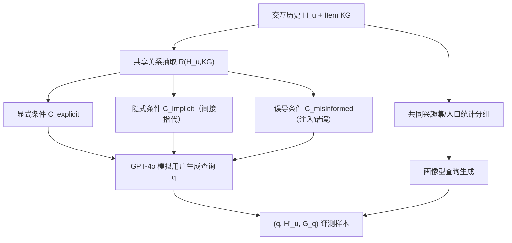
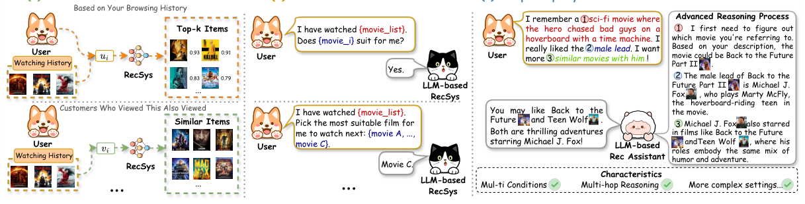

# Towards Next-Generation Recommender Systems: A Benchmark for Personalized Recommendation Assistant with LLMs (面向下一代推荐系统：LLM 个性化推荐助手基准)

- **会议/期刊**: WSDM 2026
- **作者与机构**: Jiani Huang, Shijie Wang, Liang-bo Ning, Wenqi Fan, Qing Li (香港理工大学)；Shuaiqiang Wang, Dawei Yin (百度)
- **推荐链路定位**: 端到端生成式（LLM 推荐助手）
- **研究方向**: 大语言模型推荐 / 对话推荐与智能体仿真
- **论文原文**: [论文原文链接](https://arxiv.org/abs/2503.09382v2)
- **开源代码**: [开源代码仓库链接](https://github.com/jiani-huang/RecBench.git)

## TL;DR (1分钟核心速览)

现有 LLM 推荐研究依赖固定模板（"用户是否喜欢 item_i，答 Yes/No"）评测，与真实用户复杂、多约束、含误导信息的自然语言查询严重脱节，且公开数据集缺乏高质量文本查询。本文提出 RecBench+：基于 MovieLens-1M 与 Amazon-Book 构建约 3 万条复杂查询，分条件型（显式/隐式/误导）与画像型（兴趣/人口统计）五大类，用 Precision/Recall/CMR/FTR 四指标在无固定 K 的开放生成协议下评测 7 个主流 LLM。核心发现：GPT-4o 与 DeepSeek-R1 领先（Movie 平均 P 0.157/0.148），推理型模型在隐式条件上优势显著；SFT+RFT 两阶段微调将 Qwen-2.5-3B 显式条件 Recall 从 0.019 提升至 0.410。

## Background & Motivation (背景与核心矛盾)

- **主流范式**: 传统 RecSys（MF/序列模型）在固定场景（"看了又看""基于浏览历史"）学习用户/物品隐表示打分；LLM4Rec 则把交互历史转成 prompt 做 Yes/No 判别或候选列表选择。
- **前人局限**: ① 评测 prompt 模板固定且简单，无法反映真实用户"多条件+多跳推理+误导信息"的复杂查询；② 常用数据集（LastFM、Amazon Beauty、ML-1M）只有基础元数据与交互，缺乏高质量文本查询，无法评估助手能力。
- **核心洞察 (Key Insight)**: 真实查询如"我喜欢的科幻片里男主踩悬浮滑板穿越时空，想看他演的类似电影"，要求助手先识别影片→识别演员→再推荐，远超属性匹配与浅层语义理解；现有基准测不出这种能力。
- **本文切入点**: 用知识图谱抽取共享关系 + LLM 模拟用户，程序化生成五类难度递进的复杂查询，建立首个面向"个性化推荐助手"的评测基准。

## Method (核心方法设计)

### 1. 整体框架 (Overall Architecture)

RecBench+ 的构建分两条流水线。**条件型查询**：先为电影（Wikipedia 抽取导演/演员/配乐/类型等 7 类属性）与图书（Amazon 元数据）构建 Item KG；再从用户交互历史 $\mathcal{H}_u$ 中用 KG 检索函数 $\mathcal{R}$ 抽取共享关系 $\mathcal{C}_{shared}=\{(r_1,t_1),\dots\}$ 及满足条件的物品子集 $G_{sub}$；随后按三种策略改写条件（直接采用/间接指代/注入事实错误），交由 GPT-4o 生成自然语言查询，满足条件的物品集 $G_q$ 即 ground truth，历史中剔除 $G_q$ 得 $\mathcal{H}'_u$。**画像型查询**：兴趣型从多用户共现序列挖掘共同兴趣集并让 LLM 反推推荐理由；人口统计型按 (职业,性别)/(年龄,性别) 分组取组内热门物品生成查询。最终得到约 3 万条查询，覆盖 5 类子任务。

<figure class="paper-figure" markdown="span">
  <figcaption>图1：不同推荐范式的示意图。(a) 传统方法：通过学习用户/物品表示在固定场景中生成推荐。(b) 基于LLM的推荐：采用固定且简单的查询模板，缺乏在更复杂场景中的评估。(c) 本文方法：评估LLM作为推荐助手处理复杂、灵活用户查询的能力。</figcaption>
</figure>

### 2. 关键设计拆解 (Key Designs)

1. **隐式条件改写（多跳推理的构造核心）**：痛点在于"直接说出导演名"太简单，测不出推理。本文对共享关系 $(r_m,t_m)$，用 KG 中与 $t_m$ 通过 $r_m$ 相连的另一物品 $i_k$ 做间接指代：
$$i_k\in\{i\in\mathcal{I}\mid (t_m)\xrightarrow{r_m}(i)\ \text{in KG}\},\quad \mathcal{C}_{implicit}=(r_i,\text{ref}(i_k))$$
即把"导演 Cameron"改写成"《The Abyss》的导演"。直觉：模型必须先完成"物品→属性值"的反向检索才能对齐条件，天然引入一跳推理。

2. **误导条件注入（鲁棒性探针）**：对共享关系 $(r_i,t_i)$，随机选 KG 中与 $t_i$ 无该关系的物品集 $\{i_1,\dots,i_m\}$，构造 $\mathcal{C}_{misinformed}=(r_i,t_i,\text{error info})$，如"Cameron 导演了《Star Trek》"。理想行为是先纠错再推荐；FTR 在此类查询中"越高越好"，因为拒答即代表识别出错误信息。

3. **训练目标、负采样与推理效率**：本文为基准而非模型，无自定义损失；微调实验采用全参数 SFT（下一 token 交叉熵）与基于 GRPO 的 RFT，奖励来自推荐结果与 ground truth 的匹配。推理为开放生成、不限定 K，直接解析模型输出的物品名与 $G_q$ 做集合匹配，无负采样环节。

## Experimental Setup & Evaluation Protocol (实验设置与评估协议)

- **数据集与预处理**: 基于 ML-1M 与 Amazon-Book，经字符串匹配校验（条件信息必须出现在查询中）与人工复核过滤过宽/不合理查询。

| 数据集 | #Users | #Items | #Interactions | 查询总数 | 场景说明 |
| :--- | :---: | :---: | :---: | :---: | :--- |
| Movie (ML-1M) | 6,036 | 3,247 | 29,459 | 19,529 | 含人口统计属性，5 类查询 |
| Book (Amazon) | 48,535 | 50,088 | 55,424 | 14,965 | 仅条件型+兴趣型，无人口统计 |

- **数据划分与防穿越 (Splitting Strategy)**: 非传统训练/测试切分，而是"查询级"评测；构造时已将 ground truth 物品 $G_q$ 从历史 $\mathcal{H}_u$ 中剔除（$\mathcal{H}'_u=\mathcal{H}_u\setminus G_q$），防止答案泄漏。
- **排名评测协议 (Ranking Protocol)**: 开放生成式评测，**不预设 K**（模拟真实用户不指定数量），模型自由输出推荐列表后与 $G_q$ 做集合匹配；另设 K=5 固定实验作对照。指标为 Precision、Recall、Condition Match Rate (CMR，推荐中满足条件的比例)、Fail to Recommend (FTR)。
- **对比基线与超参设置**: 7 个 LLM——GPT-4o、GPT-4o-mini、Gemini-1.5-Pro、Claude-3.5-Sonnet、DeepSeek-V3、DeepSeek-R1、Llama-3.1-70B；微调基座为 Qwen-2.5-3B 与 Llama-3.2-3B（全参数 SFT / GRPO-RFT / SFT+RFT）。

## Key Experimental Results (实验关键数据)

### 1. 主实验对比 (Main Results)

条件型查询（Movie，节选核心指标，P/R/CMR 越高越好）：

| Model | Explicit P | Explicit CMR | Implicit P | Implicit CMR | Misinformed CMR | Avg P | Avg R | Avg CMR |
| :--- | :---: | :---: | :---: | :---: | :---: | :---: | :---: | :---: |
| GPT-4o-mini | 0.185 | 0.531 | 0.083 | 0.198 | 0.104 | 0.099 | 0.183 | 0.294 |
| GPT-4o | **0.308** | **0.714** | 0.145 | 0.301 | 0.270 | **0.157** | 0.224 | 0.374 |
| Gemini-1.5-Pro | 0.256 | 0.644 | 0.104 | 0.203 | 0.030 | 0.128 | 0.221 | 0.308 |
| Claude-3.5 | 0.201 | 0.658 | 0.105 | 0.281 | 0.087 | 0.069 | 0.183 | 0.277 |
| DeepSeek-V3 | 0.190 | 0.621 | 0.090 | 0.217 | 0.013 | 0.102 | 0.246 | 0.314 |
| DeepSeek-R1 | 0.224 | 0.651 | **0.197** | **0.496** | 0.024 | 0.148 | **0.326** | **0.414** |
| Llama-3.1-70B | 0.238 | 0.609 | 0.097 | 0.210 | 0.109 | 0.124 | 0.185 | 0.312 |

画像型查询（Movie 平均）：DeepSeek-R1 取得最高 Avg Recall 0.075，Gemini 次之 0.072；Book 域 Gemini 领先（P 0.056 / R 0.127）。

### 2. 消融实验 (Ablation Study)

微调范式消融（Recall，Movie 域）：

| 基座 | 微调方式 | Explicit | Implicit | Misinformed |
| :--- | :--- | :---: | :---: | :---: |
| Qwen-2.5-3B | 零样本 | 0.019 | 0.002 | 0.004 |
| Qwen-2.5-3B | SFT | 0.391 | 0.255 | 0.296 |
| Qwen-2.5-3B | RFT (GRPO) | 0.178 | 0.119 | 0.089 |
| Qwen-2.5-3B | **SFT+RFT** | **0.410** | **0.262** | **0.307** |
| Llama-3.2-3B | 零样本 | 0.018 | 0.003 | 0.003 |
| Llama-3.2-3B | **SFT+RFT** | **0.293** | **0.181** | **0.195** |

### 3. 关键实验发现 (Key Findings)

1. **推理能力是隐式条件的胜负手**：从显式到隐式，DeepSeek-R1 的 CMR 仅从 0.651 降至 0.496（降幅 24%），而 GPT-4o 从 0.714 跌至 0.301（降幅 58%），说明强推理模型能补全未明说的约束；案例中 R1 甚至自动纠正"Scott Ambrozy"笔误为 Owen Roizman。
2. **历史交互是双刃剑**：引入 $\mathcal{H}'_u$ 后各模型 Precision 普遍上升（个性化过滤候选池），但 CMR 未必提升——模型会因历史中的奇幻偏好而推荐《致命魔术》这类不满足"Nolan 电影"硬条件的干扰项，暴露"个性化 vs 条件遵循"的权衡。
3. **SFT 是 RFT 的必要预热**：纯 RFT 的 Qwen 显式 Recall 仅 0.178，远低于纯 SFT 的 0.391；两阶段 SFT+RFT 达 0.410，验证了 RL 探索前需 SFT 建立任务先验；且在人口统计型查询上 RFT 反超 SFT（0.228 vs 0.154），说明推理型微调对画像推断更有效。

## Highlights, Limitations & Rating (亮点、对比与审稿评价)

- **与代表作对比 (vs. Prior Work)**: 相比 LLMRec 聚焦评分预测/序列推荐等传统任务、PerRecBench 隔离个性化偏差、以及 Gaia/VoiceBench 等通用助手基准，RecBench+ 首次把"复杂自然语言查询 + 多跳推理 + 误导纠错 + 画像理解"统一进推荐助手评测，且用 KG 程序化生成保证 ground truth 可验证。
- **可迁移亮点**: ① "KG 共享关系→条件改写→LLM 生成查询"的合成范式可低成本迁移到电商/POI 等任意有结构化属性的域；② CMR 指标与"误导查询下 FTR 越高越好"的评测设计，可直接复用于任何约束遵循型生成推荐系统。
- **审稿级局限批判**: ① 查询由 GPT-4o 合成，存在模板化与分布偏移风险，与真实用户口语化查询仍有差距；② 开放生成评测依赖物品名字符串匹配，跨版本/别名（如《Dune》多版本）会造成假阴性，Book 域流行度趋势反转即为例证；③ 仅覆盖电影/图书两域，且未评测 GPT-o1（被策略拦截），结论外推性受限。
- **四维评分**: 创新性 ⭐⭐⭐⭐ | 实验扎实度 ⭐⭐⭐⭐ | 方法清晰度 ⭐⭐⭐⭐⭐ | 落地价值 ⭐⭐⭐⭐

