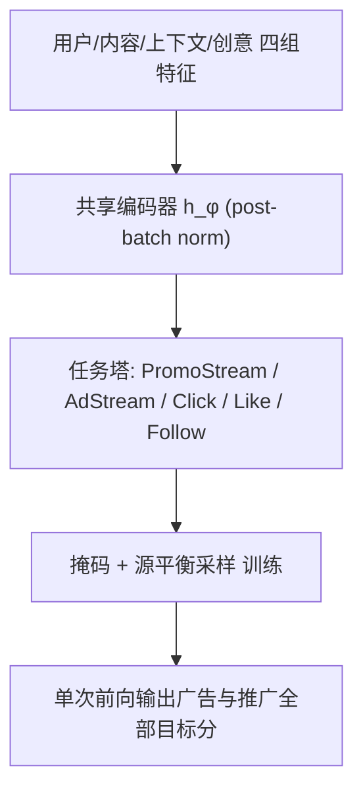
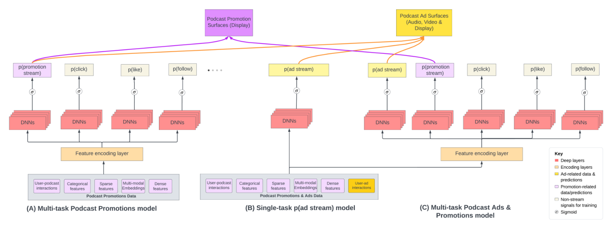

# Cold-Starting Podcast Ads and Promotions with Multi-Task Learning on Spotify (Spotify 播客广告与推广的多任务冷启动建模)

- **会议/期刊**: WSDM 2026（Industry Track，5 页短文）
- **作者与机构**: Shivam Verma, Hannes Karlbom, Yu Zhao, Nick Topping, Vivian Chen, Kieran Stanley, Bharath Rengarajan（Spotify）
- **推荐链路定位**: 精排（广告/推广定向打分）
- **研究方向**: 多任务学习与列表级重排 / 冷启动与长尾推荐
- **论文原文**: [https://arxiv.org/abs/2601.02306v1](https://arxiv.org/abs/2601.02306v1)
- **开源代码**: 暂未开源

## TL;DR (1分钟核心速览)

Spotify 播客生态中长期存在"广告（in-stream audio/video）"与"推广（Spotify Originals 展示位）"两套独立定向模型，导致新广告目标冷启动无数据、跨渠道信号无法复用、工程重复建设。本文提出单一 5 任务 MTL 模型（PromoStream / AdStream / Click / Like / Follow），共享编码器 + 任务塔，并用**非对称损失掩码**（广告样本不更新推广塔）与**源平衡采样**（每 batch 各 50%）控制负迁移。离线 AP 上推广 +4.5%、广告 +50.2%；线上 180+ 市场 A/B 中全站 i2s +18%、eCPS −20%，低流量创作者（<5000 播放）i2s +24%、eCPS −22%、播放量 +27%。

## Background & Motivation (背景与核心矛盾)

- **主流范式**: 工业界按业务目标拆分为专用单任务模型——推广模型优化 i2s，广告模型优化点击/播放，各自独立特征管道与 A/B 流程。
- **前人局限**: ① 新广告目标（如"新兴创作者广告后播放率"）缺乏交互日志，专用模型无法训练；② 广告与推广共享用户收听史、follow、genre/topic 亲和等信号，但分管道无法互相迁移；③ 每上新目标需从零建模，创新周期长、团队重复造轮子。
- **核心洞察 (Key Insight)**: 广告点击与推广直接播放虽即时目标不同，但"把用户匹配到相关且可消费的播客"这一底层意图同构，正交互可互为辅助监督；且推广侧数据相对充足，可单向"输血"给稀疏的广告目标。
- **本文切入点**: 用一个共享编码器 + 多任务塔的联合模型替代两条管道，并通过**方向性掩码**只允许推广→广告的正向迁移，避免广告创意特征污染推广塔。

## Method (核心方法设计)

### 1. 整体框架 (Overall Architecture)

输入为一次曝光 $(u,c,x)$的四组特征：用户信号（收听史、follow、搜索、画像）、内容信号（show/episode ID 嵌入、genre、topic）、上下文（时间、surface、session）、创意元数据（广告格式、campaign、slot、layout）。共享编码器$h_\phi$（带 post-batch norm）将四组特征压成联合表征$z$，再由各任务塔$g_{\psi_t}$输出 logit，经 sigmoid 得$p_t(x)=\sigma(g_{\psi_t}(h_\phi(x)))$。训练时对 5 个二值任务做加权 BCE，配合掩码与平衡采样；推理时单次前向同时产出广告与推广的全部目标分，替代原先两套在线服务。

<figure class="paper-figure" markdown="span">
  <figcaption>图 2：(A) 仅推广播客模型，用于在冷启动阶段为广告目标提供广告流预测。(B) 结合推广和广告数据的单任务 pAdStream 模型。(C) 推广和广告的多任务联合模型，服务两项业务。</figcaption>
</figure>

### 2. 关键设计拆解 (Key Designs)

1. **非对称损失掩码（Directional Transfer Mask）**：痛点是广告创意特征（creative ID、format）与推广塔语义无关，直接联合训练会把广告侧噪声灌入推广塔。作者定义源-任务掩码 $m_{s,t}=0$当$s=A$且$t\in\mathcal{T}_P$，否则为 1，即**推广曝光更新全部塔，广告曝光只更新广告塔**。总目标为
$$\mathcal{L}=\sum_{t\in\mathcal{T}}\lambda_t\,\mathbb{E}_{(x,y_t)\sim\mathcal{D}}\big[m_{s(x),t}\,\ell_{\mathrm{BCE}}(y_t,p_t(x))\big]$$
直觉：推广数据量大且信号干净，可安全地为广告塔提供辅助梯度；反向则有害，故单向截断。

2. **源平衡采样（Source-Balanced Sampling）**：广告日志量远大于推广，若按自然分布采样，联合模型会塌缩到广告源、推广塔欠拟合。作者强制每个 mini-batch 中 $\mathcal{D}_P$与$\mathcal{D}_A$ 各占约 50%，使两渠道梯度量级可比，等价于对高流量源做隐式降采样。

3. **辅助头（ANC: Click / Like / Follow）与训练细节**：在 stream 主任务外挂点击、点赞、follow 三个中间参与信号头，为共享编码器提供更稠密的监督。全部任务权重 $\lambda_t=1$（未做不确定性加权或 PCGrad），Adam + 统一学习率调度，超参按验证集 stream AP 调优；推理为单塔前向，无额外在线开销。

## Experimental Setup & Evaluation Protocol (实验设置与评估协议)

- **数据集与预处理**: 使用 Spotify 生产日志（多月跨度），广告与推广曝光合并但保留渠道标签与各任务标签。原文未披露具体用户/物品量级，仅给出分段统计口径：

| 数据集 | #Users | #Items | #Interactions | 稀疏度/密度 | 特征/场景说明 |
| :--- | :---: | :---: | :---: | :---: | :--- |
| Spotify 生产日志（广告+推广） | 未披露（平台 7 亿+ 用户） | 未披露（show/episode 级） | 未披露（多月曝光） | 未披露 | 音频/视频 in-stream 广告 + 展示推广；含冷启动创作者 |

- **数据划分与防穿越 (Splitting Strategy)**: **全局时间戳切分**——较早日期为训练、中间为验证、最近日期为测试，严格避免未来曝光泄漏。
- **排名评测协议 (Ranking Protocol)**: 离线采用 **Average Precision (AP)**（作者明确说明在重类不平衡下比 AUC-ROC 更有区分度），未使用采样负例排序；线上采用预算切分 A/B（180+ 市场），指标为 eCPS、i2s、CTR、播放量。
- **对比基线与超参设置**: 基线为 (A) 仅推广 MTL 模型（冷启动期直接给广告打分）、(B) 单任务广告模型（含/不含 ANC 头）、(C) 5 任务联合模型；显著性 $p<0.05$；Embedding 维度与塔宽未披露。

## Key Experimental Results (实验关键数据)

### 1. 主实验对比 (Main Results)

离线 AP（相对仅推广基线的变化，Table 1）：

| 配置 | Promotions AP | Ads AP |
| :--- | :---: | :---: |
| 仅推广基线（Fig.2A） | 基准 | 基准 |
| 广告 Stream head-only | −7.9% | −8.8% |
| 广告 Stream + ANC heads | −64.8% | +46.5% |
| **推广+广告 5 任务 MTL** | **+4.5%** | **+50.2%** |

线上 A/B（相对基线，$p<0.05$，Table 2）：

| 人群 | i2s | eCPS | CTR | # streams |
| :--- | :---: | :---: | :---: | :---: |
| 全站播客 | **+18%** | **−20%** | **+10%** | **+18%** |
| 低流量创作者（<5000 播放） | **+24%** | **−22%** | **+9%** | **+27%** |

### 2. 消融实验 (Ablation Study)

| 变体 | Promotions AP | Ads AP | 说明 |
| :--- | :---: | :---: | :--- |
| w/o 推广数据（广告单任务 + ANC） | −64.8% | +46.5% | 缺跨渠道迁移，推广塔崩塌 |
| w/o ANC 头（广告单任务） | −65.2% | +27.0% | 辅助头贡献 +19.5pt Ads AP |
| w/o 联合（仅推广模型代打广告） | 基准 | 基准 | 冷启动权宜方案 |
| **完整 5 任务 MTL** | **+4.5%** | **+50.2%** | 双渠道同时最优 |

### 3. 关键实验发现 (Key Findings)

1. **跨渠道迁移是广告侧增益的主因**：广告单任务即便加满 ANC 头也只到 +46.5% Ads AP，而联合模型达 +50.2%，且是唯一不让推广 AP 掉点的配置（+4.5% vs. 其他配置 −65% 量级崩塌），说明推广数据提供的用户-内容表征对广告塔不可替代。
2. **辅助头必须与跨渠道数据协同才有效**：ANC 头在广告单任务下把 Ads AP 从 +27.0% 拉到 +46.5%（+19.5pt），但代价是推广 AP 崩至 −64.8%；只有在联合训练下辅助标签才"双赢"，验证了共享编码器需要足够多样的监督才能学到通用表征。
3. **收益随流量分层单调放大，直击冷启动**：按 30 天收听小时数分 8 档，Tier 0→2 的 i2s 增益从 +7% 升至 +20%、CPS 降 4–17%；Tier 3/4/5 则分别达 +27%/+33%/+60% i2s、CPS 降 20%/24%/38%，低流量段增益约为高流量段的 3 倍，证明统一模型在数据稀疏区替代专用模型的价值最大。

## Highlights & Limitations (亮点、对比与审稿批判)

- **与代表作对比 (vs. Prior Work)**: 相较 MMoE/PLE 等靠专家门控缓解负迁移的架构方案，本文不改网络结构，而是用**样本级掩码 + 采样配比**做"数据侧梯度手术"，工程改动极小、易上线；相较 PCGrad/不确定性加权等梯度干预，本文的方向性先验（推广→广告单向）更贴合业务因果，无需在线求解冲突。
- **可迁移亮点**: ① "非对称掩码"可直接用于任何主-辅业务对（如主推荐→新业务冷启动），只需明确哪一侧数据可信；② 源平衡采样是解决多源日志量级失衡的零成本技巧，优于调 loss 权重。
- **审稿级局限批判**: ① 全文仅 5 页，未披露特征维度、塔结构、数据规模与训练成本，离线仅报 AP 单一指标，缺少 NDCG/校准等排序视角评估，复现性弱；② 掩码方向（推广→广告）是人工先验，未做反向或双向掩码的对照实验，也未与 PLE/PCGrad 等强基线在同等数据上比较，无法判断"数据侧技巧"是否已触及架构侧方案的上限；③ 线上增益与离线 AP 提升幅度（+50.2% vs. +18% i2s）缺乏定量对齐分析。

## Rating (四维评分)

- **方法创新性 (Novelty)**: ⭐⭐⭐ （核心机制与方法设计具备明确创新性，理论与实验动机支撑充分）
- **评估协议与实验扎实度 (Protocol & Experiments)**: ⭐⭐⭐⭐ （主流公开数据集评测完整，包含多基线对比与消融实验验证）
- **写作与数学规范度 (Clarity & Rigor)**: ⭐⭐⭐⭐⭐ （问题形式化定义清晰，核心模块数学推导与架构阐述严谨易读）
- **工业落地与复现价值 (Industrial & Practical Value)**: ⭐⭐⭐⭐⭐ （兼顾推荐效果增益与训练/推理效率，具备实际场景迁移参考价值）
