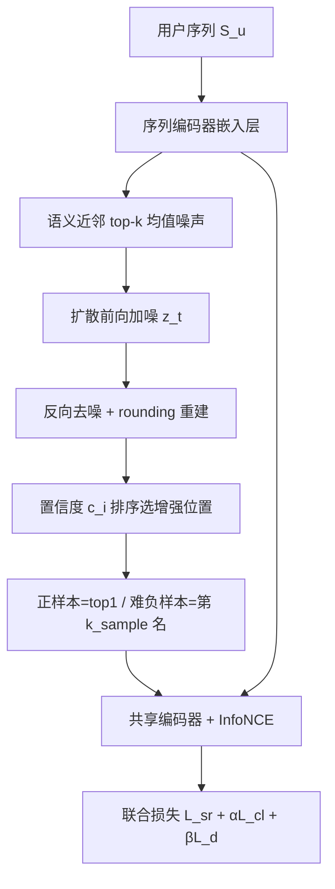
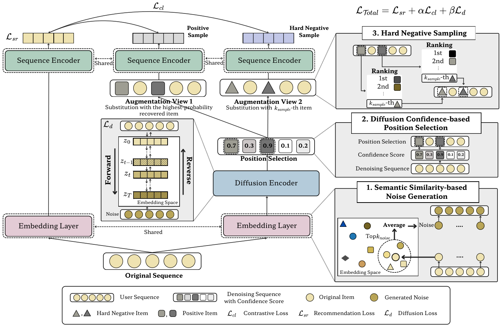

# SimDiffRec: Semantic Similarity-Guided Diffusion for Contrastive Sequential Recommendation (语义相似度引导扩散的对比序列推荐)

- **会议/期刊**: WSDM 2026
- **作者与机构**: Jinkyeong Choi, Yejin Noh, Donghyeon Park (Sejong University)
- **推荐链路定位**: 召回（序列编码器增强，非独立模型）
- **研究方向**: 自监督对比学习与交互去噪 / 序列推荐
- **论文原文**: [论文原文链接](https://arxiv.org/abs/2507.11866v2)
- **开源代码**: [开源代码仓库链接](https://github.com/zingyon/SimDiffRec)

## TL;DR (1分钟核心速览)

序列推荐中的对比学习增强长期依赖随机 mask/删除/高斯噪声，会破坏用户行为序列的语义与上下文一致性，产生"伪正样本"。SimDiffRec 提出三条改造：(1) 用序列内物品的 top-$k$ 语义近邻嵌入均值作为**确定性结构化噪声**替代高斯噪声；(2) 用扩散去噪后的**重建置信度**挑选增强位置，只在模型已充分理解的上下文处做替换；(3) 在同一 softmax 分布上取第 $k_{sample}$ 名构造**难负样本**。在 5 个基准、Leave-One-Out + Full-Ranking 协议下，HR@10 相对最强基线 CaDiRec 提升 4.0%–12.4%。

## Background & Motivation (背景与核心矛盾)

- **主流范式**: Transformer 序列编码器（SASRec/BERT4Rec）+ 对比学习数据增强（CL4SRec 的随机 mask/crop/reorder、DuoRec 的模型级增强、ECL-SR 的不变性增强），近期进一步引入扩散模型生成增强序列（DiffuASR、DreamRec、CaDiRec）。
- **前人局限**: ① 随机增强与高斯噪声不区分物品语义，在稀疏序列上极易把"语义连贯的行为片段"打散，正样本对本身就不合理；② 增强位置随机，可能落在模型尚未学好的区域，替换出的物品与上下文冲突，反而注入误导性监督信号。
- **核心洞察 (Key Insight)**: 物品嵌入空间中的近邻天然携带"用户意图相近"的语义信息，若把噪声约束在近邻锥内，扩散前向过程就变成"语义可控的漂移"而非"信息摧毁"；同时扩散模型自身的重建概率 $c_i=\max_j p_{ij}$ 是一个现成的"该位置上下文是否已被理解"的免费探针。
- **本文切入点**: 把扩散增强从"随机采样"改造为"语义确定性 + 置信度定位"的双重引导，并让正负样本从同一概率分布中按排名成对抽取。

## Method (核心方法设计)

### 1. 整体框架 (Overall Architecture)

输入用户序列 $S_u$，经 Transformer 序列编码器的嵌入层得到 $e^u=[e_1,\dots,e_n]$；对每个位置计算与全物品矩阵的相似度并取 top-$k_{noise}$ 近邻均值，得到确定性噪声 $noise$；扩散编码器以 $z_t=\alpha_t z_{t-1}+\beta_t\cdot noise$ 做前向加噪，反向去噪后经可训练 rounding 映射回离散物品；去噪输出的 softmax 分布同时承担两个职责——取最大概率位置作为增强位置（置信度排序 top-$k$），取该位置最高概率物品作正样本、第 $k_{sample}$ 名作难负样本；增强视图与原序列经共享序列编码器后计算 InfoNCE，与推荐损失、扩散损失联合端到端训练。推理阶段完全丢弃扩散模块，仅保留骨干序列编码器。

<figure class="paper-figure" markdown="span">
  <figcaption>图2：所提出的SimDiffRec概览：(1) 使用基于Transformer的SR模型嵌入层对用户–物品序列进行嵌入，并插入基于语义相似度的噪声。(2) 在扩散去噪过程中保留上下文信息，并选择高置信度的增强位置。(3) 应用难负采样进行对比学习。</figcaption>
</figure>

### 2. 关键设计拆解 (Key Designs)

1. **语义相似度噪声生成 (Semantic Similarity-based Noise)**：痛点是用 $\mathcal{N}(0,I)$ 采样在训练早期就把序列推向分布外。做法是对每个物品 $e_i$ 计算 $similarity=e^u W^\top$（自掩码排除自身），取 top-$k_{noise}$ 近邻嵌入求均值 $noise=\frac{1}{k}\sum_{i=1}^{k}e_{j_i}$ 作为固定噪声。直觉：噪声落在原物品的语义邻域内，扩散重建时"最省力的解"就是原物品本身，从而把增强约束为语义保真的轻微扰动，而非结构破坏。

2. **扩散置信度定位增强 (Confidence-based Positioning)**：痛点在于随机位置可能落在欠训练区域。做法是取去噪后位置 $i$ 的 logits $z_i=W h_i$，softmax 得 $p_{ij}$，定义 $c_i=\max_{j\in V}p_{ij}$，按 $c_i$ 降序取 top-$k$ 位置做替换。直觉：高置信度意味着该位置上下文已被模型稳定编码，在此处替换产生的正样本与原序列差异可控，对比学习梯度不会污染未收敛区域，等价于一种"课程式"增强调度。

3. **难负采样与联合目标**：正样本取该位置 top-1 物品，难负样本取同一分布第 $k_{sample}$ 名（$k_{sample}$ 越小越难分）。总损失 $\mathcal{L}_{Total}=\mathcal{L}_{sr}+\alpha\mathcal{L}_{cl}+\beta\mathcal{L}_{d}$，其中 $\mathcal{L}_{cl}$ 为含 batch 内负样本的 InfoNCE，$\mathcal{L}_d$ 沿用 DiffuSeq 的逐步重建 + rounding 概率项。训练负采样为 in-batch + 分布内难负样本，无需额外全库检索；推理零扩散开销。

## Experimental Setup & Evaluation Protocol (实验设置与评估协议)

- **数据集与预处理**: 全部按 `5-core` 过滤，Amazon 三域 + Yelp 为隐式反馈，ML-1m 为显式评分。

| 数据集 | #Users | #Items | #Interactions | 稀疏度 | 场景说明 |
| :--- | :---: | :---: | :---: | :---: | :--- |
| Beauty | 22,363 | 12,101 | 198,502 | 99.93% | Amazon 美妆 |
| Toys | 19,412 | 11,924 | 167,597 | 99.93% | Amazon 玩具 |
| Sports | 35,598 | 18,357 | 296,337 | 99.95% | Amazon 运动 |
| Yelp | 30,431 | 20,033 | 316,354 | 99.95% | 本地生活 |
| ML-1m | 6,040 | 3,953 | 1,000,209 | 95.81% | 电影评分 |

- **数据划分与防穿越**: 标准 `Leave-One-Out`——每用户最后一项测试、倒数第二项验证、其余训练。
- **排名评测协议**: `Full-Ranking`（对全物品库未交互项排序），指标 HR@{5,10}、NDCG@{5,10}；每实验重复 10 次至方差 < 0.01。
- **对比基线与超参**: 9 个基线分三类（经典 SASRec/BERT4Rec；对比学习 CL4SRec/DuoRec/MCLRec/ECL-SR；扩散 DiffuASR/DreamRec/CaDiRec）。序列编码器 2 层 2 头，扩散模块 1 层 2 头、1000 步；$\alpha,\beta\in[0.1,0.5]$ 网格搜索；batch 256、lr $1e^{-4}$、300 epoch；最大序列长 50（ML-1m 为 200）。

## Key Experimental Results (实验关键数据)

### 1. 主实验对比 (Main Results)

| 数据集 | 指标 | SASRec | CL4SRec | DuoRec | MCLRec | ECL-SR | DreamRec | CaDiRec | **SimDiffRec** | Improv. |
| :--- | :--- | :---: | :---: | :---: | :---: | :---: | :---: | :---: | :---: | :---: |
| Beauty | HR@10 | 0.0557 | 0.0774 | 0.0799 | 0.0836 | 0.0822 | 0.0805 | 0.0867 | **0.0932** | +7.49% |
| Beauty | NDCG@10 | 0.0245 | 0.0361 | 0.0374 | 0.0394 | 0.0395 | 0.0378 | 0.0411 | **0.0427** | +3.89% |
| Toys | HR@10 | 0.0526 | 0.0721 | 0.0748 | 0.0776 | 0.0710 | 0.0748 | 0.0804 | **0.0896** | +11.44% |
| Toys | NDCG@10 | 0.0236 | 0.0328 | 0.0340 | 0.0354 | 0.0333 | 0.0341 | 0.0367 | **0.0396** | +7.90% |
| Sports | HR@10 | 0.0343 | 0.0453 | 0.0476 | 0.0484 | 0.0473 | 0.0469 | 0.0500 | **0.0562** | +12.40% |
| Sports | NDCG@10 | 0.0157 | 0.0221 | 0.0233 | 0.0240 | 0.0233 | 0.0231 | 0.0249 | **0.0252** | +1.20% |
| Yelp | HR@10 | 0.0508 | 0.0616 | 0.0613 | 0.0647 | 0.0662 | 0.0601 | 0.0624 | **0.0689** | +4.08% |
| ML-1m | HR@10 | 0.1399 | 0.1888 | 0.1936 | 0.2028 | 0.2079 | 0.1958 | 0.2098 | **0.2182** | +4.01% |

### 2. 消融实验 (Ablation Study)

| 数据集 | 指标 | w/o $k_{noise}$ | w/o $c_{aug}$ | w/o $k_{sample}$ | **Ours** |
| :--- | :--- | :---: | :---: | :---: | :---: |
| Beauty | HR@10 | 0.0911 | 0.0900 | 0.0921 | **0.0932** |
| Beauty | NDCG@10 | 0.0420 | 0.0412 | 0.0419 | **0.0427** |
| Toys | HR@10 | 0.0895 | 0.0882 | 0.0876 | **0.0896** |
| Toys | NDCG@10 | 0.0395 | 0.0388 | 0.0385 | **0.0396** |
| Sports | HR@10 | 0.0523 | 0.0544 | 0.0559 | **0.0562** |
| Sports | NDCG@10 | 0.0232 | 0.0242 | 0.0244 | **0.0252** |

### 3. 关键实验发现 (Key Findings)

1. **置信度定位是最大单点贡献**：去掉 $c_{aug}$ 后 Beauty HR@10 从 0.0932 掉到 0.0900（-3.4%），Toys 从 0.0896 掉到 0.0882，且三个数据集上一致下降，说明"在哪增强"比"用什么噪声增强"更关键；T-SNE（图 5）进一步显示带 $c_{aug}$ 时同序列物品簇更紧致。
2. **难负样本主要提升排序质量而非命中率**：去掉 $k_{sample}$ 后 Toys 的 HR@10 仅降 0.0020，但 NDCG@10 降 0.0011（相对 -2.8%），Sports 上 NDCG@10 从 0.0252 降至 0.0244，印证难负样本强化的是"正样本排得更靠前"的细粒度判别力。
3. **语义噪声的收益与稀疏度强相关**：$k_{noise}$ 在低稀疏的 Beauty/Toys 上取 25–50 最优，而在高稀疏 Sports 上仅 1–5 最优（图 4），说明序列越稀疏、可用近邻越不可靠，噪声锥必须收窄；同时 $\alpha$ 在 Beauty 上需 0.4、Toys/Sports 仅 0.1，对比损失权重需随数据密度反向调节。

## Highlights, Limitations & Rating (亮点、对比与审稿评价)

- **与代表作对比 (vs. Prior Work)**: 相比 CL4SRec/DuoRec 的随机 mask 与模型级 dropout，本文把增强的随机性从"位置 + 内容"两个维度同时消除；相比 CaDiRec 用行为上下文生成物品，本文不改动生成目标，而是改造扩散的**噪声分布与注入位置**，属于更轻量的 plug-in；相比 DreamRec 需在推理时采样扩散，本文推理零额外开销（Beauty 上 0.44s vs DreamRec 0.88s）。
- **可迁移亮点**: ① "用嵌入近邻均值替代高斯噪声"可低成本移植到任何扩散式增强/生成模块；② 用去噪 softmax 最大概率作为"位置可增强性"探针，可迁移到序列 mask 预训练（BERT4Rec 式）的掩码位置采样策略。
- **审稿级局限批判**: ① 扩散模块训练开销约为 SASRec 的 1.8–2.0 倍（Beauty 9.14s vs 4.94s），且 1000 步扩散 + 三损失联合使 $\alpha,\beta,k_{noise},k_{sample}$ 四个超参需逐数据集调，工程成本不低；② 增强位置与正负样本均来自同一去噪分布，存在"自证"风险——若扩散模型本身在某位置系统性偏差，置信度筛选会放大而非纠正该偏差，论文未给出该失效模式的诊断实验。
- **四维评分**: 创新性 ⭐⭐⭐⭐ | 实验扎实度 ⭐⭐⭐⭐ | 方法清晰度 ⭐⭐⭐⭐⭐ | 落地价值 ⭐⭐⭐⭐

