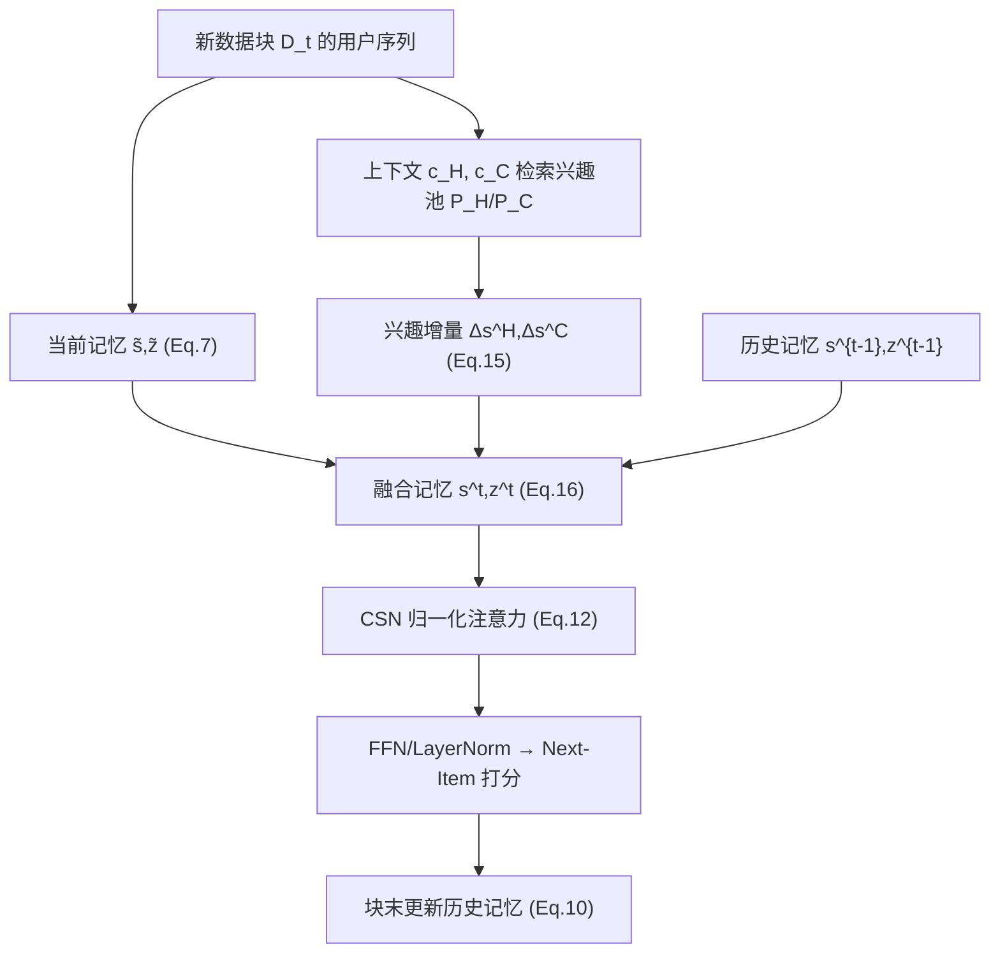
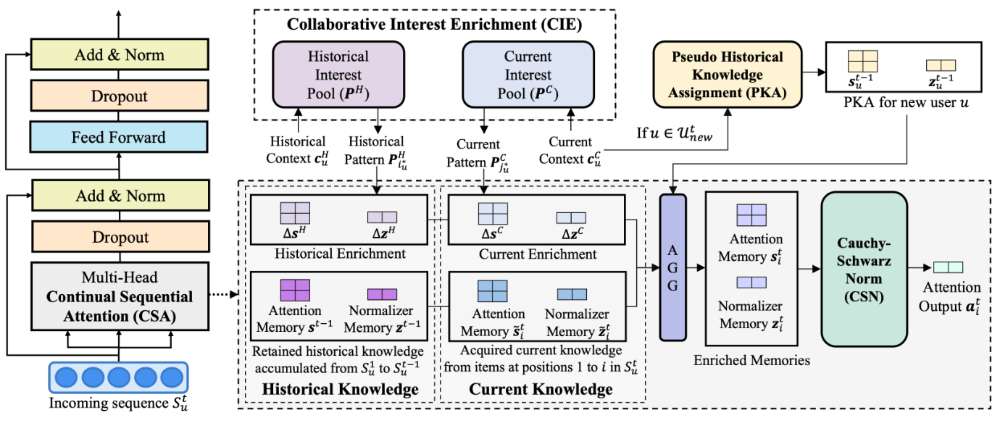

# Capturing User Interests from Data Streams for Continual Sequential Recommendation (从数据流中捕获用户兴趣的持续序列推荐)

- **会议/期刊**: WSDM 2026
- **作者与机构**: Gyuseok Lee, Hyunsik Yoo, Junyoung Hwang, SeongKu Kang, Hwanjo Yu (UIUC / 42dot / Korea University / POSTECH)
- **推荐链路定位**: 召回（Next-Item 序列建模）
- **研究方向**: 序列与会话推荐 / 自监督与去噪（持续学习视角）
- **论文原文**: [https://arxiv.org/abs/2506.07466v3](https://arxiv.org/abs/2506.07466v3)
- **开源代码**: [https://github.com/Gyu-Seok0/CSTRec_WSDM26](https://github.com/Gyu-Seok0/CSTRec_WSDM26)

## TL;DR (1分钟核心速览)

Transformer 序列推荐在流式数据上要么全量重训（自注意力 $O(N^2)$代价高），要么仅微调新块（灾难性遗忘）。本文提出 CSTRec，把线性注意力的参数化记忆当作"免回放"的历史知识载体，并用 Cauchy-Schwarz 归一化（CSN）解决活跃/不活跃用户记忆幅值失衡导致的训练不稳，用共享可学习兴趣池（CIE）补偿记忆被新数据覆盖的遗忘，再用伪历史知识分配（PKA）让新用户冷启动。在 Gowalla/ML-1M/Yelp 的 5 块时间切分流上，Fine-tune 设定下$D_4$ 的 H-mean 相对最优基线提升约 4.9%（Gowalla Hit@20：0.4912→0.5151），且推理时间比 SASRec 降低约 47%。

## Background & Motivation (背景与核心矛盾)

- **主流范式**: 序列推荐已由 SASRec/BERT4Rec 类自注意力模型主导；流式场景下持续学习分两支——正则化（SAIL-PIW 约束参数漂移）与回放（Reloop2/ADER 存少量历史样本）。
- **前人局限**: (1) 正则化方法以"最近参数"为锚做贪心传递，新信息逐步稀释历史知识；(2) 回放方法受限于固定记忆容量，必须用新交互覆盖旧样本，对**远期历史**几乎无访问能力。二者都只保住"较近的过去"。
- **核心洞察 (Key Insight)**: 线性注意力的 attention memory $s_i=\sum_{j\le i}\phi(k_j)v_j^\top$ 本身就是一种随位置递推的参数化记忆（类似 RNN 隐状态），可在**不访问原始历史序列**的前提下部分保留历史知识——但直接套用会暴露两个新问题：用户交互频次不均导致记忆幅值失衡（训练不稳），以及记忆被持续覆盖（必然遗忘）。
- **本文切入点**: 保留线性注意力的记忆机制，用 CSN 把幅值拉回稳定区间、用全局共享兴趣池补回被覆盖的历史兴趣，从而"以旧促新"地刻画兴趣轨迹。

## Method (核心方法设计)

### 1. 整体框架 (Overall Architecture)

模型按数据块 $D_1,\dots,D_t$流式更新。每个用户维护两份参数化记忆：attention memory$s^{t-1}$与 normalizer memory$z^{t-1}$（上一块训练后冻结）。新块$D_t$到来时，先用块内序列算出"当前记忆"$\tilde{s}^t_i,\tilde{z}^t_i$，再从历史/当前两个兴趣池检索最相关 pattern 生成增量$\Delta s^H,\Delta s^C$，与历史记忆相加得到融合记忆，经 CSN 归一化后算注意力输出，接标准 FFN/LayerNorm 子层做 next-item 预测；块训练结束后把当前记忆累加进历史记忆。新用户则用相似老用户的历史记忆加权初始化。

<figure class="paper-figure" markdown="span">
  <figcaption>图1：CSTRec 概览，展示注意力输出 a𝑡 的计算</figcaption>
</figure>

### 2. 关键设计拆解 (Key Designs)

1. **Cauchy-Schwarz Normalization (CSN)**：痛点是不活跃用户记忆幅值小、活跃用户记忆幅值随块累积爆炸，注意力输出量级差异巨大导致优化震荡。做法是对 Eq.(9) 的分母用 Cauchy-Schwarz 上界替换：$(q'_i)^\top z^t_i \le \|q'_i\|_2\|z^t_i\|_2$，得到
$$\hat{a}_{csn}=\left(\frac{q'_i}{\|q'_i\|_2}\right)^\top\left(\frac{s^t_i}{\|z^t_i\|_2}\right)=\hat{q}_i^\top r^t_i$$
由于 $\|a_{csn}\|_2=|\cos\theta_{qz}|\cdot\|a_{orig}\|_2$且$|\cos\theta_{qz}|\le 1$，输出被自适应压缩到$[0,\|a_{orig}\|]$ 区间，只改幅值不改方向，信息无损。图 2 显示无 CSN 时输出幅值分布右偏严重、验证 Hit@20 仅 0.0944，加 CSN 后升至 0.1426。

2. **Collaborative Interest Enrichment (CIE)**：痛点是记忆被新块覆盖造成不可逆遗忘。引入两个全局共享的 key-pattern 池 $\mathcal{P}^H=\{(\kappa^H_i,P^H_i)\}_{i=1}^{N_H}$、$\mathcal{P}^C$，每个 pattern$P_i\in\mathbb{R}^{L\times d}$编码一类兴趣。用余弦距离从最后层隐状态上下文$c^H_u,c^C_u$检索最匹配索引$i^*_u=\arg\min_i \gamma(c^H_u,\kappa^H_i)$，再经$W_K,W_V$投影成增量$\Delta s^H,\Delta z^H$注入记忆（Eq.15-16）。关键直觉：池参数只更新被选中的 pattern（选择性更新抗覆盖），且跨用户共享使相似用户互相强化历史模式。配套匹配损失$\mathcal{L}_{match}=\frac{1}{|D_t|}\sum\gamma(c^H_u,\kappa^H_{i^*_u})+\gamma(c^C_u,\kappa^C_{j^*_u})$ 拉近上下文与选中 key。

3. **Pseudo-Historical Knowledge Assignment (PKA) 与训练目标**：新用户无 $s^{t-1}$，用当前兴趣上下文检索 top-$K$相似老用户，按 softmax 相似度加权聚合其历史记忆作为伪历史：$s^{t-1}_u=\sum_{u'\in\mathcal{N}_u}\psi(u,u')s^{t-1}_{u'}$。总损失$\min_\theta \mathcal{L}_{BCE}+\lambda_{match}\mathcal{L}_{match}$，负采样为块内随机负样本（$|\mathcal{I}_{neg}|$固定），PKA 与兴趣检索每$R$个 epoch 执行一次以摊薄开销。复杂度：CSA 头为$O(Nd^2)\approx O(N)$，检索开销$O(|U_t|(N_H+N_C)d)$ 且非逐层执行，可忽略。

## Experimental Setup & Evaluation Protocol (实验设置与评估协议)

- **数据集与预处理**: 三个真实数据集，按块做 $k$-core 过滤（Yelp$k=5$，其余$k=10$）：

| 数据集 | #Users (D0) | #Items (D0) | #Interactions (D0) | 稀疏度 | 场景说明 |
| :--- | :---: | :---: | :---: | :---: | :--- |
| Gowalla | 30,682 | 68,189 | 1,754,145 | 0.9992 | LBS 签到，序列较长 |
| ML-1M | 3,978 | 2,845 | 498,877 | 0.9559 | 电影评分，序列最长 |
| Yelp | 104,281 | 52,290 | 1,449,055 | 0.9997 | 商户评论，极稀疏 |

- **数据划分与防穿越**: 全局时间戳切分——前 60% 为基块 $D_0$预训练，后 40% 均分为$D_1\sim D_4$四个增量块；块内按位置切分（末位为 test、倒数第二位为 validation、其余训练），严格保证$D_t$训练时不访问$D_{<t}$。
- **排名评测协议**: 全库排序（对 $\mathcal{I}_{1:t}$全部已见物品打分排序），报告 Hit@20 / MRR@20 / NDCG@20；采用持续学习专用指标 RA（历史保留均值）、LA（新块获取均值）与 H-mean（二者调和平均），5 次随机种子平均，配对 t 检验$p<0.05$。
- **对比基线与超参**: Fine-tune 设定对比 SAIL-PIW、Reloop2、IMSR；Full-batch 设定对比 HPMN、LimaRec、LinRec 及 SASRec。维度 $d$为 64/32/16（ML-1M/Gowalla/Yelp），头数与层数均为 2，$\lambda_{match}=10^{-4}$，$\tau=1.0$。

## Key Experimental Results (实验关键数据)

### 1. 主实验对比 (Main Results)

Fine-tune 设定、$D_4$ 训练后（Gowalla / ML-1M，Hit@20）：

| 方法 | Gowalla RA | Gowalla LA | Gowalla H-mean | ML-1M RA | ML-1M LA | ML-1M H-mean |
| :--- | :---: | :---: | :---: | :---: | :---: | :---: |
| SASRec | 0.3890 | 0.6486 | 0.4863 | 0.3511 | 0.7119 | 0.4703 |
| SAIL-PIW | 0.3901 | 0.6492 | 0.4874 | 0.3525 | 0.7136 | 0.4719 |
| Reloop2 | 0.3890 | 0.6486 | 0.4863 | 0.3513 | 0.7122 | 0.4706 |
| IMSR | 0.3980 | 0.6412 | 0.4912 | 0.3484 | 0.6969 | 0.4646 |
| **CSTRec** | **0.4247** | **0.6545** | **0.5151** | **0.3555** | **0.7311** | **0.4784** |
| Improv.% | +6.71% | +0.82% | +4.87% | +0.85% | +2.45% | +1.38% |

Full-batch 设定、$D_4$（Gowalla / Yelp，Hit@20）：

| 方法 | Gowalla RA | Gowalla LA | Gowalla H-mean | Yelp RA | Yelp LA | Yelp H-mean |
| :--- | :---: | :---: | :---: | :---: | :---: | :---: |
| SASRec | 0.7155 | 0.7137 | 0.7146 | 0.1144 | 0.1012 | 0.1074 |
| HPMN | 0.6973 | 0.6914 | 0.6943 | 0.1299 | 0.1389 | 0.1343 |
| LimaRec | 0.6848 | 0.6354 | 0.6592 | 0.0864 | 0.0868 | 0.0865 |
| LinRec | 0.7138 | 0.7128 | 0.7133 | 0.1289 | 0.1259 | 0.1274 |
| **CSTRec** | **0.7218** | **0.7188** | **0.7203** | 0.1290 | **0.1425** | **0.1353** |
| Improv.% | +0.88% | +0.71% | +0.80% | -0.69% | +2.59% | +0.74% |

### 2. 消融实验 (Ablation Study)

Gowalla、Fine-tune、$D_4$：

| 配置 | RA | LA | H-mean | Imp (%) |
| :--- | :---: | :---: | :---: | :---: |
| w/o CSN, CIE-H, CIE-C, PKA | 0.3847 | 0.6307 | 0.4779 | 0.00 |
| w/o CSN | 0.3908 | 0.6321 | 0.4830 | +1.07 |
| w/o CIE-H | 0.4142 | 0.6550 | 0.5075 | +6.19 |
| w/o CIE-C | 0.4166 | 0.6533 | 0.5088 | +6.47 |
| w/o PKA | 0.4074 | 0.6517 | 0.5014 | +4.50 |
| **Full CSTRec** | **0.4247** | **0.6545** | **0.5151** | **+7.78** |

### 3. 关键实验发现 (Key Findings)

1. **CSN 是"稳定器"而非"增益器"**：单独去掉 CSN 只掉 1.07%，但它是其余模块生效的前提——无 CSN 时线性注意力输出幅值分布右偏、验证 Hit@20 仅 0.0944（图 2），说明幅值失衡会直接摧毁优化，CSN 的价值体现在让 CIE 的增益得以释放（去掉 CIE-H 掉 6.19%）。
2. **历史兴趣池比当前兴趣池更关键**：去掉 CIE-H 的 H-mean 降幅（6.19%）与去掉 CIE-C（6.47%）相当，但超参研究显示最优配置把更多容量分给当前池（$N_C$ 更大），说明历史池负责"兜底不遗忘"、当前池负责"覆盖新趋势"，二者分工明确；t-SNE 也显示随块推进兴趣分布更均匀，即知识逐步分化。
3. **PKA 对新用户是净收益**：$K=0$（不用 PKA）时新用户 Hit@20 为 0.6677，$K=25$ 时升至 0.6741（+0.96%），MRR@20 提升 2.97%；且去掉 PKA 时 RA 降幅大于 LA，说明新用户适配失败会反向拖累整体历史保留。

## Highlights & Limitations (亮点、对比与审稿批判)

- **与代表作对比 (vs. Prior Work)**: 相比 SAIL-PIW 的"参数锚定"与 Reloop2 的"样本回放"，CSTRec 用参数化记忆实现**零原始数据访问**的历史保留，规避了隐私与存储约束；相比同为线性注意力的 LinRec（双侧 L2 归一化），CSN 用 Cauchy-Schwarz 上界做单侧自适应缩放，推理时间从 2.74s 降至 2.44s 且精度更高（H@20 0.7102→0.7218）。
- **可迁移亮点**: (1) CSN 的"用不等式上界替换分母"技巧可迁移到任何带累积归一化项的线性注意力/SSM 推荐模型；(2) 全局共享 key-pattern 池的"选择性更新"思路可用于缓解任何参数化记忆的覆盖问题。
- **审稿级局限批判**: (1) 兴趣池检索与 PKA 依赖余弦相似度与固定超参 $K$、$N_H/N_C$，论文仅在 Gowalla 上做了敏感性分析，跨数据集鲁棒性证据不足；(2) 评测仅覆盖离线块级流式模拟，未给出真实线上延迟/吞吐或与工业级增量训练管线的对比，且 Yelp Full-batch 下 RA 略低于 HPMN，说明历史保留在极稀疏场景仍有边界。

## Rating (四维评分)

- **方法创新性 (Novelty)**: ⭐⭐⭐⭐ （把线性注意力记忆正式化为持续序列推荐的知识载体，CSN 的 Cauchy-Schwarz 上界替换简洁且有幅值分析支撑）
- **评估协议与实验扎实度 (Protocol & Experiments)**: ⭐⭐⭐⭐ （三数据集 × 两训练设定 × RA/LA/H-mean 三指标 + 用户分组分析 + 效率表，消融完整；但超参敏感性仅单数据集）
- **写作与数学规范度 (Clarity & Rigor)**: ⭐⭐⭐⭐ （五步流程拆解清晰，Eq.7-16 推导连贯，复杂度分析到位；兴趣池符号略密）
- **工业落地与复现价值 (Industrial & Practical Value)**: ⭐⭐⭐⭐ （代码开源，推理时间较 SASRec 降约 47%，免回放设计契合隐私约束，适合流式增量部署）
