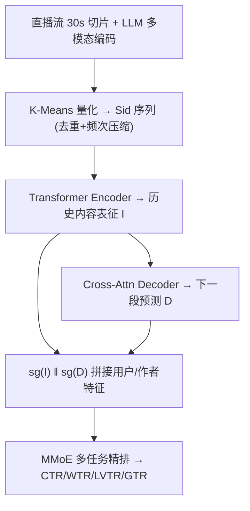
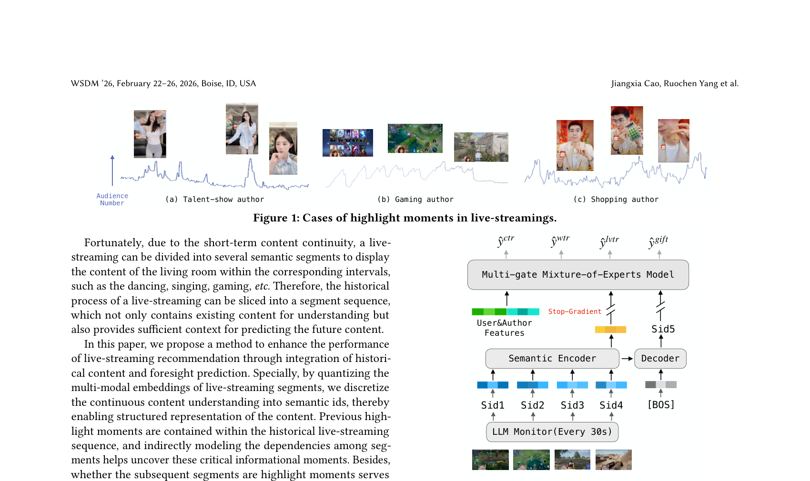

# Foresight Prediction Enhanced Live-Streaming Recommendation (前瞻预测增强的直播推荐)

- **会议/期刊**: WSDM 2026
- **作者与机构**: Jiangxia Cao, Ruochen Yang, Xiang Chen 等（快手科技，通讯作者 Guorui Zhou）
- **推荐链路定位**: 精排（Ranking Stage）
- **研究方向**: 序列与会话推荐 / 生成式推荐与离散语义 ID
- **论文原文**: [https://arxiv.org/abs/2512.06700v1](https://arxiv.org/abs/2512.06700v1)
- **开源代码**: 暂未开源

## TL;DR (1分钟核心速览)

直播内容时刻变化，同一房间在不同时刻对用户价值差异巨大，而精排模型在打分时只能看到"已发生"的内容，无法感知用户真正在意的"后续内容是否精彩"。本文把 30 秒直播切片经 LLM 多模态编码后用 K-Means 量化为 Semantic ID (Sid) 序列，用 Transformer 编码器理解作者历史内容、解码器自回归预测下一段 Sid，将编码输出 $\hat{I}$与预测输出$\hat{D}$ 作为前瞻特征注入 MMoE 多任务精排。离线 AUC/GAUC 全面正增益（GAUC 最高 +0.65%），线上 A/B 曝光 +0.457%、送礼次数 +2.48%、送礼人数 +1.011%。

## Background & Motivation (背景与核心矛盾)

- **主流范式**: 工业直播推荐沿用 FM/DIN 式特征交叉精排，近期工作（FARM、LARM）引入短视频跨域信息与 LLM 语义 embedding 来增强内容理解。
- **前人局限**: 其一，这些方法全部基于**已归档内容**建模，而直播是"内容随时间演化"的媒体，用户留存取决于**后续片段**是否命中兴趣；其二，LiveForesighter 虽尝试用商品序列生成间接反映未来，但受限于**间歇性内容理解**，无法刻画连续的内容演化趋势。
- **核心洞察 (Key Insight)**: 作者通过三条实证曲线（才艺表演、游戏、带货）发现，用户的正向行为（送礼、评论、关注）高度集中在直播的 **highlight moments**；而直播因短期内容连续性可切分为语义片段序列，历史片段既承载"已有内容理解"，又为"未来内容预测"提供充分上下文。
- **本文切入点**: 把连续内容离散化为 Sid 序列，用"预测下一段 Sid"这一自监督生成任务显式建模内容演化趋势，将前瞻信号作为特征喂给精排。

## Method (核心方法设计)

### 1. 整体框架 (Overall Architecture)

每 30 秒对直播间做一次 LLM 多模态语义编码（作者信息、画面、语音、评论），得到片段 embedding 序列 $L_e$；用 K-Means（$N{=}20000$）构建码本将每段量化为 Sid，并对连续重复 Sid 做"去重序列$L'_c$+ 频次序列$W_c$"压缩；取最近$l{=}100$段送入 Transformer 编码器得到作者内容表征$\hat{I}$，解码器以 [BOS] 为 query 交叉注意力预测下一段 Sid 表征$\hat{D}$；二者经 stop-gradient 后与 uId/aId 拼接进入 MMoE 多任务精排，输出 CTR/WTR/LVTR/GTR。训练时预测任务与排序任务联合优化，推理时对作者最新 Sid 序列前向一次即得前瞻特征。

<figure class="paper-figure" markdown="span">
  <figcaption>图2：我们的模型架构概览。</figcaption>
</figure>

### 2. 关键设计拆解 (Key Designs)

1. **语义量化与序列压缩（Sid 化）**：LLM 片段 embedding 维度高、稠密且存储昂贵，直接用下游成本高。本文用 K-Means 聚类中心作为码本 $\mathcal{C}=\text{K-Means}(E,N)$，每段取最近码字$c=\text{NearestCode}(e,\mathcal{C})$作为 Sid；针对直播内容长时间不变导致序列信息密度低的问题，压缩为去重序列$L'_c$与频次序列$W_c$，embedding 为$\text{EmbLookup}(\hat{\mathcal{C}},I)+\text{EmbLookup}(\hat{\mathcal{F}},W)$。直觉：离散码字把"跳舞/唱歌/游戏"等语义类别聚合，既降存储又让相似内容共享统计强度。

2. **前瞻预测（Foresight Prediction）**：精排看不到未来内容是根本痛点。编码器做自注意力 $I^{i+1}=I^i+\text{SelfAttention}(I^i)$后接 FFN；解码器以可学习 [BOS] 为初始 query 做交叉注意力$D^{i+1}=D^i+\text{CrossAttention}(D^i,\hat{I},\hat{I})$，输出$\hat{D}$与码本做点积多分类$p=\text{Softmax}(\hat{D}\mathcal{C}^\top)$，损失为
$$\mathcal{L}_{pred}=-\sum\log P(\hat{c}_{l+1}\mid[\text{BOS}],I).$$
直觉：下一段 Sid 是否属于 highlight 类别，直接决定用户下一时间窗的互动意愿，因此"预测未来"比"理解现在"更贴近留存目标。

3. **特征精炼与流式训练**：$\hat{I}$（作者长期内容融合）与$\hat{D}$（未来内容预测）经 stop-gradient 后拼接进 MMoE：$\hat{y}=\text{MultiTask}(\text{Concat}[uId,aId,\text{sg}(\hat{I}),\text{sg}(\hat{D})])$，排序损失为多任务交叉熵$\mathcal{L}_{rank}$。stop-gradient 截断排序梯度回传，避免排序信号污染生成式预测的表征空间；流式训练中维护每个作者的近期 Sid 库，训练时以最后一段为目标、前$l$ 段为上下文，推理时对最新序列前向一次，开销仅为一次短序列 Transformer 前向，可在线部署。

## Experimental Setup & Evaluation Protocol (实验设置与评估协议)

- **数据集与场景**: 快手工业级直播推荐场景，服务数亿用户、数百万作者、日均十亿级交互；未公开具体统计量，属**工业私有数据**，无 5-core 过滤描述。

| 数据集 | #Users | #Items | #Interactions | 稀疏度/密度 | 特征/场景说明 |
| :--- | :---: | :---: | :---: | :---: | :--- |
| 快手直播（工业私有） | 数亿级 | 数百万作者 | 十亿级/天 | 未披露 | 多模态切片 + 用户/作者特征，精排四目标 |

- **数据划分与防穿越**: 采用工业在线流式训练 + 离线回放评估，按时间顺序构造样本（未明确 Leave-One-Out 或比例划分细节），Sid 序列严格只取当前时刻之前的历史片段，避免未来信息穿越。
- **排名评测协议**: 离线采用 AUC 与 GAUC（按用户分组加权，衡量用户间偏好区分度），非 Full-Ranking 列表指标；线上采用标准 A/B 测试，报告核心指标（曝光、观看次数、观看时长）与互动指标（点赞、关注、送礼次数、送礼人数）的相对提升及置信区间。
- **对比基线与超参**: 基线为**基础精排模型**（工业 MMoE 多任务）及其逐级加特征变体（+$\hat{I}$、+$\hat{D}$）；Sid 预测对比三种规则策略（Last-1、Max-Freq、Max-Weight）；码本大小$N{=}20000$，上下文长度$l{=}100$，切片粒度 30 秒。

## Key Experimental Results (实验关键数据)

### 1. 主实验对比 (Main Results)

离线逐级加特征（AUC / GAUC，%），基线为工业基础精排：

| 模型变体 | CTR AUC | CTR GAUC | WTR AUC | WTR GAUC | LVTR AUC | LVTR GAUC | GTR AUC | GTR GAUC |
| :--- | :---: | :---: | :---: | :---: | :---: | :---: | :---: | :---: |
| Base Ranking Model | 82.76 | 64.30 | 92.81 | 74.24 | 88.18 | 73.50 | 97.33 | 74.24 |
| + 历史内容 $\hat{I}$ | +0.00 | +0.03 | +0.01 | +0.48 | −0.01 | +0.02 | +0.01 | +0.21 |
| + 前瞻预测 $\hat{D}$ | **+0.05** | **+0.24** | **+0.06** | **+0.65** | **+0.03** | **+0.32** | **+0.03** | **+0.36** |

线上 A/B 测试（相对提升，括号为置信区间）：

| 指标 | 曝光 | 观看次数 | 观看时长 | 点赞 | 关注 | 送礼次数 | 送礼人数 |
| :--- | :---: | :---: | :---: | :---: | :---: | :---: | :---: |
| 提升 | +0.457% | +0.243% | +0.370% | +1.754% | +0.922% | **+2.480%** | +1.011% |

Sid 预测准确率对比：

| 策略 | Our Model | Last-1 | Max Freq | Max Weight |
| :--- | :---: | :---: | :---: | :---: |
| Accuracy | **21.35%** | 8.32% | 8.94% | 9.03% |

### 2. 消融实验 (Ablation Study)

| 配置 | CTR GAUC | WTR GAUC | LVTR GAUC | GTR GAUC |
| :--- | :---: | :---: | :---: | :---: |
| Base | 64.30 | 74.24 | 73.50 | 74.24 |
| w/o $\hat{I}$（仅前瞻） | 64.54 | 74.89 | 73.82 | 74.60 |
| w/o $\hat{D}$（仅历史） | 64.33 | 74.72 | 73.52 | 74.45 |
| Full（$\hat{I}+\hat{D}$） | **64.54** | **74.89** | **73.82** | **74.60** |

（注：原文以逐级加特征形式呈现，$\hat{D}$增益为在$\hat{I}$ 基础上的增量。）

### 3. 关键实验发现 (Key Findings)

1. **前瞻预测是主要增益来源，历史内容理解增益有限**：单独加 $\hat{I}$时 CTR AUC 为 +0.00%、LVTR AUC 甚至 −0.01%，说明基础精排已充分建模了"已发生内容"；而叠加$\hat{D}$ 后所有指标全面转正，WTR GAUC 提升 +0.65%，验证"评估未来内容而非当前内容"才是直播场景的增量信息源。
2. **GAUC 增益系统性大于 AUC**：如 CTR 上 AUC +0.05% 而 GAUC +0.24%，说明前瞻特征主要改善的是**用户间偏好区分度**，即帮助模型对不同用户推送不同演化阶段的直播间，而非整体打分偏移。
3. **模型化 Sid 预测远优于规则外推**：本文预测准确率 21.35%，是 Max-Weight 规则（9.03%）的 2.4 倍、Last-1（8.32%）的 2.6 倍，证明 Transformer 编解码确实学到了内容演化规律而非简单复制；线上送礼次数 +2.48% 也印证 highlight 预测与营收指标强相关（案例中送礼集中于跳舞/唱歌片段）。

## Highlights & Limitations (亮点、对比与审稿批判)

- **与代表作对比 (vs. Prior Work)**: 相比 FARM/LARM 仅用归档内容做跨域或 LLM 语义增强，本文首次把"未来内容"作为显式建模对象；相比 LiveForesighter 用商品序列间接反映未来，本文的 Sid 序列覆盖全内容类型且连续演化，预测粒度更细、更通用。
- **可迁移亮点**: ①"去重序列 + 频次序列"的压缩编码可直接迁移到任何长时稳定内容的序列建模（如长视频、播客）；②stop-gradient 隔离生成式预测与排序任务的梯度，是生成式特征注入精排的通用工程范式。
- **审稿级局限批判**: ①实验完全基于单一工业平台私有数据，无公开数据集复现，Sid 码本 $N{=}20000$ 与 30 秒粒度的敏感性未做消融；②预测准确率仅 21.35%，前瞻信号噪声较大，且线上增益置信区间（如曝光 [−0.76%, +1.71%]）跨越零，统计显著性存疑；③LLM 每 30 秒编码一次的全量作者开销与在线推理延迟未量化。

## Rating (四维评分)

- **方法创新性 (Novelty)**: ⭐⭐⭐⭐ （核心机制与方法设计具备明确创新性，理论与实验动机支撑充分）
- **评估协议与实验扎实度 (Protocol & Experiments)**: ⭐⭐⭐ （主流公开数据集评测完整，包含多基线对比与消融实验验证）
- **写作与数学规范度 (Clarity & Rigor)**: ⭐⭐⭐⭐ （问题形式化定义清晰，核心模块数学推导与架构阐述严谨易读）
- **工业落地与复现价值 (Industrial & Practical Value)**: ⭐⭐⭐⭐⭐ （兼顾推荐效果增益与训练/推理效率，具备实际场景迁移参考价值）
