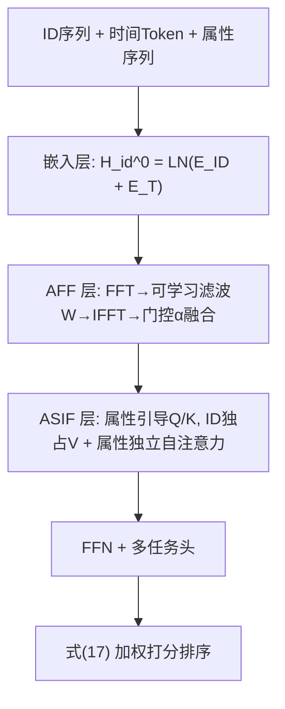
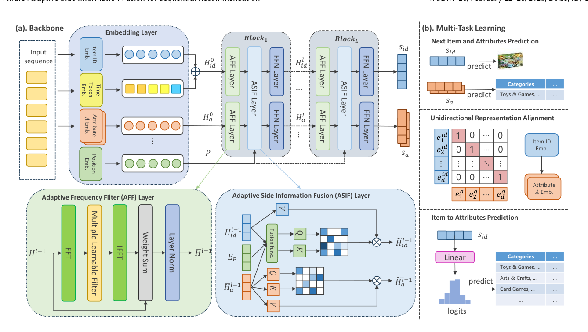

# Time-Aware Adaptive Side Information Fusion for Sequential Recommendation (时间感知自适应侧信息融合序列推荐)

- **会议/期刊**: WSDM 2026
- **作者与机构**: Jie Luo, Wenyu Zhang, Xinming Zhang (USTC); Yuan Fang (SMU)
- **推荐链路定位**: 精排（序列建模打分）
- **研究方向**: 序列与会话推荐 / 自监督对比学习与交互去噪
- **论文原文**: [https://arxiv.org/abs/2512.24246v1](https://arxiv.org/abs/2512.24246v1)
- **开源代码**: [https://github.com/jluo00/TASIF](https://github.com/jluo00/TASIF)

## TL;DR (1分钟核心速览)

现有侧信息融合序列推荐存在三大痛点：忽视时间戳的全局周期语义、频域去噪采用「一刀切」静态滤波、融合结构（交叉注意力/双路融合）计算昂贵。本文提出 TASIF，用即插即用的时间跨度划分（TSP）提供共享时间锚点、用可学习门控的自适应频域滤波（AFF）动态去噪、用「引导不混合」的 ASIF 层让属性只参与 Q/K 而不污染 V。在 Yelp/Beauty/Sports/Toys 四个数据集、`Leave-One-Out` + `Full-Ranking` 协议下，Recall@20 相对最强基线最高提升 **10.28%**，且训练时间与显存均低于 DIFF。

## Background & Motivation (背景与核心矛盾)

- **主流范式**: 以 NOVA、DIF-SR、MSSR、DIFF 为代表的侧信息融合路线，通过解耦注意力矩阵、跨序列注意力或双路融合，把 category/brand 等属性注入 ID 序列建模。
- **前人局限一（时间）**: 融合模型普遍把时间戳当作普通侧信息（DLFS-Rec）或只建模相邻物品间隔（TiSASRec），无法捕捉跨用户的全局周期行为；而 TimelyRec 类多尺度时间注意力又太重，难以塞进已臃肿的融合框架。
- **前人局限二（噪声与效率）**: DIFF/BSARec 静态压制高频分量，把「短期兴趣爆发」与噪声一并砍掉；MSSR 的 $(\lvert\mathcal{A}\rvert+2)^2$ 个交叉注意力矩阵使复杂度随属性数**二次增长**。
- **核心洞察 (Key Insight)**: 高频分量并非全是噪声，去噪强度应数据自适应；属性只需「引导」注意力打分，不应混入承载协同信号的 Value 内容。
- **本文切入点**: 三条正交改造——离散化全局时间轴、可学习门控滤波、非对称 Q/K 融合 + 独立 V 通路。

## Method (核心方法设计)

### 1. 整体框架 (Overall Architecture)

输入为用户交互序列 $S_u$及其并行的属性序列与时间 token 序列；嵌入层将 ID 与时间 token 相加得主表示$\mathbf{H}^0_{id}$，各属性独立嵌入得$\mathbf{H}^0_{a_j}$。堆叠$L$ 个 Block，每块依次经过 AFF 层（频域去噪，主/属性两路共享同一滤波算子）、ASIF 层（属性引导 ID 注意力 + 属性独立自注意力）、FFN。末端以多任务头联合优化下一物品预测、属性预测、单向对齐与 item-to-attribute 辅助任务；推理时按式 (17) 融合 ID 分数与加权属性分数排序。

<figure class="paper-figure" markdown="span">
  <figcaption>图4：TASIF的整体框架。</figcaption>
</figure>

### 2. 关键设计拆解 (Key Designs)

1. **时间跨度划分 TSP（即插即用的全局时间锚点）**：把全局时间轴切成 $N_\tau$个等长跨度（月/季），每个跨度一个可学习 token$\tau$，为每次交互映射出并行时间序列$S^\tau_u$。与直接把时间 token 塞进物品序列不同，本文保持两条平行序列，既不打乱物品序列结构，又能作为跨用户共享锚点对齐周期行为。嵌入时仅做$\mathbf{H}^0_{id}=\mathrm{LN}(E_{ID}(S_u)+E_T(S^\tau_u))$，零结构侵入，可挂到 SASRec/DIF-SR 上（图 2 显示一致增益）。

2. **自适应频域滤波 AFF（可学习门控替代残差）**：针对静态高频压制过刚的问题，先 $\mathbf{H}^{l-1}_x=\mathrm{FFT}(\mathbf{H}^{l-1})$，再用可学习滤波器$\tilde{\mathbf{H}}^{l-1}_x=\mathbf{W}\odot\mathbf{H}^{l-1}_x$调制频谱，逆变换后以可学习标量$\alpha$ 做软融合：
$$\bar{\mathbf{H}}^{l-1}=\mathrm{LN}\big(\alpha\cdot\mathrm{Dropout}(\mathrm{IFFT}(\tilde{\mathbf{H}}^{l-1}_x))+(1-\alpha)\cdot\mathbf{H}^{l-1}\big)$$
$\alpha$ 让模型按数据特性自行决定去噪强度，保留有用高频（兴趣爆发），比固定 LPF/HSF 泛化更好（图 5）。

3. **ASIF「引导不混合」融合层 + 训练目标**：融合表示 $\mathbf{H}^{l-1}_f=\mathrm{Fusion}(\bar{\mathbf{H}}^{l-1}_{id},\{\bar{\mathbf{H}}^{l-1}_{a_j}\},E_P)$只生成$Q_{id},K_{id}$，而$V_{id}=\bar{\mathbf{H}}^{l-1}_{id}W^V_{id}$ 仅来自 ID，避免属性稀释协同信号；属性各自走标准自注意力独立更新。总损失为
$$\mathcal{L}=\mathcal{L}^{ID}_{rec}+\sum_{j=1}^{\lvert\mathcal{A}\rvert}W_j\big(\lambda_1\mathcal{L}^{A_j}_{rec}+\lambda_2\mathcal{L}^{A_j}_{align}+\lambda_3\mathcal{L}^{A_j}_{i2a}\big)$$
其中对齐采用**单向** InfoNCE（仅 ID→属性，因属性值非唯一，双向会引入冲突监督），$W_j$可学习以自适应属性重要性。负采样为 batch 内 in-batch 负例（式 13 分母遍历 batch），无额外 hard negative 挖掘；复杂度为$O((\lvert\mathcal{A}\rvert+1)(nd^2+n^2d))$，对属性数**线性**。

## Experimental Setup & Evaluation Protocol (实验设置与评估协议)

- **数据集与预处理**: 按 DIF-SR 策略过滤出现少于 5 次的用户/物品（`5-core`），Yelp 仅保留 2019-01-01 后记录；属性统一用 category（多属性实验加 city/brand）。

| 数据集 | #Users | #Items | #Interactions | 稀疏度 | 场景说明 |
| :--- | :---: | :---: | :---: | :---: | :--- |
| Yelp | 30,499 | 20,068 | 317,182 | 99.95% | 本地生活商户 |
| Beauty | 22,363 | 12,101 | 198,502 | 99.93% | 美妆评论 |
| Sports | 35,598 | 18,357 | 296,337 | 99.95% | 运动户外 |
| Toys | 19,412 | 11,924 | 167,597 | 99.93% | 玩具评论 |

- **数据划分与防穿越**: `Leave-One-Out`（最后一项测试、倒数第二项验证），严格按时间戳顺序，无未来信息泄漏。
- **排名评测协议**: 无偏 `Full-Ranking`（对全库未交互物品排序），指标 Recall@{10,20}、NDCG@{10,20}，5 个随机种子取均值。
- **对比基线与超参**: 无侧信息组（GRU4Rec、SASRec、TiSASRec、FMLP-Rec、BSARec）与侧信息组（SASRec$_F$、FDSA、S³Rec、NOVA、DIF-SR、DLFS-Rec、MSSR、ASIF、DIFF）；$d=256$，Adam lr=1e-4，batch 2048（Yelp 1024），$\lambda_1=1.0,\lambda_2=0.1$，$\lambda_3\in\{10,5\}$；配对 t 检验$p<0.01$。

## Key Experimental Results (实验关键数据)

### 1. 主实验对比 (Main Results)

| 模型 | Yelp R@20 | Beauty R@20 | Sports R@20 | Toys R@20 | Yelp N@20 | Toys N@20 |
| :--- | :---: | :---: | :---: | :---: | :---: | :---: |
| SASRec | 0.0864 | 0.1192 | 0.0703 | 0.1193 | 0.0428 | 0.0517 |
| TiSASRec | 0.0887 | 0.1221 | 0.0712 | 0.1212 | 0.0444 | 0.0528 |
| BSARec | 0.1004 | 0.1226 | 0.0741 | 0.1277 | 0.0499 | 0.0544 |
| NOVA | 0.0975 | 0.1240 | 0.0757 | 0.1332 | 0.0484 | 0.0568 |
| DIF-SR | 0.0999 | 0.1265 | 0.0802 | 0.1377 | 0.0492 | 0.0598 |
| MSSR | 0.1043 | 0.1293 | 0.0816 | 0.1405 | 0.0511 | 0.0605 |
| DIFF | 0.1175 | 0.1221 | 0.0783 | 0.1322 | 0.0558 | 0.0603 |
| **TASIF** | **0.1251** | **0.1373** | **0.0912** | **0.1511** | **0.0586** | **0.0636** |
| Improv. | +6.47% | +3.86% | +10.28% | +7.54% | +5.02% | +5.12% |

多属性设置（加 city/brand）下 TASIF 仍全面领先：Beauty R@10 达 0.1024（DIFF 0.0928），Toys R@20 达 0.1595（DIFF 0.1437）。

### 2. 消融实验 (Ablation Study, Recall@20)

| 变体 | Yelp | Beauty | Sports | Toys |
| :--- | :---: | :---: | :---: | :---: |
| w/o TSP | 0.1212 | 0.1365 | 0.0862 | 0.1442 |
| w/o AFF | 0.1058 | 0.1344 | 0.0869 | 0.1472 |
| w/o ASIF | 0.1163 | 0.1356 | 0.0844 | 0.1447 |
| w/o NAP | 0.1224 | 0.1371 | 0.0908 | 0.1465 |
| w/o URA | 0.1213 | 0.1372 | 0.0887 | 0.1475 |
| w/o I2A | 0.1206 | 0.1369 | 0.0849 | 0.1447 |
| **TASIF** | **0.1251** | **0.1373** | **0.0912** | **0.1511** |

### 3. 关键实验发现 (Key Findings)

1. **AFF 是 Yelp 上最关键的组件**：移除后 R@20 从 0.1251 跌至 0.1058（−15.4%），远超移除 TSP（−3.1%），说明稀疏长序列场景下噪声污染比时间语义更致命；而在 Sports 上 w/o AFF 仅降 4.7%，去噪收益与数据噪声水平强相关。
2. **效率与效果双赢**：同等 2 层 2 头配置下，TASIF 在 Yelp 上 28s/epoch、5.0G 显存，优于 DIFF（33s、8.1G）与 MSSR（52s、6.5G），参数量 7.2M 与 DIFF 持平，验证线性复杂度设计的实际收益。
3. **时间跨度需匹配领域周期**：Yelp/Toys 最优 $\tau=90$ 天，Sports 为 180 天，Beauty 为 365 天（近年度换新周期），说明 TSP 的粒度应作为领域先验调参，而非固定超参。

## Highlights & Limitations (亮点、对比与审稿批判)

- **与代表作对比 (vs. Prior Work)**: 相比 NOVA 的「非侵入注意力」（属性只算权重但 V 仍为 ID，融合深度有限），ASIF 让属性进入 Q/K 且属性流独立演化，交互更深；相比 DIF-SR 的多注意力矩阵解耦，ASIF 只保留一条主注意力 + 属性自注意力，复杂度从属性数二次降为线性；相比 DIFF 的静态高频压制与双路融合，AFF 用可学习 $\alpha$ 门控实现数据自适应去噪。
- **可迁移亮点**: (1) TSP 作为零侵入模块可直接挂到任意序列骨干（SASRec/DIF-SR 均验证增益），适合作为通用时间特征工程；(2) 「属性只进 Q/K、V 独占 ID」的非对称注意力范式可迁移到多模态、多行为序列融合场景。
- **审稿级局限批判**: (1) 属性仅用 category（多属性实验也只加一个 brand/city），未验证在数十个属性类型下的线性复杂度实际表现与 $W_j$学习稳定性；(2) 时间跨度$\tau$与$\beta$ 需按数据集网格搜索，缺乏自适应确定跨度的机制，冷启动新领域迁移成本较高。

## Rating (四维评分)

- **方法创新性 (Novelty)**: ⭐⭐⭐⭐ （三个组件均为对既有范式的精准增量改造，TSP 简洁优雅，ASIF 的非对称 Q/K 设计有清晰的信息论直觉，但整体属组合式创新而非理论突破）
- **评估协议与实验扎实度 (Protocol & Experiments)**: ⭐⭐⭐⭐⭐ （4 数据集 + Full-Ranking 无偏评测 + 5 种子 + 配对 t 检验 + 完整消融/滤波类型/超参/效率/案例研究，实验矩阵相当完整）
- **写作与数学规范度 (Clarity & Rigor)**: ⭐⭐⭐⭐ （公式与符号定义清晰，复杂度分析给出与 MSSR 的显式对比，但部分符号如 $\mathbf{H}^{l-1}$ 同时指代 ID 与属性两路的写法略含混）
- **工业落地与复现价值 (Industrial & Practical Value)**: ⭐⭐⭐⭐⭐ （代码开源、基于 RecBole 实现、训练时间与显存均优于 SOTA，TSP 可即插即用，工程部署门槛低）
