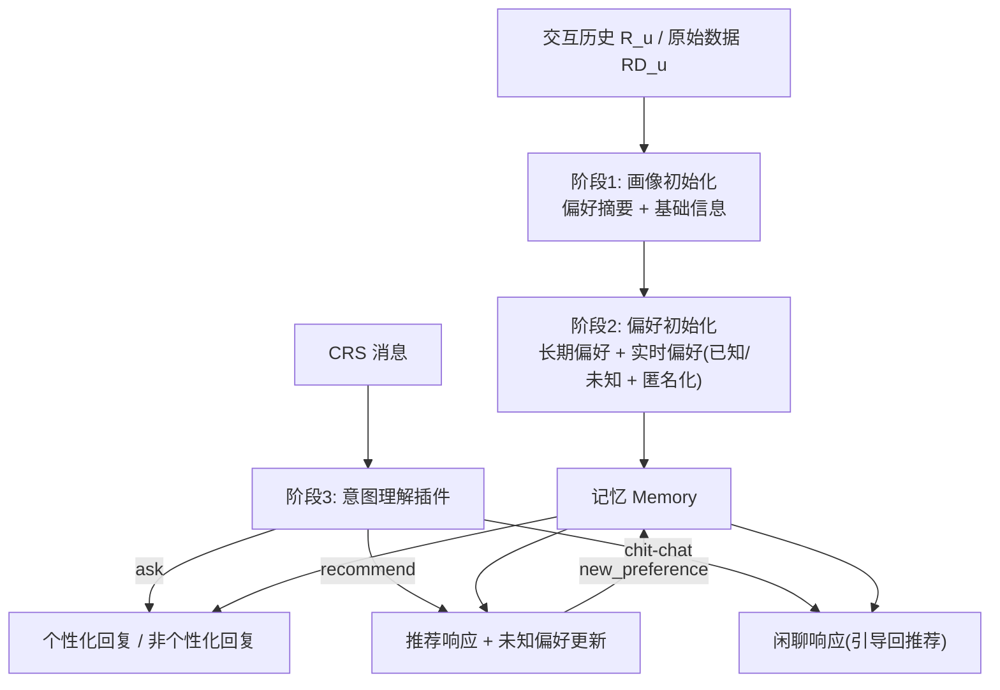
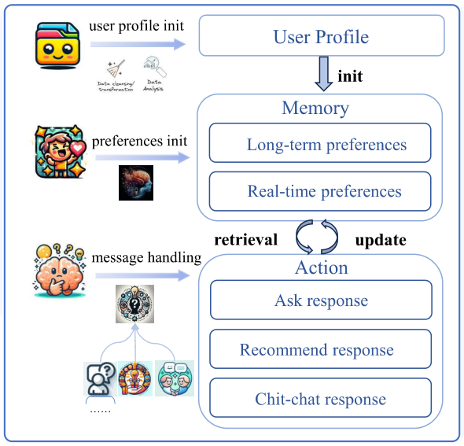

# A LLM-based Controllable, Scalable, Human-Involved User Simulator Framework for Conversational Recommender Systems (面向对话推荐的可控、可扩展、人机协同 LLM 用户模拟器框架)

- **会议/期刊**: WWW 2025
- **作者与机构**: Lixi Zhu, Xiaowen Huang, Jitao Sang（北京交通大学计算机学院、交通数据分析与挖掘北京市重点实验室）
- **推荐链路定位**: 端到端生成式（CRS 评估侧用户模拟器）
- **研究方向**: 对话推荐与智能体仿真 / 大语言模型推荐
- **论文原文**: [https://arxiv.org/abs/2405.08035v1](https://arxiv.org/abs/2405.08035v1)
- **开源代码**: [https://github.com/zlxxlz1026/CSHI](https://github.com/zlxxlz1026/CSHI)

## TL;DR (1分钟核心速览)

现有 LLM 用户模拟器普遍采用「单提示词模板」一次性驱动，导致两类致命问题：目标物品名随模板泄漏进反馈（data leakage），以及无法精细控制模拟器在「问偏好/被推荐/闲聊」三类意图下的行为。本文提出 CSHI 框架，用插件管理器把模拟器拆成「用户画像初始化 → 偏好初始化 → 消息处理」三阶段、八个可插拔插件，并以「记忆不含目标物品名」+「已知/未知偏好二分」+「敏感信息匿名化」三项机制从源头切断泄漏。在 ReDial、OpenDialKG 与 MovieLens 上，CSHI 使 KBRD/BARCOR/UniCRS/ChatGPT 的 Recall@50 在剔除泄漏对话后几乎零衰减（iEvaLM 下则下降 6.8%–17.9%），无标注场景 SR@10 从 0.742 提升至 0.906。

## Background & Motivation (背景与核心矛盾)

- **主流范式**: 基于属性的 CRS 用固定模板回复，NLP 式 CRS 用固定对话评估；近期工作（iEvaLM、Agent4Rec）改用 LLM 扮演用户，以单条 prompt 模板同时承载画像、历史与目标物品信息。
- **前人局限**: 其一，目标物品名被写进 prompt，LLM 即便被明令「不要提」仍会无意吐出，造成评估虚高；其二，单模板无法区分「该答什么、该拒什么、该在何时被引导出潜在偏好」，输出稳定性随模板变长而急剧下降（iEvaLM+ui_info 反而劣于 iEvaLM 即为明证）。
- **核心洞察 (Key Insight)**: 真实用户的「记忆」里本就不存在尚未被推荐的目标物品名；且用户偏好应分为可显式表达的**已知偏好**与需系统引导才能浮现的**未知偏好**——这正是搜索与推荐的本质差异。
- **本文切入点**: 用插件化的阶段式流水线替代单模板，把「记忆构建」与「回复生成」解耦，使泄漏在架构层面不可能发生。

## Method (核心方法设计)

### 1. 整体框架 (Overall Architecture)

CSHI 由插件管理器（plugin manager）统一调度，将模拟器生命周期切为三阶段：**User Profile Init** 生成画像（支持人工编辑人格特质或 LLM 自动摘要交互历史）；**Preferences Init** 依据画像与目标物品构建含长期/实时偏好的记忆；**Message Handling** 接收 CRS 消息后先做意图识别，再分派至问询、推荐、闲聊三类响应插件，若偏好被更新则回写记忆。插件可独立执行亦可按优先级协作，增删即改变模拟器能力，从而同时获得可控性与可扩展性。

<figure class="paper-figure" markdown="span">
  <figcaption>图1：CSHI框架概览。</figcaption>
</figure>

### 2. 关键设计拆解 (Key Designs)

1. **记忆隔离式防泄漏（Memory-Isolated Anti-Leakage）**：痛点在于目标物品名一旦进入 prompt 就无法靠指令约束。CSHI 在 Preferences Init 阶段只把目标物品的**属性信息**（导演、演员、类型、语言）写入实时偏好，物品名本身永不入记忆，故回复生成时物理上无从泄漏。这一「架构即约束」的思路比提示词层面的「请不要说」可靠得多。

2. **已知/未知偏好二分与引导式更新（Known vs. Unknown Preference）**：借鉴搜索-推荐之别，插件 3 以超参 $k_1,k_2$ 控制两类偏好占比：
$$real\_time\_preference = Plugin_3(Info_i, k_1, k_2)$$
当 CRS 推荐被拒但理由中携带未知偏好相关信息时，推荐响应插件不仅给出负反馈，还据此更新实时偏好并回传：
$$rec\_response, new\_preference = Plugin_7(intent, real\_time\_preference)$$
由此模拟「用户被系统启发后才意识到自己喜欢某导演」的真实认知过程，使多轮交互具备信息增量而非原地打转。

3. **敏感信息匿名化与训练/推理开销**：插件 3 将「2012 年 6 月 1 日」粗化为「2010 年代」、「144 分钟」改为「约 2 小时」，避免用户说出真实场景中绝不会说的领域细节。整个框架**无需训练**，全部依赖 LLM 推理；每轮对话约需 2–3 次 LLM 调用（意图识别 + 响应生成 + 可选偏好更新），开销与单模板方案同量级但可控性显著提升。

## Experimental Setup & Evaluation Protocol (实验设置与评估协议)

- **数据集与预处理**:

| 数据集 | #Users | #Items | #Interactions | 稀疏度/密度 | 特征/场景说明 |
| :--- | :---: | :---: | :---: | :---: | :--- |
| ReDial | 约 1.4k | 约 6.9k | 10,006 段对话 | 极稀疏 | 电影域，含人工标注对话与目标物品 |
| OpenDialKG | — | — | 13,802 段对话 | 极稀疏 | 多域，仅取电影域 |
| MovieLens | 标准规模 | 标准规模 | 每用户取最近 5 条为测试 | 稀疏 | 无人工对话，用于自由交互场景 |

- **数据划分与防穿越 (Splitting Strategy)**: 有标注场景沿用 iEvaLM 设定，在预定义对话上下文中交互至成功推荐或达 $t=5$轮；无标注场景对每用户取**最近 5 条交互为测试集**、其余历史生成画像，最大交互轮数$T=10$。
- **排名评测协议 (Ranking Protocol)**: 有标注场景采用 `Full-Ranking` 式 Recall@$\{1,10,50\}$，并额外设置 `-history`、`-response`、`-both` 三种**剔除泄漏对话**的净化评估；无标注场景因生成式 CRS 难以严格按物品相关性排序，改用成功率 SR@$\{3,5,10\}$ 与平均轮数 AT。
- **对比基线与超参设置**: 基线为 KBRD、BARCOR、UniCRS 与 ChatGPT（GPT-3.5-turbo-0613）；无标注场景对比 iEvaLM 及其变体 iEvaLM(+ui_info)、CSHI(-filter)。

## Key Experimental Results (实验关键数据)

### 1. 主实验对比 (Main Results)

ReDial 上各 CRS 在 CSHI 模拟器下的 Recall（括号为剔除泄漏后的相对变化）：

| Model | R@1 | R@10 | R@50 | R@1(-both) | R@10(-both) | R@50(-both) |
| :--- | :---: | :---: | :---: | :---: | :---: | :---: |
| KBRD | 0.027 | 0.170 | 0.445 | 0.009 (-66.7%) | 0.116 (-31.8%) | 0.387 (-13.0%) |
| BARCOR | 0.033 | 0.196 | 0.476 | 0.034 (+0.03%) | 0.185 (-5.6%) | 0.446 (-6.3%) |
| UniCRS | 0.064 | 0.266 | 0.564 | 0.024 (-62.5%) | 0.204 (-23.3%) | 0.529 (-6.2%) |
| ChatGPT | **0.209** | **0.445** | **0.668** | **0.183 (-12.4%)** | **0.417 (-6.3%)** | **0.654 (-2.1%)** |

OpenDialKG 上 ChatGPT 达 R@1/R@10/R@50 = 0.403/0.690/0.900，剔除泄漏后仅降 2.6%/21.2%/2.6%；而 iEvaLM 在 ReDial 上对应指标曾下降 12.0%/6.8%/10.3%/17.9%（四类 CRS），CSHI 下 `-response` 场景**全部为 0.0% 衰减**。

无标注 MovieLens 场景：

| Simulator | SR@3 | SR@5 | SR@10 | AT |
| :--- | :---: | :---: | :---: | :---: |
| iEvaLM | 0.434 | 0.680 | 0.742 | 5.384 |
| iEvaLM(+ui_info) | 0.200 | 0.484 | 0.658 | 6.598 |
| CSHI | **0.634** | **0.776** | **0.906** | **4.434** |
| CSHI(-filter) | 0.598 | 0.772 | 0.918 | 4.430 |

### 2. 消融实验 (Ablation Study)

| 变体 | 关键指标变化 | 说明 |
| :--- | :--- | :--- |
| CSHI 全量 | SR@10 = 0.906, AT = 4.434 | 完整框架 |
| CSHI(-leakage) | SR@10 = 0.902 (-0.4%) | 剔除泄漏后几乎无损，证明泄漏已被抑制 |
| CSHI(-filter) | SR@10 = 0.918 (+1.3%) | 去掉匿名化后指标反升，但不符合真实用户表达 |
| iEvaLM(-leakage) | SR@10 = 0.688 (-7.3%) | 单模板泄漏严重 |
| iEvaLM+ui_info(-leakage) | SR@10 = 0.536 (-18.5%) | 信息越多越失控 |

### 3. 关键实验发现 (Key Findings)

1. **泄漏抑制是架构性的而非提示词性的**：CSHI 在 `-response` 净化下所有 CRS 的 Recall 衰减均为 0.0%，而 iEvaLM 在 ReDial 上最高衰减 17.9%；且 iEvaLM(+ui_info) 加入更多信息后泄漏反而更严重（SR@10 掉 18.5%），说明「往 prompt 里塞信息」是错误方向。
2. **多轮增益来自未知偏好的引导机制**：图 3 显示在 `-both` 净化下 CSHI 在第 2–5 轮持续领先，图 4 显示 iEvaLM 的准确率在后期趋于平台而 CSHI 稳定上升，印证推荐响应插件对未知偏好的回写确实为 CRS 提供了新信息。
3. **匿名化是「真实性税」而非性能损失**：CSHI(-filter) 的 SR@10 反而高 1.3%，因为 CRS 能利用精确上映日期/片长做匹配；但真实用户不会说「我想看 132 分钟的电影」，故该增益属于不可接受的评估虚高，作者主动放弃。

## Highlights & Limitations (亮点、对比与审稿批判)

- **与代表作对比 (vs. Prior Work)**: 相较 iEvaLM 的单 prompt 模板，CSHI 以插件流水线实现阶段级控制，把「防泄漏」从指令约束升级为记忆结构约束；相较 Agent4Rec 侧重画像摘要，CSHI 额外引入已知/未知偏好二分与敏感信息匿名化，更贴近真实用户认知；相较基于属性的模板模拟器，CSHI 保留了完整对话流与意图自适应能力。
- **可迁移亮点**: ①「目标实体名不入记忆、只入属性」的记忆隔离范式可直接迁移到任何 LLM 评估型 Agent（如搜索评估、多轮问答评测）；②已知/未知偏好二分可作为 CRS 训练数据的自动增广策略，用于合成「被引导后才浮现」的偏好信号。
- **审稿级局限批判**: 其一，框架完全依赖 LLM 多次调用，每轮 2–3 次 API 请求在大规模评估中成本与延迟不可忽视，且未报告方差与显著性检验；其二，无标注场景的 SR@t 指标依赖生成式 CRS 的自由输出判定，缺乏统一的相关性排序协议，与有标注场景的 Recall 不可直接横向比较；此外 $k_1,k_2$ 与匿名化粒度均为人工设定，缺少敏感性分析。

## Rating (四维评分)

- **方法创新性 (Novelty)**: ⭐⭐⭐⭐ （插件化阶段管控 + 记忆隔离防泄漏的思路清晰且切中要害，但各插件内部仍以 prompt 工程为主，缺少理论刻画）
- **评估协议与实验扎实度 (Protocol & Experiments)**: ⭐⭐⭐⭐ （三种泄漏净化协议设计巧妙、双场景覆盖有标注/无标注，但缺显著性检验与超参敏感性分析）
- **写作与数学规范度 (Clarity & Rigor)**: ⭐⭐⭐ （框架叙述清楚、案例丰富，但公式多为插件接口的符号化描述，缺少形式化定义与复杂度分析）
- **工业落地与复现价值 (Industrial & Practical Value)**: ⭐⭐⭐⭐ （代码与 Web demo 已开源、免训练即插即用，可直接用于 CRS 离线评估与对话数据合成，但 LLM 调用成本需工程优化）

