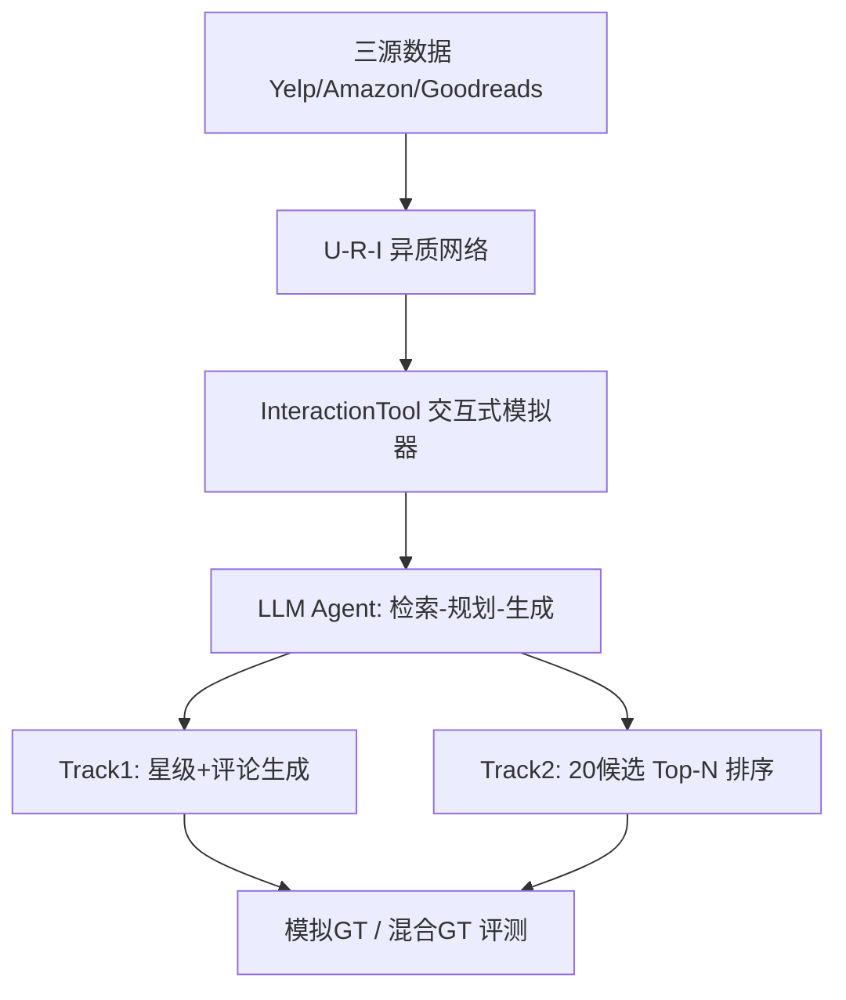
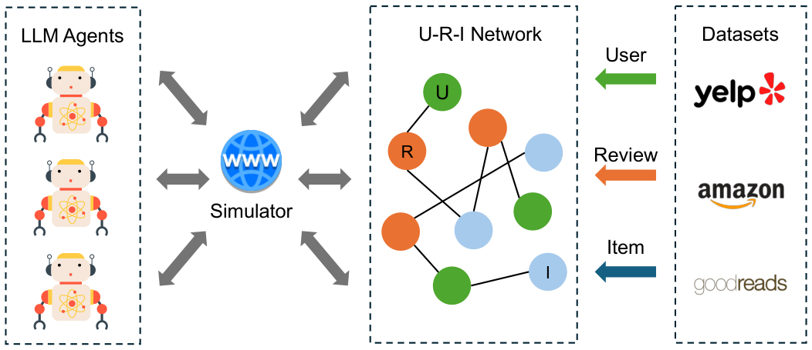

# AgentSociety Challenge: Designing LLM Agents for User Modeling and Recommendation on Web Platforms (AgentSociety 挑战赛：面向 Web 平台用户建模与推荐的 LLM 智能体设计)

- **会议/期刊**: WWW 2025 (The ACM Web Conference)
- **作者与机构**: Yuwei Yan, Yu Shang, Qingbin Zeng, Yu Li, Keyu Zhao, Zhiheng Zheng, Xuefei Ning, Tianji Wu, Shengen Yan, Yu Wang, Fengli Xu, Yong Li（清华大学、香港科技大学（广州）、InfinigenceAI）
- **推荐链路定位**: 端到端生成式（LLM Agent 直接完成用户建模与候选重排）
- **研究方向**: 对话推荐与智能体仿真 / 大语言模型推荐 (LLM4Rec)
- **论文原文**: [https://arxiv.org/abs/2502.18754v1](https://arxiv.org/abs/2502.18754v1)
- **开源代码**: [AgentSocietyChallenge 基准环境](https://tsinghua-fib-lab.github.io/AgentSocietyChallenge)

## TL;DR (1分钟核心速览)

本文并非提出单一模型，而是构建了**首个面向 Web 平台用户建模与推荐的 LLM Agent 竞赛基准**：将 Yelp、Amazon、Goodreads 三源数据融合为「用户-评论-物品」异质网络，并配套一个由 `InteractionTool` 驱动的交互式环境模拟器，让 Agent 主动检索历史数据而非被动喂入特征。赛事设 User Modeling（评分 MAE + 评论生成误差）与 Recommendation（20 候选 Top-N 命中率）双赛道，采用「开发阶段纯模拟 GT、决赛阶段 40% 模拟 + 60% 真实 GT」的两阶段防过拟合协议。295 支队伍、1400+ 次提交，最终阶段两赛道分别取得 9.1% 与 15.9% 的性能提升，且模拟 GT 与真实 GT 的 Agent 排名 Pearson 相关高达 0.9739 / 0.9245。

## Background & Motivation (背景与核心矛盾)

- **主流范式**: 传统推荐依赖 NCF/GMF/MLP 等深度学习模型，将用户历史压缩为稠密 ID 嵌入，在稠密交互数据上拟合协同信号；LLM4Rec 则多以「离线指令微调 + 固定 prompt」方式做打分或重排。
- **前人局限**: 其一，深度模型在**数据稀疏用户**上几乎失效，缺乏常识推理与少样本泛化能力；其二，现有 LLM 推荐评测多为**静态离线数据集**，Agent 无法主动检索、追问与探索，与真实 Web 平台上「信息获取—决策」的闭环相去甚远。
- **核心洞察 (Key Insight)**: LLM Agent 具备零样本角色扮演与常识推理能力，可模拟上下文敏感的用户意图；但若评测集完全公开，参赛者极易对真实 GT 过拟合，因此需要**可交互环境 + 模拟 GT 混合评测**来同时保证公平性与真实相关性。
- **本文切入点**: 以竞赛形式把「用户行为模拟」与「个性化推荐」拆成两条并行赛道，用统一模拟器与混合 GT 协议，系统性地收集并对比社区最优 Agent 设计。

## Method (核心方法设计)

### 1. 整体框架 (Overall Architecture)

整个基准由三部分咬合：**数据层**将 Yelp/Amazon/Goodreads 三源数据统一为「用户 $U$— 评论$R$— 物品$I$」网络；**环境层**由 `InteractionTool` 实现，Agent 通过工具调用按需拉取某用户的历史评论、某物品的属性与评论文本，形成「检索—规划—生成」的多轮闭环；**评测层**在开发阶段用模拟 GT 打分，决赛阶段切换为 40% 模拟 + 60% 真实 GT 的混合协议，并通过 blocking 机制屏蔽真实标签，强制 Agent 依靠推理而非记忆作答。Track 1 输出星级与评论文本，Track 2 对 20 个候选物品输出排序。

<figure class="paper-figure" markdown="span">
  <figcaption>图1：环境模拟器框架。</figcaption>
</figure>

### 2. 关键设计拆解 (Key Designs)

1. **交互式环境模拟器（InteractionTool）**：痛点在于静态数据集无法考察 Agent 的主动信息获取能力 $\to$模拟器把数据组织成可查询网络，Agent 每次动作返回结构化子图（用户历史、物品元数据、相关评论）$\to$ 直觉上这迫使 Agent 学会「先检索再推理」，与真实 Web Agent 的工作方式对齐，也使不同 Agent 的差异体现在检索策略而非 prompt 长度上。

2. **双赛道混合评测协议（Simulated + Real GT）**：痛点是公开真实 GT 会导致过拟合 $\to$开发阶段全部使用模拟 GT，决赛阶段按$0.4 \times \text{Sim} + 0.6 \times \text{Real}$加权，并对真实标签做 blocking$\to$实验证明该混合协议对 Agent 真实能力的预测相关性（Track 2 上$r=0.7641$）显著优于纯真实 GT 采样（$r=0.5825$），说明模拟 GT 起到了「方差缩减」的作用。

3. **双赛道评价指标与训练/推理开销**：Track 1 综合误差为
$\text{Error} = 1 - (0.25 \cdot E_{\text{tone}} + 0.25 \cdot E_{\text{sent}} + 0.5 \cdot E_{\text{topic}})$，
其中 $E_{\text{tone}}$、$E_{\text{sent}}$为归一化情感分数 MAE，$E_{\text{topic}}$为嵌入余弦距离；偏好估计用$\text{MAE}=\frac{1}{N}\sum_{i=1}^{N}|\hat{s}_{n_i}-s_{n_i}|$。Track 2 用$\text{HR@}N=\frac{1}{T}\sum_{t=1}^{T}\mathbb{I}(p_t \in \hat{P}_t(N))$，$N\in\{1,3,5\}$。全程**免训练、免负采样**，纯靠 in-context 推理，主要开销为每次提交的 LLM API 调用与检索轮数。

## Experimental Setup & Evaluation Protocol (实验设置与评估协议)

- **数据集与预处理**: 三源开放数据集，未做 5-core 过滤，保留原始评论与元数据；统一为 U-R-I 网络供模拟器检索。

| 数据集 | 领域 | 核心字段 | 作用 |
| :--- | :---: | :--- | :--- |
| Yelp | 本地生活 | 商户属性、星级、funny/cool/useful 计数 | Track 1/2 主场景 |
| Amazon | 电商 | 商品 ID/名称/星级/评论数/描述、购买验证 | 跨平台特征工程考察 |
| Goodreads | 图书社区 | 作者、出版年、相似书、阅读状态、投票数 | 长文本评论生成考察 |

- **数据划分与防穿越 (Splitting Strategy)**: 采用**两阶段划分**——开发阶段全部使用模拟 GT；决赛阶段使用 40% 模拟 + 60% 真实 GT 的混合集，并对真实标签实施 blocking，Agent 无法直接读取答案。
- **排名评测协议 (Ranking Protocol)**: Track 2 为 **Sampled Ranking**，即从候选中给定 20 个物品做列表内排序，报告 HR@1/3/5，而非全库 Full-Ranking；Track 1 为回归式 MAE 与生成式误差。
- **对比基线与超参设置**: 官方提供参考 baseline Agent；另对比 NCF、GMF、MLP 三类深度推荐模型作为「传统方法」参照系。无统一嵌入维度（各 Agent 自定），显著性以 Pearson 相关系数与分阶段提升幅度衡量。

## Key Experimental Results (实验关键数据)

### 1. 主实验对比 (Main Results)

| 阶段 / 赛道 | 官方 Baseline | 最优 Agent | 相对提升 (Improv.) |
| :--- | :---: | :---: | :---: |
| Track 1 开发阶段 (Overall Score) | ~0.78 | **~0.95** | **+21.9%** |
| Track 2 开发阶段 (Overall Hit Ratio) | ~0.30 | **~0.36** | **+20.3%** |
| Track 1 决赛阶段 | — | 最优队 | **+9.1%** |
| Track 2 决赛阶段 | — | 最优队 | **+15.9%** |
| 深度模型 NCF/GMF/MLP（纯真实 GT） | 基准 | — | 低于混合 GT 训练 |
| 深度模型 NCF/GMF/MLP（模拟+真实 GT） | — | **全面更优** | 见图 6 |

### 2. 消融实验 (Ablation Study)

本文为竞赛报告，无标准消融，改以「Agent 设计要素剥离」与「GT 组成剥离」作为等价分析：

| 配置 | Track 1 相关性 $r$| Track 2 相关性$r$ | 说明 |
| :--- | :---: | :---: | :--- |
| 模拟 GT vs 真实 GT（Agent 排名） | **0.9739** | **0.9245** | 模拟 GT 可信 |
| 混合 GT vs 真实 GT-B | **0.7516** | **0.7641** | 混合协议预测力更强 |
| 纯真实 GT-A vs 真实 GT-B | 0.7331 | 0.5825 | 纯真实采样方差大 |
| 深度模型：仅真实 GT | 较低 | 较低 | 数据量受限 |
| 深度模型：模拟+真实 GT | **更高** | **更高** | 模拟 GT 可作增广 |

### 3. 关键实验发现 (Key Findings)

1. **模拟 GT 是可靠代理**：Track 1/2 上 Agent 在模拟与真实 GT 的性能 Pearson 相关分别达 0.9739 与 0.9245，说明用模拟 GT 做开发阶段排名几乎不损失对真实能力的判别力，这是整套两阶段协议成立的前提。
2. **混合 GT 优于纯真实 GT 采样**：Track 2 上混合 GT 与真实 GT-B 的相关为 0.7641，而纯真实 GT-A 仅 0.5825；个别 Agent（如 Track 2 的 Agent 2）在真实采样 A 上表现差、在 B 上却很好，混合 GT 有效抹平了这种采样噪声。
3. **模拟 GT 还能反哺传统模型**：将模拟 GT 混入 NCF/GMF/MLP 的训练后，三者在真实 GT 上的 Overall Score 均高于仅用真实数据训练，证明模拟数据确实捕获了用户偏好结构，具备数据增广价值。

## Highlights & Limitations (亮点、对比与审稿批判)

- **与代表作对比 (vs. Prior Work)**: 相较 NCF/GMF 等 ID 嵌入式协同过滤，本文 Agent 依靠 in-context 检索与常识推理，在稀疏用户上具备天然优势；相较常规 LLM4Rec 离线指令微调工作，本文的核心差异是**引入可交互模拟器与混合 GT 协议**，把评测从「静态拟合」推进到「主动信息获取 + 防过拟合」。
- **可迁移亮点**: 其一，「模拟 GT + 真实 GT 加权混合」的评测思路可直接迁移到任何标注稀缺、易过拟合的生成式推荐评测；其二，平台特定特征工程（Amazon 取购买验证、Yelp 取 funny/cool/useful、Goodreads 取阅读状态）是低成本高回报的通用技巧。
- **审稿级局限批判**: 其一，Track 2 仅在 20 候选内做 Sampled Ranking，未做全库 Full-Ranking，难以反映真实工业召回规模下的性能；其二，模拟 GT 由 LLM 生成，其与真实分布的相关性虽高，但可能系统性偏向「LLM 易生成」的行为模式，且全文缺少推理延迟与 API 成本的量化对比，工程可复现性受限。

## Rating (四维评分)

- **方法创新性 (Novelty)**: ⭐⭐⭐⭐ （以竞赛基准形式系统化「交互式模拟器 + 混合 GT 防过拟合」范式，虽无新模型但评测设计有开创性）
- **评估协议与实验扎实度 (Protocol & Experiments)**: ⭐⭐⭐⭐ （295 队、1400+ 提交、两阶段协议与相关性分析扎实，但缺全库排序与显著性检验）
- **写作与数学规范度 (Clarity & Rigor)**: ⭐⭐⭐⭐ （指标公式与协议描述清晰，但主实验仅给提升百分比、缺完整数值表，复现细节依赖开源仓库）
- **工业落地与复现价值 (Industrial & Practical Value)**: ⭐⭐⭐⭐ （基准环境已开源、模拟 GT 可作数据增广，但 LLM 推理成本与延迟未量化，直接上线需额外工程评估）

