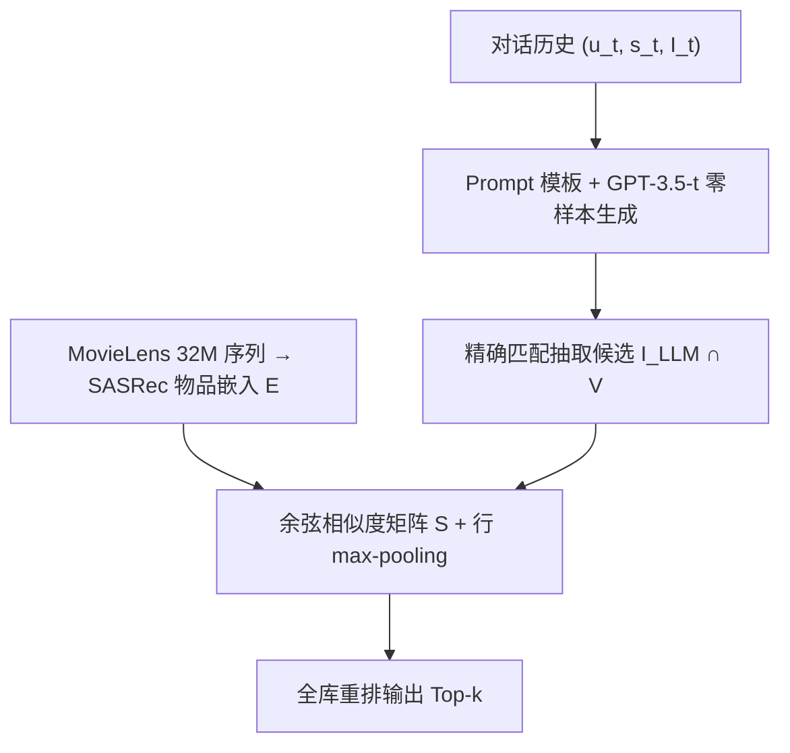
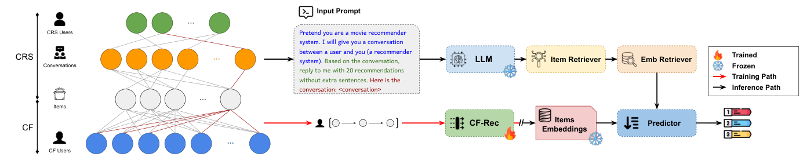

# Bridging Conversational and Collaborative Signals for Conversational Recommendation (桥接对话信号与协同信号的对话推荐)

- **会议/期刊**: WWW Companion 2025 (Short Paper)
- **作者与机构**: Ahmad Bin Rabiah, Nafis Sadeq, Julian McAuley (UC San Diego)
- **推荐链路定位**: 重排（LLM 生成候选 → 协同嵌入重排）
- **研究方向**: 对话推荐与智能体仿真 / 协同过滤与双塔召回
- **论文原文**: [https://arxiv.org/abs/2412.06949v2](https://arxiv.org/abs/2412.06949v2)
- **开源代码**: [https://github.com/MaximShidlovski23/imdbpy](https://github.com/MaximShidlovski23/imdbpy)（仅 IMDb 对齐工具，框架代码暂未开源）

## TL;DR (1分钟核心速览)

对话推荐（CRS）数据集交互极稀疏（Reddit-Movie 密度仅 0.013%），LLM 零样本推荐虽懂语义却缺乏协同信号、易偏向热门。本文构建 Reddit-ML32M，用 IMDb ID 两阶段对齐把 Reddit 对话与 MovieLens 32M 打通（交互量 5.1 万 → 3007 万，密度升至 0.68%），再用 SASRec 学到的物品协同嵌入对 GPT-3.5 生成的候选做余弦相似度 max-pooling 重排。在 H@5 上相对最强基线 GPT-3.5-t 提升 12.32%，N@5 提升 9.91%。

## Background & Motivation (背景与核心矛盾)

- **主流范式**: CRS 分两支——协同/知识驱动模型（ReDIAL、UniCRS、KBRD）建模用户-物品关系；LLM 零样本方法（GPT-3.5-t、LLaMA2）直接读对话上下文生成推荐。
- **前人局限**: ① CF 类模型无法利用对话上下文；② LLM 类方法只依赖文本元数据，无法刻画物品间协同关系，且输出偏向热门/训练数据；③ CRS 数据集本身极稀疏（ReDIAL 中 78.98% 物品交互数 < 10），学不出稳健物品表征。
- **核心洞察 (Key Insight)**: 对话数据与协同数据并非不可桥接——只要存在稳定结构化标识（IMDb ID），就能把对话场景的物品映射到大规模 CF 交互空间，从而"借"来稠密协同信号。
- **本文切入点**: 先造桥（数据集链接），再借桥（用 CF 嵌入重排 LLM 输出），不改 LLM 参数、不做微调。

## Method (核心方法设计)

### 1. 整体框架 (Overall Architecture)

BridgeCRS 是"冻结 LLM 生成 + 冻结 CF 嵌入重排"的两段式流水线。训练阶段仅在 MovieLens 32M 交互序列上训练 SASRec 得到物品嵌入矩阵 $\mathbf{E}\in\mathbb{R}^{|V|\times d}$；推理阶段把对话历史$(u_t,s_t,\mathcal{I}_t)_{t=1}^{k-1}$填入 `[TASK]+[FORMAT]+[CONTEXT]` 模板提示 GPT-3.5-t（温度$\tau=0$确定性解码），对输出文本做精确匹配抽取候选集$\mathcal{I}_{LLM}$并与全库$V$取交集，最后用$\mathbf{E}$计算候选与全库物品的余弦相似度并 max-pooling 打分重排，输出$\hat{\mathcal{I}}_k$。

<figure class="paper-figure" markdown="span">
  <figcaption>图1：所提出的CRS框架示意图，该框架将基于LLM的对话推荐与CF信号相结合。预测器利用这些信号生成排序推荐。</figcaption>
</figure>

### 2. 关键设计拆解 (Key Designs)

1. **Reddit-ML32M 两阶段数据集链接（本文最大增量）**：直接按 IMDb ID 匹配会因 ID 被修改/回收/废弃而失败。第一阶段用 IMDb ID 精确匹配；第二阶段对失败项用 IMDbPY 按"标题 + 上映日期"精确检索历史 IMDb ID 回填。结果交互从 51,148 增至 30,074,259，密度 0.013% → 0.68%，且保证 $V\subseteq\mathcal{I}$ 使嵌入可直接迁移到对话物品空间。直觉：结构化标识是跨模态对齐的"锚点"，比语义匹配更可靠。

2. **嵌入相似度 max-pooling 重排（替代 LLM logit 打分）**：LLM 输出的是自然语言列表而非可比较分数，且其内部排序受流行度偏置污染。本文不评估 LLM logits，而是对每个候选 $i\in\mathcal{I}_{LLM}$与全库物品$j\in V$计算余弦相似度，再取行方向最大值作为$j$ 的最终得分：

$$s(j)=\max_{i\in\mathcal{I}_{LLM}}\frac{\mathbf{e}_i\cdot\mathbf{e}_j}{\lVert\mathbf{e}_i\rVert\lVert\mathbf{e}_j\rVert},\quad \hat{\mathcal{I}}_k=\operatorname{argsort}_{j\in V}(-s(j))$$

直觉：max-pooling 相当于"最近邻投票"——只要 $j$ 与 LLM 推荐的任一物品在协同空间里足够近，就应被提上来，从而把 LLM 的语义召回扩散到协同邻域，同时压制纯热门偏置。

3. **训练目标与推理开销**：SASRec 以标准下一物品似然训练 $\max_\Theta\sum_{x}\sum_{k}\log p(i^x_{k+1}\mid Z^x_{1:k};\Theta)$，负采样沿用 SASRec 默认（每正样本 1 负样本）；LLM 侧完全免训练。推理开销 = 一次 GPT-3.5 API 调用 + 一次$m\times|V|$余弦矩阵乘法（$m$ 为候选数，通常 20），重排本身近乎零成本，但 LLM 调用延迟与费用是主要瓶颈。

## Experimental Setup & Evaluation Protocol (实验设置与评估协议)

- **数据集与预处理**:

| 数据集 | #Users | #Items | #Interactions | 密度 | 说明 |
| :--- | :---: | :---: | :---: | :---: | :--- |
| Reddit-Movie | 12,508 | 31,396 | 51,148 | 0.013% | 原始 CRS 对话数据 |
| Reddit-ML32M | 200,947 | 22,014 | 30,074,259 | 0.68% | 链接 MovieLens 32M 后 |

- **数据划分与防穿越**: 按 80%/10%/10% 划分训练/验证/测试（对话级划分，非全局时间戳切分，存在轻微时序泄漏风险）。
- **排名评测协议**: 对每轮对话生成 Top-$k$推荐，与 ground-truth 物品$\hat{\mathcal{I}}_k$比对，报告 H@k 与 N@k（$k\in\{1,5,10\}$）；未明确说明是否为全库 Full-Ranking，从候选构造看接近全库排序。
- **对比基线与超参**: 三类基线——CF 类（PopRec、item2vec、FISM、SASRec）、CRS 类（ReDIAL、UniCRS）、零样本 LLM 类（LLaMA2-7B、GPT-3.5-t）；嵌入维度 $d$ 未在正文显式给出，结果带标准差（±），但未报告显著性检验。

## Key Experimental Results (实验关键数据)

### 1. 主实验对比 (Main Results)

| Models | H@1 | N@1 | H@5 | N@5 | H@10 | N@10 |
| :--- | :---: | :---: | :---: | :---: | :---: | :---: |
| PopRec | .0022 | .0022 | .0087 | .0046 | .0131 | .0064 |
| item2vec | .0078 | .0078 | .0274 | .0131 | .0436 | .0172 |
| FISM | .0046 | .0046 | .0229 | .0085 | .0441 | .0132 |
| SASRec | .0059 | .0059 | .0270 | .0130 | .0390 | .0180 |
| ReDIAL | .0050 | - | .0290 | .0190 | .0440 | .0240 |
| UniCRS | .0020 | .0020 | .0260 | .0170 | .0430 | .0220 |
| LLaMA2-7B | - | - | .0420 | .0270 | .0640 | .0340 |
| GPT-3.5-t | .0152 | .0152 | .0686 | .0289 | .1218 | .0419 |
| **BridgeCRS (Ours)** | **.0156** | **.0156** | **.0770** | **.0318** | **.1330** | **.0449** |
| Improv. (%) | +2.96% | +2.96% | +12.32% | +9.91% | +9.14% | +7.22% |

### 2. 消融实验 (Ablation Study)

原文未提供严格消融表，但可从基线对比中读出组件贡献（以 H@5 为参照）：

| 配置 | H@5 | 说明 |
| :--- | :---: | :--- |
| SASRec（仅 CF，无对话） | .0270 | 协同信号单独使用 |
| GPT-3.5-t（仅对话，无 CF） | .0686 | 语义信号单独使用 |
| **BridgeCRS（CF + 对话）** | **.0770** | 两者融合 |

### 3. 关键实验发现 (Key Findings)

1. **融合增益远超单模态**：CF-only（SASRec .0270）与 LLM-only（GPT-3.5-t .0686）相加之外仍有额外增益，H@5 达 .0770，说明协同嵌入重排并非简单"补召回"，而是修正了 LLM 的排序偏置。
2. **增益随 $k$ 增大而衰减**：H@1 仅 +2.96%，H@5 达 +12.32%，H@10 回落至 +9.14%，表明重排主要改善"中段候选"的排序质量，对 Top-1 精准命中帮助有限——LLM 首位推荐本身已较强。
3. **传统 CRS 模型全面落后于零样本 LLM**：ReDIAL/UniCRS 的 H@5 仅 .029/.026，远低于 GPT-3.5-t 的 .0686，印证了在稀疏对话数据上训练专用 CRS 模型不如直接借力预训练语义知识。

## Highlights & Limitations (亮点、对比与审稿批判)

- **与代表作对比 (vs. Prior Work)**: 相比 ILM（对齐 CF 与文本嵌入但无对话上下文）与 CoLLM/A-LLMRec（把 CF 嵌入注入 prompt 或 token 空间，需训练适配器），本文完全冻结 LLM 与 CF 模型，仅在输出端做相似度重排，工程成本最低；相比 He et al. 的纯 LLM 零样本方案，本文补上了协同信号这一关键缺口。
- **可迁移亮点**: ① "结构化标识（IMDb/ASIN/ISBN）+ 标题日期回填"的两阶段链接范式可直接迁移到电商、图书等跨源数据融合；② "冻结 LLM 生成 + 冻结 CF 嵌入 max-pooling 重排"是一种极低成本的 LLM 去偏/增强插件，可套用到任意生成式推荐流水线。
- **审稿级局限批判**: ① 重排仅在 LLM 已召回的 20 个候选邻域内扩散，若 LLM 完全漏掉某物品则无法补救，召回天花板未突破；② 未做严格消融（如去掉 max-pooling 改均值、换 item2vec 嵌入），也未报告显著性检验与 $d$ 的敏感性；③ 依赖 GPT-3.5 API，推理成本与延迟高，且 80/10/10 随机划分对序列模型存在时序泄漏隐患。

## Rating (四维评分)

- **方法创新性 (Novelty)**: ⭐⭐⭐ （数据集链接思路扎实且实用，但重排机制本身较朴素，属工程组合创新而非理论突破）
- **评估协议与实验扎实度 (Protocol & Experiments)**: ⭐⭐⭐ （三类基线覆盖全面、带标准差，但缺严格消融、缺显著性检验、划分方式有时序泄漏风险）
- **写作与数学规范度 (Clarity & Rigor)**: ⭐⭐⭐⭐ （问题形式化清晰、算法伪代码完整，公式简洁；但部分符号与超参 $d$ 未交代）
- **工业落地与复现价值 (Industrial & Practical Value)**: ⭐⭐⭐⭐ （冻结双模型 + 轻量重排，落地成本极低；但 LLM API 成本与数据集链接工具的开源完整度是短板）

