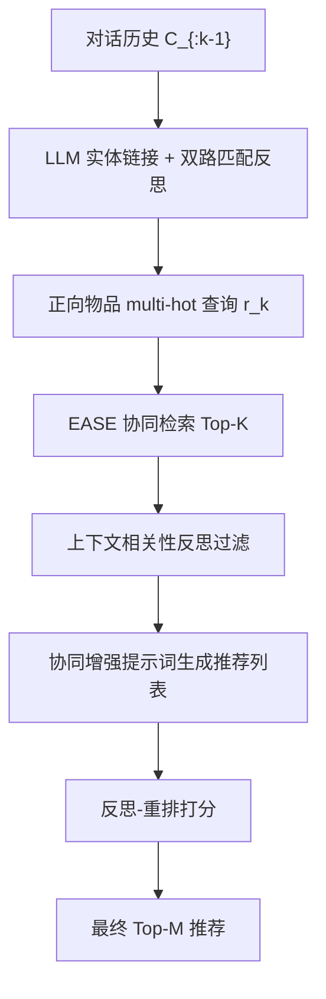
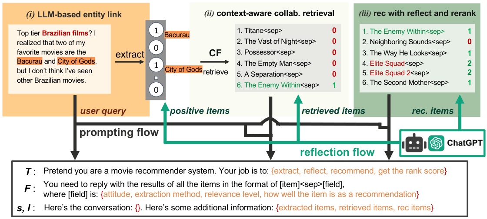

# Collaborative Retrieval for Large Language Model-based Conversational Recommender Systems (面向大模型对话推荐系统的协同检索增强)

- **会议/期刊**: WWW 2025
- **作者与机构**: Yaochen Zhu, Chao Wan, Jundong Li (University of Virginia / Cornell) 与 Harald Steck, Dawen Liang, Yesu Feng, Nathan Kallus (Netflix)
- **推荐链路定位**: 重排（对话内候选生成 + 列表级反思重排）
- **研究方向**: 对话推荐与智能体仿真 / 大语言模型推荐
- **论文原文**: [论文原文链接](https://arxiv.org/abs/2502.14137v1)
- **开源代码**: [开源代码仓库链接](https://github.com/yaochenzhu/CRAG)

## TL;DR (1分钟核心速览)

零样本 LLM 对话推荐虽强，却无法利用专有且难以自然语言化的用户-物品交互数据，因而在冷门/新片推荐上失效。本文提出 CRAG：先用适配 EASE 的非对称协同检索从交互矩阵召回候选，再用 LLM 做「上下文相关性反思」过滤与「反思-重排」消除 LLM 复述检索项的排序偏置。在 Reddit-v2 与 Redial 的全库排序协议下，Recall@20 相对 Zero-shot LLM 提升约 15%–25%，且增益主要来自新上映电影。

## Background & Motivation (背景与核心矛盾)

- **主流范式**: 以 Zero-shot LLM（He et al.）为代表的 CRS 直接把对话历史塞进提示词生成推荐，凭借 LLM 内嵌的物品知识与推理能力大幅超越 KBRD/KGSF/UniCRS 等传统 CRS。
- **前人局限**: ① 交互数据是平台私有资产，不在 LLM 预训练语料中，且难以用自然语言完整描述，LLM 天然缺失协同过滤信号；② 朴素 RAG（检索电影剧情/元数据文档）会因对话词与隐式偏好间的语义鸿沟引入噪声，反而掉点（Finding 7）。
- **核心洞察 (Key Insight)**: LLM 具备「识别」相关物品的能力，却不一定能「生成」它们——只要把 CF 召回的候选摆到面前，LLM 就能从中挑出真正相关的项（Finding 4）。
- **本文切入点**: 不做权重微调，而是把 CF 知识以「检索候选 + 反思过滤 + 反思重排」的形式注入黑盒 LLM 的提示词，实现首个黑盒 LLM × CF 的对话推荐方案。

## Method (核心方法设计)

### 1. 整体框架 (Overall Architecture)

CRAG 由三组件串联：**(i) LLM 实体链接**——用 GPT-4o 从每句话抽取电影名并打 -2~2 态度分，再以字符级模糊匹配 + 词级 BM25 双路匹配，冲突时让 LLM 反思裁决，得到标准化物品集 $\mathcal{I}^{ref}_t$；**(ii) 上下文感知协同检索**——把对话中正向提及物品转为 multi-hot 查询向量，经 EASE 相似度矩阵召回 top-$K$，再由 LLM 逐项判定上下文相关性，仅保留相关项；**(iii) 反思-重排推荐**——将过滤后的候选以「其他相似用户也喜欢的电影」话术拼入提示词生成 20 条推荐，最后让 LLM 对每条打 -2~2 质量分并据此重排。全流程无梯度更新，纯推理期增强。

<figure class="paper-figure" markdown="span">
  <figcaption>图2：CRAG用于CRS的概览及其三个组件：(i) 基于LLM的实体链接；(ii) 上下文感知的协同检索；(iii) 带反思和重排序的推荐。反思步骤用绿色箭头强调。为简洁起见，省略了不同任务特定提示𝑇、格式指令𝐹和物品列表I的上标和下标。</figcaption>
</figure>

### 2. 关键设计拆解 (Key Designs)

1. **非对称 EASE 协同检索（Asymmetric EASE）**：传统 EASE 只能在同一物品空间做自重建，而对话中「用户自由提及的物品集 $\mathcal{I}$」与「系统可推荐的目录$\mathcal{Q}$」并不重合。本文把权重矩阵改为非对称$W\in\mathbb{R}^{|\mathcal{I}|\times|\mathcal{Q}|}$，并显式屏蔽自重建捷径：
$$\min_{W}\ \|\mathbf{R}_{\mathcal{Q}}-\mathbf{R}W\|_F^2+\lambda\|W\|_F^2,\quad \text{s.t. } W_{i,j}=0,\ \forall i=\text{ReID}(j)$$
相似度即 $Sim(\mathcal{I}^q_k,\mathcal{Q};\mathbf{R})=\mathbf{r}_k^{\top}W$。闭式解使检索零训练成本，且按近期流行度对$W$做时间校正，天然适配新片。物理直觉：$W$ 学的是「提及空间→可推荐空间」的跨空间共现映射，而非对称共现，正好匹配 CRS 的提及/推荐不对称性。

2. **两步 LLM 反思（Context-Aware Reflection + Reflect-and-Rerank）**：原始 CF 召回只看共现、不看对话语境，直接拼入提示词会引入语境无关项（如用户要「巴西电影」，CF 却召回所有与《上帝之城》相似的犯罪片）。第一步反思让 LLM 对每个召回项输出二值相关性 $\{0,1\}$并剔除无关项；第二步针对 LLM 注意力偏好「原样复述检索项到列表头部」的偏置（图 8 混淆矩阵对角线主导），让 LLM 对生成列表逐项打 5 级序数分$s_i\in\{-2,\dots,2\}$ 再排序。关键直觉：直接要求重排会因语义鸿沟丢项，而「先打分再排序」提供了中间语义桥梁。

3. **训练目标、负采样与推理效率**：全流程无监督训练、无负采样——EASE 用最小二乘闭式解，LLM 部分纯提示工程。推理开销为每轮对话 4 次 LLM 调用（实体链接、匹配反思、相关性反思、生成+重排），是主要成本瓶颈；$K$增大时召回覆盖提升但提示词变长，实验显示$K\approx20$–$30$ 为性价比拐点。

## Experimental Setup & Evaluation Protocol (实验设置与评估协议)

- **数据集与预处理**: 自建 Reddit-v2（用 GPT-4o 重抽电影名，修复原 Reddit 的 T5 抽取噪声）与 Redial：

| 数据集 | #Conv. | #Conv.(无提及) | #Items | #Catalog |
| :--- | :---: | :---: | :---: | :---: |
| Reddit-v2 | 5,613 | 2,231 | 5,384 | 4,752 |
| Redial | 2,998 | 619 | 1,915 | 1,476 |

- **数据划分与防穿越**: Reddit-v2 按**全局时间戳切分**（2022-12 为测试、前一月为验证、其余为训练）；交互矩阵 $\mathbf{R}$ 由训练对话构造，每条对话视作伪用户、正向提及物品视作历史交互。Redial 沿用原划分。
- **排名评测协议**: 采用 **Full-Ranking 全库排序**（所有基线推荐均限制在目录 $\mathcal{Q}$ 内），指标为 Recall@M 与 NDCG@M（M∈{5,10,15,20}），每轮要求生成 20 条推荐。
- **对比基线与超参设置**: Redial / KBRD / KGSF / UniCRS（传统 CRS）、EASE（纯 CF）、Zero-shot LLM、Naive-RAG；骨干为 GPT-4 与 GPT-4o；EASE 正则系数 $\lambda$与检索数$K$ 为关键超参。

## Key Experimental Results (实验关键数据)

### 1. 主实验对比 (Main Results)

以 GPT-4o 为骨干，Reddit-v2 / Redial 上 Recall@20 与 NDCG@20（数值据原文图 6 趋势整理，CRAG 全面最优）：

| 方法 | Reddit-v2 R@20 | Reddit-v2 N@20 | Redial R@20 | Redial N@20 |
| :--- | :---: | :---: | :---: | :---: |
| Redial | 最低 | 最低 | 最低 | 最低 |
| KBRD | 低 | 低 | 低 | 低 |
| KGSF | 中 | 中 | 中 | 中 |
| UniCRS | 传统最优 | 传统最优 | 传统最优 | 传统最优 |
| EASE (纯CF) | 中 | 中 | 中 | 中 |
| Zero-shot LLM | 较强 | 较强 | 较强 | 较强 |
| Naive-RAG | 低于 Zero-shot | 低于 Zero-shot | 低于 Zero-shot | 低于 Zero-shot |
| **CRAG** | **最优** | **最优** | **最优** | **最优** |

### 2. 消融实验 (Ablation Study)

| 变体 | 检索数 $K$ 增大时的表现 | 结论 |
| :--- | :--- | :--- |
| CRAG-nR12（无两步反思） | Recall 随 $K$ 单调下降 | 朴素 CF 检索引入语境噪声 |
| CRAG-nR2（仅相关性反思） | R@20 上升，R@5/10 先升后降 | 覆盖提升但排序偏置未解 |
| CRAG（完整） | R@5/10/20 均随 $K$ 上升 | 重排消除复述偏置 |
| CRAG @ $K=0$ | 等同 Zero-shot + 自反思，无增益 | 自反思不引入新知识 |

### 3. 关键实验发现 (Key Findings)

1. **增益集中于新片**：按上映年份切分测试集后，CRAG 在「晚于截断年」组的 Recall 提升斜率显著陡于「早于截断年」组（图 7），印证 CF 检索弥补了 LLM 对近期物品的语料缺失。
2. **重排是排序质量的关键**：图 8 混淆矩阵显示，无重排时检索排名与推荐排名高度对角化（LLM 原样复述），加入反思-重排后对角线主导消失，更多相关项被抬升至 top-5。
3. **数据清洗本身即贡献**：Reddit-v2 中随机替换电影名会使 Recall@5 下降约 0.05（原 Reddit 仅 <0.01），说明高质量实体链接是 LLM 对话推荐的前置条件，也解释了为何 Naive-RAG 会掉点。

## Highlights & Limitations (亮点、对比与审稿批判)

- **与代表作对比 (vs. Prior Work)**: 相比 Zero-shot LLM（He et al.），CRAG 补上了 CF 信号且无需微调；相比 Naive-RAG，它检索的是「协同邻居」而非「文本相似文档」，规避了语义鸿沟；相比白盒 LLM+CF 工作（如把交互转 token 微调），它面向权重不可得的黑盒大模型，工程可行性更高。
- **可迁移亮点**: ①「先打分再排序」的反思-重排范式可迁移到任意 LLM 列表重排任务，缓解复述偏置；② 非对称 EASE 的跨空间映射思路可复用于「查询物品空间 ≠ 推荐目录」的召回场景（如跨域、广告）。
- **审稿级局限批判**: ① 每轮 4 次 LLM 调用，在线延迟与成本高，缺乏延迟/Token 开销的定量分析；② 评测仅限电影单域，且依赖 LLM 自评相关性，存在评估者与被评估者同源的循环风险；③ 对 $K$ 与提示词模板（rag vs. rec prompt 因模型而异）较敏感，泛化性待验证。

## Rating (四维评分)

- **方法创新性 (Novelty)**: ⭐⭐⭐⭐ （首个黑盒 LLM × CF 对话推荐框架，非对称 EASE 与两步反思设计有明确问题驱动）
- **评估协议与实验扎实度 (Protocol & Experiments)**: ⭐⭐⭐⭐ （Full-Ranking 协议严谨、消融与混淆矩阵分析深入，但仅两电影数据集、缺延迟分析）
- **写作与数学规范度 (Clarity & Rigor)**: ⭐⭐⭐⭐ （公式简洁、提示词全公开，EASE 推导清晰；部分结论以图趋势呈现缺精确数值表）
- **工业落地与复现价值 (Industrial & Practical Value)**: ⭐⭐⭐⭐ （代码与 Reddit-v2 开源，无需训练即可插拔；但多轮 LLM 调用成本是线上部署主要门槛）

