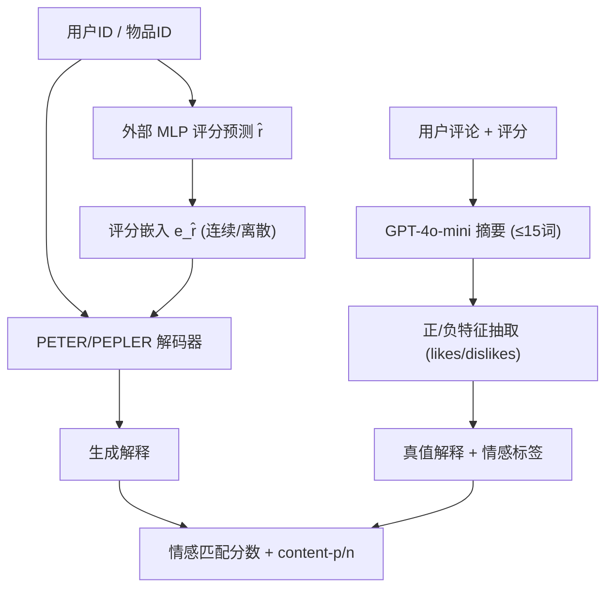

# Disentangling Likes and Dislikes in Personalized Generative Explainable Recommendation (个性化生成式可解释推荐中的喜恶解耦)

- **会议/期刊**: WWW 2025
- **作者与机构**: Ryotaro Shimizu, Takashi Wada, Yu Wang, Johannes Kruse, Sean O'Brien, Sai HtaungKham, Linxin Song, Yuya Yoshikawa, Yuki Saito, Fugee Tsung, Masayuki Goto, Julian McAuley（UCSD / ZOZO Research / Waseda / USC / HKUST 等）
- **推荐链路定位**: 端到端生成式（解释生成）
- **研究方向**: 对话推荐与智能体仿真 / 大语言模型推荐
- **论文原文**: [论文原文链接](https://arxiv.org/abs/2410.13248v2)
- **开源代码**: [开源代码仓库链接](https://github.com/jchanxtarov/sent_xrec)

## TL;DR (1分钟核心速览)

现有生成式可解释推荐把任务当作普通文本生成，仅用 BLEU/ROUGE/BERTScore 衡量与真值解释的文本相似度，完全忽略解释是否反映用户"喜欢什么/讨厌什么"的情感极性。本文用 GPT-4o-mini 从评论中分离抽取正/负观点，重构 Amazon/Yelp/RateBeer 三个数据集，并提出情感匹配分数与正负内容相似度两项指标。基准测试显示，BERTScore 高分模型的情感匹配仅约 0.52–0.54；而将预测评分作为输入注入 PETER/PEPLER 后，情感匹配最高提升至 0.5995（Amazon），使用真值评分时进一步提升 8.4%–17.1%。

## Background & Motivation (背景与核心矛盾)

- **主流范式**: 以 PETER、PEPLER、CER、ERRA 为代表的模型，从评论中抽取"特征+观点词"作为真值解释，训练 Transformer 在给定用户/物品 ID 时生成解释，并以 BLEU/ROUGE/BERTScore 及 FMR/FCR/DIV 评估。
- **前人局限一（数据噪声）**: 经典数据集（Li et al.）用情感分析工具包抽取，常丢弃混合情感中的一方——如表 1 首例仅保留正面"great start"，却漏掉"predictability / overdone body count"等负面意见；第二例甚至把整体极正面的评论抽成唯一负面词"bad"。
- **前人局限二（评估失真）**: 字符串/语义相似度无法判别情感极性。若真值为"喜欢剧情、不满画质"，模型生成"喜欢画质、不满剧情"，词面高度重叠仍得高分，但解释完全错误，会摧毁用户信任。
- **核心洞察 (Key Insight)**: 用户对同一物品常持混合情感，评分与情感呈非线性关系（图 2 显示评分升高时负面标签比例下降但并非线性），因此"关键词命中"不等于"情感正确"。
- **本文切入点**: 用 LLM 显式分离正负观点重建数据，并设计情感感知指标；同时验证"把（预测）评分直接作为输入条件"比"把评分预测当作辅助任务"更能生成情感一致的解释。

## Method (核心方法设计)

### 1. 整体框架 (Overall Architecture)

本文是"数据集+评估协议+轻量模型改造"三位一体的工作。数据侧：GPT-4o-mini 先对评论做 ≤15 词摘要作为真值解释，再从摘要中抽取 `likes`/`dislikes` 特征列表（零样本 ABSA）。评估侧：对生成解释同样抽取正负特征，据此计算情感匹配分数与正负内容相似度。模型侧：在 PETER/PEPLER 基础上移除评分预测辅助任务，改为将外部 MLP 预测的评分嵌入与用户/物品嵌入拼接后输入解码器，使每个词的自注意力都能直接条件于评分信息。

### 2. 关键设计拆解 (Key Designs)

1. **正负观点分离的数据构建与质量校验**：痛点是用工具包抽取会丢失混合情感的一方。做法是两阶段 LLM 提示——摘要阶段约束 ≤15 词以抑制幻觉，抽取阶段要求特征必须原文出现并输出 JSON。质量用 GPT-4o 自动评估 + 5 名人工标注交叉验证，事实性/上下文一致性/完整性各项均在 0.95 以上，GPT-4o 与人工判断一致率普遍 ≥0.95（表 4、表 5），证明 LLM 可作为可靠评估器。

2. **情感匹配分数 (sentiment-matching score)**：将解释按抽出的特征打三值标签——仅负面为 0、正负兼有为 1、仅正面为 2，指标定义为生成与真值标签一致的比例：
$\text{sentiment} = \frac{1}{|\mathcal{D}|}\sum_{(u,i)\in\mathcal{D}}\mathbb{I}\big[l(\hat{y}_{u,i}) = l(y_{u,i})\big]$其中$l(\cdot)$ 为上述三值映射。该设计直接惩罚"词对但极性反"的错误，弥补 BERTScore 的盲区。

3. **正负内容相似度 (content-p / content-n)**：分别对正、负特征串接后用 BERTScore（roberta-large）计算相似度；双方均无对应极性特征时记 1.0，一方有另一方无时记 0.0。这样把"是否识别出正确极性的特征"与"文本流畅度"解耦。

4. **评分条件注入与训练目标**：移除多任务评分预测，改为输入评分嵌入 $\boldsymbol{e}_{\tilde{r}_{u,i}}$，两种实现——连续式 `-c-emb` 用$\tilde{r}_{u,i}\cdot\boldsymbol{w}$，离散式 `-d-emb` 取整后查表。总损失即标准自回归负对数似然$\mathcal{L}=-\sum_{j}\log p(\hat{w}_j\mid \hat{w}_{<j},\boldsymbol{e}_u,\boldsymbol{e}_i,\boldsymbol{e}_{\tilde{r}_{u,i}})$，无负采样需求；推理时仅需一次前向解码，额外开销仅为一次 MLP 评分预测。

## Experimental Setup & Evaluation Protocol (实验设置与评估协议)

- **数据集与预处理**: 过滤少于 15 词的短评论，并沿用前作剔除交互少于 20 次的用户/物品（近似 20-core）：

| 数据集 | #Users | #Items | #Interactions | 正/负特征数 | 场景说明 |
| :--- | :---: | :---: | :---: | :---: | :--- |
| Amazon | 7,445 | 7,331 | 438,604 | 10,676 / 10,999 | 电影评论，评分上限 5 |
| Yelp | 11,780 | 10,148 | 504,184 | 8,826 / 9,252 | 餐厅评论，评分上限 5 |
| RateBeer | 2,743 | 7,452 | 512,370 | 5,672 / 3,284 | 酒类评论，评分上限 20 |

- **数据划分与防穿越**: 采用 `Leave-One-Out` 变体——每个用户最新一条交互为测试、次新一条为验证，其余为训练。
- **排名评测协议**: 本文为生成式解释任务，不涉及全库排序；评估为逐样本生成后计算 sentiment / content-p / content-n 及 BLEU-1/4、ROUGE-1/2、USR、BERTScore、FMR/FCR/DIV。
- **对比基线与超参设置**: 基线含 CER、ERRA、PETER、PEPLER、PEPLER-D 及本文改造版 `*-c/d-emb`；PEPLER 微调 GPT-2，PETER 从零训练；评分预测用独立 MLP（MAE 0.76–1.50，与多任务版本几乎持平，见表 9）。

## Key Experimental Results (实验关键数据)

### 1. 主实验对比 (Main Results)

| 方法 | Amazon sent.↑ | Amazon cont-p↑ | Amazon cont-n↑ | Yelp sent.↑ | Yelp cont-p↑ | Yelp cont-n↑ | RateBeer sent.↑ |
| :--- | :---: | :---: | :---: | :---: | :---: | :---: | :---: |
| CER | 0.5364 | 0.7131 | 0.6122 | 0.5265 | 0.7603 | 0.5519 | 0.6266 |
| ERRA | 0.5327 | 0.7243 | 0.6005 | 0.5275 | 0.7665 | 0.5435 | 0.6481 |
| PEPLER-D | 0.2842 | 0.4576 | 0.4935 | 0.3111 | 0.5252 | 0.4559 | 0.4633 |
| PETER | 0.5445 | 0.7130 | 0.6198 | 0.5238 | 0.7620 | 0.5483 | 0.6277 |
| PETER-d-emb | 0.5695 | 0.7234 | 0.6251 | 0.5744 | 0.8099 | 0.5692 | 0.6445 |
| PEPLER | 0.5691 | 0.7532 | 0.6228 | 0.5462 | 0.8027 | 0.5470 | 0.6445 |
| PEPLER-c-emb | 0.5935 | 0.7682 | 0.6337 | 0.5624 | 0.8080 | 0.5562 | 0.6449 |
| **PEPLER-d-emb** | **0.5995** | **0.7717** | **0.6363** | 0.5539 | 0.8011 | 0.5536 | **0.6697** |

（Yelp 上 sentiment 最优为 PETER-d-emb 0.5744；RateBeer 上 PETER-c-emb 0.6591 亦具竞争力。）

### 2. 消融实验 (Ablation Study)

| 配置 | Amazon sent.↑ | Yelp sent.↑ | RateBeer sent.↑ | 说明 |
| :--- | :---: | :---: | :---: | :--- |
| PETER（多任务评分） | 0.5445 | 0.5238 | 0.6277 | 基线 |
| PETER-d-emb（预测评分输入） | 0.5695 | 0.5744 | 0.6445 | 输入优于辅助任务 |
| PETER-d-emb+（真值评分输入） | 0.6259 (+9.9%) | 0.6609 (+15.0%) | 0.6616 (+2.6%) | 评分精度上限 |
| PEPLER-d-emb | 0.5995 | 0.5539 | 0.6697 | 基线 |
| PEPLER-d-emb+ | 0.6503 (+8.4%) | 0.6488 (+17.1%) | 0.6653 (−0.6%) | RateBeer 无增益 |

### 3. 关键实验发现 (Key Findings)

1. **现有指标与情感对齐严重脱节**：PETER 与 PEPLER 在 BERTScore 上均约 0.888–0.890、BLEU-1 约 0.36–0.37，差距微乎其微，但情感匹配相差可达 0.03–0.05；PEPLER-D 文本指标崩塌（BLEU-1 仅 0.0605）的同时情感匹配仅 0.2842，说明"词面相似"既不能保证也不能反映情感正确。
2. **评分作为输入 > 评分作为辅助任务**：`*-d-emb` 在三个数据集上全面超过原版，且离散嵌入普遍优于连续嵌入（Amazon 0.5995 vs 0.5935），作者归因于评分-情感的非线性关系（图 2）；表 9 显示各模型评分预测 MAE 几乎相同，证明增益来自"条件注入"而非"评分预测更准"。
3. **评分精度是情感对齐的上限瓶颈**：换用真值评分后 Amazon/Yelp 情感匹配提升 8.4%–17.1%；对真值评分加高斯噪声后性能急剧下降（图 5），而 RateBeer 因训练/测试集情感分布不一致（图 4）几乎无增益，揭示数据分布一致性是该机制生效的前提。

## Highlights & Limitations (亮点、对比与审稿批判)

- **与代表作对比 (vs. Prior Work)**: 相比 Li et al. 的工具包抽取数据集，本文用 LLM 保留混合情感双方；相比 Ma et al. 仅让 GPT-3.5 生成"为何喜欢"，本文显式分离 likes/dislikes；相比 CER 用辅助损失对齐评分与解释隐状态，本文直接把评分嵌入喂入解码器，让每个词都条件于评分，机制更直接且实验更优。
- **可迁移亮点**: ①"LLM 抽取 + 三值情感标签 + 极性分离 BERTScore"的评估范式可迁移到评论摘要、推荐理由生成等任何需要极性正确性的生成任务；②"把标量预测值离散化查表后拼入解码器输入"是低成本注入用户偏好的通用技巧。
- **审稿级局限批判**: ①真值解释与评估均依赖 GPT-4o-mini/4o，存在评估器与被评估分布同源的自洽偏差，且 15 词截断牺牲了解释丰富度；②情感仅三值粗粒度，未建模强度与多特征级极性；③RateBeer 上机制失效暴露了方法对训练/测试情感分布一致性的强依赖，泛化性存疑。

## Rating (四维评分)

- **方法创新性 (Novelty)**: ⭐⭐⭐ （模型改造本身较朴素，核心贡献在问题定义与评估范式，属"揭示盲区"型工作）
- **评估协议与实验扎实度 (Protocol & Experiments)**: ⭐⭐⭐⭐ （三领域数据集 + 人工/LLM 双重质检 + 真值评分与噪声扰动分析，协议设计完整）
- **写作与数学规范度 (Clarity & Rigor)**: ⭐⭐⭐⭐ （指标定义清晰、案例对照直观，公式较简洁，缺少对情感标签映射合理性的理论论证）
- **工业落地与复现价值 (Industrial & Practical Value)**: ⭐⭐⭐⭐ （代码与数据开源，评分注入仅增一次 MLP 开销，可直接用于提升解释可信度）

