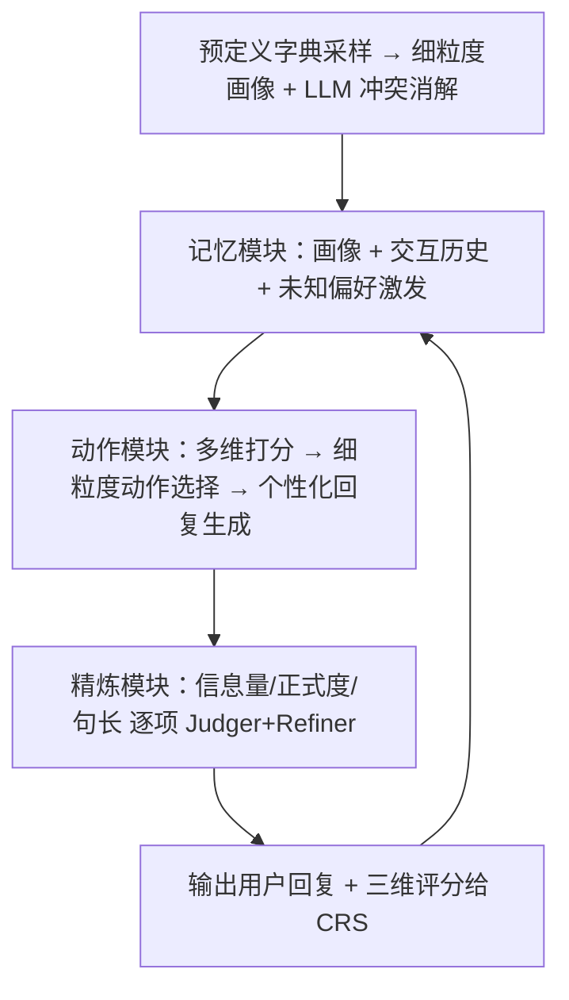
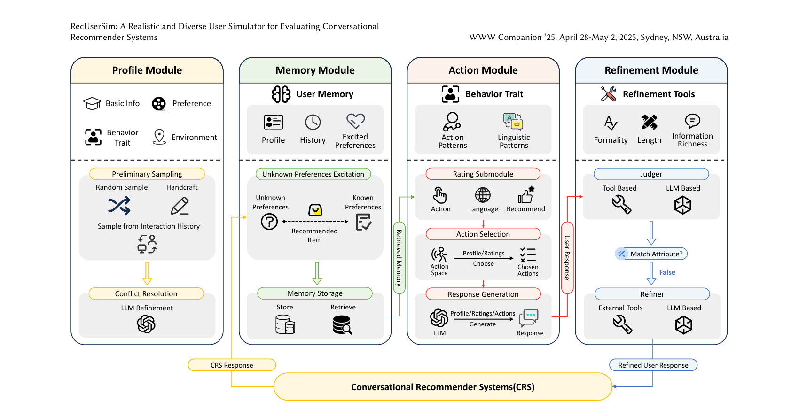

# RecUserSim: A Realistic and Diverse User Simulator for Evaluating Conversational Recommender Systems (面向对话推荐系统评测的真实多样用户模拟器)

- **会议/期刊**: WWW Companion 2025 (Industry Track)
- **作者与机构**: Luyu Chen, Quanyu Dai, Zeyu Zhang, Xueyang Feng, Mingyu Zhang, Pengcheng Tang, Xu Chen, Yue Zhu, Zhenhua Dong（中国人民大学高瓴人工智能学院 & 华为诺亚方舟实验室 & 华为）
- **推荐链路定位**: 评测/仿真（CRS 离线评估与工业开发闭环）
- **研究方向**: 对话推荐与智能体仿真 / 大语言模型推荐
- **论文原文**: [https://arxiv.org/abs/2507.22897v1](https://arxiv.org/abs/2507.22897v1)
- **开源代码**: 暂未开源

## TL;DR (1分钟核心速览)

对话推荐系统（CRS）的离线指标评测割裂了"推荐准确率"与"对话质量"，而在线真人测试成本高不可扩展；现有 LLM 用户模拟器（iEvaLM、CSHI）又存在语言风格单一、动作空间僵化、缺乏显式打分三大硬伤。本文提出 RecUserSim，以画像—记忆—动作—精炼四模块 Agent 框架，将有限理性理论落地为"Rating-Action-Response"三层机制，并配合工具增强的语言精炼器实现可控输出。在无约束餐饮推荐场景下，RecUserSim 在 6 项主观指标上全面胜出，输出多样性分布显著更均匀，且跨 gpt-4o/gpt-4o-mini/glm-4-9b 三种底座的动作评分 Pearson 相关达 0.98–0.99（$p<0.05$），并在华为 Celia 餐饮助手的工业部署中与 6 名人工标注者结论基本对齐。

## Background & Motivation (背景与核心矛盾)

- **主流范式**: CRS 评测长期依赖两类手段——基于固定 benchmark 的 turn-level 指标（HR/NDCG 评推荐、BLEU/ROUGE 评对话），以及规则/模板驱动的用户模拟器（如 CRS 对话流程脚本）来跑完整多轮交互。
- **前人局限**: 其一，固定 benchmark 的"ground-truth 对话"忽略了动态交互过程，严重低估 CRS 真实能力；规则模拟器缺乏灵活性与适应性，无法模拟真实用户在动态对话中的行为。其二，LLM 模拟器仍不足：单 prompt 方案（iEvaLM、PEARL）语言风格被底座模型锁死、对话流程重复；Agent 方案（CSHI）虽引入画像与动作模块，但动作空间仅 3 个预定义动作、画像粗粒度，导致行为僵化且缺乏对输出的细粒度控制。
- **核心洞察 (Key Insight)**: 一个理想的模拟器必须同时满足"个体真实角色扮演"与"大规模人群多样性"两个目标，而这两者的缺失根源在于——画像不够细粒度、决策过程未被显式建模、生成语言未被显式约束。此外，现有模拟器普遍缺少显式打分机制，无法对 CRS 做定量评估。
- **本文切入点**: 用细粒度画像 + 冲突消解保证"人设真实"，用有限理性三层动作机制保证"决策真实"，用工具增强精炼器保证"语言可控"，用多维打分保证"评估可量化"。

## Method (核心方法设计)

### 1. 整体框架 (Overall Architecture)

RecUserSim 是一个 LLM 自主 Agent，四模块闭环运转：**画像模块**从预定义字典按先验分布随机采样四类属性（基本信息、环境信息、偏好、行为特质），再用 LLM 做冲突消解（如"不吃辣却偏爱川菜"这类矛盾组合）；**记忆模块**存储画像与交互历史，并通过未知偏好激发机制动态发现潜在兴趣；**动作模块**接收 CRS 回复后，依次执行多维打分、细粒度动作选择、个性化回复生成；**精炼模块**对生成回复按语言模式逐项微调，最终输出给 CRS。整个流程无需训练，纯推理驱动，可直接换底座模型。

<figure class="paper-figure" markdown="span">
  <figcaption>图1：RecUserSim 概览，包含四个模块：画像、记忆、动作和精炼。画像模块构建用户画像并解决其冲突。该画像与交互历史一起存储在记忆模块中。基于这些信息，动作模块对 CRS 的回复进行评分，选择适当的动作并生成回复。最后，精炼模块对这些回复进行微调，以贴合用户的语言模式。</figcaption>
</figure>

### 2. 关键设计拆解 (Key Designs)

1. **有限理性三层 "Rating-Action-Response" 机制（核心创新）**：痛点在于现有模拟器把"评价—决策—表达"压缩成一步生成，行为不可控。本文借经济学有限理性模型，将用户决策显式拆为三步：先做**多维打分**（语言质量 1–5、动作质量 1–5、推荐质量 = 客观分 1–5 + 主观修正项 $\in[-1,+1]$），再据打分做**细粒度动作选择**（5 类动作：请求推荐/澄清偏好/反馈/属性询问/结束对话，且允许多动作并发），最后做**个性化回复生成**。推荐质量公式为$s_{\text{rec}} = s_{\text{obj}} + \sum_{k}\delta_k,\ \delta_k\in[-1,1]$，其中$\delta_k$ 刻画"爱尝鲜""价格敏感"等个体倾向。这样改的直觉是：打分先于动作、动作先于语言，与真人"先判断再决定再开口"的认知顺序一致，因而行为分布更接近真实用户。

2. **未知偏好激发 + 工具增强精炼（真实性与可控性双补丁）**：前者针对"用户未必自知偏好"这一被 [44] 忽略的事实——若推荐项不在已知偏好中但高度契合口味，LLM 将其判定为新偏好并写入记忆，实现兴趣的动态演化而非预定义隐藏。后者针对 LLM 难以同时满足多重输出约束的问题，设计三个专用工具（信息量、正式度、句长），每个工具含 Judger（规则或 LLM 判定是否达标）与 Refiner（不达标则改写），串行逐项施加约束；结束对话类动作可关闭精炼以省开销。

3. **训练目标、负采样与推理效率**：本文**无参数训练、无负采样**，全部依赖底座 LLM 的 in-context 推理；"训练"仅体现为精炼工具的 in-context 示例构造。推理开销主要来自每轮多次 LLM 调用（打分 + 动作 + 生成 + 最多 3 次精炼），作者通过"结束对话时跳过精炼"与"规则型 Judger 处理句长"来压缩调用次数；实验证明 glm-4-9b-chat 这类小底座仍可维持较高质量，说明成本可下探。

## Experimental Setup & Evaluation Protocol (实验设置与评估协议)

- **数据集与场景**: 本文不使用传统交互数据集，而是构建**无约束餐饮推荐场景**（推荐不受真实地理位置与营业状态限制），每个模拟器与同一 CRS 交互生成 **500 条对话**用于统计。对比基线为 iEvaLM（单 prompt）与 CSHI（Agent 式），二者原为电影推荐设计，作者改写其 prompt 与插件参数以适配餐饮场景；配套自建 gpt-4o-mini 单 prompt CRS 用于交互。

- **底座模型与评测协议**: 模拟器底座覆盖 gpt-3.5-turbo、gpt-4o-mini、gpt-4o，并额外用本地 glm-4-9b-chat 验证鲁棒性。主观评测采用 **pairwise 胜率**：每条对话由 gpt-4o 作为 judge 在 6 项指标（单轮输出质量、单轮交互质量、整体对话质量三维度细分）上做 win/draw/loss 判定，聚合 500 次得胜率。客观评测分析句长、信息量、正式度三类输出的**分布均匀度**（越均匀越多样）。评分可靠性用 **Pearson / Spearman 相关系数**跨底座一致性衡量，显著性标准 $p<0.05$。

- **对比基线与超参**: 评分可靠性实验对比 6 个 CRS 模型（BaseCRS 与 AgentCRS 各配 gpt-3.5-turbo / gpt-4o-mini / gpt-4o 三种底座）；工业部署对比华为 Celia Food Assistant 的 Demo 版与 Online 版，并由 6 名评估者对每版随机 100 条对话做同标准人工标注。

## Key Experimental Results (实验关键数据)

### 1. 主实验对比 (Main Results)

**主观胜率（vs. 同底座 gpt-4o-mini，500 条对话 pairwise）**：RecUserSim 在全部 6 项指标上胜率均高于 iEvaLM 与 CSHI；即便换成 glm-4-9b-chat 小底座，除"自然度"外多数指标仍胜过跑在 gpt-4o 上的 iEvaLM。

**评分可靠性（RecUserSim 对 6 个 CRS 的三维打分，节选 gpt-4o 底座）**：

| CRS 模型 | 底座 | Action | Language | Recommendation |
| :--- | :---: | :---: | :---: | :---: |
| BaseCRS | gpt-3.5-turbo | 4.48 | 4.97 | 3.96 |
| BaseCRS | gpt-4o-mini | **4.79** | 4.99 | **4.01** |
| BaseCRS | gpt-4o | 4.75 | **4.99** | 3.97 |
| AgentCRS | gpt-3.5-turbo | 3.63 | 4.98 | 3.76 |
| AgentCRS | gpt-4o-mini | 4.30 | 4.99 | 3.98 |
| AgentCRS | gpt-4o | 4.43 | **5.00** | 3.98 |

**跨底座评分一致性**：

| 对比组合 | Action Pearson | Action Spearman | Rec Pearson | Rec Spearman |
| :--- | :---: | :---: | :---: | :---: |
| gpt-4o vs gpt-4o-mini | **0.99*** | **0.88*** | 0.62 | 0.51 |
| gpt-4o vs glm-4-9b | **0.98*** | **0.82*** | 0.53 | **0.81*** |
| gpt-4o-mini vs glm-4-9b | **0.99*** | **0.89*** | **0.87*** | **0.81*** |

**工业部署（Celia Food Assistant，RecUserSim 4o-mini/4o vs 人工）**：

| 版本 | 指标 | RecUserSim | Human |
| :--- | :--- | :---: | :---: |
| Demo | Action | 3.37 / 3.30 | 2.16 |
| Demo | Language | 4.13 / 4.71 | 4.77 |
| Demo | Recommendation | 2.36 / 2.04 | 2.06 |
| Online | Action | 3.84 / 3.96 | 3.81 |
| Online | Language | 4.24 / 4.89 | 4.90 |
| Online | Recommendation | 2.99 / 2.59 | 3.53 |

### 2. 消融实验 (Ablation Study)

原文未提供严格的模块移除式消融表，而是以**模块级对照**形式呈现（RecUserSim vs. 缺少对应模块的基线）：

| 配置 | 画像 | 记忆/偏好激发 | 三层动作 | 精炼 | 主观胜率 | 输出多样性 |
| :--- | :---: | :---: | :---: | :---: | :---: | :---: |
| iEvaLM | 粗粒度 | ✗ | 单步生成 | ✗ | 基准 | 偏正式、高信息量（偏斜） |
| CSHI | 基础 | 基础 | 3 动作 | ✗ | 低于本文 | 偏正式、低信息量（偏斜） |
| RecUserSim (glm-4-9b) | 细粒度 | ✓ | 5 动作+并发 | ✓ | 多数指标胜 iEvaLM(gpt-4o) | 较均匀 |
| RecUserSim (gpt-4o-mini) | 细粒度 | ✓ | 5 动作+并发 | ✓ | **全面最优** | **最均匀** |

### 3. 关键实验发现 (Key Findings)

1. **动作评分跨底座高度一致（Pearson 0.98–0.99，Spearman 0.82–0.89，均 $p<0.05$），但推荐评分相关性仅 0.51–0.87**：说明"动作质量"是模拟器可稳定复现的强信号，而"推荐质量"因同类模型分数差异本就微小（如 3.96 vs 4.01），相关系数被放大失真——这提示工业界用模拟器做 CRS 排序时，应优先信任动作维度、对推荐维度做多次采样平均。
2. **AgentCRS 的动作评分反而低于 BaseCRS（4.43 vs 4.75，gpt-4o 底座）**：尽管 AgentCRS 框架更复杂，但其受限的动作空间削弱了行为适应性，被模拟器准确捕捉——这直接证明 RecUserSim 的打分机制具备区分"框架复杂度"与"真实交互能力"的判别力，而非简单偏好大模型。
3. **工业部署中 Demo 版推荐分（2.04–2.36）与人工（2.06）高度吻合，Online 版人工给 3.53 而模拟器给 2.59–2.99**：说明模拟器在"差系统"上判得准、在"好系统"上偏保守，可能源于模拟器对推荐质量的客观分上限约束较严；但整体趋势（Online > Demo）与人工一致，验证了其作为开发期快速迭代信号的价值。

## Highlights & Limitations (亮点、对比与审稿批判)

- **与代表作对比 (vs. Prior Work)**: 相比 iEvaLM 的单 prompt 单步生成，本文把决策拆成打分—动作—语言三层，行为可控性从"不可控"变为"逐项可调"；相比 CSHI 的 3 动作 + 粗画像，本文扩到 5 动作且支持并发、画像四维细粒度并带冲突消解；相比 PEARL 等依赖预定义隐藏偏好，本文的未知偏好激发允许兴趣真正"涌现"。
- **可迁移亮点**: 其一，"Judger + Refiner"串行约束工具链可直接迁移到任何需要多约束可控生成的推荐场景（如可解释理由的风格控制）；其二，"先打分后动作"的显式决策分解，可复用到 RL 用户模拟环境的状态-动作设计。
- **审稿级局限批判**: 其一，每轮需多次 LLM 调用（打分 + 动作 + 生成 + 最多 3 次精炼），大规模评测的 token 成本与延迟未量化，工业可扩展性存疑；其二，评测完全依赖 gpt-4o 作为 judge 做胜率判定，存在 judge 与被评模型同源（均为 GPT 系）的偏置风险，且无约束餐饮场景与真实有约束环境存在分布差距，泛化性待验证。

## Rating (四维评分)

- **方法创新性 (Novelty)**: ⭐⭐⭐⭐ （将有限理性理论落地为可执行的三层 Agent 机制，配合工具链精炼，思路清晰且工程可落地，但各模块均为已有技术的组合式创新）
- **评估协议与实验扎实度 (Protocol & Experiments)**: ⭐⭐⭐ （500 对话 × 多底座 × 跨模型相关性分析较完整，并有工业人工对齐，但缺严格模块消融、依赖 LLM judge、无约束场景削弱说服力）
- **写作与数学规范度 (Clarity & Rigor)**: ⭐⭐⭐⭐ （四模块结构叙述清楚、图示完整，但全文几乎无形式化公式，评分机制仅文字描述，理论严谨度偏弱）
- **工业落地与复现价值 (Industrial & Practical Value)**: ⭐⭐⭐⭐ （已在华为 Celia 餐饮助手真实部署并与人工对齐，小底座可跑，落地价值明确；但代码未开源，复现需自行重建 prompt 与工具链）

