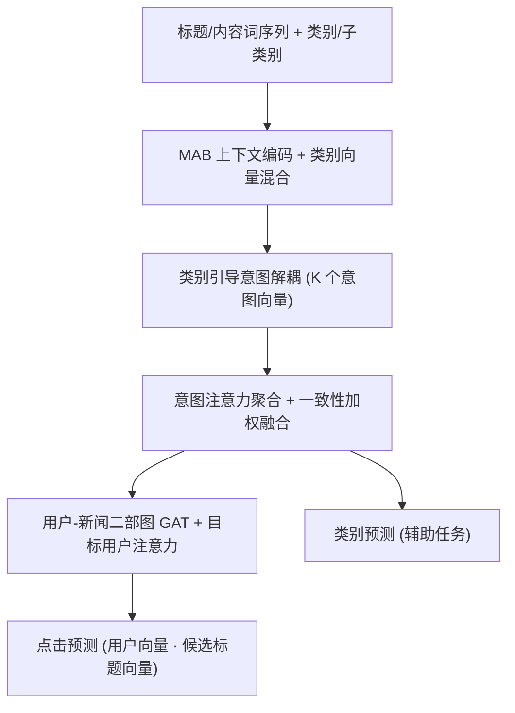
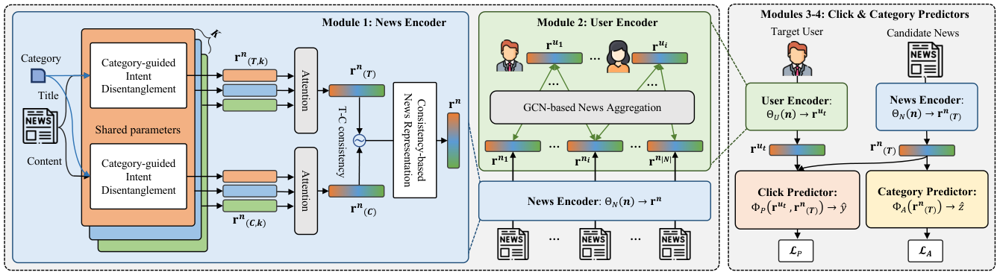

# CROWN: A Novel Approach to Comprehending Users' Preferences for Accurate Personalized News Recommendation (类别引导意图解耦与一致性新闻表征的个性化新闻推荐)

- **会议/期刊**: WWW 2025
- **作者与机构**: Yunyong Ko (Chung-Ang University), Seongeun Ryu, Sang-Wook Kim (Hanyang University)
- **推荐链路定位**: 精排（点击预测）
- **研究方向**: 冷启动与长尾推荐 / 多模态推荐（文本多视图）
- **论文原文**: [https://arxiv.org/abs/2310.09401v6](https://arxiv.org/abs/2310.09401v6)
- **开源代码**: [https://github.com/seongeunryu/crown-www25](https://github.com/seongeunryu/crown-www25)

## TL;DR (1分钟核心速览)

新闻推荐长期受困于三个未被联合解决的问题：单篇新闻耦合多重意图、点击≠满意（读后偏好差异）、冷启动用户历史极少。CROWN 提出类别引导的意图解耦（把标题/内容拆成 $K$ 个意图向量）、基于标题-内容一致性的新闻表征（用余弦一致性调节内容注入权重）、以及 GNN 增强的混合用户表征（内容聚合 + 协同信号），并以类别预测为辅助任务提供额外监督。在 MIND-small 与 Adressa 上，AUC/MRR/nDCG@5/nDCG@10 全面超越 12 个 SOTA，Adressa 上相对最强基线 CNE-SUE 分别提升 4.78%/11.71%/18.82%/11.38%，冷启动用户子集上亦领先 3.8%–7.6%。

## Background & Motivation (背景与核心矛盾)

- **主流范式**: 新闻编码器（NRMS/NAML 类自注意力 + 类别元数据）产出新闻向量，用户编码器（注意力聚合或 GNN）聚合点击历史，内积做点击预测。
- **前人局限**: 其一，现有方法把新闻压成单一向量，无法刻画"天气预报=提供信息+提升关注度、政治新闻=提供信息+说服立场"这类**同类别共享、跨类别分化**的意图结构；其二，点击历史中混入了"标题吸引但内容不符"的低读后偏好样本，直接聚合会污染用户画像；其三，纯依赖点击历史的用户编码器在点击少于 5 条的用户上几乎失效。
- **核心洞察 (Key Insight)**: 作者用两组预实验支撑假设——图 2 左显示同类别新闻的意图分布高度相似、跨类别显著分化，说明**类别可作为意图解耦的先验**；图 2 右显示标题-内容一致性与用户内容阅读时长的 Pearson 相关系数集中在 0.5–0.9 区间，说明**一致性可作为读后偏好的无监督代理**。
- **本文切入点**: 用类别先验驱动意图解耦、用一致性分数做内容注入的门控、用用户-新闻二部图引入协同信号，三者正交可叠加，且全程不依赖阅读时长等额外反馈。

## Method (核心方法设计)

### 1. 整体框架 (Overall Architecture)

CROWN 由两个编码模块与两个预测模块构成。新闻编码器先对标题/内容词序列做 MAB 上下文编码并平均池化得 $\mathbf{r}_n^T,\mathbf{r}_n^C$，同时把类别与子类别拼接映射为类别向量$\mathbf{c}_{n*}$；随后以$\mathbf{c}_{n*}$为条件，将标题与内容各自解耦为$K$个意图向量，经意图级注意力聚合为$\mathbf{r}_n^{(T)},\mathbf{r}_n^{(C)}$，再由一致性分数$cs_n$ 加权融合成最终新闻向量。用户编码器在用户-新闻二部图上做 GAT 传播，得到用户查询向量，再对历史新闻做目标用户感知的注意力聚合。最后点击预测器用用户向量与**候选新闻的标题向量**内积打分（模拟用户仅见标题的决策场景），类别预测器作为辅助任务回传梯度。

<figure class="paper-figure" markdown="span">
  <figcaption>图 3：CROWN 概览：两个编码模块（模块 1-2）和两个预测模块（模块 3-4）。</figcaption>
</figure>

### 2. 关键设计拆解 (Key Designs)

1. **类别引导意图解耦 (Category-guided Intent Disentanglement)**：痛点是把新闻压成单向量会抹平多意图。做法是以类别-子类别混合向量 $\mathbf{c}_{n*}=(\mathbf{c}_n\oplus\mathbf{sc}_n)\mathbf{W}_{mix}+\mathbf{b}_{mix}$为条件，对标题与内容**共享同一组解耦参数**生成$K$ 个意图向量：

$$\mathbf{r}_n^{(T,k)}=\sigma\big((\mathbf{r}_n^T\oplus\mathbf{c}_{n*})\mathbf{W}_k+\mathbf{b}_k\big),\quad \mathbf{r}_n^{(C,k)}=\sigma\big((\mathbf{r}_n^C\oplus\mathbf{c}_{n*})\mathbf{W}_k+\mathbf{b}_k\big)$$

直觉是：同类别新闻共享意图基底，类别条件相当于给解耦层一个"意图词典"的先验锚点，避免 $K$ 个槽位退化为无意义的随机划分；标题与内容共享参数则强制二者在同一意图语义空间对齐，为后续一致性计算提供可比性。

2. **一致性驱动的新闻表征 (Consistency-based News Representation)**：痛点是点击历史中"标题党"样本污染用户画像。先对 $K$个意图向量做注意力聚合得$\mathbf{r}_n^{(T)},\mathbf{r}_n^{(C)}$，再计算一致性$cs_n=\frac{\cos(\mathbf{r}_n^{(T)},\mathbf{r}_n^{(C)})+1}{2}\in[0,1]$，最终新闻向量为

$$\mathbf{r}_n=\mathbf{r}_n^{(T)}+cs_n\cdot\mathbf{r}_n^{(C)}$$

即内容信息按一致性**软门控**注入：标题与内容越一致，内容贡献越大；不一致时内容被压制，等价于把低读后偏好样本的噪声源掐断。这一设计无需阅读时长标签，把"读后偏好"转化为可端到端学习的几何量。

3. **GNN 增强混合用户表征与训练目标**：在用户-新闻二部图上做 GAT 传播 $\mathbf{R}_u=\sigma(\mathbf{A}\mathbf{R}_n\mathbf{W}_g^l+\mathbf{b}_g^l)$、$\mathbf{R}_n=\sigma(\mathbf{A}^\top\mathbf{R}_u\mathbf{W}_g^l+\mathbf{b}_g^l)$，用户向量由 GNN 学到的查询向量对历史新闻做注意力聚合，从而在少量点击下也能借协同信号补全兴趣。总损失为$\mathcal{L}=\mathcal{L}_P+\beta\mathcal{L}_A$，其中$\mathcal{L}_P$为 1 正$M$负的 softmax 交叉熵（均匀随机负采样），$\mathcal{L}_A$为类别预测交叉熵；$\beta$控制辅助任务权重，实验显示$0.3\le\beta\le 0.5$最优，$\beta\ge 0.6$ 反而劣于不用辅助任务。

## Experimental Setup & Evaluation Protocol (实验设置与评估协议)

- **数据集与预处理**:

| 数据集 | #Users | #Items | #Interactions | 稀疏度/密度 | 特征/场景说明 |
| :--- | :---: | :---: | :---: | :---: | :--- |
| MIND-small | 94,057 | 65,238 | 347,727 | 密度约 5.7e-5 | 英文新闻，18 类（270 子类），标题均长 11.67 词 |
| Adressa-1week | 601,215 | 73,844 | 2,107,312 | 密度约 4.7e-5 | 挪威语新闻，108 类（151 子类），内容均长 552 词 |

- **数据划分与防穿越 (Splitting Strategy)**: 沿用新闻推荐惯例的按时间/会话切分（训练-验证-测试三段），以验证集 AUC 最大化为模型选择准则，测试集报告五次运行均值。
- **排名评测协议 (Ranking Protocol)**: 采用 `Sampled Ranking`——每个正例随机采 $M$ 个未点击新闻作负例，报告 AUC、MRR、nDCG@5、nDCG@10；未做全库 Full-Ranking，这是本文评估协议的主要局限。
- **对比基线与超参设置**: 对比 12 个基线，覆盖通用 CTR（LibFM、DSSM）、新闻推荐（NPA、NRMS、NAML、LSTUR、FIM、HieRec、CNE-SUE、DIGAT、GLORY）与鲁棒表征（MCCM）；所有方法统一使用 GloVe 预训练词向量以保证公平；显著性用 95% 置信度 t 检验，$p<0.05$。

## Key Experimental Results (实验关键数据)

### 1. 主实验对比 (Main Results)

| 数据集 | 指标 | 最强基线 CNE-SUE | MCCM | CROWN | Improv.% |
| :--- | :--- | :---: | :---: | :---: | :---: |
| MIND | AUC | 0.6761 | 0.6795 | **0.6857** | +0.91% |
| MIND | MRR | 0.3219 | 0.3276 | **0.3405** | +3.94% |
| MIND | nDCG@5 | 0.3572 | 0.3662 | **0.3783** | +3.30% |
| MIND | nDCG@10 | 0.4203 | 0.4266 | **0.4384** | +2.77% |
| Adressa | AUC | 0.8074 | — | **0.8460** | +4.78% |
| Adressa | MRR | 0.5073 | — | **0.5667** | +11.71% |
| Adressa | nDCG@5 | 0.5021 | — | **0.5966** | +18.82% |
| Adressa | nDCG@10 | 0.5712 | — | **0.6362** | +11.38% |

### 2. 消融实验 (Ablation Study)

新闻编码器组件消融（I.D.=意图解耦，C.I.=类别信息，C.R.=一致性表征）：

| 配置 | MIND AUC | MIND nDCG@10 | Adressa AUC | Adressa nDCG@10 |
| :--- | :---: | :---: | :---: | :---: |
| Baseline | 0.6624 | 0.4095 | 0.7789 | 0.5546 |
| + I.D. | 0.6725 | 0.4171 | 0.8088 | 0.5886 |
| + C.R. | 0.6731 | 0.4182 | 0.7977 | 0.5868 |
| + C.I. | 0.6684 | 0.4151 | 0.7829 | 0.5704 |
| + I.D. + C.R. | 0.6764 | 0.4194 | 0.8215 | 0.5913 |
| + I.D. + C.I. | 0.6806 | 0.4259 | 0.8385 | 0.6035 |
| + C.I. + C.R. | 0.6793 | 0.4230 | 0.8343 | 0.6032 |
| 全量 CROWN | **0.6857** | **0.4384** | **0.8460** | **0.6362** |

用户编码器消融（MIND / Adressa 的 nDCG@10）：AVG 0.4174/0.5809，ATT 0.4208/0.5851，GNN 0.4211/0.5905，Hybrid **0.4384/0.6362**（相对 AVG 提升 5.03%/9.52%）。

### 3. 关键实验发现 (Key Findings)

1. **意图解耦是最大贡献项，但需类别先验才能完全释放**：单组件配置中 I.D. 在 Adressa 上把 AUC 从 0.7789 拉到 0.8088（+3.8%），显著高于单用 C.R.（0.7977）与 C.I.（0.7829）；而双组件配置中 I.D.+C.I.（0.8385）优于 I.D.+C.R.（0.8215），说明类别信息本身不直接提分，其价值在于为解耦提供监督锚点——这也解释了为何辅助类别预测任务在 $\beta\in[0.3,0.5]$时有效、$\beta\ge0.6$ 时反而过拟合辅助任务而掉点。
2. **一致性门控在长内容数据集上收益更大**：Adressa 内容均长 552 词（MIND 仅 41 词），C.R. 单组件在 Adressa 上带来 nDCG@10 +5.8%，而在 MIND 上仅 +2.1%，印证了"内容越长、标题-内容错配风险越高、门控价值越大"的机制解释。
3. **冷启动场景下混合用户表征的边际价值被放大**：在点击少于 5 条的用户子集上，CROWN 相对最强基线 GLORY/CNE-SUE 在 Adressa 上 AUC +5.57%、nDCG@5 +7.61%，且相对全量用户结果的性能衰减幅度明显小于所有竞争者，说明 GNN 协同信号在历史稀疏时承担了主要补全作用，而非仅锦上添花。

## Highlights & Limitations (亮点、对比与审稿批判)

- **与代表作对比 (vs. Prior Work)**: 相比 CNE-SUE（协同新闻编码 + GCN 用户编码），CROWN 的差异在于把"解耦"从用户侧前移到新闻侧，并用类别先验约束解耦语义；相比 HyperNews（同时考虑新鲜度与活跃时间），CROWN 不依赖任何额外反馈，仅用标题-内容一致性这一内蕴信号替代阅读时长；相比 GLORY（全局+局部用户表征），CROWN 的冷启动增益来自图传播与一致性门控的叠加而非单纯全局先验。
- **可迁移亮点**: 其一，"一致性分数做软门控"可平移到图文电商/短视频的多模态融合——用跨模态余弦一致性调节副模态注入权重，天然抑制标题党式噪声；其二，把类别预测作为辅助任务来正则化解耦槽位，是一种低成本、无需额外标注的解耦监督范式，可迁移到多兴趣召回的多向量解耦。
- **审稿级局限批判**: 其一，评估全程采用采样排序（1 正 $M$负），未报告 Full-Ranking 结果，在候选池扩大时排序指标的可靠性存疑，且采样负例分布与线上曝光分布存在偏差；其二，冷启动定义仅按"点击少于 5 条"切分，未做严格的零交互用户或时间戳切分实验，且 GNN 用户节点随机初始化意味着真正零历史用户仍无法获得协同信号，冷启动结论的边界被弱化；此外$K$与$\beta$两个关键超参的敏感性分析被放在附录，正文仅给出$\beta$ 的粗略区间。

## Rating (四维评分)

- **方法创新性 (Novelty)**: ⭐⭐⭐⭐ （把意图解耦从用户侧迁移到新闻侧并以类别先验锚定，配合一致性软门控，机制组合新颖且有预实验支撑，但单点技术均为已有算子的重组）
- **评估协议与实验扎实度 (Protocol & Experiments)**: ⭐⭐⭐ （12 个基线 + 双数据集 + t 检验 + 冷启动子集分析较完整，但仅采样排序、缺 Full-Ranking 与严格零交互冷启动划分，削弱了结论强度）
- **写作与数学规范度 (Clarity & Rigor)**: ⭐⭐⭐⭐ （三大挑战与三模块一一对应、公式简洁、图 2 预实验与图 5 可视化形成闭环论证，复杂度分析置于附录稍显隐蔽）
- **工业落地与复现价值 (Industrial & Practical Value)**: ⭐⭐⭐⭐ （代码与数据已开源，不依赖阅读时长等难采反馈，二部图构图与 GAT 传播开销可控，适合新闻/内容平台的精排阶段直接复用）

