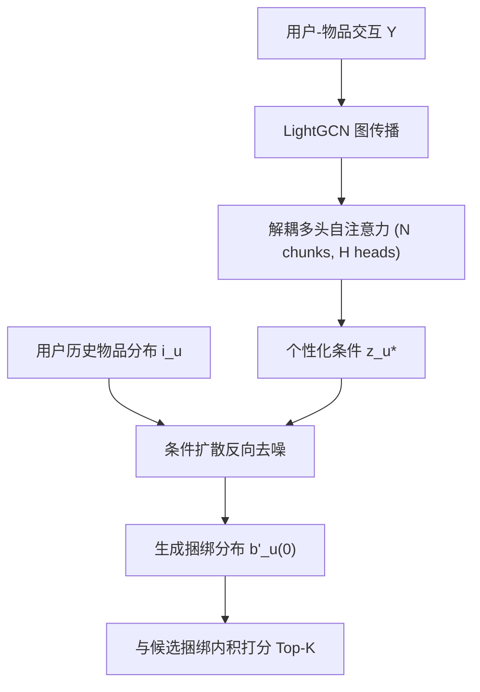
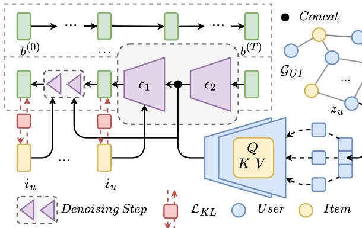

# Personalized Diffusion Model Reshapes Cold-Start Bundle Recommendation (个性化扩散模型重塑冷启动捆绑推荐)

- **会议/期刊**: WWW Companion 2025 (Short Paper)
- **作者与机构**: Tuan-Nghia Bui, Huy-Son Nguyen, Cam-Van Thi Nguyen, Hoang-Quynh Le, Duc-Trong Le (VNU University of Engineering and Technology, Hanoi)
- **推荐链路定位**: 召回（冷启动捆绑包生成式召回）
- **研究方向**: 冷启动与长尾推荐 / 生成式推荐
- **论文原文**: [https://arxiv.org/abs/2505.14901v1](https://arxiv.org/abs/2505.14901v1)
- **开源代码**: [https://github.com/bt-nghia/DisCo](https://github.com/bt-nghia/DisCo)

## TL;DR (1分钟核心速览)

捆绑推荐的用户-捆绑交互比用户-物品更稀疏，冷启动下基于隐向量的 CF 方法（CrossCBR、MultiCBR、CoHeat）几乎失效，因为冷捆绑的 embedding 在训练中几乎不更新。DisCo 改用**个性化条件扩散模型**：以 LightGCN 传播 + 解耦多头自注意力得到的用户兴趣向量 $z_u^*$作为条件，在物品分布空间逐步去噪生成该用户的"理想捆绑包"，再与候选捆绑做内积打分；并额外加 KL 正则把用户物品偏好蒸馏进生成过程以抑制生成式 top-$K$ 的偏置。在 Youshu/iFashion/Meal 三个数据集的全库排序协议下，Recall@20 相对最强基线 CoHeat 提升 72%–656%，nDCG@20 最高提升 1155%。

## Background & Motivation (背景与核心矛盾)

- **主流范式**: 捆绑推荐主流做法是二分图/超图建模（CrossCBR、MultiCBR）或物品级高阶关联，均依赖 BPR 损失更新用户与捆绑的隐向量。
- **前人局限**: 其一，冷捆绑没有任何交互，隐向量在训练与推理中"原地不动"，CF 信号无法注入；其二，用户-捆绑矩阵比用户-物品矩阵更稀疏，冷启动问题被进一步放大，唯一针对该场景的 CoHeat 仍受限于传统 CF 框架，且训练不稳定（loss 上升时才达峰值）。
- **核心洞察 (Key Insight)**: 任何捆绑都可分解为物品集合，而用户-物品交互远比用户-捆绑稠密；因此冷捆绑不应靠"学它的向量"，而应由用户的物品偏好**生成**出来。
- **本文切入点**: 把捆绑表示成物品分布 $b_u^{(0)}\in\mathbb{R}^{|I|}$，用扩散模型在分布空间为用户合成个性化捆绑，彻底绕开冷捆绑隐向量不更新的死结。

## Method (核心方法设计)

### 1. 整体框架 (Overall Architecture)

输入是用户-物品交互矩阵 $Y$与捆绑-物品归属矩阵$Z$。先在用户-物品图上做 LightGCN 传播得到高阶协同信号，再经解耦多头自注意力把用户兴趣切成$N$个方面并锐化，拼成个性化条件$z_u^*$；扩散主干以$z_u^*$与用户历史物品分布$i_u$为条件，从纯噪声反向去噪生成$b_u'^{(0)}$；最后用生成分布与候选捆绑二值向量的内积排序。训练同时优化简化去噪损失与 KL 正则。

<figure class="paper-figure" markdown="span">
  <figcaption>图1：DisCo的端到端架构</figcaption>
</figure>

### 2. 关键设计拆解 (Key Designs)

1. **解耦自注意力个性化条件（Disentangled Self-Attention）**：单一用户向量无法表达多面兴趣，生成结果会趋同。做法是把 $z_u'$切成$N$段$z_u^{(1)}\to z_u^{(N)}$，每段独立投影为 Q/K/V 并做$H$头注意力，再经 FFN 拼回：$\tilde{z}_u^{(i)}=\gamma(\bar{z}_u^{(i,1)}\oplus\cdots\oplus\bar{z}_u^{(i,H)})$，$z_u^*=\tilde{z}_u^{(1)}\oplus\cdots\oplus\tilde{z}_u^{(N)}$。直觉是每个 chunk 对应一类兴趣（如"套餐里的主食/饮品"），注意力在 chunk 内部锐化、chunk 之间保持解耦，使条件信号既有区分度又不互相污染。
2. **条件扩散生成捆绑（Guided Diffusion）**：冷捆绑无向量可学，改为生成。前向按 $q(b_u^{(t)}|b_u^{(0)})=\mathcal{N}(\sqrt{\bar\alpha_t}b_u^{(0)},(1-\bar\alpha_t)\mathbf{I})$加噪；反向均值网络设计为$\mu_\theta(b_u^{(t)},i_u,z_u^*,t)=\epsilon_1(\epsilon_2(b_u^{(t)})\oplus z_u^*)+i_u$，即把噪声捆绑经 MLP 编码后与用户条件拼接，再**残差加上用户历史物品分布**$i_u$。这个残差项是关键：它保证生成结果天然落在用户已交互物品的支撑集附近，避免扩散在高维$|I|$ 空间中漂移到无关物品。
3. **KL 正则抑制生成偏置 + 训练目标**：纯重构损失只拟合正样本捆绑，生成分布会塌缩到"热门捆绑"附近，造成 top-$K$偏置。为此加入$\mathcal{L}_{KL}=\mathbb{E}_{t,u}[D_{KL}(\delta(i_u)\,\|\,\delta(\mu_\theta(b_u^{(t)},i_u,z_u^*,t)))]$，强制生成分布对齐用户的物品偏好分布，兼作多样性正则。总损失$\mathcal{L}^{(t-1)}=\mathcal{L}_R^{(t-1)}+\mathcal{L}_{KL}^{(t-1)}+\tau\|\theta\|_2^2$，其中$\mathcal{L}_R$为简化去噪 MSE。打分$y_{u,b}=b_u'^{(0)}\cdot\tilde{b}$。负采样：**免负采样**（生成式重构目标，不依赖 BPR 负例）；推理需跑完整$T=100$ 步反向链，开销高于双塔内积。

## Experimental Setup & Evaluation Protocol (实验设置与评估协议)

- **数据集与预处理**: 三个真实数据集，捆绑集按 7:1:2 划分 train/val/test，测试集捆绑对用户完全冷启动。

| 数据集 | 领域 | 划分方式 | 冷启动设定 | 说明 |
| :--- | :---: | :---: | :---: | :--- |
| Youshu | 图书捆绑 | 7:1:2 | 完全冷捆绑 | 用户-物品交互较稠密 |
| iFashion | 时尚穿搭 | 7:1:2 | 完全冷捆绑 | 捆绑-物品归属强 |
| Meal | 餐饮套餐 | 7:1:2 | 完全冷捆绑 | 来自 MealRec 公开数据 |

- **数据划分与防穿越 (Splitting Strategy)**: 按**捆绑集合**做 7:1:2 划分（非 Leave-One-Out），测试捆绑在训练期完全不可见，属严格冷启动划分。
- **排名评测协议 (Ranking Protocol)**: 无偏 **Full-Ranking**（对全部捆绑排序后取 top-$K$），报告 Recall@10/20 与 nDCG@10/20，五个随机种子取平均。
- **对比基线与超参设置**: 基线含捆绑推荐 CrossCBR、MultiCBR，冷变体 CoHeat，条件生成 CVAE，以及物品冷启动方法 CLCRec、DropoutNet、CB2CF、Heater、GAR-CF、CVAR、CCFCRec。嵌入/隐藏维度 $\{64,128\}$，Adam，lr$1e{-3}$，batch 2048，扩散步$T=100$，$\beta_1=1e{-5},\beta_T=0.2$，LightGCN 与解耦注意力各 2 层，$H=2$，$N=4$，$\tau=1e{-5}$；显著性$p<0.05$。

## Key Experimental Results (实验关键数据)

### 1. 主实验对比 (Main Results)

| 数据集 | 指标 | CrossCBR | MultiCBR | CVAE | CLCRec | CoHeat | **DisCo** | Improv.% |
| :--- | :---: | :---: | :---: | :---: | :---: | :---: | :---: | :---: |
| Youshu | R@20 | 0.0000 | 0.0025 | 0.0084 | 0.0137 | 0.0183 | **0.0526** | +187.4 |
| Youshu | N@20 | 0.0000 | 0.0011 | 0.0047 | 0.0087 | 0.0105 | **0.0283** | +169.5 |
| iFashion | R@20 | 0.0000 | 0.0151 | 0.0011 | 0.0053 | 0.0170 | **0.1286** | +656.4 |
| iFashion | N@20 | 0.0000 | 0.0088 | 0.0006 | 0.0043 | 0.0096 | **0.1205** | +1155.2 |
| Meal | R@20 | 0.0022 | 0.0102 | 0.0084 | 0.0064 | 0.1650 | **0.2838** | +72.0 |
| Meal | N@20 | 0.0005 | 0.0054 | 0.0111 | 0.0024 | 0.1084 | **0.1961** | +80.9 |

### 2. 消融实验 (Ablation Study)

| 变体 | Youshu R@20 | Youshu N@20 | iFashion R@20 | iFashion N@20 | Meal R@20 | Meal N@20 |
| :--- | :---: | :---: | :---: | :---: | :---: | :---: |
| w/o Graph | 0.0523 | 0.0279 | 0.1256 | 0.1174 | 0.2823 | 0.1956 |
| w/o Disen | 0.0483 | 0.0263 | 0.1126 | 0.1002 | 0.2763 | 0.1937 |
| w/o KL | 0.0265 | 0.0174 | 0.0039 | 0.0029 | 0.0039 | 0.0023 |
| **DisCo** | **0.0526** | **0.0283** | **0.1286** | **0.1205** | **0.2838** | **0.1961** |

### 3. 关键实验发现 (Key Findings)

1. **KL 正则是命门而非锦上添花**：去掉 KL 后 iFashion R@20 从 0.1286 崩到 0.0039（跌 97%），Meal 从 0.2838 跌到 0.0039，说明纯重构目标下生成分布严重偏置、几乎无法区分候选捆绑；KL 把物品偏好注入生成过程才是模型可用的前提。
2. **解耦注意力贡献大于图传播**：w/o Disen 在 iFashion 上 R@20 掉 12.4%（0.1286→0.1126），而 w/o Graph 仅掉 2.3%，表明冷启动下"用户兴趣的多方面刻画"比"高阶协同信号"更关键——冷捆绑本就无协同信号可传。
3. **生成式范式对 CF 是量级碾压**：CrossCBR 在 Youshu/iFashion 上 R@20 为 0.0000，CoHeat 在 iFashion 上仅 0.0170，而 DisCo 达 0.1286；同时图 3 显示 CoHeat 在 loss 反弹时才达峰值（训练不稳定），DisCo 的 loss 单调下降且性能同步上升，验证了生成范式的稳定性优势。

## Highlights & Limitations (亮点、对比与审稿批判)

- **与代表作对比 (vs. Prior Work)**: 与 CoHeat 的本质区别在于 CoHeat 仍用 CF 骨干 + 课程学习"迁移"物品兴趣到冷捆绑，冷捆绑向量依旧不更新；DisCo 直接放弃冷捆绑向量，改为条件生成。与 CVAE 相比，扩散的多步去噪 + 残差注入 $i_u$ 提供了更强的分布表达能力与更稳的训练。
- **可迁移亮点**: ①"用稠密的辅助交互（用户-物品）条件化生成稀疏目标（用户-捆绑）"这一思路可迁移到冷物品、冷广告创意等场景；②把 KL 对齐项作为生成式推荐的去偏正则，可复用到任何"重构式 + top-$K$ 排序"的生成推荐模型。
- **审稿级局限批判**: ①推理需跑 $T=100$步反向链，在线召回延迟远高于双塔内积，论文未报告任何时延数据；②仅 4 页短文，数据集统计量、稀疏度、显著性检验细节均缺失，且未与 DropoutNet 等物品冷启动基线在主表中直接对比（仅放在图 2），公平性存疑；③超参$N$、$H$、$T$ 的敏感性分析完全缺失。

## Rating (四维评分)

- **方法创新性 (Novelty)**: ⭐⭐⭐⭐ （首次把条件扩散用于冷启动捆绑推荐，解耦注意力条件 + 残差物品分布注入的设计有明确物理直觉）
- **评估协议与实验扎实度 (Protocol & Experiments)**: ⭐⭐⭐ （Full-Ranking 协议与五种子平均较规范，但数据集统计缺失、基线对比不完整、无超参敏感性分析）
- **写作与数学规范度 (Clarity & Rigor)**: ⭐⭐⭐ （公式链条完整、符号基本自洽，但 4 页篇幅导致推导与实现细节大量省略）
- **工业落地与复现价值 (Industrial & Practical Value)**: ⭐⭐⭐ （代码已开源、思路易复现，但 100 步扩散推理的在线时延是落地硬伤，需蒸馏或步数压缩）

