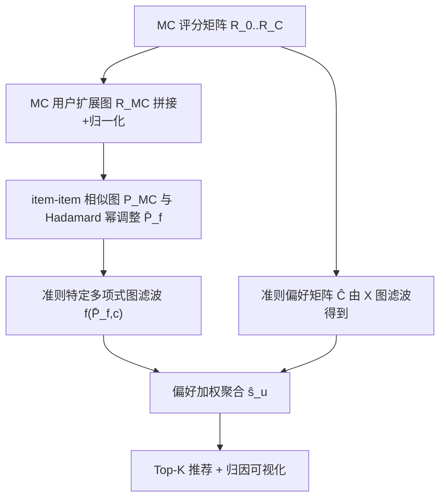
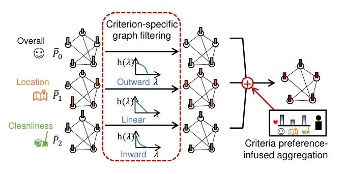

# Criteria-Aware Graph Filtering: Extremely Fast Yet Accurate Multi-Criteria Recommendation (准则感知图滤波：极速且精准的多准则推荐)

- **会议/期刊**: WWW 2025
- **作者与机构**: Jin-Duk Park (Yonsei University), Jaemin Yoo (KAIST), Won-Yong Shin (Yonsei University & POSTECH)
- **推荐链路定位**: 召回（Top-K 排序打分）
- **研究方向**: 协同过滤与双塔召回 / 图神经网络与知识图谱推荐
- **论文原文**: [https://arxiv.org/abs/2502.09046v1](https://arxiv.org/abs/2502.09046v1)
- **开源代码**: [https://github.com/jindeok/CA-GF](https://github.com/jindeok/CA-GF)

## TL;DR (1分钟核心速览)

多准则（MC）推荐中，把 $C+1$ 个评分矩阵喂给训练式 CF 会让训练开销随准则数近似平方级膨胀（8 准则时约 64 倍），而现有图滤波方案 GF-CF 的"理想低通滤波器"依赖昂贵 SVD 分解，无法直接扩展到多准则。本文提出 CA-GF：先用 MC 用户扩展图构造统一的 item–item 相似图，再对每个准则分别施加**预定义多项式低通滤波器**（Linear / Inward / Outward），最后用准则偏好矩阵加权聚合。全程免训练、免矩阵分解，在 BA 数据集上推理仅 0.2 秒（比 GF-CFMC 快 2160 倍），NDCG@5 相对最强基线最高提升 24%。

## Background & Motivation (背景与核心矛盾)

- **主流范式**: MC 推荐把总体评分拆成"总体 + 若干细粒度准则"（如餐厅的 food/service/location），主流做法是 AEMC、ExtendedSAE、CPA-LGC 等 DNN/GCN 训练式模型，或 CFM、DMCF 等矩阵分解式模型。
- **前人局限一（效率）**: 训练式 CF 复杂度为 $O(N^2)$，准则数从 1 增至 8 时训练时间约涨 64 倍；图 1(b) 显示三个 DNN 基线在 TripAdvisor 上跑 100 epoch 的耗时远超单准则场景，而用户偏好演化快，这种延迟不可接受。
- **前人局限二（精度与结构）**: 直接把单准则方法逐准则扩展（如 GF-CFMC 对每个准则各跑一次 GF-CF 再求和）既丢失跨准则协同信号，又因每个准则都要做一次 SVD 而无法规模化；DNN 类方法则难以显式利用 MC 评分间的复杂高阶结构。
- **核心洞察 (Key Insight)**: 单准则图滤波的成功来自"CF 评分天然呈低频模式"这一性质，而多项式滤波器（Turbo-CF 思路）可在**不做特征分解**的前提下逼近任意低通响应——这正好绕开 MC 场景下"多滤波器 = 多次 SVD"的算力瓶颈。
- **本文切入点**: 把"准则"作为一等公民嵌入图滤波：一张跨准则统一图捕获准则间关系（G1），每个准则配一个独立多项式 LPF 保留其独特性（G2），全部用矩阵多项式实现以榨干 GPU 并行（G3）。

## Method (核心方法设计)

### 1. 整体框架 (Overall Architecture)

CA-GF 分三步闭环：① **图构建**——把每个用户复制成 $C+1$个"准则-用户"节点，与 item 节点构成二部图，再投影出统一的 item–item 相似图$\tilde{P}_{\text{MC}}$，并对边权做 Hadamard 幂调整得到$\bar{P}_f$；② **准则特定图滤波**——对每个准则$c$从 {Linear, Inward, Outward} 三种二阶多项式 LPF 中选一个，把该准则的评分行向量作为图信号做卷积，得到$\mathbf{s}_{u,c}$；③ **准则偏好聚合**——用由"用户各准则评分总量"导出的偏好矩阵$\hat{C}$对$\mathbf{s}_{u,c}$加权求和输出最终打分。全流程无参数训练、无特征分解，超参（滤波器类型、$s_f$）仅在验证集上做离散搜索。

<figure class="paper-figure" markdown="span">
  <figcaption>图2：CA-GF的示意图概述。</figcaption>
</figure>

### 2. 关键设计拆解 (Key Designs)

1. **MC 用户扩展图 + 边权幂调整（捕获跨准则关系，G1）**：若像 CPA-LGC 那样把 item 也扩展成准则-item 节点，item–item 图维度会膨胀 $C+1$倍。本文改为只扩展用户侧，令$R_{\text{MC}}^T = R_0^T \| R_1^T \| \cdots \| R_C^T$，归一化后取$\tilde{P}_{\text{MC}} = \tilde{R}_{\text{MC}}^T \tilde{R}_{\text{MC}}$，一张$|I|\times|I|$图即编码全部准则的共现语义。进一步对边权做$(\bar{P}_f)_{ij} = (\tilde{P}_{\text{MC}})_{ij}^{s_f}$，因为二阶滤波器（Inward/Outward）比一阶更易过平滑，需用$s_f$ 调节连接强度以恢复区分度。

2. **准则特定多项式低通滤波（保留准则独特性，G2+G3）**：痛点在于每个准则的最优频响不同（如酒店"价格"这类主观准则应少用低频分量），但为每个准则单独做 SVD 不可行。本文用 $K$阶矩阵多项式$f(\bar{P}_{f,c}) = \sum_{k=1}^{K} a_{c,k}\bar{P}_f^k$替代，据引理其频响为$h(\lambda)=\sum_k a_{c,k}(1-\lambda)^k$。具体预定义三种二阶滤波器：
   - Linear：$\bar{P}_f$，$h(\lambda)=1-\lambda$；
   - Inward：$\bar{P}_f^2$，$h(\lambda)=\lambda^2-2\lambda+1$；
   - Outward：$2\bar{P}_f-\bar{P}_f^2$，$h(\lambda)=1-\lambda^2$。

   三者对低频的保留强度依次不同，且全部是稀疏矩阵乘法，可直接跑在 PyTorch/CUDA 上并行，彻底消除分解开销。

3. **准则偏好注入聚合与训练目标（个性化，G2）**：简单求和忽略"用户更看重哪个准则"。作者假设"某准则上打分次数更多/分值更高 ⇒ 该用户更偏好该准则"，构造 $X = (R_0\mathbf{1})\|\cdots\|(R_C\mathbf{1})$，归一化后得准则–准则相似图$T=\tilde{X}^T\tilde{X}$，再对$T$做同样的幂调整与图滤波得偏好矩阵$\hat{C}=\tilde{X}\bar{T}$。最终打分为
$$\mathbf{s}_u = \frac{1}{C+1}\sum_{c=0}^{C}\hat{C}_{u,c}\,\mathbf{r}_{u,c}\,f(\bar{P}_{f,c}).$$
   由于无参数，**不存在传统损失函数与负采样**：训练集仅用于构图，超参（每准则滤波器类型、$s_f$）在验证集上网格搜索；推理即若干次稀疏矩阵乘，BA 上 0.2 秒完成全库打分。

## Experimental Setup & Evaluation Protocol (实验设置与评估协议)

- **数据集与预处理**: 三个公开 MC 推荐基准，未做 k-core 过滤（沿用原数据集划分）：

| 数据集 | #Users | #Items | #Overall Ratings | #MC Ratings | 准则数 $C$ | 密度 |
| :--- | :---: | :---: | :---: | :---: | :---: | :---: |
| TripAdvisor (TA) | 5,132 | 7,205 | 41,638 | 280,521 | 7 | 0.11% |
| Yahoo!Movie (YM) | 1,827 | 1,471 | 46,239 | 231,195 | 4 | 1.72% |
| BeerAdvocate (BA) | 10,726 | 10,832 | 626,995 | 3,134,981 | 4 | 0.54% |

- **数据划分与防穿越 (Splitting Strategy)**: 每个用户交互随机 80% 训练 / 20% 测试，训练集内再随机取 10% 作验证集调参（随机划分，非时间戳切分）。
- **排名评测协议 (Ranking Protocol)**: 测试阶段将总体评分高于测试集中位数的交互视为正样本，对用户未交互物品做 **Full-Ranking 全库排序**，报告 Recall@{5,10} 与 NDCG@{5,10}；非确定性方法取 10 次独立运行均值。
- **对比基线与超参设置**: 6 个 MC 基线（ExtendedSAE、AEMC、DMCF、CFM、CPA-LGC、GF-CFMC）+ 4 个单准则基线（NGCF、LightGCN、GF-CF、DiffRec，仅用总体评分）；训练式方法 embedding 维度 64、Adam、batch 128；统一在 i7-9700K + RTX A6000 上评测。

## Key Experimental Results (实验关键数据)

### 1. 主实验对比 (Main Results)

三个数据集上 NDCG 指标（Recall 趋势一致，此处取核心列）：

| 方法 | MC | TA N@5 | TA N@10 | YM N@5 | YM N@10 | BA N@5 | BA N@10 |
| :--- | :---: | :---: | :---: | :---: | :---: | :---: | :---: |
| LightGCN | ✗ | 0.0512 | 0.0586 | 0.1154 | 0.1325 | 0.1320 | 0.1298 |
| GF-CF | ✗ | 0.0570 | 0.0612 | 0.1440 | 0.1574 | 0.1333 | 0.1344 |
| DiffRec | ✗ | 0.0527 | 0.0637 | 0.1123 | 0.1420 | 0.1230 | 0.1392 |
| AEMC | ✓ | 0.0530 | 0.0574 | 0.0909 | 0.0990 | 0.0737 | 0.0752 |
| CFM | ✓ | 0.0357 | 0.0398 | 0.0392 | 0.0538 | 0.0891 | 0.0920 |
| CPA-LGC | ✓ | 0.0550 | 0.0650 | 0.1392 | 0.1532 | 0.1388 | 0.1396 |
| GF-CFMC | ✓ | 0.0595 | 0.0645 | 0.1457 | 0.1588 | 0.1329 | 0.1344 |
| **CA-GF** | ✓ | **0.0738** | **0.0774** | **0.1476** | **0.1608** | **0.1464** | **0.1477** |
| Improv.% (vs. best) | | +24.0% | +19.1% | +1.3% | +1.3% | +5.5% | +5.8% |

效率对比（BA，最大数据集）：CA-GF 训练 0 秒、总运行 **0.2 s**、NDCG@10 = 0.1477；GF-CFMC 274 s / 0.1344；CPA-LGC 10,020 s / 0.1396；AEMC 1,022 s / 0.0752；ExtendedSAE 11,520 s / 0.0052。即 CA-GF 比 GF-CFMC 快约 **2160×**，且精度更高。

### 2. 消融实验 (Ablation Study)

Recall@10 对比（TA / YM / BA）：

| 变体 | 说明 | TA | YM | BA |
| :--- | :--- | :---: | :---: | :---: |
| CA-GF | 完整模型 | **0.0854** | **0.1765** | **0.1147** |
| CA-GF-m | 去掉 MC 用户扩展图（仅总体评分） | 0.0718 | 0.1751 | 0.1031 |
| CA-GF-s | 所有 $s_f$ 置 1（去掉幂调整） | 0.0713 | 0.1698 | 0.1076 |
| CA-GF-f | 全部准则统一用 Linear LPF | 0.0725 | 0.1751 | 0.1077 |
| CA-GF-p | 去掉偏好聚合，改为等权求和 | 0.0840 | 0.1760 | 0.1143 |

### 3. 关键实验发现 (Key Findings)

1. **跨准则统一图是最大增益源**：去掉 MC 扩展图（CA-GF-m）在 TA 上 Recall@10 从 0.0854 掉到 0.0718（−15.9%），BA 上掉 10.1%，说明把多准则评分拼进同一张 item–item 图所捕获的跨准则协同信号，比任何单一准则信号都更有价值。
2. **"一准则一滤波器"与幂调整缺一不可**：统一用 Linear（CA-GF-f）在 TA/BA 分别损失 15.1%/6.1%，而固定 $s_f=1$（CA-GF-s）损失 16.5%/6.2%；图 5 进一步显示 Linear 的最优$s_f<1$、Inward/Outward 的最优$s_f>1$，印证二阶滤波器更易过平滑、需靠$s_f$ 拉开数值区分度。
3. **偏好聚合是"锦上添花"而非主力**：CA-GF-p 仅比完整模型低 1.6%/0.3%/0.3%，但其价值在于提供可解释性——图 6 的归因图显示 check-in 与 rooms 两个准则对 TA 预测贡献显著偏低，与"用户更关注 cleanliness/location"的业务直觉一致，可直接指导运营侧改进。

## Highlights & Limitations (亮点、对比与审稿批判)

- **与代表作对比 (vs. Prior Work)**: 相比 CPA-LGC（首个把 LightGCN 引入 MC 推荐的工作），CA-GF 用免训练的闭式滤波替代了多层图卷积训练，精度更高且快 5 万倍量级；相比 GF-CFMC（GF-CF 的朴素多准则扩展），CA-GF 用多项式滤波器替代 SVD 理想滤波器，并额外引入准则特定滤波与偏好聚合，在 BA 上同时实现 2160× 加速与精度反超；相比 Turbo-CF（单准则多项式滤波），本文把多项式滤波从"一个全局滤波器"扩展为"每准则一个滤波器 + 跨准则统一图"。
- **可迁移亮点**: ① "用户侧扩展 + item 侧不扩展"的构图技巧，可推广到任何多视图/多行为（点击-收藏-购买）推荐，避免 item 图维度爆炸；② 用 Hadamard 幂 $s_f$ 调节二阶滤波器的过平滑，是一个几乎零成本、可即插即用的调优旋钮。
- **审稿级局限批判**: ① 滤波器类型与 $s_f$靠验证集网格搜索，准则数$C$ 增大时搜索空间线性膨胀，论文未给出自适应选滤波器的方案（作者亦在结论中列为未来工作）；② 评估仅用随机 80/20 划分与中位数二值化，未做时间戳切分或冷启动划分，且未报告显著性检验，泛化性证据偏弱；③ 偏好聚合基于"打分多/分高即偏好强"的强假设，对刷分或评分尺度不一致的用户可能失真。

## Rating (四维评分)

- **方法创新性 (Novelty)**: ⭐⭐⭐⭐ （首次把多项式图滤波系统性地移植到多准则场景，"准则特定滤波器 + 跨准则统一图"的组合有清晰的设计目标 G1–G3 支撑，但单点技术多为已有组件的巧妙重组）
- **评估协议与实验扎实度 (Protocol & Experiments)**: ⭐⭐⭐ （三数据集 + 10 个基线 + 完整消融与敏感性分析较充分，但随机划分、中位数二值化、缺显著性检验削弱了结论强度）
- **写作与数学规范度 (Clarity & Rigor)**: ⭐⭐⭐⭐ （引理与三条推论把三种滤波器的频响讲得干净利落，复杂度分析置于附录，符号统一；偏好矩阵推导略紧凑）
- **工业落地与复现价值 (Industrial & Practical Value)**: ⭐⭐⭐⭐⭐ （免训练免分解、0.2 秒全库打分、代码开源，对需要频繁重训的电商/本地生活场景落地价值极高）

