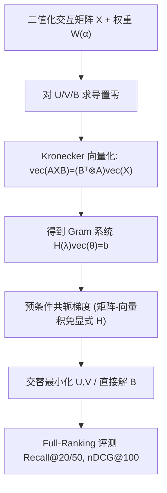

# Does Weighting Improve Matrix Factorization for Recommender Systems? (加权真的能改进推荐系统矩阵分解吗？)

- **会议/期刊**: WWW 2025
- **作者与机构**: Alex Ayoub, Samuel Robertson (University of Alberta); Dawen Liang, Harald Steck, Nathan Kallus (Netflix, Inc. / Cornell University)
- **推荐链路定位**: 召回（Top-N 协同过滤召回）
- **研究方向**: 协同过滤与双塔召回 / 自监督对比学习与交互去噪
- **论文原文**: [https://arxiv.org/abs/2510.10440v1](https://arxiv.org/abs/2510.10440v1)
- **开源代码**: [https://github.com/aa14k/Weighted-MF](https://github.com/aa14k/Weighted-MF)

## TL;DR (1分钟核心速览)

隐式反馈矩阵分解长期奉行"正样本上加权（$\alpha>1$）"的教条，本文系统实证推翻其普适性：在 ML-20M / Netflix / MSD 三数据集、Full-Ranking 协议下，**大秩（$d=1000$ 及满秩）不加权模型常持平甚至优于最优加权模型**，加权仅在低秩小容量模型上稳定获益。为支撑该结论，作者用 Kronecker 向量化引理首次给出 AWMF 与满秩加权目标的**闭式解**（此前被认为不可解），并以预条件共轭梯度在千亿级 Gram 矩阵上高效求解。

## Background & Motivation (背景与核心矛盾)

- **主流范式**: 隐式反馈（点击/观看）中正样本稀疏且信息量大，Hu et al.、Pan et al. 起即对 $X_{ui}=1$上权$W_{ui}=(\alpha-1)X_{ui}+1$，配合 ALS 求解 WMF，成为工业召回标配。
- **前人局限**: ① 加权收益的实证多基于**低秩、弱调参**设定，未控制模型容量与正则方案；② AWMF（非对称）与满秩加权目标因 Hadamard 积 $\odot$ 与矩阵乘不可交换，长期被认为**无闭式解**，只能靠 SGD/ALS 近似，导致"加权 vs 不加权"的比较本身不公平（优化不充分）。
- **核心洞察 (Key Insight)**: EASE 用**不加权**数据却在多个榜单击败加权 MF 与深度模型；且 Byrd & Lipton 在深度分类任务中观察到"容量足够大时加权收益消失"。作者推测：加权本质是**隐式正则**（把未观测零压向预测零），当模型容量/正则已足够时该正则冗余甚至有害。
- **本文切入点**: 先补齐加权目标的精确求解算法，再在**同等优化精度**下做容量 $\times$正则$\times$ 加权三维网格扫描，给出干净的因果结论。

## Method (核心方法设计)

### 1. 整体框架 (Overall Architecture)

论文不提出新打分函数，而是把五类线性模型（AWMF+weight decay、WMF、AWMF+dropout、AWMF+data/weight decay、满秩 AWMF）统一写成 $\|\sqrt{W}\odot(X-XUV^\top)\|_F^2+\lambda\Omega(U,V)$形式，对每个目标推导固定另一因子时的**精确闭式解**，再用预条件共轭梯度（PCG）迭代求解线性系统，避免显式构造$|I|d\times|I|d$的 Gram 矩阵。最终在统一调参网格下比较加权（$\alpha\in\{1,2,5,10,20\}$）与不加权（$\alpha=1$）的排序精度。

### 2. 关键设计拆解 (Key Designs)

1. **Kronecker 向量化闭式解（破解"加权不可解"猜想）**：痛点是 $\odot$ 阻断矩阵求导的常规化简。作者证明核心恒等式
$$\mathrm{vec}\big(A^\top(W\odot(ABC^\top))C\big)=(C\otimes A)^\top\bar{W}(C\otimes A)\,\mathrm{vec}(B),\quad \bar{W}=\mathrm{diagMat}(\mathrm{vec}(W))$$
从而把驻点方程线性化为 $H(\lambda)\mathrm{vec}(\theta)=b$。以满秩模型为例，$H(B,\lambda)=(I_{|I|}\otimes X^\top)\bar{W}(I_{|I|}\otimes X)+\lambda I_{|I|^2}$，解为$\mathrm{vec}(B)=H(B,\lambda)^{-1}\mathrm{vec}(X^\top(W\odot X))$。直觉：Hadamard 加权只是把每个样本的残差按行"重标定"，向量化后等价于对设计矩阵做**行加权最小二乘**，故必有解析驻点。

2. **免显式 Gram 矩阵的 PCG 求解**：ML-20M 上 $d=10$时$V\otimes X$需 >1000GB 内存。关键观察是$H$对称正定，且$Hp$可借同一恒等式**按矩阵形式廉价计算**（如$H(B,\lambda)p=\mathrm{vec}(X^\top(W\odot(XP))+\lambda P)$）。以不加权 Gram 作预条件$M^{-1}=I_{|I|}\otimes(X^\top X+\lambda I)^{-1}$，使$M^{-1}H$条件数约为$\max(W)$（由$\alpha$控制），收敛率$\|x_k-x\|_A\le 2\exp(-2k/\kappa(A))\|x_0-x\|_A$，最多$|I|d$ 步精确收敛。

3. **训练目标、负采样与推理效率**：全部模型用**平方损失 + 全量零样本**（不做负采样，隐式反馈全矩阵参与），仅通过 $W$与$\lambda$调节正负样本相对权重；推理为内积$XUV^\top$的 Top-N 排序，与标准 MF 召回同复杂度。核心开销在训练期 PCG 的矩阵-向量积（每步$O(\mathrm{nnz}(X)d)$ 量级），可离线完成。

## Experimental Setup & Evaluation Protocol (实验设置与评估协议)

- **数据集与预处理**（沿用 Liang et al. 多-VAE 官方预处理，评分 >3 视为正，二值化）：

| 数据集 | #Users | #Items | #Interactions | 稀疏度 | 特征/场景说明 |
| :--- | :---: | :---: | :---: | :---: | :--- |
| ML-20M | 136,677 | 20,108 | ~10M | 密度 0.003 | 电影评分，中等长尾 |
| Netflix | 463,435 | 17,769 | ~57M | 极稀疏 | 电影观看，用户量最大 |
| MSD | 571,355 | 41,140 | ~34M | 极稀疏 | 音乐收听，长尾最重 |

- **数据划分与防穿越**: 沿用多-VAE 的 **Holdout 比例划分**（每用户留出部分交互作验证/测试），训练集二值化后仅用训练交互构图。
- **排名评测协议**: 无偏 **Full-Ranking**（对全部未交互物品排序），指标 Recall@20、Recall@50、nDCG@100；标准误约 0.001–0.002。
- **对比基线与超参**: 5 类线性模型 × 3 个秩（$d=10,100,1000$，另含满秩$d=|I|$）；$\lambda\in\{10^{-4},0.01,1,100,10^4\}$、$\alpha\in\{1,2,5,10,20\}$ 网格搜索，验证集选优，边界最优则扩网格。

## Key Experimental Results (实验关键数据)

### 1. 主实验对比 (Main Results)

$d=1000$代表性结果（W 表示加权最优，U 表示不加权$\alpha=1$；粗体为该指标更优者）：

| 模型 | ML-20M R@20 | ML-20M nDCG@100 | Netflix R@50 | Netflix nDCG@100 | MSD R@20 | MSD nDCG@100 | Wins |
| :--- | :---: | :---: | :---: | :---: | :---: | :---: | :---: |
| AWMF + weight decay (W, $\alpha$=20) | 0.344 | 0.378 | 0.395 | 0.345 | 0.228 | 0.277 | 7/9 |
| AWMF + weight decay (U) | **0.348** | **0.381** | 0.376 | 0.334 | 0.189 | 0.230 | 2/9 |
| WMF (W, $\alpha$=3) | **0.377** | **0.409** | 0.376 | 0.329 | 0.268 | 0.322 | 6/9 |
| WMF (U) | 0.328 | 0.360 | **0.406** | **0.352** | 0.189 | 0.231 | 3/9 |
| AWMF + dropout (W, $\alpha$=2) | 0.355 | 0.388 | 0.419 | 0.370 | 0.227 | 0.277 | 4/9 |
| AWMF + dropout (U) | **0.378** | **0.407** | 0.417 | 0.369 | 0.216 | 0.266 | 5/9 |
| Full-Rank (W, $\alpha$=2) | 0.360 | 0.389 | 0.421 | 0.370 | 0.277 | 0.338 | 3/9 |
| Full-Rank (U) | **0.376** | **0.407** | 0.417 | 0.368 | **0.284** | **0.344** | 6/9 |

$d=10$ 时格局反转：AWMF+weight decay 加权版在 ML-20M 上 R@20 从 0.297 升至 0.305、MSD 从 0.074 升至 0.086，**9/9 全胜**；WMF 加权版亦 8/9 胜。

### 2. 消融实验 (Ablation Study)

以 $d=1000$ 满秩模型为基准，逐项拆解加权与正则的作用（ML-20M / Netflix / MSD 的 nDCG@100）：

| 配置 | ML-20M | Netflix | MSD | 说明 |
| :--- | :---: | :---: | :---: | :--- |
| Full-Rank, U, weight decay | 0.407 | 0.368 | 0.344 | 基准（不加权） |
| Full-Rank, W ($\alpha$=2), weight decay | 0.389 | 0.370 | 0.338 | 加权重下降 |
| AWMF+dropout, U, $d$=1000 | 0.407 | 0.369 | 0.266 | dropout 正则 |
| AWMF+weight decay, U, $d$=1000 | 0.381 | 0.334 | 0.230 | weight decay 正则 |
| AWMF+data/weight decay, W ($\alpha$=2) | 0.383 | 0.303 | 0.283 | 混合正则 |
| AWMF+dropout, U, $d$=10 | 0.331 | 0.290 | 0.098 | 降容量 |

### 3. 关键实验发现 (Key Findings)

1. **容量决定加权收益方向**：$d=10$时加权几乎全胜（AWMF 9/9），$d=1000$ 时加权在 ML-20M 上反使 nDCG@100 从 0.407 降至 0.389，满秩不加权在 MSD 上以 0.344 vs 0.338 反超——加权是"小模型的拐杖"。
2. **正则方案与加权强耦合**：不加权大秩下 dropout 式正则（$\lambda\|UV^\top\|_F^2$）显著优于 weight decay（ML-20M 0.407 vs 0.381，MSD 0.266 vs 0.230）；而 weight decay 把因子压向零，恰好与"把零预测为零"的加权目标同向，故 WMF 类模型加权仍有效（WMF 加权 6/9 胜）。
3. **MSD 的"异常"实为长尾信号**：所有加权低秩模型均胜不加权，但满秩不加权（R@20=0.284）远超最优低秩 WMF（0.268），说明 MSD 结构更复杂、需更高容量，加权只是低容量下的补偿。

## Highlights & Limitations (亮点、对比与审稿批判)

- **与代表作对比 (vs. Prior Work)**: 相比 Hu et al./Pan et al. 的 WMF（加权 + ALS 近似），本文首次在**精确最优解**下比较加权与否，排除优化误差混淆；相比 EASE（不加权满秩 + 对角约束），本文去掉零对角约束以公平对齐，并补上加权版本与低秩 AWMF 家族；相比 Byrd & Lipton 的深度分类观察，本文在线性 MF 上给出同构结论并附闭式解理论支撑。
- **可迁移亮点**: ① Kronecker 向量化恒等式可直接用于任何"行加权最小二乘"型推荐目标（如加权 SLIM、加权线性自编码器）的精确求解；② "容量–正则–加权"三角权衡可作为调参先验：大秩模型优先调 dropout 正则、慎开 $\alpha$。
- **审稿级局限批判**: ① 仅覆盖**线性/平方损失**模型，未验证 BPR/softmax 等排序损失下结论是否成立；② PCG 每步需多次稀疏-稠密乘，$d=1000$满秩训练成本高，论文未给 wall-clock 与内存实测；③ 三数据集均为电影/音乐，缺电商、短视频等强曝光偏差场景，$\alpha$ 最优值对曝光机制的敏感性未讨论。

## Rating (四维评分)

- **方法创新性 (Novelty)**: ⭐⭐⭐⭐ （非新模型，但以 Kronecker 向量化首次给出加权 AWMF/满秩目标闭式解，理论增量扎实）
- **评估协议与实验扎实度 (Protocol & Experiments)**: ⭐⭐⭐⭐ （三数据集 × 三秩 × 五模型 × 双超参网格，Full-Ranking 无偏，唯缺显著性检验与线上验证）
- **写作与数学规范度 (Clarity & Rigor)**: ⭐⭐⭐⭐⭐ （引理–命题–闭式解–复杂度链条完整，预条件收敛率有显式界）
- **工业落地与复现价值 (Industrial & Practical Value)**: ⭐⭐⭐⭐ （代码开源、结论直接指导召回调参，但满秩 PCG 训练开销限制超大规模部署）

