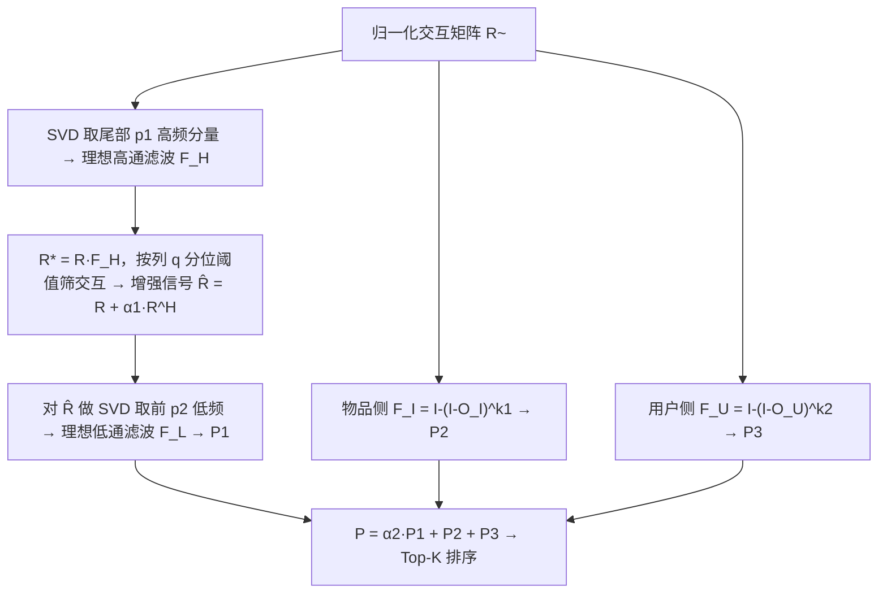
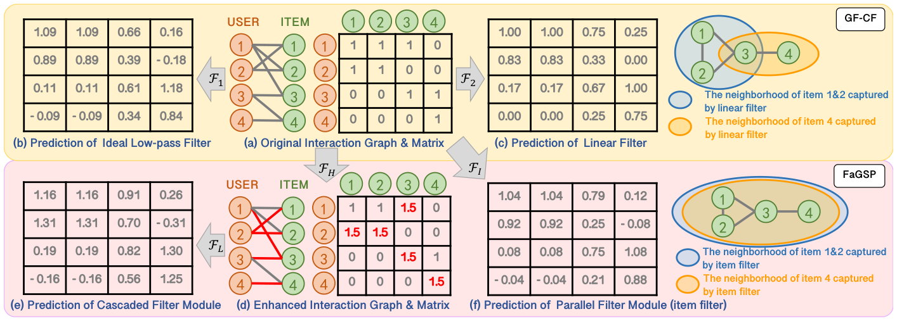

# Frequency-aware Graph Signal Processing for Collaborative Filtering (面向协同过滤的频率感知图信号处理)

- **会议/期刊**: WWW 2025
- **作者与机构**: Jiafeng Xia, Tun Lu, Peng Zhang, Li Shang, Ning Gu (复旦大学)；Dongsheng Li (微软亚洲研究院)；Hansu Gu (Seattle)
- **推荐链路定位**: 召回（免训练图滤波打分）
- **研究方向**: 协同过滤与双塔召回 / 图神经网络与知识图谱推荐
- **论文原文**: [论文原文链接](https://arxiv.org/abs/2402.08426v1)
- **开源代码**: 暂未开源

## TL;DR (1分钟核心速览)

现有 GSP 类 CF 方法（GF-CF、PGSP）只用理想低通滤波 + 线性滤波，导致两个缺陷：低通滤波把反映用户/物品**独有特征**的高频交互信号一并抹平，线性滤波又只能看到**一阶邻域**。本文提出 FaGSP：级联滤波模块先用理想高通滤波增强独有特征交互、再在其上做理想低通滤波；并行滤波模块用 $I-(I-O)^{k}$ 形式的低通滤波捕获任意阶邻域；两模块线性加权即得预测分。在 6 个公开数据集、72:8:20 比例划分、Full-Ranking 协议下，相对最优基线提升 1.66%–5.43%（NDCG@10/MRR@10），且训练开销与 GF-CF 同量级、比 UltraGCN 快约 8 倍。

## Background & Motivation (背景与核心矛盾)

- **主流范式**: GSP 类方法把交互矩阵视为图信号，在谱域设计图滤波器 $F=U\,\mathrm{diag}(f(\lambda))\,U^\top$ 直接做免训练打分，效率远高于 GCN 类方法且精度可比。
- **前人局限一（独有特征被抹平）**: 理想低通滤波使图信号变平滑（Proposition 1 证明 $\Delta S<0$），只保留节点间**共性**，而区分用户/物品的**独有特征**恰恰落在高频分量，被直接滤除。
- **前人局限二（仅一阶邻域）**: GF-CF/PGSP 的线性滤波建立在共现矩阵 $O_I=\tilde{R}^\top\tilde{R}$ 上，本质只能刻画物品间**直接**关联，无法利用多跳高阶邻域信息。
- **核心洞察 (Key Insight)**: 图 1 的 4×4 玩具例显示，低通滤波使 $u_2$对$i_2,i_3$的打分差被压平（忽略$i_2$目标人群更窄的独有特征）；线性滤波则让$u_4$完全看不到与$i_4$间接相关的$i_1,i_2$。
- **本文切入点**: 用「高通增强 + 低通平滑」的级联结构同时保留独有与共性特征，用幂次低通滤波显式建模高阶邻域，二者线性融合。

## Method (核心方法设计)

### 1. 整体框架 (Overall Architecture)

输入归一化交互矩阵 $\tilde{R}=D_U^{-1/2}RD_I^{-1/2}$。级联滤波模块先对$\tilde{R}$做 SVD，取尾部$p_1$个高频奇异向量构造理想高通滤波$F_H$，得到"独有特征强度"矩阵$R^*=RF_H$，按列$q$分位数阈值筛出真正体现独有特征的交互并加权重构增强信号$\hat{R}=R+\alpha_1 R^H$；再对$\hat{R}$做 SVD 取前$p_2$个低频分量构造理想低通滤波$F_L$，输出$P_1=\hat{R}F_L$。并行滤波模块分别用物品侧$F_I=I-(I-O_I)^{k_1}$与用户侧$F_U=I-(I-O_U)^{k_2}$得到$P_2=RF_I$、$P_3=F_UR$。最终$P=\alpha_2 P_1+P_2+P_3$ 直接排序，全程无梯度训练。

<figure class="paper-figure" markdown="span">
  <figcaption>图1：4个用户和4个物品的用户交互预测玩具示例。(a)为原始交互矩阵，(b)和(c)分别为GF-CF中理想低通滤波器和线性滤波器的预测结果。(d)为增强后的交互矩阵，(e)–(f)分别为FaGSP中级联滤波模块和并行滤波模块的预测结果。对于(d)中用于增强交互的理想高通滤波器，我们设置𝑝1 = 2、𝑞= 0.65、𝛼1 = 0.5。对于(b)和(d)中的理想低通滤波器，我们设置𝑝2 = 2。在并行滤波模块中，我们仅考虑物品高阶邻域信息</figcaption>
</figure>

### 2. 关键设计拆解 (Key Designs)

1. **级联滤波模块（Cascaded Filter Module，独有+共性联合建模）**：痛点在于低通滤波把高频独有特征当噪声抹掉。做法是先构造理想高通滤波 $F_H=D_I^{-1/2}V_{-p_1:}V_{-p_1:}^\top D_I^{1/2}$，用$R^*=RF_H$度量每条交互体现独有特征的程度，再以列分位数$r_i^q$为阈值保留$R^*_{u,i}\ge r_i^q$且$R_{u,i}>0$的交互构成$R^H$，增强后$\hat{R}=R+\alpha_1 R^H$再做低通。直觉：高通"锐化"信号使节点保留自身特性，低通再在增强信号上平滑，共性预测中便嵌入了独有特征的方向修正（图 1(e) 中$u_4$对$i_3$打分显著高于$i_2$，符合预期）。

2. **并行滤波模块（Parallel Filter Module，任意阶邻域捕获）**：痛点在于线性滤波 $O_I$只覆盖一阶邻域。设计$F_I=I-(I-O_I)^{k_1}$，其频率响应为$f(\lambda_i)=1-\lambda_i^{k_1}$（Proposition 2 证明当$k_1\ge2$时为非线性凹函数）。$k_1=1$时退化为线性滤波；$k_1$增大时低频分量保留比例快速上升（$k_1=2$保留约 3.2% 低频，$k_1=5$保留约 25.1%），同时高频分量被增强，从而把不同距离邻域的信息一并纳入。用户侧对称构造$F_U$。

3. **训练目标、负采样与推理效率**：本文**无训练损失、无负采样**——所有滤波器均由 SVD 与矩阵幂闭式构造，超参 $p_1,p_2,\alpha_1,\alpha_2,q,k_1,k_2$在验证集上网格搜索。总 FLOPs 为$O(n^3)$（$m\approx n$），与 GF-CF 同阶；ML1M 上单轮训练 2.08 min，对比 UltraGCN 的 16.09 min 快约 8 倍，对比 LightGCN 的 135.96 min 快两个数量级。

## Experimental Setup & Evaluation Protocol (实验设置与评估协议)

- **数据集与预处理**: 六个跨域公开数据集，未做 k-core 过滤（沿用原始划分）：

| 数据集 | #Users | #Items | #Interactions | 密度 | 场景说明 |
| :--- | :---: | :---: | :---: | :---: | :--- |
| ML100K | 943 | 1,682 | 100,000 | 0.0630 | 电影 |
| Beauty | 22,363 | 12,101 | 198,502 | 0.0007 | 电商产品（极稀疏） |
| BX | 18,964 | 19,998 | 482,153 | 0.0013 | 图书 |
| LastFM | 992 | 10,000 | 571,817 | 0.0576 | 音乐 |
| ML1M | 6,040 | 3,706 | 1,000,209 | 0.0477 | 电影 |
| Netflix | 20,000 | 17,720 | 5,678,654 | 0.0160 | 电影 |

- **数据划分与防穿越 (Splitting Strategy)**: 按 **72%:8%:20%** 比例随机划分为训练/验证/测试集，超参在验证集上选取，测试集仅用于最终报告。
- **排名评测协议 (Ranking Protocol)**: 采用 **Full-Ranking（全库未交互物品排序）**，指标为 F1@K、MRR@K、NDCG@K（K=10, 20），无采样负例偏差。
- **对比基线与超参设置**: 7 个 GCN 类基线（LR-GCCF、LCFN、DGCF、LightGCN、IMP-GCN、SimpleX、UltraGCN）+ 2 个 GSP 类基线（GF-CF、PGSP），均用官方代码并按其论文调参。FaGSP 超参：$p_1,p_2$在 ML100K 上搜 16–256、其余数据集 32–1024；$\alpha_1,\alpha_2\in[0.1,1.0]$步长 0.05；$k_1,k_2\in[2,14]$；$q\in\{0.6,0.65,0.7,0.75,0.8\}$，采用分层搜索降低开销。

## Key Experimental Results (实验关键数据)

### 1. 主实验对比 (Main Results)

下表摘取 6 个代表性基线在 MRR@10 / NDCG@10 上的结果（完整表含 F1@10/20、MRR@20、NDCG@20）：

| 数据集 | 指标 | LightGCN | SimpleX | UltraGCN | GF-CF | PGSP | **FaGSP** | Improv. |
| :--- | :--- | :---: | :---: | :---: | :---: | :---: | :---: | :---: |
| ML100K | MRR@10 | 0.5877 | 0.6064 | 0.5749 | 0.6010 | 0.5767 | **0.6380** | +5.21% |
| ML100K | NDCG@10 | 0.6771 | 0.6866 | 0.6688 | 0.6843 | 0.6722 | **0.7092** | +3.29% |
| Beauty | MRR@10 | 0.0519 | 0.0517 | 0.0441 | 0.0517 | 0.0525 | **0.0549** | +4.57% |
| Beauty | NDCG@10 | 0.0763 | 0.0761 | 0.0649 | 0.0751 | 0.0765 | **0.0799** | +4.44% |
| BX | MRR@10 | 0.0601 | 0.0628 | 0.0594 | 0.0576 | 0.0578 | **0.0656** | +4.46% |
| BX | NDCG@10 | 0.0861 | 0.0892 | 0.0847 | 0.0821 | 0.0817 | **0.0931** | +4.37% |
| LastFM | MRR@10 | 0.6073 | 0.5930 | 0.5529 | 0.6086 | 0.6007 | **0.6338** | +4.36% |
| LastFM | NDCG@10 | 0.6855 | 0.6690 | 0.6340 | 0.6817 | 0.6767 | **0.6969** | +1.66% |
| ML1M | MRR@10 | 0.5010 | 0.5051 | 0.4886 | 0.4996 | 0.5063 | **0.5229** | +3.28% |
| ML1M | NDCG@10 | 0.5873 | 0.5921 | 0.5773 | 0.5897 | 0.5923 | **0.6082** | +2.68% |
| Netflix | MRR@10 | 0.5974 | 0.5839 | 0.4708 | 0.6126 | 0.5905 | **0.6293** | +2.73% |
| Netflix | NDCG@10 | 0.6814 | 0.6694 | 0.5746 | 0.6928 | 0.6756 | **0.7079** | +2.18% |

### 2. 消融实验 (Ablation Study)

| 设置 | ML100K MRR@10 | ML100K NDCG@10 | ML1M MRR@10 | ML1M NDCG@10 | LastFM MRR@10 | LastFM NDCG@10 |
| :--- | :---: | :---: | :---: | :---: | :---: | :---: |
| (1) FaGSP 完整 | **0.6380** | **0.7092** | **0.5229** | **0.6082** | **0.6338** | **0.6969** |
| (2) w/o IHF | 0.6233 | 0.6998 | 0.5196 | 0.6062 | 0.6249 | 0.6937 |
| (3) w/o IHF+ILF | 0.6227 | 0.6993 | 0.5128 | 0.6025 | 0.6234 | 0.6929 |
| (4) w/o IHNF | 0.6187 | 0.6976 | 0.5117 | 0.5988 | 0.6242 | 0.6946 |
| (5) w/o UHNF | 0.6313 | 0.7046 | 0.5163 | 0.6044 | 0.6304 | 0.6938 |
| (6) w/o IHNF+UHNF | 0.5938 | 0.6760 | 0.4918 | 0.5806 | 0.6063 | 0.6827 |

### 3. 关键实验发现 (Key Findings)

1. **独有特征（IHF）是最大单项增益来源，且与共性特征互补**：ML100K 上去掉 IHF 使 MRR@10 从 0.6380 降至 0.6233（-2.3%），再去掉 ILF 仅再降 0.0006，说明高通增强后的信号才是低通滤波发挥作用的载体；图 3 的 KL 散度随 IHF→UHNF→IHNF 依次引入而单调下降，验证预测偏好分布逐步逼近历史偏好分布。
2. **高阶邻域滤波的贡献在稀疏数据上更显著**：同时去掉 IHNF+UHNF 后 ML1M MRR@10 从 0.5229 跌至 0.4918（-5.9%），跌幅大于单独去掉任一项之和，说明用户侧与物品侧高阶邻域信息存在互补；Beauty 这类密度仅 0.0007 的极稀疏集上 FaGSP 仍取得 +4.57% MRR@10，印证高阶邻域对稀疏场景的补全价值。
3. **精度-效率双优，且超参存在明确拐点**：FaGSP 训练耗时 2.08 min，与 GF-CF（1.18 min）、PGSP（2.36 min）同量级，却比最省时的 GCN 基线 UltraGCN（16.09 min）快约 8 倍；图 5 显示 $p_1$过大时高频噪声交互被一并纳入导致精度回落，$k_1$增大则精度持续上升但$(I-O_I)^{k_1}$ 稠密化带来复杂度上升，需折中选取。

## Highlights & Limitations (亮点、对比与审稿批判)

- **与代表作对比 (vs. Prior Work)**: GF-CF 用「理想低通 + 线性滤波」、PGSP 用「混合频率低通 + 增广图线性滤波」，二者均只保留共性且局限一阶邻域；FaGSP 首次把**理想高通**引入 CF 滤波链，并用幂次低通 $I-(I-O)^k$ 替代线性滤波，在保持免训练特性的同时把频率响应从线性扩展为凹函数族。
- **可迁移亮点**: (1) 「高通增强 → 阈值筛选 → 低通平滑」的级联范式可迁移到任何基于共现矩阵的召回打分，用于注入区分性信号；(2) 用 $I-(I-O)^k$ 的幂次形式近似多跳邻域聚合，可作为 LightGCN 多层传播的免训练闭式替代，用于冷启动或低延迟场景的快速召回基线。
- **审稿级局限批判**: (1) 需对 $\tilde{R}$与$\hat{R}$各做一次截断 SVD，物品/用户数达百万级时$O(n^3)$的谱分解与$k$次矩阵幂的稠密化开销难以承受，论文仅在最大 2 万节点的 Netflix 上验证；(2) 超参多达 7 个（$p_1,p_2,\alpha_1,\alpha_2,q,k_1,k_2$）且需逐数据集网格搜索，缺乏自适应选取机制，实际部署调参成本被低估。

## Rating (四维评分)

- **方法创新性 (Novelty)**: ⭐⭐⭐⭐ （首次将理想高通滤波引入 GSP 推荐链，并用 Proposition 1/2 给出平滑性与凹频率响应的谱域证明，思路清晰但属滤波器组合的工程性创新）
- **评估协议与实验扎实度 (Protocol & Experiments)**: ⭐⭐⭐⭐ （6 数据集 + Full-Ranking + 9 个基线 + 完整消融与 KL 可视化，但划分采用随机比例而非时间切分，存在轻度信息泄漏风险）
- **写作与数学规范度 (Clarity & Rigor)**: ⭐⭐⭐⭐ （命题证明完整、复杂度以 FLOPs 量化，但符号在正文与附录间略有重复，$q$ 分位阈值的选取依据未给理论解释）
- **工业落地与复现价值 (Industrial & Practical Value)**: ⭐⭐⭐⭐ （免训练、比 GCN 快 8 倍、易并行，适合作为召回粗排基线；但未开源且大规模 SVD 与稠密矩阵幂是落地瓶颈）

