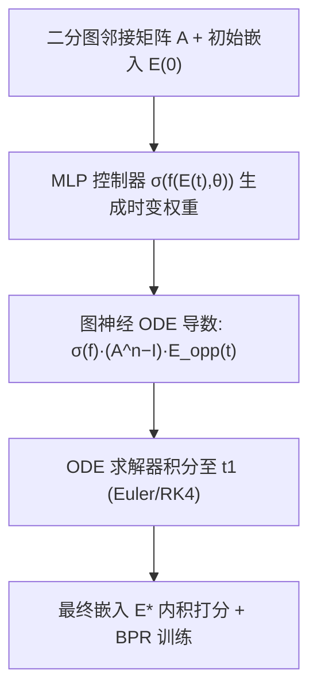
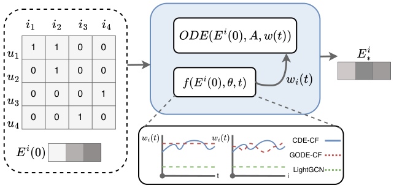

# Graph Neural Controlled Differential Equations For Collaborative Filtering (面向协同过滤的图神经受控微分方程)

- **会议/期刊**: WWW 2025 (Short Paper)
- **作者与机构**: Ke Xu, Weizhi Zhang, Zihe Song, Yuanjie Zhu, Philip S. Yu (University of Illinois Chicago)
- **推荐链路定位**: 召回 (图嵌入召回)
- **研究方向**: 协同过滤与双塔召回 / 图神经网络推荐
- **论文原文**: [https://arxiv.org/abs/2501.13908v1](https://arxiv.org/abs/2501.13908v1)
- **开源代码**: [https://github.com/DavidZWZ/CDE-CF](https://github.com/DavidZWZ/CDE-CF)

## TL;DR (1分钟核心速览)

本文针对图神经 ODE 推荐中"权重矩阵被固定或离散化、无法随 ODE 时间连续演化"的痛点，提出 CDE-CF：用一个以节点当前嵌入为输入的 MLP 控制器 $\sigma(f(E(t),\theta))$在连续时间上生成时变权重矩阵，替代 GODE-CF 的离散权重。在四个 Amazon 5-core 数据集、Leave-One-Out + Full-Ranking 协议下，Recall@20 相对 GODE-CF 提升 0.06%–2.39%，且最优积分时长$t$ 从 8.5 降至 6.5，训练时间反而更短。

## Background & Motivation (背景与核心矛盾)

- **主流范式**: LightGCN 证明线性 GCN 在 CF 中优于非线性版本，且线性传播可视为 ODE 的离散化；LT-OCF 把 GCN 层连续化为可调层数的 NODE，GODE-CF 则用一两层 GCN 参数化导数函数、以 ODE 求解器估计最终嵌入。
- **前人局限**: 其一，LightGCN/LT-OCF 完全去掉权重矩阵，所有节点在同一时刻收敛到同一状态，无法为不同节点定制最优传播步长；其二，GODE-CF 虽引入权重，但它是**离散、与时间无关**的固定矩阵，而 ODE 本质是连续系统，离散权重无法在积分过程中动态调节，原文实验也显示离散权重并非在所有数据集上都带来增益。
- **核心洞察 (Key Insight)**: 节点到达最优嵌入所需的"时间"不同，权重的作用是控制每个节点沿时间轴的推进速度；既然 ODE 在连续时间上演化，权重也应当是时间的连续函数，而非一次性给定的常数矩阵。
- **本文切入点**: 把权重矩阵本身参数化为一个以当前节点嵌入为输入的 MLP，嵌入进 ODE 导数函数内部，使权重随积分时间 $t$与节点索引$i$ 连续变化（受控微分方程 CDE 思想）。

## Method (核心方法设计)

### 1. 整体框架 (Overall Architecture)

模型沿用 GODE-CF 的"以 GCN 层参数化 ODE 导数"骨架，但把导数函数中的常数权重 $W$替换为 MLP 控制器输出。输入为二分图归一化邻接矩阵$A$与初始嵌入$E_u(0),E_i(0)$；在 ODE 求解器（Euler / RK4）的每一步，MLP 读取当前时刻的用户/物品嵌入，经 sigmoid 输出该时刻的权重矩阵，再与$(A^n-I)$及对侧嵌入相乘得到导数，积分至$t_1$ 得到最终嵌入，最后以内积打分并用 BPR 损失训练。整个框架可视为"控制 ODE（生成权重）+ 图神经 ODE（生成嵌入）"两段合一。

<figure class="paper-figure" markdown="span">
  <figcaption>图 1：CDE-CF 生成物品最终嵌入 𝐸𝑖∗ 的图卷积过程，用户嵌入 𝐸𝑢∗ 可通过类似过程生成。(a) 数据输入包含二分邻接矩阵和初始嵌入。(b) 所提出的 CDE-CF 架构包括用于建模图卷积的 ODE 函数和用于生成连续权重的权重生成器。下图比较了 CDE-CF、GODE-CF 和 LightGCN 的权重值随时间 𝑡 和节点索引 𝑖 的变化。</figcaption>
</figure>

### 2. 关键设计拆解 (Key Designs)

1. **连续时变权重控制器 (Continuous Weight Controller)**：GODE-CF 的 $W$是离散常数，无法在积分中自适应。本文将权重写成$\sigma(f(E_u(t),\theta))$，其中$f$为 MLP、$\sigma$ 为 sigmoid 保证权重有界，整体嵌入公式为
$$E_{u*}=E_u(0)+\int_0^{t_1}\sigma(f(E_u(t),\theta))(A^n-I)E_i(t)\,dt$$
物品侧对称。直觉上，MLP 依据节点当前状态"按需"放大或抑制传播强度，使不同节点以不同速率逼近各自最优嵌入，这正是离散权重做不到的。

2. **权重随时间与节点的双重差异化**：原文图 1 的下方曲线对比了三种方法的权重形态——LightGCN 恒为 1（无控制）、GODE-CF 为与 $t$无关的离散阶梯、CDE-CF 则随$t$与节点索引$i$ 平滑变化。这一可视化直接支撑了"连续控制优于离散控制"的论点，也解释了为何 CDE-CF 在稀疏数据集（Health 稀疏度 0.0484%）上收益更大：稀疏节点更需要个性化的传播强度。

3. **训练目标、负采样与推理效率**：损失沿用 BPR  pairwise 目标，负采样为常规均匀负采样（未引入 hard negative 或 in-batch 策略）；ODE 用显式 Euler 或 RK4 求解。关键效率发现是：CDE-CF 的最优积分时长 $t\approx 6.5$，低于 GODE-CF 的$t\approx 8.5$，因此尽管多了一个 MLP，求解步数更少，训练时间反而略优（Beauty 2109.52s vs. 2120.92s）。

## Experimental Setup & Evaluation Protocol (实验设置与评估协议)

- **数据集与预处理**: 四个 Amazon Reviews 基准类目，均按 `5-core` 过滤，将评论存在性视为正交互：

| 数据集 | #Train | #Valid | #Test | 稀疏度 | 场景说明 |
| :--- | :---: | :---: | :---: | :---: | :--- |
| Beauty | 153,776 | 22,363 | 22,363 | 0.07335% | 美妆 |
| Health | 269,137 | 38,609 | 38,609 | 0.0484% | 健康个护（最稀疏） |
| Cell Phone | 138,681 | 27,879 | 27,879 | 0.0668% | 手机数码 |
| Office | 43,448 | 4,905 | 4,905 | 0.44867% | 办公用品（最稠密） |

- **数据划分与防穿越 (Splitting Strategy)**: 按用户交互时间排序后采用 `Leave-One-Out`，最后一条交互作测试、倒数第二条作验证。
- **排名评测协议 (Ranking Protocol)**: 无偏 `Full-Ranking`，所有未交互物品参与排序，指标为 Recall@20 与 NDCG@20。
- **对比基线与超参设置**: 基线覆盖 GCN 类（NGCF、layerGCN、UltraGCN、GTN、LightGCN）与 ODE 类（LT-OCF、GODE-CF）；统一 BPR 训练，ODE 求解器与积分时长 $t$为关键超参（CDE-CF 最优$t\approx 6.5$）。原文未报告显著性检验与嵌入维度细节。

## Key Experimental Results (实验关键数据)

### 1. 主实验对比 (Main Results)

| 方法 | Beauty R@20 | Beauty N@20 | Health R@20 | Health N@20 | Cell R@20 | Cell N@20 | Office R@20 | Office N@20 |
| :--- | :---: | :---: | :---: | :---: | :---: | :---: | :---: | :---: |
| NGCF | 0.07079 | 0.02995 | 0.03064 | 0.01226 | 0.04387 | 0.01691 | 0.05097 | 0.02214 |
| UltraGCN | 0.05661 | 0.02618 | 0.03170 | 0.01348 | 0.03604 | 0.01558 | 0.04689 | 0.02336 |
| GTN | 0.07146 | 0.03059 | 0.03287 | 0.01351 | 0.04559 | 0.01780 | 0.04363 | 0.02026 |
| LightGCN | 0.07776 | 0.03299 | 0.03030 | 0.01202 | 0.04429 | 0.01660 | 0.05647 | 0.02635 |
| LT-OCF | 0.07879 | 0.03309 | 0.03022 | 0.01197 | 0.04641 | 0.01739 | 0.05626 | 0.02596 |
| GODE-CF | 0.08075 | 0.03406 | 0.03387 | 0.01356 | 0.05079 | 0.01909 | 0.05667 | 0.02702 |
| **CDE-CF** | **0.08129** | **0.03426** | **0.03468** | **0.01375** | **0.05082** | **0.01945** | **0.05728** | **0.02713** |
| Improv. vs GODE-CF | +0.67% | +0.59% | +2.39% | +1.40% | +0.06% | +1.89% | +1.08% | +0.41% |

### 2. 消融实验 (Ablation Study)

| 变体 | Beauty R@20 | Health R@20 | Cell R@20 | Office R@20 |
| :--- | :---: | :---: | :---: | :---: |
| 无权重 (w/o W) | 0.08076 | 0.03403 | 0.05058 | 0.05586 |
| 离散权重 (GODE-CF) | 0.08027 | 0.03362 | 0.05079 | 0.05668 |
| **CDE-CF (连续权重)** | **0.08129** | **0.03468** | **0.05082** | **0.05728** |

### 3. 关键实验发现 (Key Findings)

1. **离散权重并非稳定增益**：在 Beauty 与 Health 上，GODE-CF 加离散权重后 Recall@20 反而低于无权重版本（0.08027 vs. 0.08076；0.03362 vs. 0.03403），说明"有权重"本身不是关键，"权重能否随时间连续调节"才是；CDE-CF 在全部四个数据集上均优于无权重版本。
2. **稀疏度越高收益越大**：最稀疏的 Health（0.0484%）上 Recall@20 相对 GODE-CF 提升 2.39%，而最稠密的 Office（0.44867%）仅提升 1.08%，印证了连续权重对稀疏节点个性化传播的补偿作用。
3. **效率不降反升**：固定 1000 epoch 下，CDE-CF 在 Beauty/Health/Cell Phone 上训练时间均略低于 GODE-CF（2109.52s vs. 2120.92s 等），根源是最优积分时长从 8.5 缩短到 6.5，MLP 的额外开销被更少的 ODE 求解步数抵消。

## Highlights & Limitations (亮点、对比与审稿批判)

- **与代表作对比 (vs. Prior Work)**: 与 LightGCN 的本质区别在于保留并连续化了权重矩阵，避免所有节点同步收敛；与 LT-OCF 的区别在于后者只连续化"层数"、仍无权重控制；与 GODE-CF 的区别在于把离散常数权重升级为以嵌入为输入的 MLP 时变权重，是"控制"而非"参数"层面的改动。
- **可迁移亮点**: ①"用轻量 MLP 生成时变系数"的思路可迁移到任意带传播系数的图模型（如自适应层间衰减、动态图上的边权生成）；②以最优积分时长 $t$ 作为效率调节旋钮，可在精度与求解开销间做显式权衡。
- **审稿级局限批判**: ①增益幅度偏小（Cell Phone 上 Recall@20 仅 +0.06%），且未报告显著性检验与多次运行方差，说服力有限；②MLP 控制器在每步 ODE 求解中都要前向一次，若换用更高阶求解器或更大图，开销会放大，原文仅在 1000 epoch 固定设置下比较时间，未给出推理阶段成本；③实验仅限 Amazon 四个类目与两个指标，缺少与序列/生成式召回的对比。

## Rating (四维评分)

- **方法创新性 (Novelty)**: ⭐⭐⭐ （把 CDE 的受控思想引入图 ODE 推荐，思路清晰但属"替换权重生成方式"的增量改进，理论分析较薄）
- **评估协议与实验扎实度 (Protocol & Experiments)**: ⭐⭐⭐ （Full-Ranking + 四数据集 + 消融与效率对比齐全，但缺显著性检验、方差报告与更广基线）
- **写作与数学规范度 (Clarity & Rigor)**: ⭐⭐⭐⭐ （公式简洁、图 1 的权重形态对比直观，符号定义基本完备；短论文篇幅下部分推导从简）
- **工业落地与复现价值 (Industrial & Practical Value)**: ⭐⭐⭐⭐ （代码已开源，训练时间与 LightGCN 持平甚至更优，ODE 求解器可插拔，具备实际部署参考价值）

