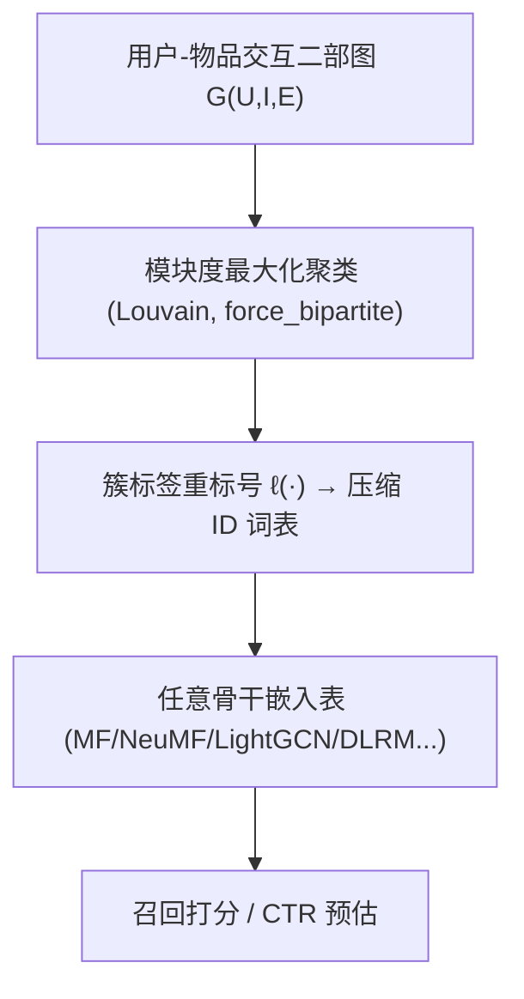
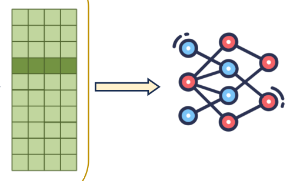

# GraphHash: Graph Clustering Enables Parameter Efficiency in Recommender Systems (图哈希：图聚类赋能推荐系统参数高效化)

- **会议/期刊**: ACM Web Conference (WWW) 2025, Oral
- **作者与机构**: Xinyi Wu, Donald Loveland, Runjin Chen, Yozen Liu, Xin Chen, Leonardo Neves, Ali Jadbabaie, Clark Mingxuan Ju, Neil Shah, Tong Zhao (MIT / UMich / UT Austin / Snap Inc.)
- **推荐链路定位**: 召回（Retrieval）+ 精排 CTR 预估（共用嵌入表压缩层）
- **研究方向**: 协同过滤与双塔召回 / 图神经网络与知识图谱推荐
- **论文原文**: [https://arxiv.org/abs/2412.17245v2](https://arxiv.org/abs/2412.17245v2)
- **开源代码**: [https://github.com/snap-research/GraphHash](https://github.com/snap-research/GraphHash)

## TL;DR (1分钟核心速览)

工业级深度推荐系统的嵌入表动辄数百 GB，传统哈希（取模/双哈希/频率哈希）靠 ID 随机分桶，把行为迥异的实体强行共享嵌入，碰撞严重拖垮精度。本文提出 GraphHash：在预处理阶段对用户-物品二部图做**模块度最大化聚类**（Louvain），把同簇实体映射到同一嵌入桶，从而以"一次性全平滑"替代多层消息传递的迭代平滑。在 Gowalla/Yelp2018/AmazonBook 三个召回数据集上，嵌入表缩减 75%+ 时 Recall@20 平均相对最强基线提升 **101.52%**、NDCG@20 提升 **88.33%**；CTR 任务上 DoubleGraphHash 平均降低 LogLoss 0.008、提升 AUC 0.002。

## Background & Motivation (背景与核心矛盾)

- **主流范式**: 用"哈希技巧"把高基数 ID 映射到更小的桶集合，桶内实体共享同一嵌入行；改进方向是双哈希（两个哈希码嵌入相加）与频率感知哈希（高频实体独占桶）。
- **前人局限**: ① 纯 ID 哈希（取模）与实体语义完全无关，碰撞即"随机噪声注入"，在稀疏图上精度断崖式下跌（MF+random 在 Gowalla 的 Recall@20 仅 0.766，而 full 为 15.617）；② 频率哈希只保护头部实体，尾部用户/物品被大量合并，加剧长尾偏差。
- **核心洞察 (Key Insight)**: 模块度最大化在随机游走视角下等价于"随机游走者一步后仍留在原簇的概率减去独立游走者同簇概率"，这与消息传递的邻域平滑在数学上同源——**聚类即是一次粗粒度、免迭代的平滑**。
- **本文切入点**: 把图结构的使用时机从"前向传播/训练时"前移到"预处理时"，用 Louvain 的局部贪心启发式在十亿级图上完成分桶，得到即插即用的图基哈希函数。

## Method (核心方法设计)

### 1. 整体框架 (Overall Architecture)

输入用户-物品交互二部图 $G(\mathcal{U},\mathcal{I},\mathcal{E})$，先由 Louvain 在训练集上做模块度最大化聚类，得到用户簇标签与物品簇标签；再用重标号函数$\ell$ 把簇映射为连续整数，作为"哈希 ID"替换原始 ID 词表；随后任意带嵌入表的骨干（MF / NeuMF / LightGCN / WideDeep / DLRM / DCNv2）照常训练与推理，仅嵌入表行数被压缩。整个流程对骨干零侵入，聚类只跑一次、可离线缓存。

<figure class="paper-figure" markdown="span">
  <figcaption>图1：GraphHash 概览。通过采用快速图聚类算法，GraphHash 在预处理阶段作为消息传递的计算高效代理，并作为传统 ID 哈希的即插即用图基替代方案，可与任何使用嵌入表的架构骨干无缝协作。</figcaption>
</figure>

### 2. 关键设计拆解 (Key Designs)

1. **模块度二部图聚类作为哈希函数**：痛点是用 ID 取模分桶与交互模式无关。本文对二部图定义模块度 $Q=\frac{1}{m}\sum_{C\in\mathcal{P}}\sum_{u,i\in C}\left(A_{ui}-\frac{k_u d_i}{m}\right)$，其中$m=|\mathcal{E}|$、$k_u$、$d_i$分别为用户度与物品度；最大化$Q$ 使"簇内边密度显著高于零模型期望"的实体同桶。物理直觉：同簇用户共享相似物品集合，共享嵌入不会引入语义冲突，碰撞从"噪声"变为"正则"。
2. **GraphHash 与 DoubleGraphHash 的定义**：GraphHash 直接取 $\text{GraphHash}(x)=\ell(\mathcal{A}(x)),\ \forall x\in\mathcal{U}\cup\mathcal{I}$，其中$\mathcal{A}$为 Louvain 聚类算子；由于 Louvain 在固定图上确定性输出（Proposition 3.1），GraphHash 具备与常规哈希一致的确定性，可与随机哈希组合成$\text{DoubleGraphHash}(x)=(\mathcal{H}(x),\text{GraphHash}(x))$，等价于把桶空间扩为笛卡尔积以进一步降碰撞。
3. **训练目标、负采样与推理效率**：召回骨干沿用 BPR 损失 $\mathcal{L}_{\text{BPR}}=-\sum_{(u,i^+)\in\mathcal{E}}\ln\sigma(\hat{s}_{ui^+}-\hat{s}_{ui^-})$，负样本均匀采样；CTR 骨干用 BCE（LogLoss）。GraphHash 本身不引入任何训练期开销，聚类在 Gowalla 上仅需 1.928s（谱协同聚类需 332.062s，慢 170 倍以上），推理阶段与普通哈希完全同构。

## Experimental Setup & Evaluation Protocol (实验设置与评估协议)

- **数据集与预处理**（转导设置，保证验证/测试集实体在训练集出现，规避 OOV）：

| 数据集 | #Users | #Items | #Interactions | 稀疏度 | 任务/说明 |
| :--- | :---: | :---: | :---: | :---: | :--- |
| Gowalla | 29,858 | 49,981 | 1,027,370 | 99.92% | 召回 |
| Yelp2018 | 31,668 | 38,048 | 1,561,406 | 99.87% | 召回 |
| AmazonBook | 52,643 | 91,599 | 2,984,108 | 99.94% | 召回 |
| Frappe | 954 | 4,082 | 288,609 | — | CTR，8 维特征 |
| MovieLens-1M | 6,040 | 3,641 | 738,983 | — | CTR，48 维特征 |
| MovieLens-20M | 138,484 | 24,689 | 15,709,070 | — | CTR，35 维特征 |

- **数据划分与防穿越**: 召回任务采用随机 `80%/10%/10%` 划分；Frappe 用 RecZoo 提供的 `70%/20%/10%`；MovieLens-1M/20M 随机 `80%/10%/10%`。MovieLens 评分 <3 归 0、>3 归 1、=3 剔除。
- **排名评测协议**: 召回采用 `Full-Ranking`（全库未交互物品排序），报告 Recall@20 与 NDCG@20；CTR 报告 LogLoss 与 AUC。所有结果均为 5 次独立运行的均值±标准差。
- **对比基线与超参**: 基线含 Random（取模）、Double、Frequency、Double Frequency、LSH、LSH-structure，并附无哈希 full 作上界参考；嵌入维度 $d=64$（MovieLens-20M 为 32），学习率网格$\{1e^{-2},5e^{-3},1e^{-3}\}$，权重衰减$\{1e^{-4},1e^{-6},1e^{-8}\}$，Adam 优化器，早停 patience 召回 50 / CTR 5。GraphHash 的嵌入表行数被**刻意压到小于所有基线**，以强调"更少参数仍更优"。

## Key Experimental Results (实验关键数据)

### 1. 主实验对比 (Main Results)

召回任务（Gowalla，Recall@20 / NDCG@20，%）：

| 骨干 | 方法 | #Params | Recall@20 | NDCG@20 |
| :--- | :--- | :---: | :---: | :---: |
| MF | full | 4.534M | 15.617 | 9.661 |
| MF | double frequency | 0.744M | 3.888 | 2.532 |
| MF | LSH-structure | 1.049M | 1.106 | 0.617 |
| MF | **GraphHash** | **0.742M** | **9.300** | **5.512** |
| LightGCN | full | 4.534M | 18.321 | 11.534 |
| LightGCN | double frequency | 0.744M | 9.880 | 6.414 |
| LightGCN | LSH-structure | 1.049M | 9.780 | 6.291 |
| LightGCN | **GraphHash** | **0.742M** | **15.325** | **9.658** |
| MF+DAU | double frequency | 0.744M | 3.440 | 2.677 |
| MF+DAU | **GraphHash** | **0.742M** | **7.660** | **4.148** |

CTR 任务（Frappe，LogLoss↓ / AUC↑）：

| 骨干 | 方法 | #Params | LogLoss | AUC |
| :--- | :--- | :---: | :---: | :---: |
| DLRM | full | 0.443M | 0.194 | 0.982 |
| DLRM | double frequency | 0.155M | 0.291 | 0.969 |
| DLRM | GraphHash | 0.152M | 0.278 | 0.950 |
| DLRM | **DoubleGraphHash** | **0.152M** | **0.231** | **0.973** |
| DCNv2 | double frequency | 1.001M | 0.223 | 0.968 |
| DCNv2 | **DoubleGraphHash** | **0.998M** | **0.194** | **0.972** |

跨全部数据集与骨干，GraphHash 相对最强基线平均提升 Recall@20 **101.52%**、NDCG@20 **88.33%**；DoubleGraphHash 平均降 LogLoss **0.008**、升 AUC **0.002**。

### 2. 消融实验 (Ablation Study)

| 消融维度 | 设置 | 关键指标变化 | 结论 |
| :--- | :--- | :--- | :--- |
| 聚类目标 | 谱协同聚类 vs. 模块度 | Gowalla MF：9.622 vs. 9.144 Recall；耗时 332.062s vs. 1.928s | 谱聚类精度略高但慢 170×，不可扩展 |
| 分辨率 resolution | 50 / 100 / 200 / 400 | MF Recall 7.296→9.733；LightGCN 15.365→15.289 | GraphHash 全档位碾压 double frequency；LightGCN 下对分辨率不敏感 |
| 训练目标 | BPR vs. DirectAU（$\gamma\in\{0.25,...,5\}$） | 所有哈希法切到 DAU 均大幅掉点；GraphHash 对$\gamma$ 鲁棒 | 哈希与 DAU 均匀性项存在冲突，GraphHash 缓解之 |
| 骨干深度 | LightGCN 0–4 层 | GraphHash 0 层 ≈ random 哈希 1–2 层 | 实证"聚类≈免迭代平滑" |
| 平滑质量 | 簇内平滑度 $S(X,C)$ | Gowalla MF：GraphHash 8.324 vs. 2-hop 15.046 | GraphHash 找到比 2-hop 更优的平滑邻域 |
| 稀疏鲁棒性 | 仅用 25%/50% 训练数据 | MF Recall：4.251/5.249 vs. double freq 1.862/1.767 | 极稀疏下优势进一步放大 |

### 3. 关键实验发现 (Key Findings)

1. **图信息对召回的价值远大于对 CTR**：GraphHash 在召回全面最优，但在 CTR 上单独使用反而不如 double frequency（Frappe DLRM LogLoss 0.278 vs. 0.291 虽略优，但 AUC 0.950 低于 0.969），必须叠加双哈希成 DoubleGraphHash 才登顶——说明召回更依赖交互结构、CTR 更依赖碰撞规避。
2. **GraphHash 天然缓解长尾偏差**：按训练频率分桶后，频率哈希把收益几乎全部倾斜给头部用户，而 GraphHash 各分位用户性能曲线与 full 模型几乎平行；物品侧平均被召回物品度数从 double frequency 的 722.994 降到 195.174（MF/Gowalla），兼顾了 unpopular 物品曝光。
3. **"零层消息传递 ≈ 两层消息传递"得到实证**：LightGCN 上不加任何消息传递层的 GraphHash 与加 1–2 层的 random 哈希性能相当，且簇内平滑度指标显著优于 2-hop 邻域，直接验证了模块度目标与消息传递平滑的理论同源性。

## Highlights & Limitations (亮点、对比与审稿批判)

- **与代表作对比 (vs. Prior Work)**: 相比 Frequency/Double Hashing（Zhang et al., RecSys 2020）只用 ID 频次做启发式分桶，GraphHash 首次把交互图结构引入分桶决策；相比 LightGCN（He et al., SIGIR 2020）在训练期迭代消息传递，GraphHash 把图平滑一次性前置到预处理，零训练开销；相比 LEGCF 等 GNN 专用压缩法，GraphHash 骨干无关（Gowalla Recall 15.388 vs. LEGCF 14.03，参数更少）。
- **可迁移亮点**: ① "预处理期图聚类 + 确定性重标号"可作为任何嵌入表压缩管线的即插即用替换件，尤其适合流式/增量场景下离线缓存簇标签；② 用模块度分辨率参数直接控制"桶数-精度"权衡曲线，比手工调哈希桶数更有物理可解释性。
- **审稿级局限批判**: ① 聚类依赖完整训练图，**新用户/新物品（OOV）无法分配簇**，论文明确将 OOV 适配列为未来工作，工业冷启动场景落地受限；② 簇标签一旦生成即冻结，图演化后需周期性重聚类，重聚类引发的嵌入行语义漂移与增量训练兼容性未做评估；③ CTR 任务上纯 GraphHash 表现平庸，实际部署需同时维护随机哈希与图哈希两套码本，工程复杂度上升。

## Rating (四维评分)

- **方法创新性 (Novelty)**: ⭐⭐⭐⭐ （首次将模块度二部图聚类用于嵌入表压缩，并给出与消息传递的随机游走理论桥梁，思路简洁但理论支撑扎实）
- **评估协议与实验扎实度 (Protocol & Experiments)**: ⭐⭐⭐⭐⭐ （6 数据集 × 7 骨干 × 6 哈希基线，Full-Ranking + 5 次重复±标准差，消融覆盖分辨率/聚类目标/深度/稀疏度，完整度罕见）
- **写作与数学规范度 (Clarity & Rigor)**: ⭐⭐⭐⭐ （模块度与消息传递的等价性推导清晰，Proposition 3.1 附证明；但平滑度指标 $S(X,C)$ 的归一化细节略简）
- **工业落地与复现价值 (Industrial & Practical Value)**: ⭐⭐⭐⭐⭐ （代码开源、Louvain 聚类秒级完成、对骨干零侵入、嵌入表缩减 75%+ 仍大幅提效，Snap 工业背景背书，落地门槛极低）

