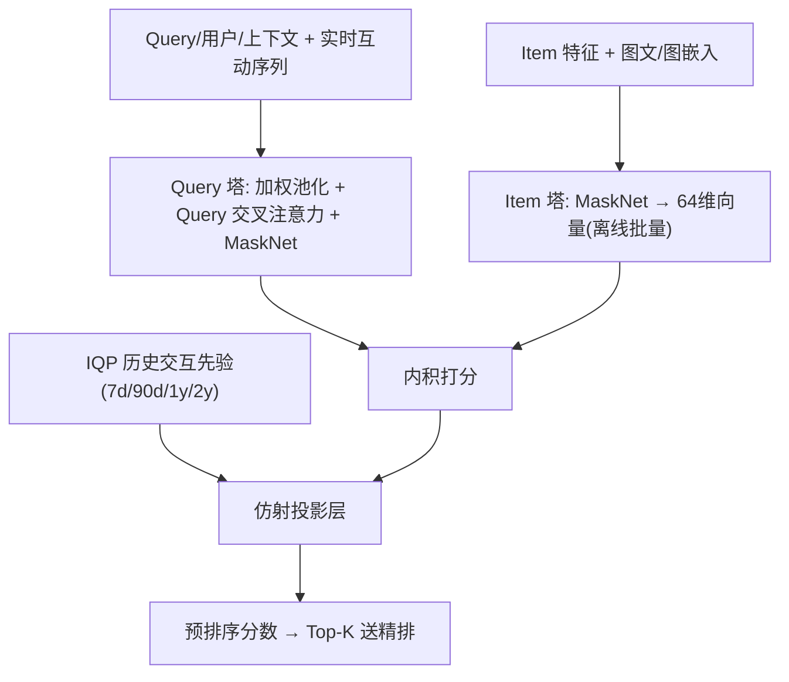
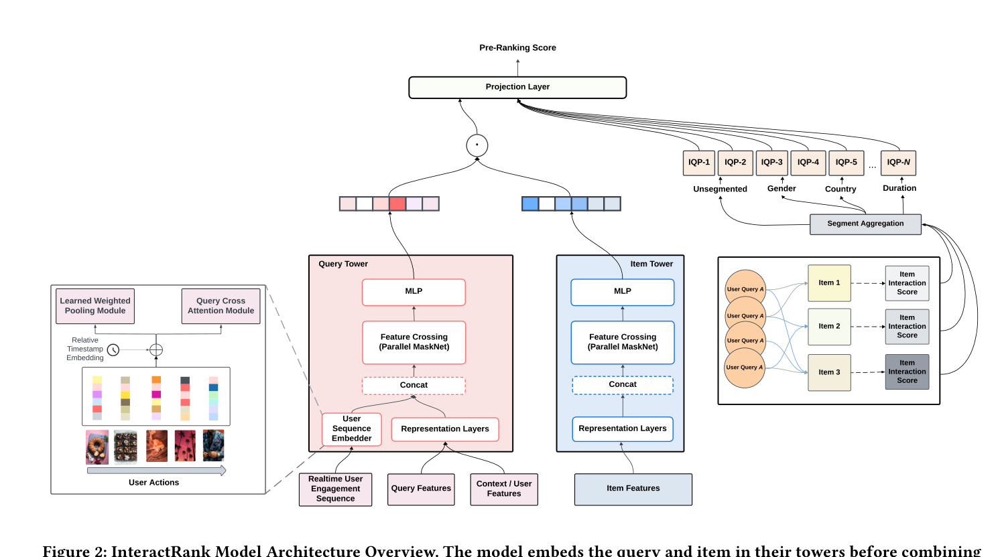

# InteractRank: Personalized Web-Scale Search Pre-Ranking with Cross Interaction Features (面向个性化万级搜索预排序的交叉交互特征双塔模型)

- **会议/期刊**: WWW 2025 (Companion, Industry Track)
- **作者与机构**: Sujay Khandagale, Bhawna Juneja, Prabhat Agarwal, Aditya Subramanian, Jaewon Yang, Yuting Wang（Pinterest）
- **推荐链路定位**: 粗排（Pre-Ranking，检索后 ~$10^5$候选筛至 ~$10^3$）
- **研究方向**: 协同过滤与双塔召回 / CTR 预估与特征交叉
- **论文原文**: [https://arxiv.org/abs/2504.06609v1](https://arxiv.org/abs/2504.06609v1)
- **开源代码**: [https://github.com/pinterest/atg-research](https://github.com/pinterest/atg-research)

## TL;DR (1分钟核心速览)

搜索预排序必须在毫秒级内为 $O(10^5)$ 候选打分，双塔点积虽快却无法建模 query-item 交叉交互，而 DCN/IntTower 类显式交叉模型算力开销达 24×。本文提出 InteractRank：保留解耦双塔点积，再叠加由两年历史曝光-互动日志统计出的 ItemQueryPerf (IQP) 先验特征与实时用户行为序列，经仿射投影层融合成最终分数，服务端仅增加 1.1× FLOPs。Pinterest 线上 A/B（千万用户、一周）中 SIFR 相对 BM25 提升 6.5%、相对纯双塔提升 3.7%，F1S 分别提升 9.2% 与 5.1%。

## Background & Motivation (背景与核心矛盾)

- **主流范式**: 工业搜索采用「检索 → 预排序 → 精排 → 混排」漏斗（图 1），预排序因候选量巨大普遍采用双塔结构，query 塔与 item 塔各自编码后做内积打分，item 向量可离线批量写入正排索引实现 O(1) 查表。
- **前人局限一**: 双塔只能建模塔内特征交互，塔间交互被压缩为一次内积，语义匹配精度受限；BM25 类词频方法虽能通过共现捕捉交互，却丢失语义且无法利用会话内实时上下文。
- **前人局限二**: IntTower、COLD、ColBERT 类方法通过多向量 MaxSim 或类精排结构显式建模交叉，但服务端 FLOPs 达双塔的 24×，在万级候选场景下延迟与成本不可接受。
- **核心洞察 (Key Insight)**: 交叉交互不必由模型在线「算」出来——历史海量日志中 query-item 的共现互动频次本身就是一种可离线预计算、在线仅需查表的交叉信号；它与双塔语义内积互补，且二者增益近似可加。
- **本文切入点**: 用「双塔内积 + 历史交互先验特征 + 实时序列」的轻量仿射融合，以近零额外算力换取显式交叉建模能力。

## Method (核心方法设计)

### 1. 整体框架 (Overall Architecture)

离线侧：item 塔对全库物品做批量推理，将 64 维 item 向量与 IQP 特征一并写入检索引擎正排索引；query 塔在线接收用户属性、上下文与最近 100 条跨场景互动序列，经序列编码器与塔内 MaskNet 交叉后输出 query 向量。在线侧：对检索召回的 $O(10^5)$ 候选做内存查表取得 item 向量与 IQP 值，先算内积，再与 IQP 特征一起送入仿射投影层得到最终预排序分数，排序后取数百条送入精排。整个打分逻辑被编译为带权 WAND 结构化查询在检索引擎内执行，无需独立模型服务。

<figure class="paper-figure" markdown="span">
  <figcaption>图2：InteractRank 模型架构概览。模型先在各自塔中嵌入查询和物品，再将它们的点积与物品-查询交叉交互特征结合，生成最终预排序分数。</figcaption>
</figure>

### 2. 关键设计拆解 (Key Designs)

1. **ItemQueryPerf 交叉交互特征（把交叉从在线计算搬到离线统计）**：痛点是双塔内积无法表达「该 query 下该 item 是否被互动过」。作者直接用两年搜索日志估计条件互动概率并做平滑，按 7 天/90 天/1 年/2 年多时间窗分别统计以兼顾短期热点与长期稳定偏好，还可条件化到性别、国家等上下文：

$$IQP_p(q,c)=P_h(p\mid q,c)=\frac{C(p,q,c)}{C(q,c)}$$

每个 item 只保留 Top-K 高互动 query 的信号，增量更新历史计数而非重算全量日志。直觉上这是把协同过滤的共现统计作为先验注入双塔，在线只需一次正排查表，成本近乎为零。

2. **实时用户互动序列建模（跨场景实时个性化）**：痛点是预排序若只用静态用户画像，无法响应会话内兴趣漂移。序列取用户最近 100 条互动（含 save、长点击、分享及时间戳），经两个模块聚合——学习式加权池化给出全局兴趣 $u_p=\sum_{i=1}^{N}\alpha_i e_i$，Query 交叉注意力按当前 query 聚焦相关行为$u_q=\sum_{i=1}^{N}\beta_i(q)e_i$，其中$\beta_i(q)$ 为 query 与行为向量的点积注意力。二者拼接后进入 query 塔，使预排序具备会话级实时性，且序列跨信息流、相关推荐等多场景采集，实现「搜索之外的个性化」。

3. **训练目标、负采样与推理效率**：预排序不做多任务多向量（会成倍增加 serving 成本），而是定义统一标签 $U_i=\mathbb{I}[\sum_{a_k\in\mathcal{A}}y_{a_k}>0]$ 将多行为合并为单任务，损失为加权 BCE 与带 logQ 校正的 sampled softmax 对比损失之和：

$$\mathcal{L}=\phi_e\mathcal{L}_E+\phi_s\mathcal{L}_S,\quad \phi_e=1.0,\ \phi_s=0.01$$

负样本采用 in-batch 随机采样构造「简单负例」，缓解曝光日志只有正例与隐式负例造成的分布偏移。推理端 FLOPs 仅 142（双塔 127），无额外模型服务调用。

## Experimental Setup & Evaluation Protocol (实验设置与评估协议)

- **数据集与预处理**: 取自 Pinterest 每日搜索曝光日志，因日均近十亿搜索做了降采样以保持可训练规模：

| 数据集 | #Samples | #Unique Queries | #Unique Items | 说明 |
| :--- | :---: | :---: | :---: | :--- |
| Train | 8.1B | 302.3M | 514.1M | 搜索曝光-互动日志 |
| Test | 540M | 32.7M | 117.6M | 留出时间段 |

- **数据划分与防穿越 (Splitting Strategy)**: 全局时间戳切分——前 $k$天训练、后$T-k$ 天测试，模拟上线后的真实分布。
- **排名评测协议 (Ranking Protocol)**: 离线采用 HITS@3（每条请求内对曝光候选按分数排序，正例进入前 3 即命中），作者称 $K=3$ 与线上表现相关性最好；线上采用会话级 SIFR（会话内至少一次高质量互动即视为满足）与 F1S（首次搜索即满足的比例）。
- **对比基线与超参设置**: 离线对比双塔、IntTower 及其组合；线上对比 Proximity BM25、纯双塔、仅交叉特征模型 (ICIF) 与完整 InteractRank。所有模型 embedding 维度固定 $d=64$ 以保证服务内存占用可比，8×A100 训练 1.5 epoch。

## Key Experimental Results (实验关键数据)

### 1. 主实验对比 (Main Results)

线上 A/B（1000 万用户、一周，相对 BM25 基线）：

| 模型 | SIFR↑ | F1S↑ |
| :--- | :---: | :---: |
| Proximity BM25 | 基线 | 基线 |
| Two Tower | +2.7% | +3.9% |
| ICIF（仅交叉特征） | +3.6% | +5.5% |
| **InteractRank** | **+6.5%** | **+9.2%** |

离线 HITS@3 与算力开销对比：

| 交互方法 | HITS@3 $U$ | HITS@3 LC | #FLOPs |
| :--- | :---: | :---: | :---: |
| Two Tower | +0.0% | +0.0% | 127 |
| IntTower | +1.4% | +1.9% | 3069 (24.2×) |
| **InteractRank** | **+2.9%** | **+2.9%** | **142 (1.1×)** |
| InteractRank + IntTower | +4.1% | +3.7% | 3084 (24.3×) |

### 2. 消融实验 (Ablation Study)

Remove-one 消融（HITS@3 相对变化）：

| 移除组件 | HITS@3 LC | HITS@3 Saves |
| :--- | :---: | :---: |
| 用户互动序列 | -5.56% | -13.08% |
| 交叉交互特征 (IQP) | -3.28% | -4.47% |
| 塔内 Parallel MaskNet | -2.29% | -3.40% |

### 3. 关键实验发现 (Key Findings)

1. **双塔与交叉特征增益近似可加**：线上 ICIF 单独 +3.6% SIFR、双塔单独 +2.7%，而合并后达 +6.5%，超过两者之和，说明语义内积与历史共现先验刻画的是互补信号，而非冗余信息。
2. **IQP 的收益高度依赖 query 热度，双塔负责兜底长尾**：按热度分桶，ICIF 在 HEAD 上 +5.9%，但在 TAIL/SINGLE 上为 -0.1%/-0.8%（统计不显著）；双塔在 SINGLE 上仍有 +0.8%；融合后 HEAD 达 +8.3%、TAIL +4.2%、SINGLE +1.8%，即交叉特征补头部精度、双塔保长尾泛化。
3. **实时序列是离线指标的第一贡献源**：移除序列使 saves 的 HITS@3 下降 13.08%，远超移除 IQP（-4.47%）与 MaskNet（-3.40%），说明会话级行为聚合对预排序的个性化贡献最大，而 IQP 的价值更多体现在线上头部 query 的精确匹配上。

## Highlights & Limitations (亮点、对比与审稿批判)

- **与代表作对比 (vs. Prior Work)**: 与 IntTower 的本质区别在于交互建模的位置——IntTower 用多向量 MaxSim 在线「计算」细粒度交叉，代价 24× FLOPs；本文用离线统计「查表」获得交叉先验，代价 1.1×。与 COLD/FCSD 类类精排结构相比，本文不改变双塔解耦形态，可直接嵌入现有检索引擎的 WAND 查询，工程侵入性极低。与 BM25 相比，本文同时具备语义向量与实时上下文。
- **可迁移亮点**: (1) 将协同共现统计（多时间窗、可条件化到人群属性）作为先验特征注入双塔打分，是低成本引入交叉信息的通用范式，可迁移至推荐召回/粗排；(2) 用统一标签把多行为合并为单任务，避免多任务多向量带来的 serving 成本膨胀。
- **审稿级局限批判**: (1) 评估完全依赖 Pinterest 内部数据与线上指标，离线仅报告 HITS@3 相对值，缺少公开数据集与 NDCG/Recall 等标准指标，外部可复现性受限；(2) IQP 依赖两年日志与高频增量更新管线，新 item 与冷启动 query 天然缺失该特征（TAIL/SINGLE 上的负增益已暴露此问题），且多时间窗、Top-K 截断、损失权重 $\phi_s$ 等超参敏感性未做系统分析。

## Rating (四维评分)

- **方法创新性 (Novelty)**: ⭐⭐⭐ （思路朴素但切中工业痛点——把交叉交互从在线计算转为离线统计查表，理论新颖度一般，工程洞察强）
- **评估协议与实验扎实度 (Protocol & Experiments)**: ⭐⭐⭐⭐ （千万用户级线上 A/B 加热度分桶分析很有说服力，但缺公开数据集与标准离线指标）
- **写作与数学规范度 (Clarity & Rigor)**: ⭐⭐⭐⭐ （公式简洁、系统链路描述清晰，IQP 平滑与增量更新细节略简）
- **工业落地与复现价值 (Industrial & Practical Value)**: ⭐⭐⭐⭐⭐ （已在 Pinterest 全量部署服务十亿级请求，代码开源，1.1× FLOPs 的增量成本极具落地参考价值）

