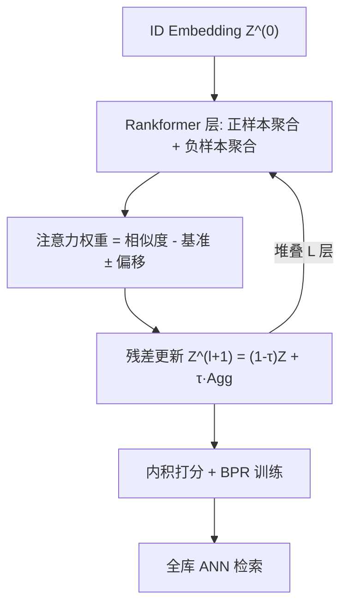

# Rankformer: A Graph Transformer for Recommendation based on Ranking Objective (基于排序目标的图 Transformer 推荐模型)

- **会议/期刊**: WWW 2025
- **作者与机构**: Sirui Chen, Shen Han, Jiawei Chen, Binbin Hu, Sheng Zhou, Gang Wang, Yan Feng, Chun Chen, Can Wang（浙江大学 / 蚂蚁集团 / 邦盛科技）
- **推荐链路定位**: 召回（协同过滤表征学习）
- **研究方向**: 协同过滤与双塔召回 / 图神经网络与知识图谱推荐
- **论文原文**: [https://arxiv.org/abs/2503.16927v1](https://arxiv.org/abs/2503.16927v1)
- **开源代码**: [https://github.com/StupidThree/Rankformer](https://github.com/StupidThree/Rankformer)

## TL;DR (1分钟核心速览)

现有推荐模型架构（尤其 GNN）本质是低通图平滑器，与"把正样本排到负样本之上"的排序目标存在结构性错位，堆叠层数还会加剧过平滑。本文提出 Rankformer：直接对 BPR 排序目标的梯度下降过程做算子级镜像，推导出一个正/负样本分离聚合、带基准项与偏移项的图 Transformer 层，并用矩阵恒等变换把全局聚合从 $O(nmd)$降到$O((n+m)d^2+Ed)$。在 4 个真实数据集、5-core + 7:1:2 划分、Full-Ranking 协议下，NDCG@20/Recall@20 平均相对提升 4.48%，叠加对比学习损失后进一步领先 XSimGCL、GFormer。

## Background & Motivation (背景与核心矛盾)

- **主流范式**: 以 LightGCN 为代表的 GNN 推荐模型通过邻域归一化聚合迭代精炼 embedding，被理论解释为低通滤波器（图平滑器），配合 BPR 排序损失训练。
- **前人局限**: 其一，图平滑把相连用户/物品拉近，与"拉开正负样本分数差"的排序目标方向不一致；其二，堆叠多层后正负样本分数差被压缩（过平滑），排序能力反而退化。图 1 显示：在随机初始化、不训练的条件下，LightGCN 随层数增加 NDCG@20 几乎不涨甚至下降，而 Rankformer 单调上升——说明架构本身就能携带排序归纳偏置。
- **核心洞察 (Key Insight)**: 排序目标的梯度 $\partial\mathcal{L}/\partial\mathbf{Z}$ 本身就指明了"embedding 该往哪走才能提升排序"，若把每一层网络设计成对该梯度步的模拟，则前向传播即等价于在 embedding 空间做多次排序导向的梯度上升。
- **本文切入点**: 不做启发式网络设计，而是从 BPR 梯度解析式反推注意力权重形式，得到"正负分离 + 相对基准 + 偏移"的 Transformer 层，并配套线性复杂度实现。

## Method (核心方法设计)

### 1. 整体框架 (Overall Architecture)

输入为用户/物品 ID embedding 矩阵 $\mathbf{Z}^{(0)}$，每层 Rankformer 对每个用户聚合其**正样本物品**与**负样本物品**（物品侧对称聚合正/负用户），注意力权重由"相似度 − 同类平均基准 ± 偏移"构成，聚合结果以步长$\tau$残差更新 embedding；堆叠$L$层后取最终 embedding 做内积打分，用 BPR 损失端到端训练。推理阶段仅需一次前向得到 embedding，再走 ANN 全库检索。关键工程点是负样本聚合的全局求和通过预计算$\sum_i \mathbf{z}_i\mathbf{z}_i^\top$ 等全局统计量转化为与边数线性相关的运算。

### 2. 关键设计拆解 (Key Designs)

1. **梯度镜像层（Gradient-Mirroring Layer）**：把"层"定义为对 BPR 梯度的一步模拟 $\mathbf{Z}^{(l+1)}=\mathbf{Z}^{(l)}-\tau\cdot\partial\mathcal{L}_{\text{BPR}}/\partial\mathbf{Z}^{(l)}$，取二次激活$\sigma(x)=x^2+cx$（二阶 Taylor 近似）后展开得：
$$\mathbf{z}_u^{(l+1)}=(1-\tau)\mathbf{z}_u^{(l)}+\frac{\tau}{C_u^{(l)}}\Big(\sum_{i\in\mathcal{N}_u^+}\Omega_{ui}^+\mathbf{z}_i^{(l)}+\sum_{i\in\mathcal{N}_u^-}\Omega_{ui}^-\mathbf{z}_i^{(l)}\Big)$$
直觉：正样本项把用户拉向"喜欢的物品"，负样本项把用户推离"不喜欢的物品"，两者共同刻画偏好，这是 LightGCN 完全缺失的信号。

2. **排序感知注意力权重（Ranking-Aware Attention）**：权重由三项构成
$$\Omega_{ui}^+=\frac{1}{d_u}\big(\mathbf{z}_u^\top\mathbf{z}_i-b_u^-+\alpha\big),\quad \Omega_{ui}^-=\frac{1}{m-d_u}\big(\mathbf{z}_u^\top\mathbf{z}_i-b_u^++\alpha\big)$$
其中相似度项是去掉投影参数的 vanilla attention；**基准项** $b_u^\pm$为同类平均相似度，把绝对分数转成"相对同类高出多少"的相对分数，直接对应排序语义；**偏移项**$\alpha$放大正样本权重、压低（甚至取负）负样本权重，同时充当平滑因子。表 1 表明 LightGCN（$\Omega^-=0$、无基准偏移）、GAT、vanilla Transformer 均为其特例。

3. **线性加速与训练稳定性**：负样本聚合的朴素计算是 $O(nmd)$，利用$\sum_{i\in\mathcal{N}_u^-}=\sum_{i\in\mathcal{I}}-\sum_{i\in\mathcal{N}_u^+}$与全局统计量$\sum_i\mathbf{z}_i\mathbf{z}_i^\top$预计算，把复杂度降到$O((n+m)d^2+Ed)$。实现上采用 embedding 归一化（相似度约束在$[-1,1]$）、首层 warm-up（均匀权重、不做负聚合）、归一化常数$C_u^{(l)}$ 防梯度爆炸。总损失为 BPR + L2 正则，负采样为全负样本集合上的均匀采样（BPR 标准做法）。

## Experimental Setup & Evaluation Protocol (实验设置与评估协议)

- **数据集与预处理**（标准 `5-core` 过滤）：

| 数据集 | #Users | #Items | #Interactions | 特征/场景说明 |
| :--- | :---: | :---: | :---: | :--- |
| Ali-Display | 17,730 | 10,036 | 173,111 | 淘宝展示广告 CTR |
| Epinions | 17,893 | 17,659 | 301,378 | 消费者评论社区 |
| Amazon-CDs | 51,266 | 46,463 | 731,734 | 亚马逊 CD 评分 |
| Yelp2018 | 167,037 | 79,471 | 1,970,721 | 本地生活评论 |

- **数据划分与防穿越**: 随机 `7:1:2` 比例划分训练/验证/测试（非时间戳切分，存在轻度未来信息泄漏风险）。
- **排名评测协议**: `Full-Ranking`（全库未交互物品排序），指标 Recall@20 与 NDCG@20，$K=20$。
- **对比基线与超参**: 基线覆盖 MF、LightGCN、DualVAE、MGFormer（推荐方法）、Nodeformer/DIFFormer/SGFormer（图 Transformer）、XSimGCL/GFormer（对比学习 SOTA）；显著性检验 $p<0.05$（表中 `*` 标注）。

## Key Experimental Results (实验关键数据)

### 1. 主实验对比 (Main Results)

| 方法 | Ali N@20 | Ali R@20 | Epinions N@20 | Epinions R@20 | Amazon N@20 | Amazon R@20 | Yelp N@20 | Yelp R@20 |
| :--- | :---: | :---: | :---: | :---: | :---: | :---: | :---: | :---: |
| MF | 0.0586 | 0.1094 | 0.0512 | 0.0847 | 0.0717 | 0.1255 | 0.0402 | 0.0766 |
| LightGCN | 0.0643 | 0.1174 | 0.0523 | 0.0850 | 0.0764 | 0.1317 | 0.0456 | 0.0842 |
| MGFormer | 0.0649 | 0.1083 | 0.0542 | 0.0854 | 0.0763 | 0.1324 | 0.0468 | 0.0869 |
| SGFormer | 0.0411 | 0.0769 | 0.0333 | 0.0571 | 0.0284 | 0.0524 | 0.0218 | 0.0427 |
| XSimGCL | 0.0650 | 0.1194 | 0.0558 | 0.0887 | 0.0796 | 0.1346 | 0.0500 | 0.0907 |
| GFormer | 0.0644 | 0.1176 | 0.0602 | 0.0978 | 0.0812 | 0.1366 | 0.0502 | 0.0897 |
| **Rankformer** | **0.0652** | **0.1208** | 0.0554 | 0.0895 | 0.0831 | 0.1412 | 0.0482 | 0.0890 |
| **Rankformer-CL** | **0.0680** | **0.1246** | **0.0633** | **0.1008** | **0.0877** | **0.1467** | **0.0523** | **0.0941** |
| Improv.(CL) | +4.57% | +4.32% | +5.22% | +3.11% | +8.00% | +7.41% | +4.29% | +3.71% |

### 2. 消融实验 (Ablation Study)

| 变体 | Ali N@20 | Epinions N@20 | Amazon N@20 | Yelp N@20 |
| :--- | :---: | :---: | :---: | :---: |
| w/o negative pairs | 0.0535 | 0.0409 | 0.0744 | 0.0429 |
| w/o benchmark | 0.0641 | 0.0535 | 0.0827 | 0.0475 |
| w/o offset ($\alpha=0$) | 0.0539 | 0.0544 | 0.0732 | 0.0349 |
| w/o normalization | 0.0291 | 0.0351 | 0.0357 | 0.0166 |
| **Rankformer** | **0.0652** | **0.0554** | **0.0831** | **0.0482** |

### 3. 关键实验发现 (Key Findings)

1. **负样本聚合是最大增益来源**：去掉负样本聚合后 Ali-Display NDCG@20 从 0.0652 跌至 0.0535（−18%），Epinions 从 0.0554 跌至 0.0409（−26%），远超去掉基准项（−1.7%/−3.4%）的损失，证明"用户不喜欢什么"与"喜欢什么"同等重要。
2. **归一化常数是训练可行性的前提**：去掉 $C_u^{(l)}$ 后所有数据集性能崩塌（Yelp 仅 0.0166，不足完整模型 1/3），出现梯度爆炸，说明该层本质是带步长的迭代优化，数值尺度控制不可省略。
3. **图 Transformer 基线在推荐任务上普遍失效**：Nodeformer/DIFFormer/SGFormer 在 Ali-Display 上 NDCG@20 仅 0.0205–0.0411，Amazon/Yelp 上甚至不收敛，印证"为节点分类设计的平滑归纳偏置"与排序目标不兼容；而 Rankformer 与对比学习正交可叠加，CL 版本在 Amazon-CDs 上相对 XSimGCL 提升 8.00%。

## Highlights & Limitations (亮点、对比与审稿批判)

- **与代表作对比**: 相比 LightGCN（仅正样本、均匀权重、纯平滑），Rankformer 引入负样本聚合与相对分数注意力；相比 GFormer（Transformer 仅用于构造对比视图）、MGFormer（启发式 mask + 位置编码），本文的层结构由排序目标梯度**推导**而非设计，且无需 signed 交互或复杂 mask。
- **可迁移亮点**: ①"从损失函数梯度反推网络层"的建模范式可迁移到 softmax 损失、序列推荐等场景；②负样本聚合的全局统计量预计算技巧，可复用于任何需要全库负采样聚合的模型。
- **审稿级局限批判**: ①随机 7:1:2 划分而非时间戳切分，存在未来交互泄漏，线上时序泛化性未验证；②理论分析（Lemma 3.1 与 Levenberg-Marquardt 的等价）依赖二次激活近似，实际增益与二阶优化的因果链较弱；③每层需维护全局 $\sum_i\mathbf{z}_i\mathbf{z}_i^\top$，物品规模极大时$d^2$ 统计量更新与多轮训练开销仍需实测。

## Rating (四维评分)

- **方法创新性 (Novelty)**: ⭐⭐⭐⭐⭐ （从排序目标梯度直接推导网络层，视角新颖且有 LM 算法理论支撑，非启发式拼装）
- **评估协议与实验扎实度 (Protocol & Experiments)**: ⭐⭐⭐⭐ （4 数据集 + 9 基线 + 显著性检验 + 完整消融，但随机划分而非时序划分削弱说服力）
- **写作与数学规范度 (Clarity & Rigor)**: ⭐⭐⭐⭐ （推导链条清晰、表 1 特例对照精炼，但部分推导置于附录、二次激活近似的合理性论证偏薄）
- **工业落地与复现价值 (Industrial & Practical Value)**: ⭐⭐⭐⭐ （代码开源，线性复杂度实现使其可扩展至 Yelp 级数据，但全局统计量维护与多层堆叠的工程成本需线上验证）

