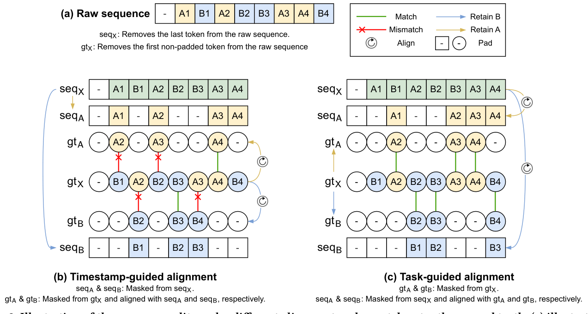
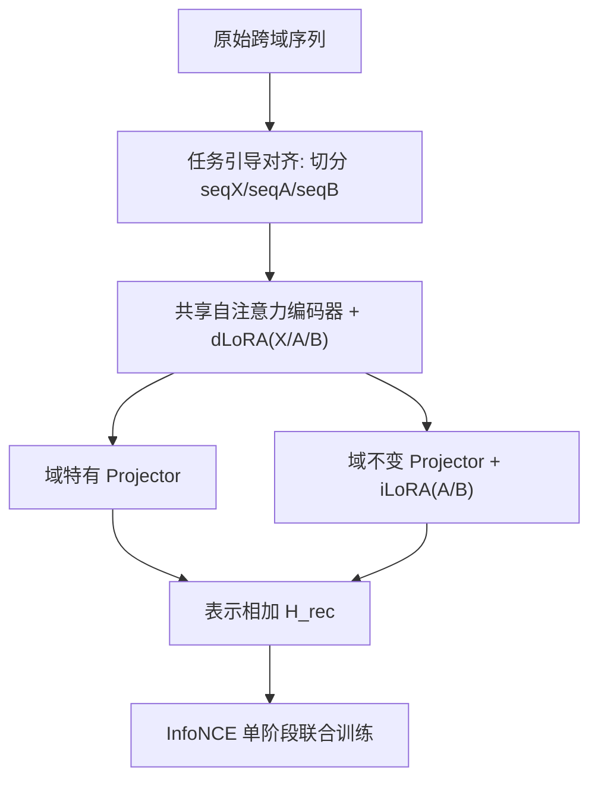
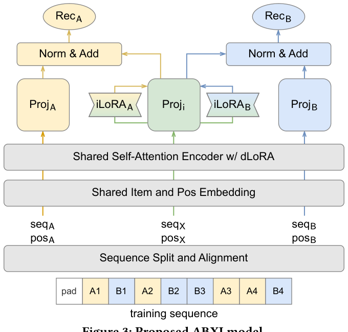

# ABXI: Invariant Interest Adaptation for Task-Guided Cross-Domain Sequential Recommendation (任务引导的域不变兴趣适配跨域序列推荐)

- **会议/期刊**: WWW 2025 (WebConf '25)
- **作者与机构**: Qingtian Bian, Marcus Vinícius de Carvalho, Tieying Li, Jiaxing Xu, Hui Fang, Yiping Ke（南洋理工大学、东北大学、上海财经大学）
- **推荐链路定位**: 召回（序列化 next-item 召回）
- **研究方向**: 跨域与多场景推荐 / 序列与会话推荐
- **论文原文**: [https://arxiv.org/abs/2501.15118v2](https://arxiv.org/abs/2501.15118v2)
- **开源代码**: [https://github.com/DiMarzioBian/ABXI](https://github.com/DiMarzioBian/ABXI)

## TL;DR (1分钟核心速览)

跨域序列推荐（CDSR）的两大痛点是：跨域知识未经筛选就被直接迁移（域特有噪声污染目标域），以及按时间戳对齐域序列导致"预测错配"（输入 token 与标签不同域）。ABXI 提出**任务引导对齐**（按标签所属域重排域序列，统一正样本）与**双 LoRA 机制**（dLoRA 让共享编码器切换域模式，iLoRA 把域不变兴趣适配到各域），在 Food-Kitchen / Beauty-Electronics / Movie-Book 三组 Amazon 数据上以 1:999 采样排序评测，MRR 相对最强基线提升约 8%–17%。

## Background & Motivation (背景与核心矛盾)

- **主流范式**: 将域内序列合并为跨域序列作为"桥梁"，用多个自注意力编码器分别编码跨域与域内序列，再按时间戳逐 token 相加融合（C2DSR、DREAM、CD-ASR 等）。
- **前人局限一（知识未过滤）**: 现有方法把"跨域兴趣"与"域不变兴趣"混为一谈，直接迁移未过滤的跨域知识，导致科幻偏好被共享的同时，言情小说/喜剧电影等域特有偏好也被错误扩散，形成负迁移。
- **前人局限二（预测错配）**: 时间戳对齐下，若输入 token 与 ground truth 属于不同域（如图 2b 中用 B3 预测 A4），当前 token 携带的域特有信息与目标域不符，反而损害预测。
- **核心洞察 (Key Insight)**: 跨域序列中真正可迁移的只是"域不变"子空间；且域内序列的对齐基准应是**标签所属域**而非时间戳，这样域内与跨域序列的监督信号可以完全统一。
- **本文切入点**: 用任务引导对齐统一正样本，再用 LoRA 在单阶段训练中同时完成"域模式切换"与"域不变兴趣适配"。

<figure class="paper-figure" markdown="span">
  <figcaption>图 2：不同对齐方式下序列划分的示意图，其中 gt 表示真实标签。(a) 展示输入原始序列。(b) 和 (c) 分别展示时间戳引导对齐与任务引导对齐的划分结果。</figcaption>
</figure>

## Method (核心方法设计)

### 1. 整体框架 (Overall Architecture)

输入用户原始跨域序列，先按 seq2seq 范式切出跨域序列 seqX 与跨域标签 gtX；对 gtX 按域掩码得到 gtA/gtB，再将 seqX 按域掩码并按 gtA/gtB 位置重排（补 padding），得到与 seqX 逐位置目标一致的 seqA/seqB。三条序列共享 Item/Position Embedding 后进入**同一个**自注意力编码器，编码器 FFN 旁挂三个 dLoRA 分别对应 X/A/B 模式。编码输出分两路：域特有 projector 得到 $\boldsymbol{H}^{p}_{A},\boldsymbol{H}^{p}_{B}$；域不变 projector 加两个 iLoRA 得到$\boldsymbol{H}^{p}_{i2A},\boldsymbol{H}^{p}_{i2B}$。两路相加得最终表示，用单一 InfoNCE 联合优化。

<figure class="paper-figure" markdown="span">
  <figcaption>图 3：所提出的 ABXI 模型。</figcaption>
</figure>

### 2. 关键设计拆解 (Key Designs)

1. **任务引导对齐 (Task-Guided Alignment)**：痛点是用 B3 预测 A4 时域信息错配。做法是把 seqX 中属于 A 的 token 保留、B 的 token 掩掉，再按 gtA 的位置重新排布并补 padding，使 seqA 与 seqX 在每个位置上共享同一标签。由于 gtA/gtB 仅作对齐中间量、不参与损失，跨域与域内序列的监督被统一为一套正负样本，省去独立的域内损失项，也从根源上消除了错配。

2. **dLoRA：共享编码器的域模式切换**：痛点是多编码器参数冗余且割裂共享知识。作者只保留一个 SASRec 式编码器，在 FFN 分支并联三个低秩模块，前向为 $\text{LoRA}(\boldsymbol{X})=\boldsymbol{M}^{\uparrow}_{B}\boldsymbol{M}^{\downarrow}_{A}\boldsymbol{X}$，其中$\boldsymbol{M}^{\downarrow}_{A}\in\mathbb{R}^{r\times d}$、$\boldsymbol{M}^{\uparrow}_{B}\in\mathbb{R}^{d\times r}$。编码更新为$\boldsymbol{H}^{enc}_{X}=\text{LN}\big(\boldsymbol{H}_{X}+\text{Drop}(\text{FFN}(\boldsymbol{H}_{X}))+\text{Drop}(\text{dLoRA}_{X}(\boldsymbol{H}_{X}))\big)$。低秩假设契合推荐数据的稀疏低秩特性，用极少参数即可保留域特有细微差异。

3. **iLoRA：域不变兴趣的按域适配**：域不变 projector 从 $\boldsymbol{H}^{enc}_{X}$抽取共享兴趣，再经两个 iLoRA 分别适配到 A/B：$\boldsymbol{H}^{p}_{i2A}=\text{LN}\big(\boldsymbol{H}^{enc}_{X}+\text{Drop}(\text{Proj}_{i}(\boldsymbol{H}^{enc}_{X}))+\text{Drop}(\text{iLoRA}_{A}(\boldsymbol{H}^{enc}_{X}))\big)$，最终$\boldsymbol{H}^{rec}_{A}=\boldsymbol{H}^{p}_{A}+\boldsymbol{H}^{p}_{i2A}$。直觉是"共享子空间 + 轻量域偏移"比"直接迁移整段跨域表示"更不易引入负迁移。

4. **训练目标、负采样与推理效率**：每个正样本在同域随机采 $N_{neg}=128$个未交互物品，损失为$\mathcal{L}=\frac{1}{|\boldsymbol{H}^{rec}_{A}|}\sum_{h}f(h)+\frac{1}{|\boldsymbol{H}^{rec}_{B}|}\sum_{h}f(h)$，其中$f(h)=-\log\frac{\exp(h\cdot e_{+}/\tau)}{\sum_{e\in\boldsymbol{E}}\exp(h\cdot e/\tau)}$，$\tau=0.75$。所有 LoRA 与其他组件单阶段联合训练（非微调范式）。复杂度由共享编码器主导，约$O(dL^{2}+Ld^{2}+dj)$，扩展至$N$域只需 1 个编码器 +$N$个 dLoRA +$N$个 iLoRA +$N$ 个域 projector。

## Experimental Setup & Evaluation Protocol (实验设置与评估协议)

- **数据集与预处理**: Amazon 评论数据，保留双域均有交互的用户，按时间戳聚合排序，过滤交互少于 5 次的物品（5-core），截断至最近 50 次交互后二次过滤掉不再跨域的用户。

| 数据集 | #Users | #Items (A/B) | #Interactions (A/B) | 稀疏度/密度 | 特征/场景说明 |
| :--- | :---: | :---: | :---: | :---: | :--- |
| Food-Kitchen | 7,144 | 11,837 / 16,258 | 83,663 / 89,885 | 极稀疏 | Grocery-Food → Home-Kitchen |
| Beauty-Electronics | 4,474 | 10,379 / 14,188 | 50,329 / 63,800 | 极稀疏 | Beauty → Electronics |
| Movie-Book | 28,350 | 35,712 / 90,958 | 347,650 / 403,147 | 较稠密 | Movies-TV → Books |

- **数据划分与防穿越 (Splitting Strategy)**: `Leave-One-Out`，每用户最后两次交互分别作验证/测试标签，倒数第三次及以前作输入。
- **排名评测协议 (Ranking Protocol)**: `Sampled Ranking`，每个 ground truth 从同域随机采 999 个负候选（1:999），报告 HR@5、HR@10、NDCG@10、MRR；5 个随机种子取均值方差。
- **对比基线与超参设置**: 四类基线——ST-SDSR（SASRec-1/BERT4Rec-1）、DT-SDSR（SASRec-2/BERT4Rec-2）、ST-CDSR（CD-SASRec/CD-ASR/MGCL）、DT-CDSR（C2DSR/DREAM）。Embedding 维度 $d=256$，编码器 1 层，负样本 128，AdamW，学习率$\{10^{-3},10^{-4}\}$，早停 patience 60，配对 t 检验$p<0.01$。

## Key Experimental Results (实验关键数据)

### 1. 主实验对比 (Main Results)

以 MRR 为核心指标（HR@10 括号内），最优加粗：

| 方法 | Food | Kitchen | Beauty | Electronics | Movie | Book |
| :--- | :---: | :---: | :---: | :---: | :---: | :---: |
| SASRec-1 (ST) | 0.1332 | 0.0900 | 0.1295 | 0.0982 | 0.1874 | 0.1147 |
| BERT4Rec-2 (DT) | 0.1427 | 0.0948 | 0.1363 | 0.1101 | 0.1697 | 0.1176 |
| CD-ASR (ST-CDSR) | 0.1368 | 0.0941 | 0.1211 | 0.0987 | 0.1743 | 0.1244 |
| MGCL (ST-CDSR) | 0.1260 | 0.1017 | 0.1001 | 0.1118 | 0.1509 | 0.0946 |
| C2DSR (DT-CDSR) | 0.1311 | 0.0903 | 0.1290 | 0.0960 | 0.1700 | 0.1025 |
| DREAM (DT-CDSR) | 0.1441 | 0.0956 | 0.1447 | 0.0895 | 0.1848 | 0.1118 |
| **ABXI** | **0.1679** | **0.1206** | **0.1846** | **0.1200** | **0.2118** | **0.1502** |
| Improv.% (vs 最强基线) | +16.5% | +18.6% | +27.6% | +7.3% | +14.6% | +20.7% |

HR@10 上 ABXI 同样全面领先（如 Beauty 0.3835 vs. SASRec-2 的 0.3262，+17.6%；Book 0.2571 vs. CD-SASRec 0.2253，+14.1%）。

### 2. 消融实验 (Ablation Study)

MRR 结果（RQ2/RQ3）：

| 变体 | 说明 | Food | Kitchen | Beauty | Electronics | Movie | Book |
| :--- | :--- | :---: | :---: | :---: | :---: | :---: | :---: |
| ABXI | 完整模型 | **0.1679** | **0.1206** | **0.1846** | **0.1200** | **0.2118** | **0.1502** |
| Vts | 回退时间戳对齐 | 0.1290 | 0.0870 | 0.1389 | 0.0923 | 0.1803 | 0.1265 |
| V1 | 去 dLoRA | 0.1673 | 0.1182 | 0.1792 | 0.1177 | 0.2104 | 0.1488 |
| V2 | 去 projector | 0.1648 | 0.1164 | 0.1792 | 0.1171 | 0.2096 | 0.1497 |
| V3 | 去 iLoRA | 0.1679 | 0.1193 | 0.1823 | 0.1193 | 0.2101 | 0.1488 |
| V4 | 三者全去 | 0.1619 | 0.1106 | 0.1653 | 0.1164 | 0.1980 | 0.1356 |
| Ve3 | 3 个独立编码器替代共享+dLoRA | 0.1659 | 0.1198 | 0.1729 | 0.1112 | 0.2114 | 0.1488 |
| Vdp3 | 稠密 MLP 替代 dLoRA | 0.1668 | 0.1208 | 0.1729 | 0.1112 | 0.2114 | 0.1488 |
| Vip3 | X→A/X→B projector 替代 iLoRA | 0.1656 | 0.1209 | 0.1781 | 0.1146 | 0.2102 | 0.1509 |

### 3. 关键实验发现 (Key Findings)

1. **对齐方式是最强杠杆**：Vts 回退时间戳对齐后，Beauty MRR 从 0.1846 跌至 0.1389（-24.8%）、Kitchen 从 0.1206 跌至 0.0870（-27.9%），跌幅远超任何模块移除，直接验证"预测错配"是 DT-CDSR 的真实瓶颈——这也解释了为何 C2DSR/DREAM 在多数数据集上打不过 SASRec-2。
2. **LoRA 优于稠密层且非冗余**：Vdp3（稠密 MLP 替 dLoRA）在 Beauty/Electronics 上 MRR 仅 0.1729/0.1112，低于 ABXI 的 0.1846/0.1200；Ve3（三独立编码器）同样退化，说明任务引导对齐后域内编码器与跨域编码器学到重复知识，共享编码器 + 低秩切换才是正解。
3. **秩与数据规模反相关**：最优秩为 FK $(r_d{=}64,r_i{=}64)$、BE$(16,64)$、MB$(4,4)$——小数据集需更大秩补容量，大数据集小秩即可，且盲目增大 iLoRA 容量（Vip3）会干扰域不变 projector 学习，导致性能下降。

## Highlights & Limitations (亮点、对比与审稿批判)

- **与代表作对比 (vs. Prior Work)**: C2DSR 用图+自注意力双通道并做对比增广，DREAM 用独立编码器做 specific-to-cross 迁移与用户级对比学习，二者均按时间戳对齐且迁移未过滤知识；ABXI 的本质区别是**把对齐基准从"时间"换成"任务标签"**，并用 LoRA 把"域切换"与"域不变适配"解耦为两个低秩算子，参数量与编码器数量都显著更少。
- **可迁移亮点**: (1) 任务引导对齐可推广到任何"多源序列 + 单标签"的融合场景（如多行为序列、多场景 CTR）；(2) 用 dLoRA 做"单编码器多域模式切换"是替代多塔编码器的低成本方案，适合工业多业务线共用底座。
- **审稿级局限批判**: (1) 评测采用 1:999 采样排序而非 Full-Ranking，负样本仅同域均匀采样，未考察难负例下的排序稳定性；(2) 仅覆盖双域设定，$N$域扩展只有复杂度论述而无实验；且秩$r$ 需按数据集网格搜索（4 到 64 跨度大），跨域数量增加后超参搜索成本与推理时的多 LoRA 切换开销未被量化。

## Rating (四维评分)

- **方法创新性 (Novelty)**: ⭐⭐⭐⭐ （"任务引导对齐"精准命中被忽视的预测错配问题，双 LoRA 分工设计简洁且有低秩理论直觉支撑）
- **评估协议与实验扎实度 (Protocol & Experiments)**: ⭐⭐⭐⭐ （三组跨域数据、5 种子、配对 t 检验、消融与秩敏感性齐全，但采样排序与双域限定略削弱说服力）
- **写作与数学规范度 (Clarity & Rigor)**: ⭐⭐⭐⭐ （图 2 对齐示意与公式推导清晰，LoRA 前向与损失定义规范，复杂度分析到位）
- **工业落地与复现价值 (Industrial & Practical Value)**: ⭐⭐⭐⭐⭐ （代码已开源，单编码器 + 低秩模块显著省参数，天然适配多业务线共享底座的工程诉求）

