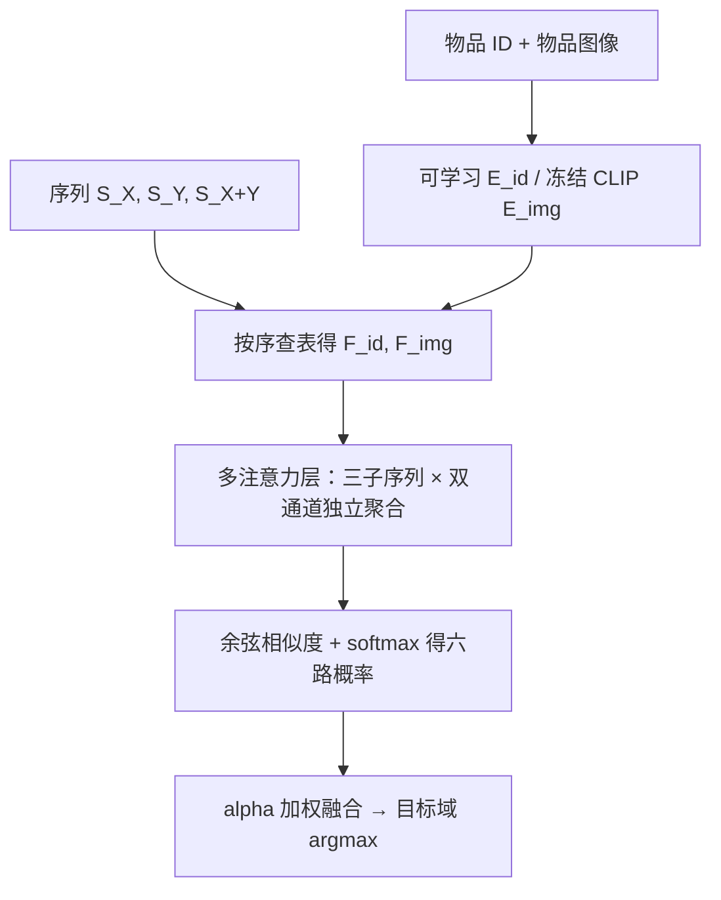
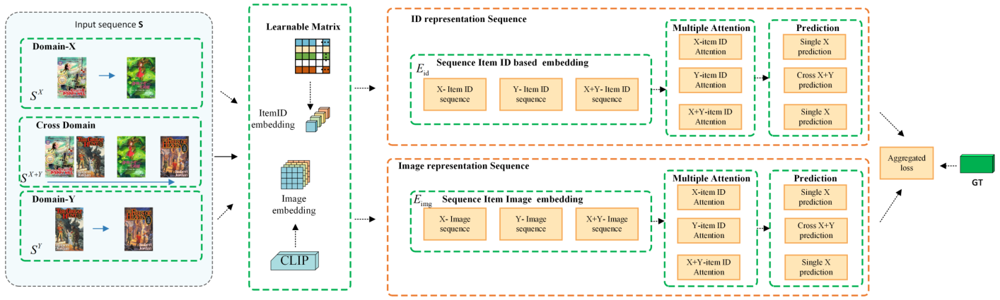

# Image Fusion for Cross-Domain Sequential Recommendation (跨域序列推荐的图像融合)

- **会议/期刊**: WWW Companion 2025
- **作者与机构**: Wangyu Wu, Siqi Song, Xianglin Qiu, Xiaowei Huang, Fei Ma, Jimin Xiao（西交利物浦大学 / 利物浦大学）
- **推荐链路定位**: 召回（下一物品预测）
- **研究方向**: 跨域与多场景推荐 / 多模态推荐
- **论文原文**: [https://arxiv.org/abs/2502.15694v2](https://arxiv.org/abs/2502.15694v2)
- **开源代码**: 暂未开源

## TL;DR (1分钟核心速览)

CDSR 现有方法只用物品 ID 建模序列，既忽略物品视觉表征，又把两域行为混在一条序列里导致"域偏置"（行为量大的域主导表征）。IFCDSR 用冻结 CLIP 生成图像嵌入与可学习 ID 矩阵并行构成双通道物品表征，再对 $S_X$、$S_Y$、$S_{X+Y}$三条子序列分别做注意力聚合，按$\alpha$ 加权融合 ID 与图像两路 softmax 概率。在 Amazon Food-Kitchen / Movie-Book 重划分数据上，MRR 相对最强基线 MIFN 提升约 5.9%（Food）与 20.4%（Movie）。

## Background & Motivation (背景与核心矛盾)

- **主流范式**: $\pi$-Net、MIFN、Tri-CDR 等以门控迁移或知识图谱增强的方式，在单域序列表征之上做跨域知识传递，输入统一为物品 ID 嵌入。
- **前人局限**: 其一，跨域交互被拼成一条序列后不加区分地送入同一编码器，行为量大的域会压制另一域，形成跨域对齐缺失导致的域偏置；其二，物品的视觉表征完全缺席，而标题/类目相近的物品在图像上可能差异极大，直接影响用户点击意愿。
- **核心洞察 (Key Insight)**: 用户对物品的第一印象来自图像，图像通道与 ID 通道刻画的是互补的偏好维度；同时域内序列与跨域合并序列应各自独立聚合，才能避免域间相互污染。
- **本文切入点**: 把冻结 CLIP 图像嵌入作为与 ID 并列的第二表征通道，并用"多注意力 + 概率级融合"替代"拼接序列 + 单编码器"。

## Method (核心方法设计)

### 1. 整体框架 (Overall Architecture)

模型分两段。**表征准备段**：对域 $X$、$Y$的全部物品同时构造可学习 ID 矩阵$\mathbf{E}_{id}\in\mathbb{R}^{(|\mathcal{X}|+|\mathcal{Y}|)\times q}$与冻结 CLIP 图像矩阵$\mathbf{E}_{img}\in\mathbb{R}^{(|\mathcal{X}|+|\mathcal{Y}|)\times e}$。**预测段**：将用户序列拆为$S_X$、$S_Y$、$S_{X+Y}$三条子序列，各自按序查表得到 ID 序列嵌入$\mathbf{F}_{id}$与图像序列嵌入$\mathbf{F}_{img}$，分别经注意力层聚合，取末位向量$h$ 与对应物品矩阵做余弦相似度并 softmax，得到六路（3 子序列 × 2 通道）下一物品概率，加权求和后在目标域内取 argmax。

<figure class="paper-figure" markdown="span">
  <figcaption>图2：我们提出的 IFCDSR 的概览。来自域 𝑋 和 𝑌 的物品使用可学习的基于 ID 的矩阵 𝐸𝑖𝑑 和冻结的 CLIP 图像编码器 𝐸𝑖𝑚𝑔 进行嵌入。输入序列 S 由 𝑆𝑋、𝑆𝑌 和 𝑆𝑋+𝑌 组成，对物品 ID 和图像特征进行嵌入，然后通过多个注意力层处理以捕获序列内和序列间关系。注意力聚合后的嵌入与 𝐸𝑖𝑑 和 𝐸𝑖𝑚𝑔 计算余弦相似度，用于预测下一个物品。</figcaption>
</figure>

### 2. 关键设计拆解 (Key Designs)

1. **双通道物品表征与图像增强相似度**：痛点是 ID 嵌入对视觉差异无感知。做法是保持 CLIP 编码器冻结（不引入额外训练开销与过拟合风险），仅让 ID 矩阵可学习，两路各自独立完成"序列聚合 → 余弦打分"：
$\mathrm{Sim}(h_{img},\mathbf{E}_{img})=\frac{h_{img}\cdot \mathbf{E}_{img}^{\top}}{\lVert h_{img}\rVert\,\lVert \mathbf{E}_{img}^{\top}\rVert}$
直觉上，图像通道提供的是跨域共享的"外观语义"，对冷门物品与跨域迁移尤其友好，因为视觉相似性不依赖 ID 共现统计。

2. **多注意力分解与概率级融合**：痛点是合并序列被大域主导。做法是不在嵌入层拼接，而是让 $S_X$、$S_Y$、$S_{X+Y}$各自过注意力层，得到$h_{X,id},h_{X,img},h_{Y,id},h_{Y,img},h_{X+Y,id},h_{X+Y,img}$ 六组表征，域内先做通道融合：
$P_X(x_{t+1}\mid S)=\alpha P_{X,id}(x_{t+1}\mid S)+(1-\alpha)P_{X,img}(x_{t+1}\mid S)$再在推理时做跨域融合$P(x_i\mid S)=P_X+\lambda_1 P_Y+\lambda_2 P_{X+Y}$。在概率空间而非表征空间融合，使各域贡献可被显式系数调节，天然抑制域偏置。

3. **训练目标与推理开销**：三条子序列各用交叉熵，总损失 $\mathcal{L}=\mathcal{L}_X+\lambda_1\mathcal{L}_Y+\lambda_2\mathcal{L}_{X+Y}$，采用 softmax 全库打分（in-batch 式负样本即全物品），无额外负采样器。超参$\alpha=0.7$、$\lambda_1=0.1$、$\lambda_2=0.4$、$q=256$、$e=512$、dropout 0.3、batch 256、Adam、100 epoch。推理时 CLIP 嵌入可离线预计算并缓存，在线仅需注意力前向与两次矩阵乘，开销与 SASRec 同级。

## Experimental Setup & Evaluation Protocol (实验设置与评估协议)

- **数据集与预处理**: Amazon 评论数据构造两个 CDSR 场景，保留双域均有交互的用户，过滤交互数 $<10$ 的用户与物品，并要求跨域序列在每个域至少含 3 个物品。

| 场景 | 域 | #Items | #Train | #Valid | #Test | 平均序列长度 |
| :--- | :--- | :---: | :---: | :---: | :---: | :---: |
| Food-Kitchen | Food | 29,207 | 34,117 | 2,722 | 2,747 | 9.91 |
| Food-Kitchen | Kitchen | 34,886 | — | 5,451 | 5,659 | — |
| Movie-Book | Movie | 36,845 | 58,515 | 2,032 | 1,978 | 11.98 |
| Movie-Book | Book | 63,937 | — | 5,612 | 5,730 | — |

- **数据划分与防穿越 (Splitting Strategy)**: 按时间取最新的一段交互序列，**等分**为验证集与测试集，其余作训练集（时间序切分，避免未来信息泄漏）。
- **排名评测协议 (Ranking Protocol)**: 采用 **Full-Ranking**（对目标域全库候选做 softmax 排序），指标为 MRR 与 NDCG@{5,10}；未使用采样负例排序，故数值偏低但可比性强。
- **对比基线与超参设置**: 基线含单域序列模型 GRU4Rec、SASRec、SR-GNN，跨域模型 PSJNet、MIFN、Tri-CDR；嵌入维度 $q=256$、图像维度$e=512$，与 MIFN 保持同参设置以保证公平；原文未报告显著性检验。

## Key Experimental Results (实验关键数据)

### 1. 主实验对比 (Main Results)

Food-Kitchen 场景（%）：

| Model | Food MRR | Food NDCG@5 | Food NDCG@10 | Kitchen MRR | Kitchen NDCG@5 | Kitchen NDCG@10 |
| :--- | :---: | :---: | :---: | :---: | :---: | :---: |
| GRU4Rec | 5.79 | 5.48 | 6.13 | 3.06 | 2.55 | 3.10 |
| SASRec | 7.30 | 6.90 | 7.79 | 3.79 | 3.35 | 3.93 |
| SR-GNN | 7.84 | 7.58 | 8.35 | 4.01 | 3.47 | 4.13 |
| MIFN | 8.55 | 8.28 | 9.01 | 4.09 | 3.57 | 4.29 |
| Tri-CDR | 8.35 | 8.18 | 8.89 | 4.29 | 3.63 | 4.33 |
| **IFCDSR** | **9.05** | **8.85** | **9.92** | **4.95** | **4.56** | **5.24** |
| Improv.% (vs 最优基线) | +5.85% | +6.88% | +10.10% | +15.38% | +25.62% | +21.02% |

Movie-Book 场景（%）：

| Model | Movie MRR | Movie NDCG@5 | Movie NDCG@10 | Book MRR | Book NDCG@5 | Book NDCG@10 |
| :--- | :---: | :---: | :---: | :---: | :---: | :---: |
| GRU4Rec | 3.83 | 3.14 | 3.73 | 1.68 | 1.34 | 1.52 |
| SASRec | 3.79 | 3.23 | 3.69 | 1.81 | 1.41 | 1.71 |
| SR-GNN | 3.85 | 3.27 | 3.78 | 1.78 | 1.40 | 1.66 |
| PSJNet | 4.63 | 4.06 | 4.76 | 2.44 | 2.07 | 2.35 |
| MIFN | 5.05 | 4.21 | 5.20 | 2.51 | 2.12 | 2.31 |
| Tri-CDR | 5.15 | 4.62 | 5.05 | 2.32 | 2.08 | 2.22 |
| **IFCDSR** | **6.08** | **5.02** | **5.86** | **2.75** | **2.37** | **2.65** |
| Improv.% (vs 最优基线) | +18.06% | +8.66% | +12.69% | +9.56% | +11.79% | +12.77% |

### 2. 消融实验 (Ablation Study)

Movie 域 MRR（%）：

| 配置 | MRR | 增量 |
| :--- | :---: | :---: |
| 原始框架（仅 ID，单序列） | 5.03 | — |
| + 图像融合（无多注意力） | 5.63 | +0.60 |
| + 图像融合 + 多注意力（完整 IFCDSR） | **6.08** | +0.45 |

### 3. 关键实验发现 (Key Findings)

1. **图像通道是主要增益来源**：仅加入 CLIP 图像融合即带来 +0.60 MRR（约 11.9% 相对提升），超过多注意力模块的 +0.45，说明 CDSR 的性能瓶颈确实在物品表征的信息缺失而非序列编码器容量。
2. **域偏置在弱势域上更严重、修复收益更大**：Kitchen 与 Book 作为交互量较小的域，NDCG@5 分别提升 25.6% 与 11.8%，显著高于 Food 的 6.9%，印证"多注意力分解 + 概率级融合"确实缓解了大域压制小域的问题。
3. **跨域增益依赖域间语义距离**：Movie-Book 场景 Movie 域 MRR 相对提升 18.1%，远高于 Food-Kitchen 的 5.9%，提示当两域视觉/语义空间差异较大时，图像通道提供的跨域对齐信号价值更高。

## Highlights & Limitations (亮点、对比与审稿批判)

- **与代表作对比 (vs. Prior Work)**: 相比 $\pi$-Net / MIFN 的"门控迁移 + 单序列编码"，本文不改动跨域迁移结构，而是从**输入侧**（增加图像通道）与**输出侧**（概率级多路融合）两处切入，工程改动小、可插拔性强；相比 DASL 依赖双域序列配对假设，本文对$S_X$、$S_Y$ 独立编码，不要求域间严格对齐，对非重叠用户场景更稳健。
- **可迁移亮点**: 其一，"冻结 CLIP 嵌入 + 可学习 ID 矩阵"的双通道并行打分、概率级 $\alpha$ 融合，可直接移植到多模态召回的双塔结构；其二，把合并序列拆成"域内 + 跨域"三条子序列分别聚合再融合概率，是抑制多场景/多业务域偏置的通用低成本手段。
- **审稿级局限批判**: 其一，图像通道仅用末位向量 $h$做余弦打分，未建模图像序列内部的时序演化，且$\alpha,\lambda_1,\lambda_2$ 为手工设定，缺少敏感度分析；其二，实验仅在 Amazon 两个双域场景、单一 Full-Ranking 协议下验证，无显著性检验、无冷启动/长尾分桶与线上 A/B，且未与近年基于图或对比学习的 CDSR 强基线对比，泛化性证据偏薄。

## Rating (四维评分)

- **方法创新性 (Novelty)**: ⭐⭐⭐ （图像通道与多注意力分解均为工程级组合创新，缺少理论或谱分析支撑，但"概率级跨域融合"思路清晰有效）
- **评估协议与实验扎实度 (Protocol & Experiments)**: ⭐⭐⭐ （Full-Ranking 协议规范、消融完整，但仅两个场景、无显著性检验与冷启动分桶，基线覆盖偏旧）
- **写作与数学规范度 (Clarity & Rigor)**: ⭐⭐⭐ （公式与符号定义清楚、框架图完整，但正文存在方法名 IFCDRS/IFCDSR 拼写不一致、贡献段与实验段数据集数量表述矛盾等疏漏）
- **工业落地与复现价值 (Industrial & Practical Value)**: ⭐⭐⭐⭐ （CLIP 嵌入可离线缓存、在线开销与 SASRec 同级，模块可插拔，但代码未开源且超参需人工调优）

