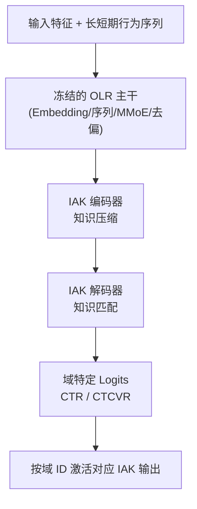

# Pre-train and Fine-tune: Recommenders as Large Models (预训练与微调：将推荐系统视作大模型)

- **会议/期刊**: WWW 2025 (Companion)
- **作者与机构**: Zhenhao Jiang, Chenghao Chen, Hao Feng, Yu Yang, Jin Liu, Jie Zhang, Jia Jia, Ning Hu（香港中文大学（深圳） & 阿里巴巴集团）
- **推荐链路定位**: 精排（CTR/CTCVR 多任务预估）
- **研究方向**: 跨域与多场景推荐 / CTR 预估与特征交叉
- **论文原文**: [https://arxiv.org/abs/2501.14268v1](https://arxiv.org/abs/2501.14268v1)
- **开源代码**: 暂未开源

## TL;DR (1分钟核心速览)

工业推荐系统结构复杂、日增 TB 级数据，多域学习一旦改动结构就需从零重训，成本不可接受。本文把十亿参数预训练推荐大模型 OLR 视作"大模型"，从信息瓶颈视角将微调拆解为**知识压缩 + 知识匹配**两阶段，设计即插即用的编码器-解码器模块 IAK（高斯参数近似 + KL 正则），冻结主干仅用一周域内数据微调。在 11 个真实工业数据集上，相对零样本 OLR 平均 CTR-AUC 提升 +0.26%~+0.66%，线上多 IAK 部署带来净 GMV +0.74%。

## Background & Motivation (背景与核心矛盾)

- **主流范式**: 多场景/多地域/多时段被统一视为多域学习问题，代表工作 STAR、ADIN、SAR-Net 采用"共享参数 + 域特定参数"的单模型服务所有域。
- **前人局限**: ① 新增一个域就要改动网络结构并全量重训，而工业平台每日产生数 TB 数据、模型按增量方式学习，结构大改意味着数千 TB 历史数据重训，成本不可接受；② 单模型服务所有域时，早餐 vs. 晚餐这类用户兴趣的**突变式漂移**难以被精细刻画。
- **核心洞察 (Key Insight)**: 预训练模型学到的通用业务知识中，只有一部分对下游域有用，其余应被"遗忘"——这恰好对应信息瓶颈中"最小充分表征"的压缩-保留权衡；且微调只需一周域内数据即可收敛。
- **本文切入点**: 不改主干、不重训，用信息瓶颈理论指导设计一个轻量适配核 IAK，把微调显式建模为"压缩通用知识 → 匹配下游任务"两阶段。

## Method (核心方法设计)

### 1. 整体框架 (Overall Architecture)

OLR 主干（Embedding 层 → 长短期序列模块 → MMoE 式主网 → 去偏模块 → 堆叠 logits 层，约十亿参数、千亿样本预训练）**完全冻结**以保留通用业务知识；在主干输出之后插入 IAK 编码器-解码器（均为 MLP），编码器负责把通用知识压缩为与下游任务相关的表征，编码器+解码器共同完成新旧知识融合匹配，最终输出域特定的 logits。训练时仅更新 IAK 参数，每个下游域（场景/城市/餐段）对应一个独立 IAK；线上推理采用"全 IAK 并行前向 + 按域 ID 选择输出"的策略。

### 2. 关键设计拆解 (Key Designs)

1. **微调的信息瓶颈理论刻画**：痛点在于微调在推荐领域长期缺乏可解释性。作者定义微调目标为在通用知识 $G$与下游任务$T$之间求最小充分表征$\hat{G}$：

$$\hat{G} = \arg\min -I(\hat{G};T) + \beta I(\hat{G};G)$$

并进一步拆为两阶段：知识压缩 $\bar{G}=\arg\min D_{KL}(\bar{G}\|T)$与知识匹配$\hat{G}=\arg\min D_{KL}(\bar{G}+f(T;\bar{G})\|T)$。直觉上，第一项要求保留任务相关信息，第二项惩罚保留过多通用信息，二者张力正是"遗忘无关业务知识"的数学表达。

2. **高斯近似把理论落到可优化损失**：直接优化互信息不可行。作者对第一项用交叉熵近似 $-I(\hat{G};T)\approx H(\hat{Y}|Y)$；对第二项，将编码器参数初始化设为$w_0\sim\mathcal{N}(0,\mathbf{I})$、训练后参数设为$w\sim\mathcal{N}(\mu,\sigma)$，用参数分布偏移$D_{KL}(w\|w_0)$ 代理信息压缩量（假设：参数分布偏移与所含信息正相关），最终损失为：

$$\mathcal{L}_{IAK} = H(\hat{Y}|Y) + D_{KL}(w\|w_0)$$

物理直觉清晰：若训练后参数仍贴近初始高斯，说明输入样本对模型扰动小、压缩率高，即成功"遗忘"了与下游无关的通用知识。

3. **训练目标、负采样与推理效率**：总损失即上述交叉熵 + KL 正则，无额外负采样设计（CTR/CTCVR 为二分类点式预估）。工程上有两点关键：① **并行推理与域激活** $\mathcal{F}=\sum_{i}^{N_d}\mathcal{F}_i\times\mathbb{I}(d=d_i)$，避免为每域独立部署模型；② **动态批感知训练**，按批内样本数$N_B$与梯度倒数$W$调整学习率$\hat{\lambda}=\text{SoftMax}(N_B\odot W)\times\lambda$，缓解小域批内样本缺失导致的梯度震荡。

## Experimental Setup & Evaluation Protocol (实验设置与评估协议)

- **数据集与预处理**: 采集自十亿级在线外卖平台 2023-07-20 至 07-27 的真实行为日志，共 11 个数据集，分多场景（Scene1/2）、多时段（Time1/2/3）、多地域（Region1~6）三组：

| 数据集 | #Users | #Items | #Clicks | #Purchases | 稀疏度(点击) | 场景说明 |
| :--- | :---: | :---: | :---: | :---: | :---: | :--- |
| Scene1 | 63M | 3M | 273M | 38M | 5.69% | 首页主场景 |
| Scene2 | 22M | 2M | 111M | 15M | 6.43% | 频道页场景 |
| Time2 | 38M | 3M | 133M | 20M | 6.04% | 晚餐时段 |
| Region1 | 5M | 120K | 42M | 6M | 5.95% | 大城市 |
| Region4 | 2M | 73K | 8M | 1M | 5.86% | 粤菜特色地域 |

- **数据划分与防穿越 (Splitting Strategy)**: 按时间窗口切分，预训练用全量历史，微调仅用目标域**最近一周**数据，测试用其后日志，属全局时间戳切分。
- **排名评测协议 (Ranking Protocol)**: 采用工业标准 **CTR-AUC 与 CTCVR-AUC** 点式排序指标（非 Full-Ranking 列表指标），与线上业务目标一致。
- **对比基线与超参设置**: 基线为 Shared-Bottom、ESMM、MMoE 三类经典多任务模型，以及零样本 OLR（ZS-OLR）；IAK 编码维度 $d_e$ 经敏感性实验推荐取 50。

## Key Experimental Results (实验关键数据)

### 1. 主实验对比 (Main Results)

CTR-AUC 主结果（节选代表性数据集与组均值）：

| 数据集 | SB | ESMM | MMoE | ZS-OLR | OLR+IAK | Improv.(vs ZS-OLR) |
| :--- | :---: | :---: | :---: | :---: | :---: | :---: |
| Scene1 | 0.70034 | 0.70452 | 0.71133 | 0.71405 | **0.72192** | +1.10% |
| Scene2 | 0.72067 | 0.71986 | 0.72131 | **0.73045** | 0.72635 | -0.56% |
| Time2 | 0.70008 | 0.70852 | 0.70996 | 0.71263 | **0.72004** | +1.04% |
| Region4 | 0.70102 | 0.70324 | 0.70381 | 0.70784 | **0.72111** | +1.87% |
| 多场景均值 | 0.71051 | 0.71219 | 0.71632 | 0.72225 | **0.72414** | +0.26% |
| 多时段均值 | 0.71266 | 0.71849 | 0.72190 | 0.72634 | **0.73112** | +0.66% |
| 多地域均值 | 0.71952 | 0.72094 | 0.72239 | 0.72473 | **0.72730** | +0.35% |

CTCVR-AUC 上 OLR+IAK 在全部 11 个数据集均取得最优，组均值分别为 0.84053 / 0.84806 / 0.83852，相对 ZS-OLR 提升 +0.49% / +0.26% / +0.11%。

### 2. 消融与对照实验 (Ablation & Control Test)

| 配置 | 说明 | 效果 |
| :--- | :--- | :---: |
| ZS-OLR（w/o IAK） | 冻结主干零样本推理 | 基线 |
| OLR + IAK | 完整模型 | 全部组均值最优 |
| SB + IAK | 将 IAK 迁移至 Shared-Bottom | 一致正向提升 |
| ESMM + IAK | 迁移至 ESMM | 一致正向提升 |
| MMoE + IAK | 迁移至 MMoE | 一致正向提升 |
| IAK w/o KL 正则 | 仅交叉熵（理论退化） | 性能下降（对应 Eq.19 消去第二项） |
| 完全隔离样本微调 | 仅用本域样本 | 劣于 70%/30% 加权混合训练 |

### 3. 关键实验发现 (Key Findings)

1. **提升集中在分布漂移剧烈的域**：Region4（+1.87%）、Scene1（+1.10%）、Time2（+1.04%）提升最大，而这些恰是与全局分布差异最大的域；分布接近全局的 Region2/Region6 提升仅 +0.01%~+0.05%，证明 IAK 的价值在于追踪"兴趣突变"而非普遍性涨点。
2. **IAK 是模型无关的通用插件**：对照测试热力图（图 1）显示 IAK 对 SB/ESMM/MMoE 全部基线一致正向，且表现好的域与微调 OLR 时高度重合，说明增益来自微调机制本身而非 OLR 结构。
3. **跨主题组合仍有效、线上收益真实**：Scene-Time 组合平均 CTR-AUC +0.55%、CTCVR-AUC +0.61%；线上 Region4 单 IAK 测试（2% 流量、23 天）NO +1.86%、OR +1.14%、NG +1.62%，多场景多 IAK 全局部署（8% 流量、30 天）NG +0.74%，最终全量上线首页。

## Highlights & Limitations (亮点、对比与审稿批判)

- **与代表作对比 (vs. Prior Work)**: 相较 STAR/ADIN 等"改结构 + 全量重训"的多域范式，IAK 冻结主干、只训轻量适配器，新增域零结构改动；相较 NLP 中通用 PEFT（Adapter/LoRA），本文首次给出推荐微调的信息瓶颈解释，并把"遗忘无关业务知识"显式写进损失。
- **可迁移亮点**: ① 用"参数分布相对初始化的 KL 偏移"作为信息压缩的正则项，可低成本移植到任何需要域适应的排序模型；② 并行推理 + 域 ID 激活的选择机制，是工业多适配器部署的实用范式。
- **审稿级局限批判**: ① 评测仅用 AUC 点式指标，缺少 NDCG/GAUC 等排序与用户级指标，且无公开数据集复现，工业结论的可验证性受限；② 每域一个 IAK 带来参数量与并行前向开销随域数线性增长，论文未给出延迟/显存量化分析；③ 伪冷启动与用户/物品重叠问题仅做了初步探索（一周窗口、70/30 加权），缺乏系统性解法。

## Rating (四维评分)

- **方法创新性 (Novelty)**: ⭐⭐⭐⭐ （首次用信息瓶颈为推荐微调建立可解释理论，并将压缩项落地为参数高斯 KL 正则，理论-算子对应清晰）
- **评估协议与实验扎实度 (Protocol & Experiments)**: ⭐⭐⭐⭐ （11 个工业数据集 + 对照测试 + 跨主题 + 三组线上 A/B，规模罕见；但仅 AUC 指标、无公开数据与显著性检验）
- **写作与数学规范度 (Clarity & Rigor)**: ⭐⭐⭐ （两阶段定理与上界推导完整，但部分近似（如假设 1）缺严格论证，关键推导大量外放附录）
- **工业落地与复现价值 (Industrial & Practical Value)**: ⭐⭐⭐⭐ （已全量上线十亿级平台并带来 GMV 增益，工程经验（并行推理、动态批学习率）极具参考价值；可惜未开源）

