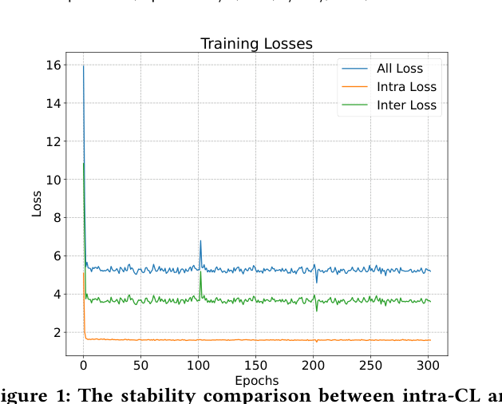
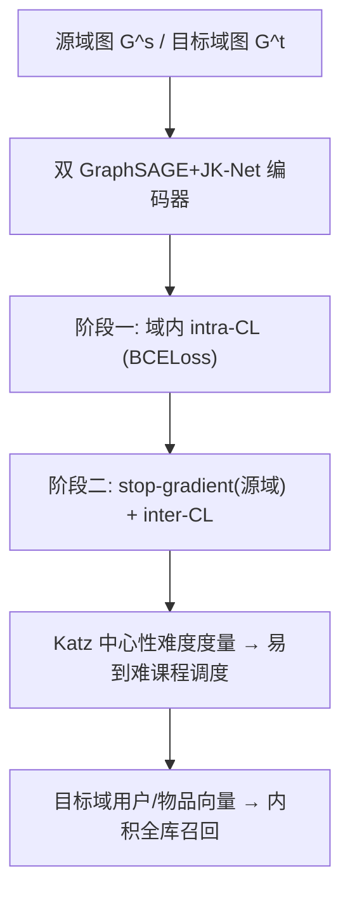

# Separated Contrastive Learning for Matching in Cross-domain Recommendation with Curriculum Scheduling (基于课程调度的分离式对比学习跨域召回)

- **会议/期刊**: WWW Companion 2025
- **作者与机构**: Heng Chang, Liang Gu, Cheng Hu, Zhinan Zhang, Hong Zhu, Yuhui Xu, Yuan Fang, Zhen Chen（华为技术有限公司）
- **推荐链路定位**: 召回（Matching / Candidate Generation）
- **研究方向**: 跨域与多场景推荐 / 自监督对比学习与交互去噪
- **论文原文**: [https://arxiv.org/abs/2502.16239v1](https://arxiv.org/abs/2502.16239v1)
- **开源代码**: 暂未开源

## TL;DR (1分钟核心速览)

跨域召回中，现有方法（如 CCDR）把域内对比（intra-CL）与跨域对比（inter-CL）混在一个损失里联合优化，忽略了跨域对齐远比域内学习困难这一事实，导致训练剧烈震荡、embedding 质量退化。本文提出 SCCDR：先用两个独立视图分别做源/目标域的 intra-CL，再进入 inter-CL 阶段，并在两阶段间插入 stop-gradient 保护源域表征；inter-CL 内部用 Katz 中心性度量负样本难度、按"易到难"课程调度。在 8 个 Amazon 跨域场景与 1 个工业 Music2Videos 数据集上，HIT@100 全面超越 CCDR/COAST 等基线（如 Books-Music 提升 1.1pt），线上 A/B 的 CTR +1.92%、人均时长 +3.65%。

## Background & Motivation (背景与核心矛盾)

- **主流范式**: 跨域召回普遍采用 GNN 编码器 + 图对比学习，通过重叠用户（overlapped users）作为锚点，把源域知识迁移到目标域；代表作为 CCDR，将 intra-CL 与 inter-CL 损失加权求和联合训练。
- **前人局限**: ① 重叠用户占比极小，域内交互远比跨域稠密，两类对比任务的学习难度天然不对等，混合优化使 inter-CL 的梯度持续冲击已学好的域内结构；② 跨域负样本中混有大量语义相近的"假阴性"，直接对比会引入噪声。
- **核心洞察 (Key Insight)**: 作者在 Books-Videos 上绘制训练曲线（图 1），发现 intra-CL 损失平滑收敛，而 inter-CL 损失剧烈震荡且量级远高于前者——混合训练的总损失被 inter-CL 主导，训练不稳定直接污染 embedding。
- **本文切入点**: 把"域内学好再跨域对齐"显式建模为两阶段课程，并用 stop-gradient 切断目标域对源域的反向污染。

<figure class="paper-figure" markdown="span">
  <figcaption>图1：在Amazon Books-Videos数据集上进行跨域推荐任务训练时，intra-CL损失与inter-CL损失的稳定性比较。</figcaption>
</figure>

## Method (核心方法设计)

### 1. 整体框架 (Overall Architecture)

SCCDR 采用双塔式 GNN 编码器（源域 $f^s$、目标域$f^t$，同构但参数独立，均为 2 层 GraphSAGE + JK-Net 跳连），直接在采样得到的子图上生成用户/物品表征，无需额外图增广。训练分两个课程阶段：**阶段一（intra-CL）** 在源域与目标域各自独立执行邻域相似度对比，充分学习域内结构；**阶段二（inter-CL）** 冻结源域梯度通路（stop-gradient），仅用源域锚点去校准目标域表征，并以课程调度器逐步引入高难度负样本。推理时仅需目标域编码器输出向量做内积全库检索。

### 2. 关键设计拆解 (Key Designs)

1. **分离式 intra/inter 两阶段 + Stop-Gradient**：痛点是混合训练让 inter-CL 梯度回传污染源域已收敛的表征。SCCDR 在 inter-CL 阶段对源域锚点施加 $\text{stopgrad}(\boldsymbol{u}^s)$，使目标域只"读取"源域知识而不"改写"它：
$$\mathcal{L}_{inter}=\lambda_{inter}\big[\mathcal{L}_{inter}^{u}(\text{stopgrad}(\boldsymbol{u}^s),\boldsymbol{v}^t)+\mathcal{L}_{inter}^{n}(\text{stopgrad}(\boldsymbol{u}^s),\boldsymbol{v}^t)\big]$$
直觉上这既保护了源域表征的均匀性（uniformity），又避免两域分布被过度对齐而坍缩。

2. **BCELoss 替代 InfoNCE 做 intra-CL**：域内对比只需刻画"邻居相似、非邻居不相似"，用成对 BCE 即可把所有边当作监督信号，且计算开销低于 InfoNCE：
$$\mathcal{L}_{intra}^{s}(\boldsymbol{v}^s)=-\sum_{v_i^s}\sum_{v_j^s\in\mathcal{N}(v_i^s)}\sum_{v_k^s\notin\mathcal{N}(v_i^s)}\big(\log\sigma(\boldsymbol{v}_i^{s\top}\boldsymbol{v}_j^s)+\log(1-\sigma(\boldsymbol{v}_i^{s\top}\boldsymbol{v}_k^s))\big)$$
目标域同理得 $\mathcal{L}_{intra}^{t}$，总 intra 损失为$\lambda_{intra}(\mathcal{L}_{intra}^{s}+\mathcal{L}_{intra}^{t})$。

3. **基于 Katz 中心性的课程调度器**：inter-CL 的负样本质量决定对齐效果，但随机负样本中既有简单（长尾冷门）也有困难（热门相似）样本。作者用 Katz 中心性 $x_i=\alpha\sum_j A_{ij}x_j+\beta$预计算节点影响力，定义样本对难度$d_{u_i,v_j}=d_{u_i}+x_{v_j}$，按难度降序排列后，前$N_{epoch}$轮先取最容易的 50% 负样本，之后每$N_{step}=N_{epoch}/(N_{neg}/2)$ 步递补一个更难样本。Katz 分数离线预计算，不增加训练开销。

## Experimental Setup & Evaluation Protocol (实验设置与评估协议)

- **数据集与预处理**: Amazon 7 域构造 8 个跨域场景，按两域共同用户过滤；工业数据集 Music2Videos 来自真实音乐/视频 App，已脱敏。

| 数据集 | #Users | #Src Items | #Tgt Items | #Src Edges | #Tgt Edges |
| :--- | :---: | :---: | :---: | :---: | :---: |
| Books-Videos | 344,000 | 222,244 | 31,086 | 1,826,791 | 229,147 |
| Books-Music | 64,920 | 119,694 | 694 | 643,112 | 1,251 |
| Books-Elec | 380,874 | 220,020 | 39,171 | 1,809,283 | 334,807 |
| Books-Toys | 243,265 | 205,081 | 8,848 | 1,619,884 | 44,484 |
| Videos-Music | 51,534 | 33,052 | 1,466 | 287,218 | 3,397 |
| Cloth-Music | 4,286 | 8,212 | 712 | 15,123 | 1,013 |
| Kitchen-Music | 8,144 | 22,550 | 36,018 | 6,670 | 60,358 |
| Elec-Cloth | 142,834 | 44,837 | 21,299 | 470,057 | 123,890 |
| Industrial: Music2Videos | 7,388,137 | 50,006 | 94,207 | 15,313,658 | 7,030,889 |

- **数据划分与防穿越 (Splitting Strategy)**: 沿用 CCDR 的 `Leave-One-Out` 式划分——目标域每个用户最后一条行为作测试、倒数第二条作验证、其余为训练。
- **排名评测协议 (Ranking Protocol)**: 召回阶段采用 `Full-Ranking`（目标域全库未交互物品排序），指标为 HIT@50 / HIT@100（工业集额外报 HIT@10/20）；线上以 CTR 与人均时长为指标。
- **对比基线与超参设置**: 基线含经典跨域方法 MV-DNN、EMCDR、DTCDR、HeroGraph，图方法 GraphDR+、CCDR、COAST；embedding 维度 128、GNN 2 层、$\lambda_{intra}=1.0$、$\lambda_{inter}=0.5$，所有提升经$t$-test 检验$p<0.05$。

## Key Experimental Results (实验关键数据)

### 1. 主实验对比 (Main Results)

| Model | Books-Videos H@100 | Books-Music H@100 | Books-Elec H@100 | Books-Toys H@100 | Elec-Cloth H@100 | Industrial H@100 |
| :--- | :---: | :---: | :---: | :---: | :---: | :---: |
| MV-DNN | 0.1848 | 0.2074 | 0.0958 | 0.1487 | 0.0291 | 0.0266 |
| EMCDR | 0.1880 | 0.2211 | 0.0968 | 0.1511 | 0.0313 | 0.0706 |
| DTCDR | 0.1648 | 0.2124 | 0.0682 | 0.0767 | 0.0201 | 0.0366 |
| HeroGraph | 0.2068 | 0.2301 | 0.0948 | 0.1557 | 0.0135 | 0.1374 |
| GraphDR+ | 0.2431 | 0.2421 | 0.1245 | 0.1828 | 0.0284 | 0.1418 |
| CCDR | 0.2545 | 0.2737 | 0.1048 | 0.2350 | 0.0335 | 0.1791 |
| COAST | 0.2136 | 0.2423 | 0.1174 | 0.1924 | 0.0379 | 0.1582 |
| **SCCDR** | **0.2613** | **0.2847** | **0.1238** | **0.2490** | **0.0515** | **0.1836** |
| Improv. vs best | +2.7% | +4.0% | +6.0% | +6.0% | +35.9% | +2.5% |

### 2. 消融实验 (Ablation Study)

| 变体 | Books-Videos H@100 | Books-Music H@100 | Books-Elec H@100 | Books-Toys H@100 |
| :--- | :---: | :---: | :---: | :---: |
| SCCDR ## (去 stop-grad + 去课程) | 0.2271 | 0.2127 | 0.1088 | 0.1828 |
| SCCDR # (去课程调度) | 0.2498 | 0.2601 | 0.1190 | 0.2350 |
| **SCCDR (完整)** | **0.2613** | **0.2847** | **0.1238** | **0.2490** |

### 3. 关键实验发现 (Key Findings)

1. **stop-gradient 是最大增益来源**：去掉课程调度仅损失约 1.1–2.5pt HIT@100，而再去掉 stop-gradient 后 Books-Toys 从 0.2350 骤降至 0.1828（-22%），说明切断目标域对源域的反向梯度是稳定训练的核心。
2. **目标域越稀疏、跨域相关性越弱，收益越大**：Books-Videos 两域高度相关，SCCDR 仅比 CCDR 高 0.7pt；而 Books-Elec（弱相关）与 Elec-Cloth（目标域极稀疏）分别提升 6.0% 与 35.9%，验证了方法对冷启动与弱迁移场景的适配性。
3. **课程调度对负样本噪声的抑制可量化**：在工业 Music2Videos 上 SCCDR 的 HIT@100 达 0.1836，较 CCDR 的 0.1791 提升 2.5%，且线上 A/B 中 CTR +1.92%、时长 +3.65%，均显著优于 CCDR 的 +1.18%/+2.14%，说明离线增益可转化为真实业务收益。

## Highlights & Limitations (亮点、对比与审稿批判)

- **与代表作对比 (vs. Prior Work)**: 与 CCDR 的本质区别在于 CCDR 用图增广构造视图并混合优化两类对比损失，而 SCCDR 取消增广、以双编码器天然视图替代，并把"域内→跨域"显式拆成课程阶段；相较 COAST 等固定负采样策略，SCCDR 用 Katz 中心性给负样本排难度，属于训练动态层面的改进而非结构层面。
- **可迁移亮点**: ① stop-gradient 保护"已学好的一侧"可推广到任何非对称知识迁移场景（如多场景联合训练中的主场景保护）；② 用图中心性离线预计算负样本难度、零额外开销的课程调度，可直接嵌入现有对比学习召回管线。
- **审稿级局限批判**: ① 课程调度采用静态分段策略（前 50% 简单样本 + 固定步长递补），未与训练损失动态联动，超参 $N_{step}$ 依赖人工设定；② 实验仅在 Amazon 与单一工业场景验证，未讨论多源域（>2 域）扩展与重叠用户比例极低时的退化风险；③ 双编码器参数量翻倍，虽推理只用目标域塔，但训练显存开销未做量化对比。

## Rating (四维评分)

- **方法创新性 (Novelty)**: ⭐⭐⭐⭐ （将课程学习与 stop-gradient 引入跨域对比学习的训练动力学层面，视角新颖但组件本身非全新）
- **评估协议与实验扎实度 (Protocol & Experiments)**: ⭐⭐⭐⭐⭐ （8 个 Amazon 场景 + 工业数据集 + 7 天线上 A/B，Full-Ranking 协议与显著性检验完整）
- **写作与数学规范度 (Clarity & Rigor)**: ⭐⭐⭐⭐ （损失公式与课程调度定义清晰，但 Katz 难度与"易到难"的因果论证偏直觉）
- **工业落地与复现价值 (Industrial & Practical Value)**: ⭐⭐⭐⭐ （Katz 预计算零开销、推理单塔，工业数据验证充分；但代码未开源、双塔训练成本需评估）

