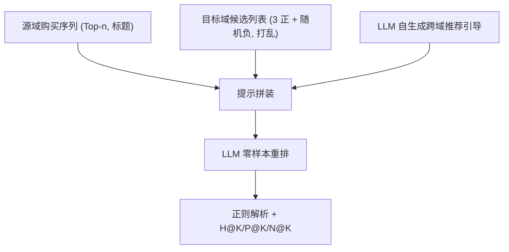
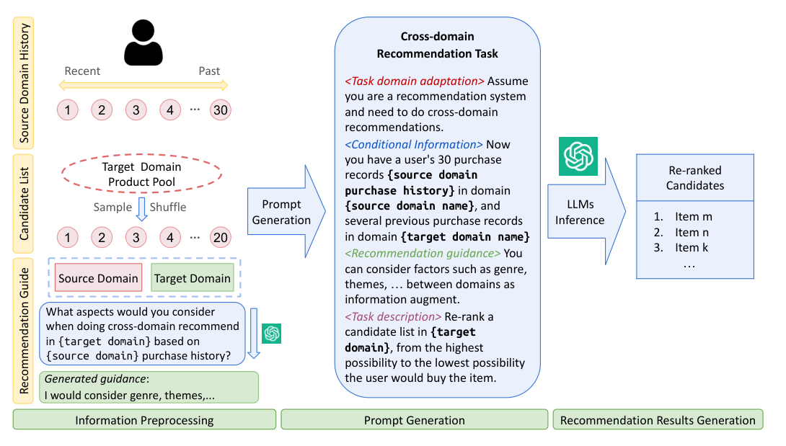

# Uncovering Cross-Domain Recommendation Ability of Large Language Models (揭示大语言模型的跨域推荐能力)

- **会议/期刊**: WWW Companion 2025 (LLM4ECommerce Workshop)
- **作者与机构**: Xinyi Liu, Ruijie Wang, Dachun Sun, Dilek Hakkani-Tür, Tarek Abdelzaher (University of Illinois Urbana-Champaign)
- **推荐链路定位**: 重排（候选列表级 Re-ranking，零样本免训练）
- **研究方向**: 跨域与多场景推荐 / 大语言模型推荐
- **论文原文**: [https://arxiv.org/abs/2503.07761v1](https://arxiv.org/abs/2503.07761v1)
- **开源代码**: 暂未开源

## TL;DR (1分钟核心速览)

本文针对**目标域完全无用户购买记录**的极端冷启动跨域场景，提出 LLM4CDR：把源域购买序列、目标域候选列表与 LLM 自生成的"跨域推荐引导"拼成结构化提示，让 GPT-3.5/GPT-4 直接对候选列表做零样本重排。在 Amazon 5-core 四子集上采用"3 正样本 + 随机负样本"的 Sampled Ranking 协议，同子群跨域（CD&Vinyl→Movies&TV）下 GPT-3.5 取得 MAP@1 相对提升 64.28%、MAP@5 提升 44.62%、MAP@10 提升 37.62%；而跨子群（Movies&TV→Electronics）引入源域历史反而全面掉点，揭示 LLM 跨域迁移的"域间隙阈值"现象。

## Background & Motivation (背景与核心矛盾)

- **主流范式**: 传统 CDR 分内容级迁移（共享标签/语义相关）与嵌入级迁移（跨域用户/物品表征对齐），均需在目标域存在可训练的用户或物品交互。
- **前人局限**: (1) 当目标域**完全没有**用户购买记录时，嵌入级方法无锚点可对齐，直接失效；(2) 现有 LLM4Rec 工作（P5、LLM 零样本 top-K）只验证单域能力，未考察"源域历史能否被 LLM 用于目标域迁移"。
- **核心洞察 (Key Insight)**: LLM 的预训练世界知识天然编码了跨品类语义关联（如"恐怖片爱好者→生存类游戏"），因此跨域迁移可被重构为**条件文本推理**而非表征对齐问题。
- **本文切入点**: 不做任何微调，仅通过"源域历史 + 候选列表 + 自动生成跨域引导"的提示构造，把 CDR 变成 LLM 的列表重排任务，并系统性地探测其能力边界（历史长度、候选规模、域间隙、模型规模）。

## Method (核心方法设计)

### 1. 整体框架 (Overall Architecture)

LLM4CDR 是一条三阶段免训练流水线：**信息预处理**阶段从源域抽取用户最近 $n$条 5.0 分购买记录（按时间倒序、以商品标题表示），从目标域全库随机采样负样本并与 3 个真实购买正样本混成候选列表$C$（并用 bootstrapping 打乱顺序消除位置偏置），同时让 LLM 自身针对"源域-目标域"组合总结应关注的共性特征形成推荐引导；**提示生成**阶段将任务域适应、条件信息、推荐引导、任务描述四段拼装；**结果生成**阶段由 LLM 输出重排列表，经正则/字符串匹配解析后计算 H@K、P@K、N@K。

<figure class="paper-figure" markdown="span">
  <figcaption>图 1：LLM4CDR 框架由信息预处理、提示生成和推荐结果生成组成。信息预处理包括生成源域历史、创建候选列表和准备推荐指南。预处理阶段获得的信息在提示生成部分以粗体突出显示。提示生成阶段包括任务域适应、条件信息、推荐引导和任务描述（各用不同颜色标记）。</figcaption>
</figure>

### 2. 关键设计拆解 (Key Designs)

1. **跨域推荐引导生成 (Recommendation Guidance)**：痛点在于跨域组合无穷无尽，人工写提示不可扩展，且 LLM 面对无关源域时易被噪声带偏。做法是先问 LLM "基于 {源域} 历史在 {目标域} 推荐时应考虑哪些方面"，将其回答（如 genre、themes、popular franchises）作为引导段注入正式提示。直觉上这相当于给 LLM 一个**显式的跨域特征对齐先验**，把隐式知识激活为可操作的推理路径；实验显示去掉引导后增益显著缩水（图 4）。
2. **候选列表构造与位置去偏**：受 token 上限约束无法全库排序，故采用 $|C|\in\{20,25,30\}$ 的采样列表，固定 3 个正样本以保证指标可算，负样本均匀随机采样，并沿用 bootstrapping 多次打乱候选顺序取平均，消除 LLM 对列表位置的系统性偏好。该设计使评测退化为可控难度的 Sampled Ranking，便于横向比较"有/无源域信息"的净增益。
3. **训练目标、负采样与推理效率**：本文**无训练损失、无负采样训练**（负样本仅用于评测构造），完全依赖 in-context 推理；单次查询即完成一次列表重排，成本为一次 LLM API 调用，但需为每个用户重复调用，且输出需后处理（约 3% 内容不匹配样本被过滤）。

## Experimental Setup & Evaluation Protocol (实验设置与评估协议)

- **数据集与预处理**: Amazon Review 2018 的 `5-core` 子集，经四重过滤——仅保留 5.0 分评分、用户购买数 > 20、物品被 > 10 人购买、源域历史长度 ≥ 阈值（20/30/40），并取源/目标域**共同用户**：

| 数据集 | #Users | #Items | Avg. Len. | 特征/场景说明 |
| :--- | :---: | :---: | :---: | :--- |
| Movies and TV | 17,984 | 42,516 | 38.18 | Movies, Music & Games 组 |
| CDs and Vinyl | 12,621 | 52,384 | 36.42 | 同组，域间隙小 |
| Video Games | 2,202 | 12,344 | 31.65 | 同组，域间隙小 |
| Electronics | 26,402 | 97,345 | 28.20 | 跨组，域间隙大 |

- **数据划分与防穿越 (Splitting Strategy)**: 采用**时间序切分**——源域历史严格取目标域正样本购买之前的记录，按最近→最远排序，杜绝未来信息泄漏。
- **排名评测协议 (Ranking Protocol)**: `Sampled Ranking`，候选列表 = 3 个真实购买 + 17/22/27 个均匀随机负样本（默认 20 项，正负比 3:17），bootstrapping 打乱顺序；指标 H@K / MAP@K / NDCG@K，K∈{1,5,10}。
- **对比基线与超参设置**: 基线为**同一 LLM 在无源域历史（wo Info）下的重排结果**（自对比消融式基线），模型覆盖 Ollama3、GPT-3.5、GPT-4；默认历史长度 30、候选 20；每实验重复 3 次取均值并报标准差，满足用户数 > 100 时随机抽 100 用户评测。

## Key Experimental Results (实验关键数据)

### 1. 主实验对比 (Main Results)

同子群跨域、GPT-3.5、历史长度 30 下的"有/无源域信息"对比（节选代表性组合，加粗为引入源域历史后的最优）：

| 源域 → 目标域 | 设置 | H@1 | H@10 | MAP@1 | MAP@10 | NDCG@10 |
| :--- | :--- | :---: | :---: | :---: | :---: | :---: |
| CD&Vinyl → Movies&TV | wo Info | 0.2460 | 0.8997 | 0.1996 | 0.4439 | 0.4271 |
| CD&Vinyl → Movies&TV | **w Info** | **0.3408** | **0.9058** | **0.3279** | **0.6109** | **0.4955** |
| VideoGames → Movies&TV | wo Info | 0.2269 | 0.8380 | 0.1659 | 0.4013 | 0.3931 |
| VideoGames → Movies&TV | **w Info** | **0.3272** | **0.8878** | **0.2361** | **0.4703** | **0.4348** |
| Movies&TV → CD&Vinyl | wo Info | 0.1806 | 0.8302 | 0.1280 | 0.3129 | 0.3434 |
| Movies&TV → CD&Vinyl | **w Info** | **0.2419** | **0.8548** | **0.1783** | **0.3961** | **0.3986** |
| Movies&TV → Electronics | wo Info | 0.1659 | 0.8241 | 0.1261 | 0.2867 | 0.3318 |
| Movies&TV → Electronics | w Info | 0.1058 | 0.6700 | 0.0752 | 0.2192 | 0.2662 |

CD&Vinyl→Movies&TV 上 MAP@1 相对提升 **64.28%**、MAP@5 **44.62%**、MAP@10 **37.62%**；而跨子群 Movies&TV→Electronics 上 H@1 从 0.1659 跌至 0.1058（**-36.2%**），MAP@10 从 0.2867 跌至 0.2192。

### 2. 消融实验 (Ablation Study)

| 消融维度 | 设置 | 关键指标变化 | 结论 |
| :--- | :--- | :--- | :--- |
| 推荐引导 | 有 vs. 无 guidance | 四组跨域场景下 w/ guidance 的 MAP@K 增益均更大（图 4） | 引导是增益放大器而非必需项 |
| 历史长度 | 20 / 30 / 40 | 20 项时 H@1、P@1、N@1 甚至低于 wo Info；30 项起稳定正向 | 存在最小有效历史阈值 |
| 候选规模 | 20 / 25 / 30 | 20 项时 H@1 增益 +54.55%、MAP@1 +72.00%；30 项时 H@1 -3.33%、MAP@1 -5.71% | 列表越长 LLM 越难利用跨域知识 |
| 模型规模 | Ollama3 / GPT-3.5 / GPT-4 | 同子群下 GPT-4 在 4/6 组合中 %imp 达 100%，Ollama3 多次 0% | 参数量需越过能力阈值 |

### 3. 关键实验发现 (Key Findings)

1. **域间隙是硬门槛而非软衰减**：同子群 6 组跨域中 5 组引入源域历史后多数指标上升（如 VideoGames→CD&Vinyl 的 H@1 从 0.1258 升至 0.1509），但跨子群 Movies&TV→Electronics 的 H@1 骤降 36.2%，说明无关源域注入的是**干扰性知识**而非弱相关信号，提示系统应显式做源域筛选。
2. **候选列表长度与跨域增益强负相关**：候选从 20 增至 30 时，H@1 增益由 +54.55% 翻转为 -3.33%、MAP@1 由 +72.00% 翻转为 -5.71%，表明 LLM 的跨域推理注意力预算有限，长列表下难以维持跨域特征对齐。
3. **模型规模存在能力阈值效应**：Ollama3 在 6 组同子群跨域中有 2 组 %imp 为 0%（完全无增益），而 GPT-4 在 Movies&TV→CD&Vinyl 上 H@1 从 0.1806 跃至 0.3562（+97%），说明 CDR 所需的"跨域语义桥接"是复杂推理能力，小模型无法通过提示弥补。

## Highlights & Limitations (亮点、对比与审稿批判)

- **与代表作对比 (vs. Prior Work)**: 相较 P5（T5 式统一 text-to-text，需目标域训练数据）与 PLM 嵌入迁移方法（需跨域用户/物品重叠），本文是首个在**目标域零交互**条件下系统探测 LLM 跨域迁移边界的工作；与同期的 LLM 零样本序列推荐（Hou et al.）相比，其增量在于引入**双域条件 + 自动引导**而非单域历史。
- **可迁移亮点**: (1) "让 LLM 自生成域对专属引导再注入提示"的两段式提示模板，可低成本迁移到任意跨域/跨场景重排；(2) 用 bootstrapping 打乱候选顺序消除位置偏置的评测技巧，适用于所有 LLM 列表重排实验。
- **审稿级局限批判**: (1) **评测规模过小且非全库**——候选仅 20–30 项、正负比 3:17，且每实验最多抽 100 用户，Sampled Ranking 下的 64% 提升难以外推到真实全库检索场景；(2) **无训练、无开源、强依赖闭源 API**——成本随用户数线性增长，且缺少与传统 CDR 模型（如 EMCDR、PTUPCDR）的定量对比，无法判断相对 SOTA 的真实竞争力；此外仅用商品标题作特征，丢弃了描述、价格、图像等多模态信号。

## Rating (四维评分)

- **方法创新性 (Novelty)**: ⭐⭐⭐ （首次系统刻画 LLM 零样本跨域迁移的边界条件，"域间隙阈值"与"能力阈值"两个发现具启发性，但方法本身仅为提示工程流水线，无模型/理论层面创新）
- **评估协议与实验扎实度 (Protocol & Experiments)**: ⭐⭐⭐ （时间序切分与 bootstrapping 去偏严谨、RQ 覆盖全面，但 Sampled Ranking 规模过小、用户采样上限 100、缺少传统 CDR 基线对比）
- **写作与数学规范度 (Clarity & Rigor)**: ⭐⭐⭐⭐ （问题定义清晰、RQ 驱动结构工整、提示模板与解析规则交代完整，但全文无形式化公式与复杂度分析）
- **工业落地与复现价值 (Industrial & Practical Value)**: ⭐⭐ （免训练流水线易落地，但闭源 API 成本、无开源代码、标题级特征与 20 项候选规模距工业全库召回差距较大）

