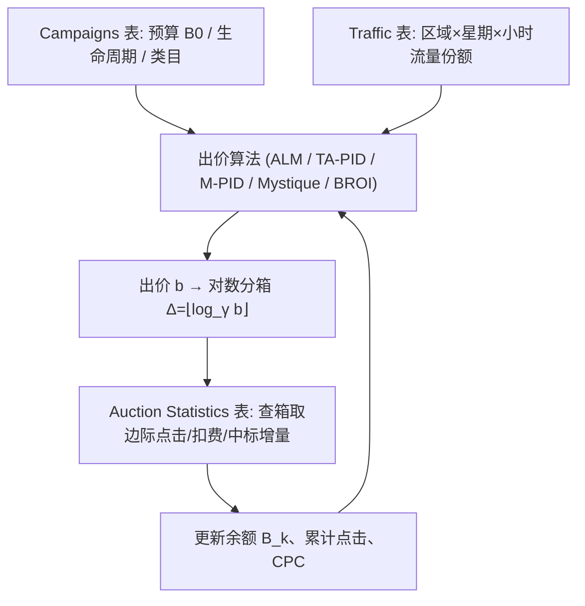

# BAT: Benchmark for Auto-bidding Task (自动出价任务基准)

- **会议/期刊**: WWW 2025
- **作者与机构**: Alexandra Khirianova, Ekaterina Solodneva, Andrey Pudovikov 等（Avito / 莫斯科国立大学 / 莫斯科物理技术学院 / 列别捷夫物理研究所）
- **推荐链路定位**: 精排（广告竞价与出价决策层）
- **研究方向**: CTR/CVR 预估与特征交叉 / 强化学习与动态探索推荐
- **论文原文**: [https://arxiv.org/abs/2505.08485v1](https://arxiv.org/abs/2505.08485v1)
- **开源代码**: [https://github.com/avito-tech/bat-autobidding-benchmark](https://github.com/avito-tech/bat-autobidding-benchmark)

## TL;DR (1分钟核心速览)

自动出价（RTB）算法研发长期受困于公开数据集稀缺：iPinYou 仅 9 个广告主且只含二价拍卖，Alibaba 2024 数据集仅 GSP 单格式。本文发布 BAT——Avito 平台真实日志构建的**双拍卖格式**基准（1000 万次 FP + 100 万次 VCG，9000+ 广告活动，21 天），并配套 5 个可复现基线（ALM、TA-PID、改进 M-PID、Mystique、BROI）与 3 套评估协议（预算平滑 RMSE$_T$、CPC 约束 REL_CPC、点击总量 SCR）。实验表明 Mystique 在预算平滑上最优（FP RMSE$_T$=1.18），TA-PID 在 VCG 点击总量上领先（SCR=909282），M-PID 在 FP 的 CPC 约束下 REL_CPC 低至 0.49。

## Background & Motivation (背景与核心矛盾)

- **主流范式**: 平台按相关性排序广告位并以拍卖分配曝光，人工出价不可行，需自动出价算法在预算 $B$与 CPC 上限$C$ 下最大化点击/转化。
- **前人局限**: ① 公开数据仅 iPinYou（2013 年、9 广告主、纯二价）与 Alibaba 2024（GSP 单格式、48 广告主），无法模拟多广告主竞争与一价拍卖迁移趋势；② 多数论文在私有闭源数据上验证，结果不可复现、不可横向比较。
- **核心洞察 (Key Insight)**: 真实平台日志中，**出价分箱（price bin）的边际增量**（点击增量、曝光增量、中标价增量）与**分区域-小时的流量份额**共同决定了任意出价策略的收益曲线，因此可脱离原始竞价流、以聚合统计做高保真离线仿真。
- **本文切入点**: 以"活动属性 + 拍卖统计 + 流量分布"三表结构公开数据，并给出与生产环境一致的轻量基线，把自动出价研究从"私有数据黑箱"推向"标准化可复现"。

## Method (核心方法设计)

### 1. 整体框架 (Overall Architecture)

BAT 由**数据层**与**仿真层**构成。数据层三张表：`Campaigns`（预算、起止时间、类目、地域、平台分布）、`Auction statistics`（按小时 × 价格分箱聚合的 `AuctionClicksSurplus`、`AuctionWinBidSurplus`、`AuctionVisibilitySurplus`、CTR/CVR 预测值）、`Traffic`（区域 × 星期 × 小时的流量份额，周内和为 1）。仿真层以 1 小时为步长：算法读取当前余额 $B_k$与剩余流量$T_{left}$输出出价$b$，经对数分箱$\Delta=\lfloor \log_\gamma b \rfloor$（$\gamma=1.2$）映射到价格箱，再从统计表查得该箱相对前一箱的边际点击/扣费/中标增量，累加更新余额与点击，进入下一时刻。

### 2. 关键设计拆解 (Key Designs)

1. **流量感知的预算平滑控制（TA-PID）**：痛点在于经典 PID 以"绝对时间"为基准，忽略流量昼夜 30 倍波动（图 1），导致夜间超支、白天欠支。本文将理想花费率改为按流量份额归一：$s_{ideal}=B_0/T_{all}$，误差$e_n=s_{ideal}-(B_0-B_n)/T_{prev}$，控制量$u(n)=k_p e_n+k_i\sum_t e_t(T_t-T_{t-1})+k_d\frac{e_n-e_{n-1}}{T_n-T_{n-1}}$，再令$\Delta_n=\Delta_{n-1}+u(n)$。以**流量增量而非时间增量**做积分/微分，使控制器在高流量时段自动放缓加价，物理直觉即"按真实机会密度分配预算"。

2. **自适应线性模型（ALM）**：针对冷启动无历史出价的问题，以相对余额 $\hat{B}_n=B_n/B_0$对累计流量$T_n$拟合斜率$k=(\hat{B}_n-\hat{B}_{n-1})/(T_n-T_{n-1})$，外推期末余额$\hat{B}_{left}=\hat{B}_n+k\cdot T_{left}$，再按$\Delta_n=\Delta_{n-1}+\hat{B}_{left}\cdot\beta$ 调整分箱并做 clip 限幅。其本质是用"当前花费速度"线性外推剩余预算缺口，计算量 O(1)，适合高并发在线场景。

3. **M-PID 的 CPC 参考信号重构与训练/推理开销**：原 M-PID 的最优出价 $\text{bid}_n=\frac{1}{p+q}\cdot CTR_n\cdot CVR_n+\frac{q}{p+q}\cdot CTR_n\cdot C$依赖对偶变量$p,q$；本文改用可观测参考量：CPC 参考取$B_0/\text{Clicks}$，预算参考取$s_n=B_n\cdot T_{cur}/T_{left}$，使 PID 无需解 LP 即可在线运行。全部基线均为**免训练**的规则控制器（仅超参经 Optuna 贝叶斯优化），单步推理为常数级算术，无梯度、无负采样。

## Experimental Setup & Evaluation Protocol (实验设置与评估协议)

- **数据集与预处理**: 过滤规则为"活动全生命周期被统计完整覆盖、日志对齐、时长 ≥1 天、预算充足、点击/联系量达标"；VCG 采 10% 拍卖日志覆盖 2500 活动，FP 采 100% 日志但仅 1% 活动（9000 活动），均 21 天。

| 数据集 | #Campaigns | #Auctions | 时长 | 拍卖格式 | 说明 |
| :--- | :---: | :---: | :---: | :---: | :--- |
| BAT-VCG | 2,500 | 1M | 21 天 | VCG（二价） | 2024.03–04 采集，10% 日志 |
| BAT-FP | 9,000 | 10M | 21 天 | First-Price | 2024.07–08 采集，1% 活动全量日志 |

- **数据划分与防穿越 (Splitting Strategy)**: 按活动生命周期切分为 $S_1$（调参）与$S_2$（评估），强制$S_1$中所有活动**结束时间早于**$S_2$ 任一活动开始时间，杜绝时间穿越。
- **排名评测协议 (Ranking Protocol)**: 非排序任务，采用三类仿真指标：预算平滑 $RMSE_T=\sqrt{\frac{1}{N}\sum_{n=1}^{N}(B_n^{*}-B_n)^2}$（$B_n^{*}=\hat{T}_n B_0$为流量归一理想花费）；CPC 约束$REL\_CPC=CPC_{Real}/CPC$（越接近 1 越好，实验设为类目均值的 1/10 以构造强约束）；点击总量$SCR$（全活动点击求和）。
- **对比基线与超参设置**: 5 个基线（ALM、TA-PID、M-PID、Mystique、BROI），超参由 Optuna 在 $S_1$上以对应指标最大化搜索，$S_2$ 上一次性评估；结果在逻辑类目 1 上聚合。

## Key Experimental Results (实验关键数据)

### 1. 主实验对比 (Main Results)

实验一（预算平滑，$RMSE_T$越低越好）与实验三（点击总量$SCR$ 越高越好）：

| 方法 | RMSE$_T$VCG ↓ | SCR VCG ↑ | RMSE$_T$ FP ↓ | SCR FP ↑ |
| :--- | :---: | :---: | :---: | :---: |
| ALM | 8.73 | 662,466 | 1.27 | 1,085,836 |
| TA-PID | 1.42 | **909,282** | 1.61 | **1,478,538** |
| M-PID | 1.38 | 889,251 | 1.26 | 1,240,244 |
| Mystique | **1.25** | 932,152 | **1.18** | 1,073,291 |
| BROI | — | 495,169 | — | 1,098,184 |

实验二（CPC 强约束，$REL\_CPC$ 越接近 1 越好）：

| 方法 | REL_CPC VCG | REL_CPC FP |
| :--- | :---: | :---: |
| M-PID | 0.91 | **0.49** |
| BROI | **0.88** | 0.94 |

### 2. 消融实验 (Ablation Study)

原文未设标准消融，但 M-PID 相对原版 [33] 的改造构成天然对照：

| 配置 | 预算参考信号 | CPC 参考信号 | 表现 |
| :--- | :--- | :--- | :--- |
| 原版 M-PID | 对偶变量 $p$| 对偶变量$q$+ 常数$C$ | 需解 LP，离线可用 |
| 本文 M-PID | $s_n=B_n T_{cur}/T_{left}$|$B_0/\text{Clicks}$ | 免解 LP，FP 上 REL_CPC 达 0.49 |
| TA-PID（无 CPC 约束） | 流量归一 $s_{ideal}$ | 无 | VCG SCR 最高 909,282 |

### 3. 关键实验发现 (Key Findings)

1. **拍卖格式决定算法优劣排序**：Mystique 在两种格式的预算平滑上均第一（1.25 / 1.18），但 TA-PID 在 FP 的点击总量上高出 Mystique 约 **37.8%**（1,478,538 vs 1,073,291），说明"平滑最优"与"点击最优"存在结构性权衡，单一指标无法选型。
2. **CPC 约束在 FP 下更易满足**：M-PID 在 FP 上 REL_CPC=0.49（实际 CPC 仅为上限一半），而在 VCG 上为 0.91，逼近约束边界；BROI 则相反（VCG 0.88 / FP 0.94），反映一价拍卖下出价即扣费、控制信号更直接。
3. **低分箱区间存在"储备价陷阱"**：图 2 显示分箱 10–20 区间点击增量接近零（储备价所致），ALM 因线性外推在 VCG 上 RMSE$_T$ 高达 8.73（约为 Mystique 的 7 倍），说明忽略分箱非线性收益曲线是线性模型的致命短板。

## Highlights & Limitations (亮点、对比与审稿批判)

- **与代表作对比 (vs. Prior Work)**: 相较 iPinYou（9 广告主、纯二价、2013 年），BAT 提供 9000+ 广告主与 VCG/FP 双格式；相较 Alibaba 2024（GSP、CPA 约束、面向 RL），BAT 面向预算平滑与 CPC 约束并提供流量表这一独有维度；相较 M-PID [33] 与 BROI [19] 的理论解，本文基线免解 LP、可直接上线。
- **可迁移亮点**: ① "按流量份额归一化"的误差定义可迁移到任何带周期性流量波动的预算控制任务（如推荐系统冷启动配额分配）；② 以"边际增量表 + 分箱查表"替代原始竞价流回放的仿真范式，可大幅降低离线评估的存储与计算成本。
- **审稿级局限批判**: ① 数据仅来自 Avito 单一平台、单一类目评估（逻辑类目 1），跨平台泛化性未验证；② 仿真以聚合统计的期望值替代逐次拍卖随机性，缺少竞价环境的多智能体博弈反馈，BROI 类均衡性结论难以在该框架下检验；③ 全部基线为规则控制器，未纳入 RL/学习方法，基准的"上限"参考缺失。

## Rating (四维评分)

- **方法创新性 (Novelty)**: ⭐⭐⭐ （数据集与基准贡献为主，TA-PID 的流量归一化 PID 属工程巧思而非理论突破）
- **评估协议与实验扎实度 (Protocol & Experiments)**: ⭐⭐⭐⭐ （双格式 × 三任务 × 时间防穿越切分 + Optuna 调参，协议设计严谨，但缺学习型基线与跨类目验证）
- **写作与数学规范度 (Clarity & Rigor)**: ⭐⭐⭐⭐ （三表结构与仿真流程描述清晰，公式完整；部分符号如 $T_{cur}/T_{left}$ 的下标定义散落正文）
- **工业落地与复现价值 (Industrial & Practical Value)**: ⭐⭐⭐⭐⭐ （代码与数据全开源、基线均为生产在用算法、单步 O(1) 推理，是 RTB 研究稀缺的标准化基础设施）

