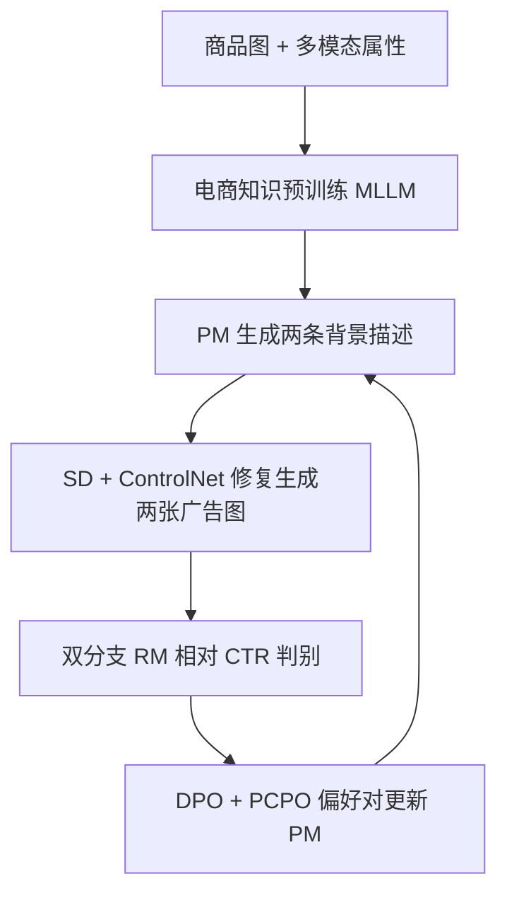
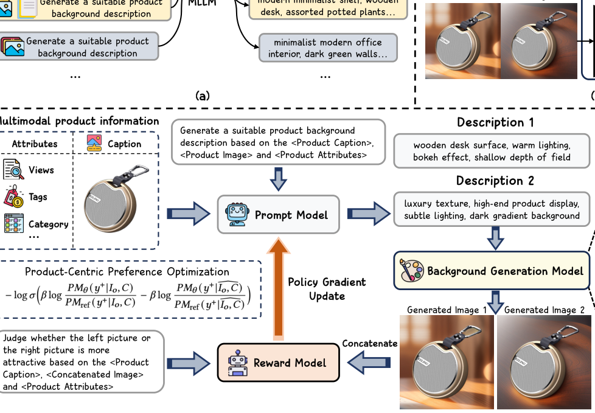

# CTR-Driven Advertising Image Generation with Multimodal Large Language Models (CTR 驱动的多模态大模型广告图像生成)

- **会议/期刊**: WWW 2025
- **作者与机构**: Xingye Chen, Wei Feng, Zhenbang Du 等（华中科技大学 & 京东）
- **推荐链路定位**: 端到端生成式（广告创意生成 + CTR 预估）
- **研究方向**: CTR/CVR 预估与特征交叉 / 多模态推荐
- **论文原文**: [论文原文链接](https://arxiv.org/abs/2502.06823v1)
- **开源代码**: [开源代码仓库链接](https://github.com/Chenguoz/CAIG)

## TL;DR (1分钟核心速览)

现有广告图生成方法只优化美学质量或图文一致性，与线上 CTR 脱节。本文提出 CAIG：先用 1.2M 电商多模态数据做领域预训练，再把 CTR 回归改造成**同商品图像对的相对比较二分类**训练双分支奖励模型（RM），最后用 RM 作为人类反馈信号，以 DPO + 产品中心偏好优化（PCPO）微调提示模型（PM）。在商业/公开数据集上 Pair Accuracy 达 58.6%/56.2%，线上 44 类目 CTR 相对预训练基线提升 2%（6000 万曝光 A/B）。

## Background & Motivation (背景与核心矛盾)

- **主流范式**: Stable Diffusion + ControlNet 为商品图生成和谐背景，优化目标集中在图像质量、语义一致性等离线指标。
- **前人局限**: ① 视觉内容与线上 CTR 的关联被完全忽略，生成图与用户真实点击偏好存在系统性偏差；② 现有 CTR 预估模型（CNN/ViT/embedding 类）图像理解弱，需堆叠检测、OCR 等辅助任务，且难以融合标题、类目、属性等稀疏多模态特征。
- **核心洞察 (Key Insight)**: 同一商品换背景 CTR 差异巨大（图 1a），但不同类目基线 CTR 量级差异同样巨大——**绝对 CTR 不可跨类目比较，相对比较才是稳定信号**；同时纯奖励优化会让背景与商品语义脱节（运动鞋背景被误用到化妆品，图 1b）。
- **本文切入点**: 用 MLLM 统一承担「多模态理解 + CTR 相对判别」，并把商品信息作为唯一变量构造偏好对，约束生成背景与商品匹配。

## Method (核心方法设计)

### 1. 整体框架 (Overall Architecture)

三阶段闭环：**(a) 电商知识预训练**——在 1.2M 样本上设计图像理解、多模态内容理解、提示生成三类任务，用指令函数 $C=f_{\text{instruct}}(Q,i_1,\dots,i_n)$把标题/类目/价格等属性拼成统一语义描述；**(b) 奖励模型训练**——以预训练 MLLM 初始化，输入拼接图像对与商品指令，双分支输出相对偏好与绝对 CTR；**(c) CTR 驱动偏好优化**——PM 为每商品生成两条背景描述，经 SD+ControlNet 修复生成两张广告图，RM 判定优劣构成偏好对，用$\mathcal{L}_{\text{DPO}}+\mathcal{L}_{\text{PCPO}}$ 更新 PM（仅微调 PM，因背景描述对图像内容影响远大于微调扩散模型）。

<figure class="paper-figure" markdown="span">
  <figcaption>图2：(a) 电商知识预训练。MLLM在大规模多模态电商数据集上进行预训练，以融入领域特定知识。(b) RM的结构。RM使用视觉和文本编码器整合多模态商品特征，并通过双分支估计CTR并识别有吸引力的广告图像。(c) CTR驱动的偏好优化阶段。PM为背景生成模型生成背景描述，以创建具有各种背景的商品图像。随后RM估计这些图像的CTR，模拟人类反馈以优化PM。</figcaption>
</figure>

### 2. 关键设计拆解 (Key Designs)

1. **双分支相对 CTR 奖励模型**：痛点是把 CTR 回归直接做跨类目比较会被类目基线淹没。做法是将同商品图像对拼接后送入 LLM，取末位 token 隐状态 $h$，分类头输出$p=\text{softmax}(FC_{\text{cls}}(h))$做左右优劣二分类，另设回归分支$FC_{\text{ctr}}$拟合绝对 CTR 作辅助：$\mathcal{L}_{\text{reward}}=\lambda_1\mathcal{L}_{\text{CE}}+\lambda_2\mathcal{L}_{\text{Point}}$（$\lambda_1=1,\lambda_2=0.5$）。相对监督消除类目偏置，点式辅助保留细粒度 CTR 差异，二者互补。
2. **产品中心偏好优化 PCPO**：痛点是 DPO 只追奖励，5 轮后匹配率从 0.842 崩到 0.597。PCPO 固定正例 $y^+$，构造失配商品输入$\tilde{I}_o$（视觉侧随机遮挡 75% 商品图；文本侧随机替换为其他商品属性），强制模型在商品信息被破坏时降低$y^+$ 的似然：
$$\mathcal{L}_{\text{PCPO}}=-\log\sigma\Big(\beta\log\frac{PM_\theta(y^+|I_o,C)}{PM_{\text{ref}}(y^+|I_o,C)}-\beta\log\frac{PM_\theta(y^+|\tilde{I}_o,C)}{PM_{\text{ref}}(y^+|\tilde{I}_o,C)}\Big)$$
   本质是把「商品-背景一致性」写成同一正例在不同商品条件下的对比，等价于难负例约束，防止奖励黑客。
3. **训练目标与推理开销**：总损失 $\mathcal{L}_{\text{opt}}=\mathcal{L}_{\text{DPO}}+\mathcal{L}_{\text{PCPO}}$，偏好对由 RM 在线判定（无需人工标注负例，也无需采样负例池）；预训练全参微调约 5 天/8×A100，偏好优化用 LoRA（lr=2e-5，5 epoch，约 20 小时）；线上仅需 PM 前向 + 一次扩散修复，RM 不参与推理。

## Experimental Setup & Evaluation Protocol (实验设置与评估协议)

- **数据集与预处理**: 每张图要求最小曝光 $E$，成对图相对 CTR 差需超过阈值$D$（训练$E=50,D=1\%$；测试$E=1000,D=5\%$）：

| 数据集 | #Products | #Ad Images | #Train Pairs | #Test Pairs | 说明 |
| :--- | :---: | :---: | :---: | :---: | :--- |
| Public | 500K | 1.2M | 890K | 1,034 | 平均 10 天 CTR 采集 |
| Commercial | 1M | 3.4M | 1.15M | 1,528 | 含标题/类目/标签等属性，1 个月 CTR |

- **数据划分与防穿越 (Splitting Strategy)**: 按商品维度划分训练/测试对，测试集采用更严格的曝光与 CTR 差阈值，避免低置信样本污染评估。
- **排名评测协议 (Ranking Protocol)**: 非全库排序，采用 **Pair Accuracy**（成对相对 CTR 判别正确率），随机基线 50%；匹配率由 3 名广告从业者人工评估 1,000 个商品。
- **对比基线与超参设置**: 闭源 GLM4V / Claude3.5 Sonnet / GPT-4o / GPT-4V，开源 VAM / CG4CTR / LLaVA-v1.6-7B；基座 LLaVA-v1.6-7B（Vicuna-7B + CLIP-ViT-L/14-336），生成侧 MajicmixRealistic-v7 + ControlNet-v1.1。

## Key Experimental Results (实验关键数据)

### 1. 主实验对比 (Main Results)

| 方法 | 类型 | Commercial Pair Acc | Public Pair Acc |
| :--- | :---: | :---: | :---: |
| GLM4V | 闭源 | 49.6% | 49.6% |
| Claude3.5 Sonnet | 闭源 | 48.7% | 50.1% |
| GPT-4o | 闭源 | 50.6% | 50.2% |
| GPT-4V | 闭源 | 49.7% | 49.8% |
| LLaVA-v1.6 | 开源 | 53.3% | 52.8% |
| VAM | 开源 | 53.2% | 52.2% |
| CG4CTR | 开源 | 54.0% | 53.1% |
| **CAIG (Ours)** | — | **58.6%** | **56.2%** |
| Improv. (vs 最强基线) | — | **+4.6pt** | **+3.1pt** |

线上 CTR 相对提升（%，基线为直接用预训练 MLLM）：

| 方法 | All | Beauty | Fashion | Home | Digital | Computers |
| :--- | :---: | :---: | :---: | :---: | :---: | :---: |
| VAM | 3.9 | 5.1 | 3.8 | 4.2 | 2.3 | 4.5 |
| CG4CTR | 3.7 | 4.8 | 3.2 | 4.9 | 2.1 | 3.7 |
| DPO | 5.7 | 3.7 | 3.2 | 6.2 | 5.8 | 4.7 |
| **Ours** | **7.4** | **9.5** | **7.6** | **7.8** | **3.2** | **5.4** |

### 2. 消融实验 (Ablation Study)

RM 组件消融（Commercial，Pair Accuracy）：

| 配置 | 预训练 | 分类头 | Caption | 附加属性 | Point Loss | Pair Acc |
| :--- | :---: | :---: | :---: | :---: | :---: | :---: |
| Base LLaVA | ✗ | ✗ | ✗ | ✗ | ✗ | 53.3 |
| + 预训练 | ✓ | ✗ | ✗ | ✗ | ✗ | 54.4 (+1.1) |
| + 分类头 | ✓ | ✓ | ✗ | ✗ | ✗ | 56.4 (+2.0) |
| + Caption | ✓ | ✓ | ✓ | ✗ | ✗ | 57.3 (+0.9) |
| + 附加属性 | ✓ | ✓ | ✓ | ✓ | ✗ | 58.2 (+0.9) |
| + Point Loss | ✓ | ✓ | ✓ | ✓ | ✓ | **58.6 (+0.4)** |

PCPO 消融（第 5 轮 Match Rate）：LLaVA 0.753 → 预训练初始化 0.842 → DPO 0.597 → w/o textual / w/o visual 均高于 DPO 但低于完整 PCPO（0.798，相对 DPO **+33.7%**）。

### 3. 关键实验发现 (Key Findings)

1. **通用大模型不具备 CTR 判别力**：GPT-4o、Claude3.5 等闭源模型 Pair Accuracy 全部徘徊在 50% 随机线附近，说明「通用视觉理解」与「电商点击偏好」之间存在显著域鸿沟，领域预训练 + 相对监督不可替代。
2. **分类头替换生成式输出是最大单点增益**：仅把自然语言输出改为分类头即带来 +2.0pt（54.4→56.4），远超预训练的 +1.1pt，证明 CTR 比较任务需要显式判别边界而非自由文本生成。
3. **纯奖励优化会牺牲商品一致性**：DPO 线上 All 类目 CTR 提升 5.7% 但 Fashion 仅 3.7%、匹配率跌至 0.597；PCPO 在保持匹配率 0.798 的同时把 All 类目提升推到 7.4%、Fashion 达 9.5%，验证「一致性约束不是 CTR 的代价而是增益」。

## Highlights & Limitations (亮点、对比与审稿批判)

- **与代表作对比 (vs. Prior Work)**: 相比 VAM / CG4CTR 这类依赖 CNN/ViT + 辅助检测任务的 CTR 预估器，本文用 MLLM 原生融合图文属性，免去 OCR/检测标注；相比 Parrot 等多奖励 RL 图像生成，本文首次把奖励信号替换为真实点击偏好，并用 PCPO 显式约束商品-背景一致性。
- **可迁移亮点**: ① 「绝对指标 → 同主体成对相对比较」的奖励建模范式可迁移到任何跨类目量级差异大的生成式推荐场景；② PCPO 的「固定正例 + 破坏条件输入构造难负例」思路可直接用于 LLM 推荐中的指令微调防幻觉。
- **审稿级局限批判**: ① 评估仅用 Pair Accuracy 与人工匹配率，缺少生成多样性、美学质量与推理时延的量化；② 偏好优化仅微调 PM 而非扩散模型，生成上限受限于固定底模，且预训练 5 天 + 优化 20 小时的算力门槛较高；③ 线上实验仅一周、单一平台，跨平台泛化性未验证。

## Rating (四维评分)

- **方法创新性 (Novelty)**: ⭐⭐⭐⭐ （首次将 CTR 相对偏好引入 MLLM 驱动的广告图生成，PCPO 的失配条件对比构造简洁有效）
- **评估协议与实验扎实度 (Protocol & Experiments)**: ⭐⭐⭐⭐ （离线双数据集 + 44 类目线上 A/B 超千万曝光，但缺少多样性与效率维度评估）
- **写作与数学规范度 (Clarity & Rigor)**: ⭐⭐⭐⭐ （三阶段流程与公式定义清晰，DPO/PCPO 推导规范，符号略有多处重复定义）
- **工业落地与复现价值 (Industrial & Practical Value)**: ⭐⭐⭐⭐ （代码与预训练模型已开源，线上 CTR +2% 已验证，但训练算力与底模依赖限制中小团队复现）

