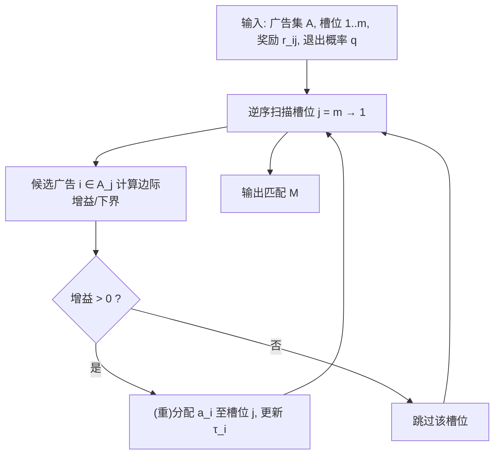

# Efficient and Practical Approximation Algorithms for Advertising in Content Feeds (信息流广告的高效实用近似算法)

- **会议/期刊**: WWW 2025
- **作者与机构**: Guangyi Zhang (深圳技术大学), Ilie Sarpe, Aristides Gionis (KTH 皇家理工学院)
- **推荐链路定位**: 重排（广告位分配后处理）
- **研究方向**: CTR预估与特征交叉 / 多任务学习与列表级重排
- **论文原文**: [https://arxiv.org/abs/2502.02115v1](https://arxiv.org/abs/2502.02115v1)
- **开源代码**: [https://github.com/Guangyi-Zhang/ads-in-stream-code](https://github.com/Guangyi-Zhang/ads-in-stream-code)

## TL;DR (1分钟核心速览)

信息流原生广告需在"广告相关性约束 + 用户注意力衰减"下决定广告插入位置，前人最优实用算法仅达 4-近似且依赖昂贵最大权匹配。本文提出反向贪心 G-bwd 与 G-bpx，利用"底部槽位才是近似比关键"的反直觉结构，将近似比改进至紧的 2-近似，复杂度降至 $O(|E|)$ 级别，并在合成二部图与 YouTube/Criteo 模拟数据上取得最高期望奖励。

## Background & Motivation (背景与核心矛盾)

- **主流范式**: 信息流广告分配被建模为 StrmAds 问题——给定 $m$个自然内容槽位与$n$个广告，广告$a_i$仅能插入相关槽位$S_i$，用户每消费一个内容/广告以概率$q$退出，目标是最大化期望奖励$f(M)=\sum_{e=(i,j)\in M} r_e(1-q)^{j+z(j)}$，其中$z(j)$为槽位$j$ 之前的广告数。
- **前人局限**: (1) Ieong 等人的 PTAS 依赖子序列穷举与流计算，实际不可用；(2) 最优实用算法 Flow 通过带基数约束的最大权匹配仅达 4-近似，且当 $q>0.5$ 时无法输出非零解。
- **核心洞察 (Key Insight)**: 期望奖励函数 $f$**既非单调也非次模**（Proposition 1），故次模最大化工具全部失效；更关键的是，由于注意力衰减，直觉上"优先占满顶部槽位"的在线贪心与 MWM 均可构造出近似比任意差的实例（Example 2，$q=1/2$时比值约$2^{m/2}$）。
- **本文切入点**: 反其道而行——**从底部槽位反向处理**，先保证尾部优质分配，再向前回填，从而同时兼顾衰减效应与匹配约束。

## Method (核心方法设计)

### 1. 整体框架 (Overall Architecture)

模型将广告分配视为二部图 $E=\cup_i(\{i\}\times S_i)$上的匹配问题。核心是定义后缀子问题 StrmAds-$j$：忽略前$j$个槽位，目标为$f_j(M)=\sum_{e=(i,j')\in M:j'>j} r_e(1-q)^{j'-j+z_j(j')}$。算法从槽位$m$逆序扫描至 1，在每个槽位尝试（重）分配广告并计算边际增益，仅当增益为正时保留，最终输出匹配$M$。G-bwd 用精确边际增益，G-bpx 用可证明的边际增益下界替代以加速。

### 2. 关键设计拆解 (Key Designs)

1. **反向贪心 G-bwd（StrmAds-R 最优解）**：针对"顶部贪心失效"痛点，改为逆序处理，在槽位 $j$选择使$g_i=f_{j-1}(M_i)/(1-q)-f_j(M)$最大的广告并重分配。定理 2 证明其对允许重复投放的 StrmAds-R **精确最优**，复杂度$O(|E|)$；对 StrmAds 亦为 2-近似（Corollary 7），复杂度$O(|E|\min\{m,n\})$。

2. **非短视反向贪心 G-bpx（2-近似且更快）**：重分配会通过衰减效应影响多个槽位的边际增益，精确分析困难。本文提出奖励分解 $R_j=\sum_{e=(i,j')\in M:j'>j}(1-q)^{j'-j}(r_e-qR_{j'})$，并维护广告级估计$\tau_i=r_{ij}-qf_j(M)$，用下界准则
$$\arg\max_{i\in A_j}\left\{r_{ij}-qf_j(M)-\tau_i(1-q)^{\sigma(i)-j}\right\}$$
替代真实边际增益（Lemma 4 证明其为下界），得到 2-近似（Theorem 5），复杂度 $O(|E|+m|M|)$，实测显著快于 G-bwd。

3. **训练目标、负采样与推理效率**：本文为组合优化问题，无学习损失；奖励 $r_{ij}$可由上游 CTR 模型预估后作为输入。2-近似对贪心类算法是**紧的**（Proposition 6，$q=0$的 MWM 特例即达此界）。推理为离线/后处理式，G-bpx 在$n,m$ 增长时保持近线性扩展。

## Experimental Setup & Evaluation Protocol (实验设置与评估协议)

- **数据集与预处理**: 无公开原生广告真实数据，故采用两类：(1) 合成完全二部图（$n=100$,$m=1000$,$q=0.1$），含对称随机、非对称随机（重顶/重底）、精细定向三种权重方案；(2) 基于真实匿名广告数据模拟的两个实例：

| 数据集 | #Ads $n$| #Slots$m$| #Edges$|E|$| 奖励范围 |$q$ |
| :--- | :---: | :---: | :---: | :---: | :---: |
| YouTube | 120 | 14 999 | 1 799 880 | $2.9\times10^{-5}$–$3.92\times10^{5}$ | 0.1 |
| Criteo | 14 400 | 1 440 | 144 000 | $8.4\times10^{0}$–$1.5\times10^{3}$ | 0.1 |

- **数据划分与防穿越**: 不适用（离线组合优化，无训练/测试划分）；所有结果为 3 次独立运行均值，报告标准差。
- **排名评测协议**: 以**期望奖励 $f(M)$** 为唯一指标（等价于全库目标值评估，非采样排序），并辅以运行时间与槽位选择累积分布分析。
- **对比基线与超参设置**: 基线含在线贪心 G-fwd、阈值贪心 G-onl（阈值取首槽最优奖励）、流算法 Flow（4-近似）及其增强 FlowG、最大权匹配 MWM、全局贪心 G-glb（惰性评估加速）；本文方法 G-bwd、G-bpx。

## Key Experimental Results (实验关键数据)

### 1. 主实验对比 (Main Results)

合成二部图（图 3）与真实模拟数据（图 5）的期望奖励定性结论如下（原文以柱状图呈现，无精确表格数值）：

| 方法 | 对称随机 | 精细定向 | 重顶非对称 | 重底非对称 | YouTube | Criteo | 近似比 |
| :--- | :---: | :---: | :---: | :---: | :---: | :---: | :---: |
| G-onl | 最差(多为0) | 最差 | 最差 | 最差 | 较好 | 差 | 无保证 |
| G-fwd | 差 | 差 | 差 | 差 | 差 | 较好 | 无保证 |
| Flow | 显著低 | 显著低 | 显著低 | 显著低 | 低 | 低 | 4 |
| MWM | 接近最优 | 接近最优 | 接近最优 | 接近最优 | 中 | 中 | 无保证 |
| FlowG | **高** | **高** | **高** | **高** | **高** | **高** | 4+贪心 |
| **G-bwd** | **最高档** | **最高档** | **最高档** | **最高档** | **最高档** | **最高档** | **2** |
| **G-bpx** | **最高档** | **最高档** | **最高档** | **最高档** | **最高档** | **最高档** | **2** |
| G-glb | 略优于G-bwd | 略优 | 略优 | 略优 | 略优 | 略优 | 无保证 |

### 2. 消融实验 (Ablation Study)

| 配置/变体 | 关键观察 |
| :--- | :--- |
| 缩放 $n$（图 4a） | Flow/MWM 运行时间最长；G-bpx 远快于 G-bwd；G-glb 随$n$ 增长耗时高 |
| 缩放 $m$（图 4b） | G-glb 因惰性评估对$m$ 不敏感；在线算法最快但奖励最低 |
| 变化 $q$（图 4c） |$q$增大奖励单调下降；Flow 在$q>0.5$ 时输出零解 |
| 匹配规模上限 $k$（图 4d） |$k>20$后奖励进入平台期，与$q$ 值一致 |

### 3. 关键实验发现 (Key Findings)

1. **反向设计带来"高召回"分配**：图 6 显示 G-bwd/G-bpx 是唯一会把广告分配到**大索引尾部槽位**的方法，尾部优质分配被保留，劣质分配可后续剪枝而几乎不损失奖励——这正是 2-近似证明中"照顾底部槽位"直觉的实证。
2. **近似比与实测并非线性对应**：MWM 虽无衰减建模却常接近最优，而理论更优的 Flow（4-近似）实测显著落后，说明**基数约束式建模**损失了大量可行解；本文方法在理论与实测上同时占优。
3. **效率与质量可兼得**：G-bpx 用下界替代精确边际增益，在保持最高档奖励的同时运行时间远低于 G-bwd 与 G-glb，是工业后处理场景的实用首选。

## Highlights & Limitations (亮点、对比与审稿批判)

- **与代表作对比 (vs. Prior Work)**: 相比 Ieong 等人的 PTAS（不可实用）与 Flow（4-近似、$q>0.5$ 失效），本文首次给出**紧 2-近似**的实用贪心；相比 Yan 等人的工业方案（需自然内容参与度阈值）与 Liao 等人的 RL 方案（未建模广告引起的注意力衰减），本文显式刻画了广告对后续曝光的负外部性。
- **可迁移亮点**: (1) "逆序处理 + 后缀子问题分解"可迁移至任何带位置衰减的序列分配/重排问题；(2) 用可证下界替代精确边际增益的 non-oblivious 贪心技巧，可加速其他非次模组合优化。
- **审稿级局限批判**: (1) 奖励 $r_{ij}$ 被当作给定输入，未与上游 CTR 预估误差联合建模，端到端收益不明；(2) 缺乏真实平台在线 A/B 与公开真实广告数据集，YouTube/Criteo 均为模拟构造，外部效度受限；(3) 仅离线设定，作者亦承认在线常数竞争比算法仍是开放问题。

## Rating (四维评分)

- **方法创新性 (Novelty)**: ⭐⭐⭐⭐ （反向贪心 + 奖励分解下界，将近似比从 4 改进至紧 2，理论贡献扎实）
- **评估协议与实验扎实度 (Protocol & Experiments)**: ⭐⭐⭐ （首次系统评测且覆盖多权重方案，但缺真实在线数据与公开基准）
- **写作与数学规范度 (Clarity & Rigor)**: ⭐⭐⭐⭐ （分解式与引理链条清晰，复杂度分析完整，证明置于附录）
- **工业落地与复现价值 (Industrial & Practical Value)**: ⭐⭐⭐⭐ （代码开源，G-bpx 近线性扩展，可直接作为信息流广告后处理模块）

