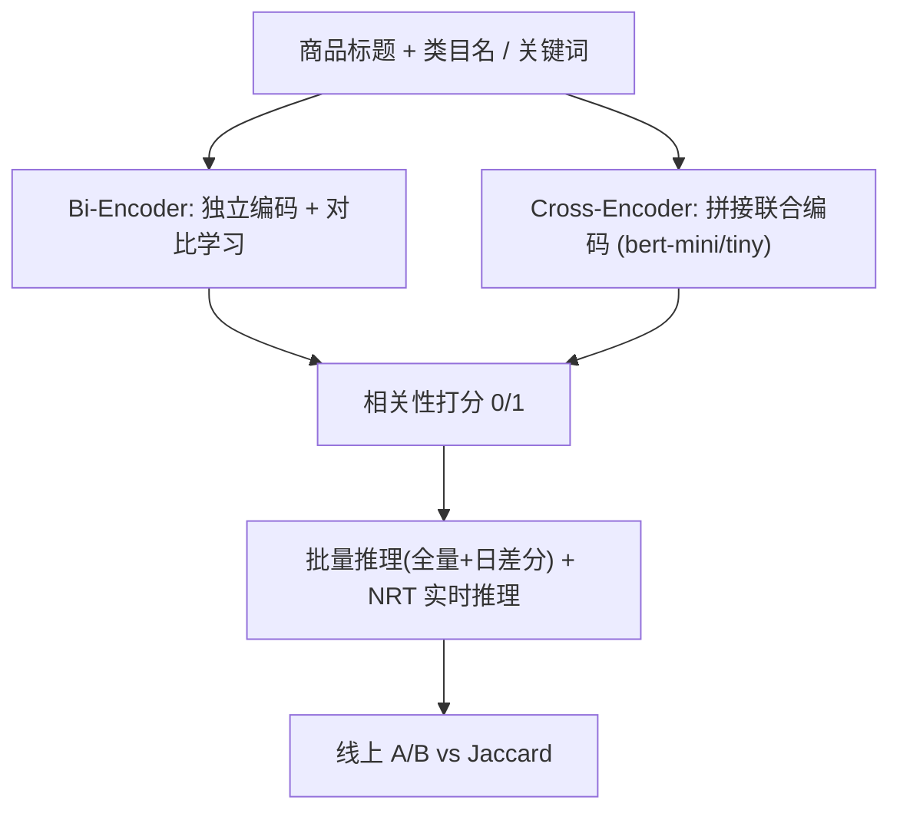

# Middleman Bias in Advertising: Aligning Relevance of Keyphrase Recommendations with Search (广告中的中间人偏差：对齐关键词推荐与搜索的相关性)

- **会议/期刊**: WWW 2025 (Companion)
- **作者与机构**: Soumik Dey, Wei Zhang, Hansi Wu, Bingfeng Dong, Binbin Li (eBay Inc.)
- **推荐链路定位**: 召回（关键词推荐的相关性过滤环节）
- **研究方向**: CTR预估与特征交叉 / 去偏、公平与工业架构
- **论文原文**: [https://arxiv.org/abs/2502.00131v2](https://arxiv.org/abs/2502.00131v2)
- **开源代码**: [bert-mini](https://huggingface.co/prajjwal1/bert-mini)（仅基座模型，业务代码未开源）

## TL;DR (1分钟核心速览)

eBay 广告关键词推荐的相关性过滤器若用点击/成交信号训练，会因“只有通过 Search 相关性过滤的关键词才产生曝光日志”而陷入样本选择偏差——作者称之为 **middleman bias**。本文改用 Search 侧相关性判定重构 2400 万条训练标签，将任务重定义为 Advertising 与 Search 两个动态系统的对齐问题，并系统比较 bi-encoder 与 cross-encoder。离线 F1 从 Jaccard 的 0.70 提升至 bert-mini 的 0.81；线上 bert-tiny 相对 Jaccard 使 CVR +11.6%、成交 +26.04%（$p<0.05$）。

## Background & Motivation (背景与核心矛盾)

- **主流范式**: 关键词推荐分召回→相关性过滤→排序三步，相关性过滤长期依赖点击/成交数据训练（CTR 模型）或规则化的 Jaccard token 重合度。
- **前人局限**: ① 点击数据是 MNAR 的——不流行商品在 SRP 上排名靠后、拿不到曝光，于是“无点击”被误当作“不相关”负样本；② 更隐蔽的是，只有通过 Search 相关性过滤、赢得拍卖的关键词才会被记录，模型**从未见过** Search 判为不相关的关键词，而 Advertising 恰恰需要过滤这类样本。
- **核心洞察 (Key Insight)**: Search 是连接卖家关键词与买家的“中间人”，它单方面决定哪些关键词能进入拍卖。图 2 中 Itm1 的 KP2/KP3/KP5 即便真实相关，只要 Search 判不相关就无法参拍——因此 Advertising 的相关性定义必须与 Search 对齐，而非与点击对齐。
- **本文切入点**: 直接以 Search 的相关性判定作为监督标签，把偏差从数据源头切断，同时保留对 Search 不相关关键词的过滤能力。

## Method (核心方法设计)

### 1. 整体框架 (Overall Architecture)

任务形式化为：给定商品标题、类目名与候选关键词，预测该关键词是否会被 Search 判为相关。数据侧用 2400 万条 Search 判定为 1 的样本训练、300 万条（含 0/1 标签）评估，按类目流量分层以保证 10 万+ 类目的覆盖。模型侧并行比较两类编码器：bi-encoder 独立编码商品与关键词、可离线预计算向量；cross-encoder 将二者拼接联合编码、精度更高但推理需枚举组合。最终按“离线 F1 × 差分推理延迟”双约束选型，落地 bert-tiny 并做线上 A/B。

### 2. 关键设计拆解 (Key Designs)

1. **Middleman Bias 的数据重构（核心贡献）**：痛点在于点击日志的负样本被 Search 过滤器系统性截断。作者不再从行为日志构造标签，而是直接采集 Search 相关性判定 $y=\mathbb{I}[\text{Search 判为相关}]$，使训练分布与部署时需过滤的分布一致。直觉上，这把“学买家偏好”换成了“学中间人的准入规则”，从而消除样本选择偏差。
2. **Bi-Encoder 的三种训练目标对比**：同一骨干 eBERT 下比较 Softmax 分类头（输入 $(u,v,|u-v|)$ 拼接）、对比学习（拉近 label=1、推远 label=0）、以及基于点击数据的 In-batch 随机负采样 (IRNS)。对比损失显著优于另两者（F1 0.79 vs 0.73/0.71），说明**标签质量比负采样技巧更关键**——IRNS 虽用 CTR≥0.05 且曝光≥30 过滤噪声，仍继承了点击偏差。
3. **Cross-Encoder 的轻量化与推理经济学**：cross-encoder 需对 item-keyphrase 组合逐一前向，全量约 1000 亿对不可行，故只用于日差分（约 70 亿对）。作者选 bert-mini（4 层/256 维）与 bert-tiny（2 层/128 维），在 PySpark（1000 executors）+ ONNX Runtime 上测得差分延迟分别为 2.5h 与 1.5h，后者与 bi-encoder 的 1h 基本同档，构成“精度-延迟”的帕累托拐点。

## Experimental Setup & Evaluation Protocol (实验设置与评估协议)

- **数据集与预处理**: 训练集 2400 万条 Search 判正样本；评估集 300 万条 item-keyphrase 对（含正负标签），按类目流量分层采样。IRNS 额外使用 30 天搜索日志中 CTR≥0.05、曝光≥30 的 2400 万条点击样本。

| 数据集 | #Users | #Items | #Interactions | 稀疏度/密度 | 特征/场景说明 |
| :--- | :---: | :---: | :---: | :---: | :--- |
| 训练集 | — | — | 24M | — | Search 相关性判定=1，按类目分层 |
| 评估集 | — | — | 3M | — | 含 0/1 标签，衡量与 Search 的一致性 |
| IRNS 辅助集 | — | — | 24M | — | 30 天搜索日志，CTR≥0.05 且曝光≥30 |

- **数据划分与防穿越 (Splitting Strategy)**: 训练/评估独立采样，评估集标签来自 Search 判定而非点击，规避了行为日志的时间穿越问题。
- **排名评测协议 (Ranking Protocol)**: 本质为二分类，采用 Precision / Recall / F1 而非全库排序指标；Precision 衡量与 Search 过滤的一致性，Recall 衡量被误杀的关键词机会损失。
- **对比基线与超参设置**: 基线为线上 Jaccard 规则模型；模型侧含 3 种 bi-encoder 目标与 2 种 cross-encoder 规模。统一 4 epoch、学习率 $2\times10^{-5}$、8×A100-80GB；bi-encoder 单卡 batch 384 + fp16，bert-mini batch 10240，bert-tiny batch 40960。

## Key Experimental Results (实验关键数据)

### 1. 主实验对比 (Main Results)

| 模型 | 类型 | Precision | Recall | F1 | 差分延迟(h) |
| :--- | :---: | :---: | :---: | :---: | :---: |
| Jaccard | 规则 | 0.63 | 0.75 | 0.70 | — |
| Softmax bi-enc | 双塔 | 0.60 | 0.85 | 0.71 | 1 |
| IRNS bi-enc | 双塔 | 0.62 | 0.88 | 0.73 | 1 |
| Contrastive bi-enc | 双塔 | 0.71 | 0.88 | 0.79 | 1 |
| bert-tiny | 交叉 | 0.74 | 0.87 | 0.80 | 1.5 |
| **bert-mini** | 交叉 | **0.76** | **0.88** | **0.81** | 2.5 |

线上 A/B（bert-tiny vs Jaccard，均 $p<0.05$除 CTR）：曝光 **+20.17%**、点击 **+13.01%**、成交 **+26.04%**、CVR **+11.6%**，CTR 中性（$p=0.17$）；同时曝光给卖家的关键词总量**减少 7%**。

### 2. 消融实验 (Ablation Study)

| 配置 | Precision | Recall | F1 | 说明 |
| :--- | :---: | :---: | :---: | :--- |
| w/o Search 标签（用点击训练） | — | — | 离线未通过 Search 对齐检验 | 上线后遭卖家投诉，被迫下线 |
| Softmax → Contrastive | 0.60→0.71 | 0.85→0.88 | 0.71→0.79 | 目标函数替换 |
| Contrastive → bert-tiny | 0.71→0.74 | 0.88→0.87 | 0.79→0.80 | 双塔换轻量交叉 |
| bert-tiny → bert-mini | 0.74→0.76 | 0.87→0.88 | 0.80→0.81 | 容量翻倍，延迟 +1h |

### 3. 关键实验发现 (Key Findings)

1. **标签来源比模型结构更决定成败**：三种 bi-encoder 的 Recall 都在 0.85–0.88 的高位，差异几乎全部体现在 Precision（0.60→0.71），说明瓶颈在于“能否正确拒绝 Search 不相关的关键词”，而这正是点击标签无法提供的监督信号。
2. **2 层 cross-encoder 即可反超复杂双塔**：bert-tiny 以 128 维隐层、1.5h 延迟取得 F1 0.80，超过对比学习双塔的 0.79，验证了联合编码在细粒度相关性判别上的结构性优势，且轻量化后延迟代价可接受。
3. **线上收益来自“减量增效”**：关键词曝光量下降 7% 的同时成交 +26.04%，说明被剔除的主要是 Search 不相关项；后续分析确认 bert-tiny 同时降低了 False Positive 与 False Negative，且被救回的 False Negative 中大量是**单词头部关键词**——恰是 Jaccard 因标题长度惩罚而系统性误杀的高价值流量。

## Highlights & Limitations (亮点、对比与审稿批判)

- **与代表作对比 (vs. Prior Work)**: 相比 Jaccard 规则，本文引入语义匹配并消除长度惩罚；相比 xgboost CTR 模型，本文从标签源头切断 MNAR 偏差而非在模型侧做加权纠偏；相比通用 cross-encoder 精排工作，本文把“对齐下游系统判定”本身作为建模目标，属于级联排序中依赖系统对齐思路的广告侧变体。
- **可迁移亮点**: ① 当上游模块的监督信号被下游过滤器截断时，直接采集下游判定作标签是成本最低的去偏手段；② “离线 F1 + 差分推理延迟”双约束选型，比单纯追 SOTA 更贴合工业部署。
- **审稿级局限批判**: ① 全文仅 5 页，缺少与显式去偏方法（IPS/重加权）的定量对照，无法判断数据重构相对算法去偏的增益边界；② 完全对齐 Search 判定意味着继承 Search 自身的偏差，若 Search 相关性模型本身有误，Advertising 会同步放大，论文未讨论这一“对齐的代价”；③ 评估仅用 P/R/F1，缺少按类目/关键词长度的分层误差分析。

## Rating (四维评分)

- **方法创新性 (Novelty)**: ⭐⭐⭐ （middleman bias 的概念提炼有工业洞察价值，但技术方案本身是标准编码器 + 标签替换，缺少算法层面的新算子）
- **评估协议与实验扎实度 (Protocol & Experiments)**: ⭐⭐⭐⭐ （2400 万训练 + 300 万评估的规模可信，且有 $p<0.05$ 的线上 A/B 佐证，但缺少与去偏基线的对照）
- **写作与数学规范度 (Clarity & Rigor)**: ⭐⭐⭐ （工业叙事清晰、图表直观，但全文无一个形式化公式，相关性对齐缺乏数学刻画）
- **工业落地与复现价值 (Industrial & Practical Value)**: ⭐⭐⭐⭐⭐ （完整给出批量/NRT 双路服务架构、延迟基准与选型逻辑，是难得的可落地工业范本）

