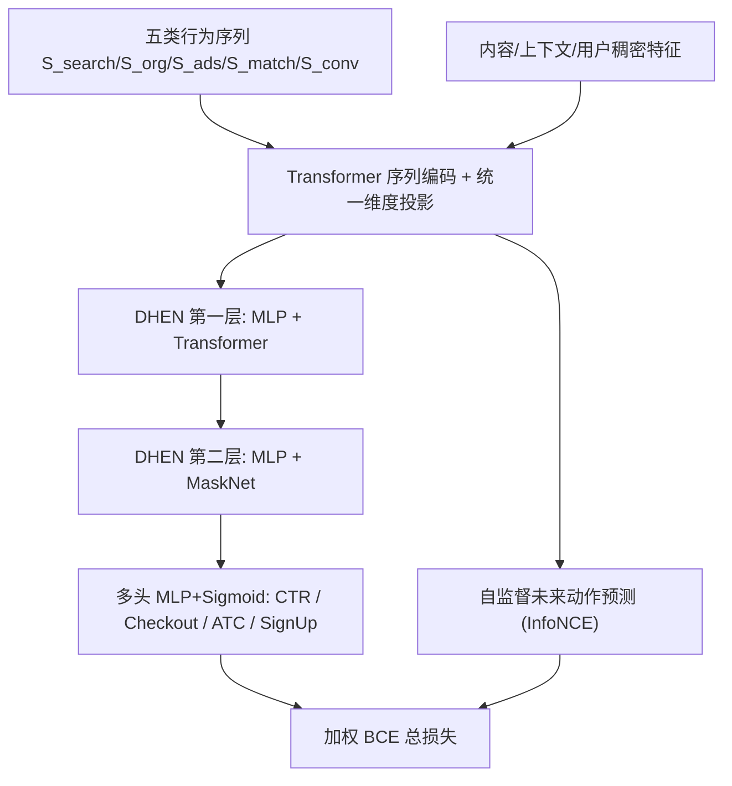
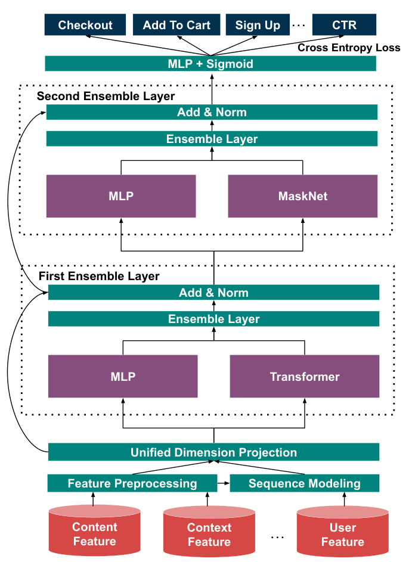

# On the Practice of Deep Hierarchical Ensemble Network for Ad Conversion Rate Prediction (深度分层集成网络用于广告转化率预测的工业实践)

- **会议/期刊**: WWW Companion 2025 (Industry Track)
- **作者与机构**: Jinfeng Zhuang, Yinrui Li, Runze Su 等 18 人，Pinterest Inc.
- **推荐链路定位**: 精排（oCPM 转化广告排序）
- **研究方向**: CTR/CVR 预估与特征交叉 / 序列推荐
- **论文原文**: [https://arxiv.org/abs/2504.08169v3](https://arxiv.org/abs/2504.08169v3)
- **开源代码**: 暂未开源

## TL;DR (1分钟核心速览)

针对 oCPM 转化广告 CVR 标签极稀疏（比 CTR 少数个量级）、延迟长、噪声大的痛点，本文在 Pinterest 生产环境系统性地回答"DHEN 该怎么配"：以两层 DHEN（MLP+Transformer / MLP+MaskNet）为单一多任务骨干统一预测全部转化行为，引入站内搜索/自然内容/广告与站外匹配/归因五类序列端到端建模，并加一路 InfoNCE 式未来行为自监督损失。离线相对 MLP 基线 AUC 提升约 2.18%，线上 A/B 中 CPA 显著下降 2.15%、转化数 +1.62%、iCVR +4.90%。

## Background & Motivation (背景与核心矛盾)

- **主流范式**: 工业 CVR 精排长期依赖单一特征交叉模块（MLP / DCN-V2 / MaskNet / Transformer）叠加预训练用户向量（PinnerFormer 类），DHEN 在 Meta 的 CTR 场景已验证"多模块集成"有效，但在转化广告 CVR 上是否成立、如何配置完全未知。
- **前人局限**: 其一，DHEN 自由度极高（选哪些模块、几层、每层超参），盲目堆叠层数会过拟合且推理成本爆炸；其二，预训练用户向量只优化站内互动目标，训练数据不含站外转化，与 CVR 目标存在系统性错位。
- **核心洞察 (Key Insight)**: 作者发现 CVR 的真正瓶颈不是模型容量而是**标签量**——把 CTR 头与全部转化行为合并进一个多任务模型可成倍扩充监督信号；同时用户序列本身蕴含大量可被端到端学到的"手工特征"（计数、类目、兴趣），且序列中的未来行为可作为免标注的免费监督。
- **本文切入点**: 用 ParetoNet 搜索在"性能-吞吐"帕累托前沿上锁定两层 DHEN 配置，再以序列端到端建模 + 自监督未来动作预测补足稀疏标签。

## Method (核心方法设计)

### 1. 整体框架 (Overall Architecture)

输入侧将用户行为组织为五条有序序列 $\mathcal{S}=\{S_{search},S_{org},S_{ads},S_{match},S_{conv}\}$，每条序列内每个 item 拼接 ID 级信号与预训练信号后经 Transformer Encoder 编码；序列表征与内容/上下文/用户稠密特征一同进入特征预处理（min-max 归一化、预训练 embedding 的 BN、时间戳对数差分、类别 embedding 映射）与统一维度投影$\mathbb{R}^{B\times L\times D}$，随后送入两层 DHEN 集成层做特征交叉，最后每个预测头接独立 MLP+Sigmoid。训练时监督 BCE 与序列自监督损失联合优化，线上推理仅保留 CVR 相关头。

<figure class="paper-figure" markdown="span">
  <figcaption>图2：用于CVR预测的多任务DHEN模型架构。我们通过实验发现，最佳权衡是两层特征交叉，其中第一层为MLP + Transformer，第二层为MLP + MaskNet。</figcaption>
</figure>

### 2. 关键设计拆解 (Key Designs)

1. **两层异构 DHEN 集成骨干（回答"配多深、配什么"）**：痛点在于单模块容量有限、多层同构又迅速过拟合。作者以 4 层 Transformer 为基线做逐层消融，发现单层 DHEN 反而掉 0.18%，两层（第一层 MLP+Transformer、第二层 MLP+MaskNet）取得 +0.31%，三层无额外收益而成本陡增，三层同构（3-Layer-S）仅 +0.08%。直觉是不同交叉算子（注意力式 vs. 乘性门控式）捕捉互补的高阶交互，异构性本身即是增益来源，而非深度。

2. **五类序列端到端建模 + 未来动作自监督损失**：针对 CVR 标签稀疏，作者不预测标签而预测**输入序列自身的未来 item**。对序列 $S$在时间戳$t_0$ 之后的位置构造自回归目标，并用 InfoNCE 近似全库 softmax：

$$\mathcal{L}(S)=-\sum_{t_0<t<N}\log\frac{e^{\mathbf{x}^{\top}\mathbf{x}_t}}{e^{\mathbf{x}^{\top}\mathbf{x}_t}+\sum_{P^-\in\mathcal{N}_t}e^{\mathbf{x}^{\top}\mathbf{x}^-}}$$

其中 $\mathcal{N}_t$为位置$t$采样的负例 pin 集合。总损失为$\mathcal{L}=\sum_{heads}\mathrm{BCE}(f(U,P),Y)+\alpha\sum_{S\in\mathcal{S}}\mathcal{L}(S)$。物理直觉：站外归因转化序列$S_{conv}$ 天然刻画"什么样的广告会带来转化"，对其做自回归等价于用历史转化行为为每个用户扩增伪标签，直接缓解正例稀缺。

3. **ParetoNet 参数搜索与训练/推理开销**：在算力受限下，先建最小可用基线，随机采样搜索空间训练 60 天数据、3 天评估，得到 (AUC, Throughput) 散点后拟合预测模型，再从预测面采样挑帕累托前沿候选。负采样采用"每正例配 20 负例"的轻量配置（远小于预训练 embedding 学习的负例比），因为自监督项只是辅助项。线上仅保留 CVR 头，CTR 头训练期用于正则化参数空间、推理期丢弃。

## Experimental Setup & Evaluation Protocol (实验设置与评估协议)

- **数据集与预处理**: Pinterest 生产采样数据，正例为全部有归因转化（checkout）的站外广告曝光并带完整互动标签，负例为 5% 下采样的无转化曝光；日级样本数亿、独立用户数千万。

| 数据集 | #Users | #Items | #Interactions | 稀疏度/密度 | 特征/场景说明 |
| :--- | :---: | :---: | :---: | :---: | :--- |
| Pinterest 生产采样 | 千万级/天 | 十亿级 pin 库 | 数亿/天 | 正负比 $\ll 1$（负例已 5% 下采样） | oCPM 转化广告，含站内互动 + 站外归因转化 |

- **数据划分与防穿越 (Splitting Strategy)**: 时间切分——用 60–150 天数据训练，评估"次日"性能并取平均；训练采用 batch + 增量模式（110 天 warm-up 后逐日加载前一日 checkpoint 增量训练 40 天），严格避免未来信息泄漏。
- **排名评测协议 (Ranking Protocol)**: 离线为工业日志上的 **Sampled Ranking**（负例已下采样至 5%，非全库 Full-Ranking），指标 ROC-AUC 与 PR-AUC（作者指出二者在不同线上环境下各有优劣）；线上以固定预算的 A/B 实验测 CPA、#Conversion、iCVR 等业务指标。
- **对比基线与超参设置**: 基线为 MLP、DCN-V2、MaskNet、Transformer 四类单交叉模块及 DHEN 变体；统一输入特征集，DHEN 内 Transformer 为 2 层 4 头，MaskNet 含 2 个水平 block；线上显著性以 A/B 实验统计检验标注（✓/✕）。

## Key Experimental Results (实验关键数据)

### 1. 主实验对比 (Main Results)

离线相对 AUC 提升（基线为 MLP，图 5 数据）与线上 A/B（表 2，对照组为原生产模型）：

| 模型 / 指标 | 离线相对 AUC Lift | 线上 CPA | #Conversion | iCVR | Overall CTR |
| :--- | :---: | :---: | :---: | :---: | :---: |
| MLP (基线) | 0.00% | — | — | — | — |
| DCN-V2 | 正增益（低于 DHEN） | — | — | — | — |
| MaskNet | 正增益（低于 DHEN） | — | — | — | — |
| Transformer | 正增益（低于 DHEN） | — | — | — | — |
| **DHEN (2 层)** | **最优（大幅领先）** | **-2.15%** ✓ | **+1.62%** ✓ | **+4.90%** ✓ | -2.70% ✓ |
| 线上其他指标 | — | CPC -0.12% ✕ | Revenue -0.10% ✕ | Ad Diversity -0.87% ✓ | Infra Cost +$1.2M/年 |

DHEN 层数与模块配置消融（基线为 4 层 Transformer，表 1）：

| 配置 | 每层模块组合 | AUC Lift |
| :--- | :--- | :---: |
| 1-Layer | MLP | -0.18% |
| **2-Layer** | **MLP+DCN-V2+Transformer** | **+0.31%** |
| 3-Layer | MLP+DCN-V2+MaskNet+Transformer | +0.30% |
| 3-Layer-S（同构） | 每层相同模块 | +0.08% |

### 2. 消融实验 (Ablation Study)

自监督损失配置消融（表 3，指标 PR-AUC 相对提升）：

| 配置 | #Pos | #Neg | OrgWeight | AdsWeight | AUC Lift |
| :--- | :---: | :---: | :---: | :---: | :---: |
| **NAL（未来动作）** | **90** | **20** | **0.0002** | **0.0001** | **2.18%** |
| NAL，去站内序列权重 | 90 | 20 | 0 | 0.0002 | 0.90% |
| NAL，少正例多负例 | 20 | 100 | 0.0005 | 0.0005 | 1.03% |
| NAL，权重过大 | 20 | 100 | 0.01 | 0.01 | 0.29% |
| MLM（掩码中间动作） | 60 | 30 | 0.0002 | 0.0001 | 1.68% |

用户侧特征类别消融（图 6，基线为移除全部用户侧特征）：Sequence 增益最大，Pre-trained User Embedding 次之但**无法替代**其他类别特征。

### 3. 关键实验发现 (Key Findings)

1. **异构性比深度更值钱**：两层异构 DHEN 比 4 层 Transformer 高 0.31%，而三层同构仅 +0.08%、单层甚至 -0.18%，说明增益来自 MLP/Transformer/MaskNet 交叉算子的互补而非堆叠容量；三层与两层几乎持平（0.30% vs 0.31%）却推高推理成本，故生产只上两层。
2. **自监督项是"轻量辅助"而非"重训练"**：NAL 优于 MLM（2.18% vs 1.68%），证明预测未来比还原中间更贴合转化意图；且正负比 90:20 远优于 20:100，权重放大到 0.01 时增益塌缩至 0.29%——辅助损失必须保持小权重，否则会与主任务争夺表征容量。
3. **CTR 与 CVR 可以反向移动**：线上整体 CTR 下降 2.70%、整体点击 -3.37%，但转化广告自身 CTR 中性（+0.08% 不显著）、转化数 +1.62%、iCVR +4.90%，CPA 降 2.15% 且收入基本中性（-0.10%）。这直接反驳了"以 CTR 代理 CVR"的惯例，支撑全空间联合优化（Entire Space Optimization）的必要性。

## Highlights & Limitations (亮点、对比与审稿批判)

- **与代表作对比 (vs. Prior Work)**: 相比 DHEN 原论文（Meta，仅 CTR、未讨论配置选择），本文首次给出 CVR 场景下"两层异构即够"的定量结论与帕累托搜索流程；相比 PinnerFormer/PinnerSAGE 类预训练用户向量，本文证明端到端序列建模在 CVR 上增益更大且预训练向量不可替代其他特征；相比 DIN/TWIN 等 CTR 序列模型，本文的序列建模直接服务于稀疏转化标签，并额外引入站外归因序列这一 CVR 独有信号。
- **可迁移亮点**: ①"CTR 头训练期正则、推理期丢弃"的多任务扩容技巧，可低成本迁移到任何标签稀疏的转化/留存预估任务；②用输入序列自身的未来 item 做 InfoNCE 辅助损失，无需额外标注即可为冷启动或长尾场景补充监督。
- **审稿级局限批判**: ①离线评估基于 5% 负例下采样的 Sampled Ranking，AUC 绝对值不可跨论文比较，且缺少全库 Full-Ranking 与校准（calibration）分析，而 CVR 在竞价中恰恰对概率校准敏感；②自监督权重（$10^{-4}$量级）与负例比高度敏感，缺乏敏感性曲线与理论解释，且线上增量基础设施成本$1.2M/年 未与收益做显式 ROI 核算；③未讨论转化延迟反馈（delayed feedback）的建模，仅作为未来工作提及。

## Rating (四维评分)

- **方法创新性 (Novelty)**: ⭐⭐⭐ （模块本身均为已有算子，创新在于异构集成的配置规律与序列自监督在 CVR 上的落地验证，属工程增量而非理论突破）
- **评估协议与实验扎实度 (Protocol & Experiments)**: ⭐⭐⭐⭐ （离线消融 + 严格固定预算的线上 A/B 双轨验证，指标覆盖广告主/平台/用户三方，但离线为下采样排序、缺校准分析）
- **写作与数学规范度 (Clarity & Rigor)**: ⭐⭐⭐⭐ （问题定义与损失公式清晰，配置结论可直接照搬；但部分实验仅以图呈现缺具体数值，符号体系较简）
- **工业落地与复现价值 (Industrial & Practical Value)**: ⭐⭐⭐⭐⭐ （已在 Pinterest 生产部署并带来 CPA -2.15%、转化 +1.62% 的实测收益，配置结论与 ParetoNet 流程对工业界可直接复用；扣分项为未开源）

