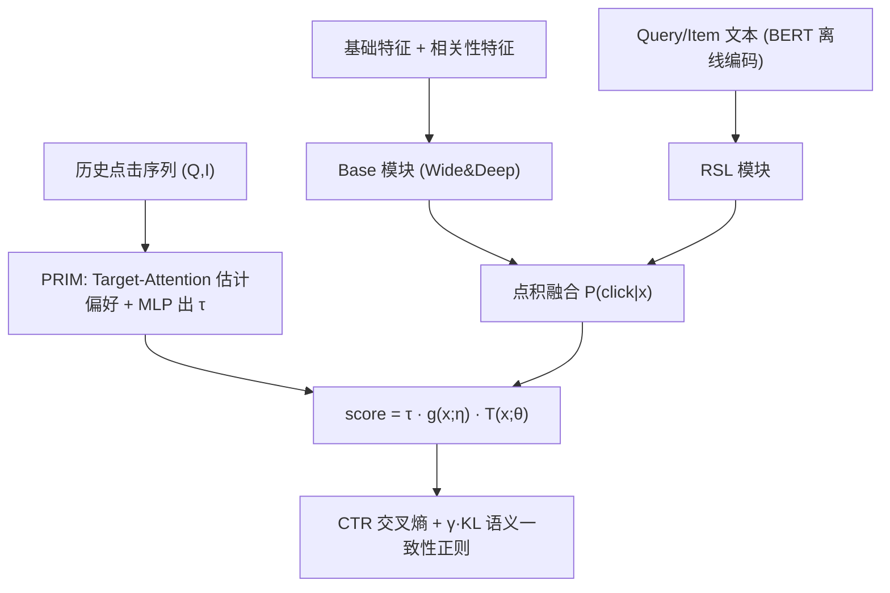
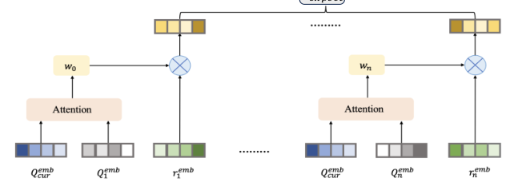
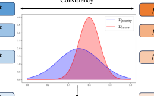

# PRECTR: A Synergistic Framework for Integrating Personalized Search Relevance Matching and CTR Prediction (个性化搜索相关性与CTR预测协同融合框架)

- **会议/期刊**: WWW Companion 2025 (Industry Track)
- **作者与机构**: Rong Chen, Ailong He, Shuguang Han, Jufeng Chen (阿里巴巴闲鱼)；Shuzhi Cao (西安交通大学，实习期间完成)
- **推荐链路定位**: 精排（搜索推荐融合排序）
- **研究方向**: CTR预估与特征交叉 / 多任务学习与列表级重排
- **论文原文**: [https://arxiv.org/abs/2503.18395v2](https://arxiv.org/abs/2503.18395v2)
- **开源代码**: 暂未开源

## TL;DR (1分钟核心速览)

闲鱼搜索采用"相关性分级 + 组内按 CTR 排序"的分治范式，导致两模型不一致、低相关高点击商品被埋没，且相关性只做客观文本匹配、忽略用户个性化偏好。本文提出 PRECTR，用条件概率分解 $P(\text{click}|\boldsymbol{x})=\sum_i P(\text{click}|rsl=i,\boldsymbol{x})P(rsl=i|\boldsymbol{x})$ 将相关性分级模块与 CTR 模块点积融合，辅以两阶段训练、语义一致性正则与个性化相关性激励。离线 AUC 0.7548（较 Wide&Deep +0.82%）、GAUC +1.99%，线上 CTR +0.4%、GMV +1.1%。

## Background & Motivation (背景与核心矛盾)

- **主流范式**: 工业搜索系统普遍训练两个独立模型——相关性匹配模型（BERT 文本匹配打分）与 CTR 模型（Wide&Deep/DIN 类），再按人工规则（分级 + 组内排序、线性加权）融合。
- **前人局限**: ① 分治训练造成两模型目标不一致，低相关但高点击的商品落入低相关层级后彻底失去曝光；② 相关性仅刻画客观文本匹配度，忽略"不同用户对相关性的敏感度不同"这一事实。
- **核心洞察 (Key Insight)**: 用户点击由"商品内在质量"与"与 query 的相关程度"共同决定，因此点击概率天然可按相关性等级做全概率分解；把相关性等级当作隐变量显式建模，比把相关性分数当普通特征喂进 CTR 模型更能保证两模块一致性。
- **本文切入点**: 以条件概率融合为骨架统一两任务，再用列表级正则约束"高相关优先"的排序语义，最后用历史行为估计用户相关性偏好做个性化激励。

## Method (核心方法设计)

### 1. 整体框架 (Overall Architecture)

模型由三部分组成：**Base 模块**（Wide&Deep，输入用户/商品/上下文/相关性特征，输出 4 维 $P(\text{click}=1|rsl=i,\boldsymbol{x})$）、**RSL 模块**（以 BERT 编码 query 与商品文本并降维，输出 4 维相关性等级分布$P(rsl=i|\boldsymbol{x})$，$k\in\{1,2,3,4\}$对应不相关/弱相关/相关/强相关）、**个性化相关性激励模块 PRIM**（由历史点击序列估计当前 query 下的相关性偏好期望，输出标量激励$\tau$）。两模块输出点积得原始分，再乘$\tau$ 得最终 CTR。训练上先以相关性等级标签预热 RSL 模块，再联合优化 CTR 交叉熵与语义一致性正则。

<figure class="paper-figure" markdown="span">
  <figcaption>图2：PRECTR的整体框架可大致分为三个核心组件：Base模块、Rsl模块和个性化相关性激励模块。Base模块和Rsl模块分别计算𝑃(𝑐𝑙𝑖𝑐𝑘= 1|𝑥,𝑟𝑠𝑙)和𝑃(𝑟𝑠𝑙|𝑥)，并最终得到原始分数，而个性化相关性激励模块基于用户的个性化搜索相关性偏好计算激励分数𝜏，并最终生成预测的CTR。</figcaption>
</figure>

### 2. 关键设计拆解 (Key Designs)

1. **条件概率融合 (Conditional Probability Fusion)**：痛点是把相关性当辅助特征时模型不会显式优化相关性。本文令 $P(\text{click}=1|\boldsymbol{x})=\sum_{i=1}^{4}P(\text{click}=1|rsl=i,\boldsymbol{x})\,P(rsl=i|\boldsymbol{x})$，即 Base 与 RSL 各出 4 维向量后做点积。直觉上它把"相关性分级"变成可解释的隐变量：RSL 决定流量在相关性层级间的分配，Base 决定层级内的点击倾向，二者共享同一梯度通路，天然消除分治不一致。

2. **两阶段训练 + 语义一致性正则**：直接用点击二分类端到端训练时，点击标签对 RSL 模块是过弱监督，且会无限推高高点击低相关商品。第一阶段以相关性等级为多分类标签预热 RSL：$\mathcal{R}_{pretrain}(\theta)=-\frac{1}{n}\sum_{i=1}^{n}rsl^{*}\log(\text{softmax}(T(\boldsymbol{x};\theta)))$；第二阶段联合训练时对 RSL 用小学习率（1e-5 vs 1e-4）。正则项构造列表级优先级标签$y^{List}=\alpha y+\beta(1-y)\cdot rsl$（$\beta=1$，$\alpha=4$），并最小化其与模型分数的分布差异：$\mathcal{R}_{regular}=D_{KL}(\text{softmax}(D_{priority})\,\|\,\text{softmax}(D_{score}))$。物理直觉是：已点击样本一律排前，未点击样本按相关性等级保序，从而把"相关优先"的排序语义注入 CTR 目标。

<figure class="paper-figure" markdown="span">
  <figcaption>图1：语义一致性正则化的示意图。</figcaption>
</figure>

3. **个性化相关性激励 (PRIM)**：不同用户对相关性的敏感度不同。先用语言模型对历史 $(Q_i,I_i)$编码得相关性表征$r^{emb}_i$，再以当前 query 为 Q、历史 query 为 K、历史相关性表征为 V 做 Target-Attention 得偏好期望$r^{emb}_{expect}=\text{softmax}(QK^{\top}/\sqrt{d})V$；将当前 query-item 相关性表征$r^{emb}_{cur}$与期望拼接经 MLP 输出激励$\tau=M(\text{concat}(r^{emb}_{cur},r^{emb}_{expect});\omega)$，最终$\text{score}=\tau\cdot g(\boldsymbol{x};\eta)\cdot T(\boldsymbol{x};\theta)$。总损失$\mathcal{R}=\mathcal{R}_{CE}(\text{score},y)+\gamma\mathcal{R}_{regular}$，$\gamma=0.3$。训练负采样即曝光未点击（真实日志），无额外负采样；BERT 文本向量离线预计算存静态索引表，线上仅查表，控制推理延迟。

## Experimental Setup & Evaluation Protocol (实验设置与评估协议)

- **数据集与预处理**: 闲鱼生产日志，日训练量约 16 亿条、651 维特征；取 9 天数据，前 7 天训练、后 2 天测试。点击为正样本、曝光未点击为负样本。

| 数据集 | #Users | #Items | #Interactions | 稀疏度/密度 | 特征/场景说明 |
| :--- | :---: | :---: | :---: | :---: | :--- |
| Xianyu 生产日志 | 未披露 | 未披露 | 约 16 亿/天 | 极高稀疏 | 651 维用户/query/商品/上下文/相关性特征，二手电商搜索 |

- **数据划分与防穿越 (Splitting Strategy)**: 全局时间戳切分（前 7 天训练 / 后 2 天测试），符合线上时序。
- **排名评测协议 (Ranking Protocol)**: 离线采用 AUC / GAUC（按用户分组加权）与 RelaImpr 相对提升；另设 Relevance Score——对每个 query 取 Top-10 结果，用 BERT 向量余弦相似度均值衡量推荐相关性。属工业日志上的全量曝光评估，非采样排序。
- **对比基线与超参设置**: LR、DNN、Wide&Deep（基座）、DeepFM、XDeepFM、DIN、SuKD（BERT 相关性特征增强）。Batch size 4096，SGD；预热阶段 lr=1e-4，联合训练 RSL lr=1e-5；历史序列取近 30 天、最大长度 50。

## Key Experimental Results (实验关键数据)

### 1. 主实验对比 (Main Results)

| Method | AUC | RI | GAUC | RI | Relevance Score |
| :--- | :---: | :---: | :---: | :---: | :---: |
| LR | 0.6835 | -27.36% | 0.6230 | -33.31% | 0.7188 |
| DNN | 0.7528 | 0.06% | 0.6853 | 0.47% | 0.7524 |
| Wide&Deep | 0.7527 | 0.00% | 0.6845 | 0.00% | 0.7538 |
| DeepFM | 0.7526 | -0.04% | 0.6852 | 0.42% | 0.7522 |
| XDeepFM | 0.7517 | -0.39% | 0.6839 | -0.29% | 0.7501 |
| DIN | 0.7546 | 0.76% | 0.6870 | 1.40% | 0.7524 |
| SuKD | 0.7513 | -0.54% | 0.6841 | -0.22% | 0.7535 |
| **PRECTR** | **0.7548** | **0.82%** | **0.6882** | **1.99%** | **0.7561** |

### 2. 消融实验 (Ablation Study)

（在线模型热启动，模拟线上环境）

| 变体 | AUC | RI | Relevance Score |
| :--- | :---: | :---: | :---: |
| Base (Wide&Deep) | 0.7538 | 0.00% | 0.7494 |
| w/o Two-stage Training | 0.7628 | 3.53% | 0.7534 |
| w/o Semantic Consistency Reg. | 0.7639 | 3.96% | 0.7559 |
| w/o Personalized Incentive | 0.7640 | 4.01% | 0.7522 |
| **PRECTR** | **0.7642** | **4.04%** | **0.7561** |

### 3. 关键实验发现 (Key Findings)

1. **融合机制本身贡献最大**：热启动下完整模型较 Base 提升 AUC +4.04% RI，而三个消融变体分别只到 3.53%/3.96%/4.01%，说明条件概率融合是主增益来源，三个辅助设计各贡献约 0.03–0.5 个千分点量级的边际提升。
2. **语义一致性正则对 AUC 增益有限但守住相关性**：去掉它 AUC 反而略高（0.7639 vs 0.7642），但 Relevance Score 从 0.7561 降至 0.7559；作者归因于训练数据中强相关样本占多数，弱化了正则作用——这恰印证该正则的定位是"抑制高点击低相关曝光"而非提 AUC。
3. **个性化激励主要改善相关性而非点击排序**：去掉 PRIM 后 AUC 几乎不变（0.7640），但 Relevance Score 掉到 0.7522（低于 w/o 正则的 0.7559），说明 PRIM 的价值在于让排序贴合用户相关性偏好；线上 7 天、>5% 流量 A/B 中 CTR +0.4%、GMV +1.1%、CTCVR +1.04%，验证了商业价值。

## Highlights & Limitations (亮点、对比与审稿批判)

- **与代表作对比 (vs. Prior Work)**: 相比 SuKD 等"把 BERT 相关性分数当辅助特征"的做法，PRECTR 显式建模相关性等级分布并参与概率分解，避免相关性特征被淹没；相比 DIN 等纯 CTR 模型，它引入了 query-item 相关性这一搜索场景独有信号；相比传统"分级 + 组内排序"的分治流水线，它从训练目标层面消除两模型不一致。
- **可迁移亮点**: ① 条件概率分解可作为通用"业务约束 × 点击倾向"融合模板（如质量分、时效性、多样性分级）；② 用列表级 KL 正则把硬性排序规则软化为可微损失，适合任何"主目标 + 合规/相关性约束"的精排场景。
- **审稿级局限批判**: ① 实验仅在生产私有数据上，无公开基准与开源代码，可复现性弱；② 相关性等级仅 4 档且依赖人工标注与 BERT 离线编码，冷启动 query 或长尾商品的相关性等级质量存疑；③ 消融显示正则与 PRIM 的 AUC 增益极小，其收益高度依赖线上指标，缺乏统计显著性检验与延迟开销的定量报告。

## Rating (四维评分)

- **方法创新性 (Novelty)**: ⭐⭐⭐⭐ （条件概率分解统一相关性与 CTR 的思路清晰且可解释，但各组件均为工业界常见技术的组合，理论新颖度中等）
- **评估协议与实验扎实度 (Protocol & Experiments)**: ⭐⭐⭐⭐ （16 亿级生产数据 + 7 天线上 A/B 颇具说服力，但缺公开数据集、显著性检验与延迟分析）
- **写作与数学规范度 (Clarity & Rigor)**: ⭐⭐⭐⭐ （融合公式与两阶段训练推导简洁自洽，符号统一；部分模块细节如 PRIM 的 MLP 结构描述偏简）
- **工业落地与复现价值 (Industrial & Practical Value)**: ⭐⭐⭐⭐ （已在闲鱼全量上线并带来 GMV +1.1%，BERT 离线预计算保证低延迟，工程价值高；但未开源限制复现）

