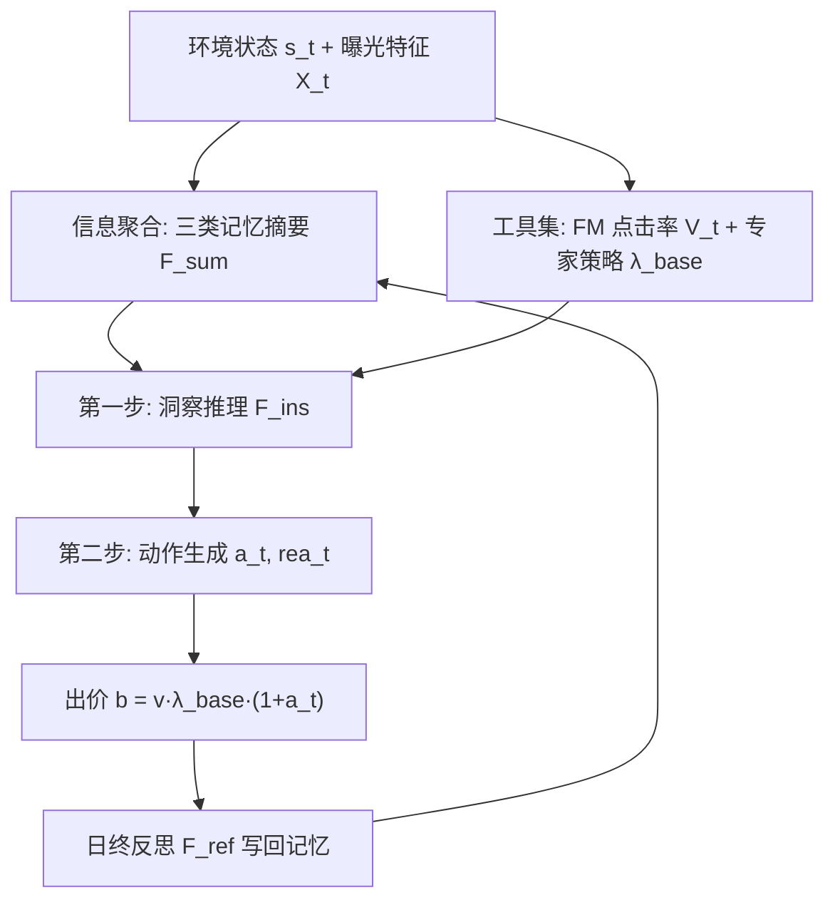
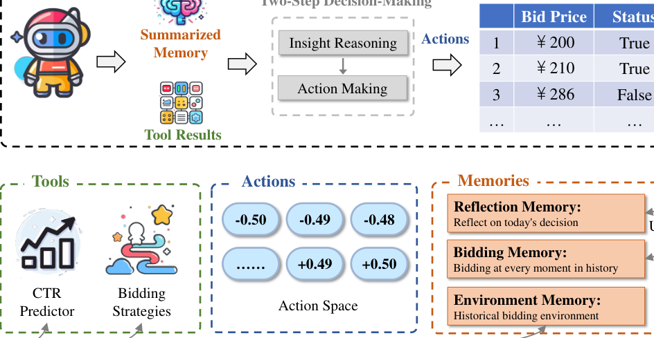

# RTBAgent: A LLM-based Agent System for Real-Time Bidding (基于大模型智能体的实时竞价系统)

- **会议/期刊**: WWW Companion 2025
- **作者与机构**: Leng Cai, Junxuan He, Yikai Li, Junjie Liang, Yuanping Lin, Ziming Quan, Yawen Zeng, Jin Xu（华南理工大学、上海大学、琶洲实验室、字节跳动）
- **推荐链路定位**: 精排（出价决策层，依赖 CTR 预估作为价值输入）
- **研究方向**: CTR/CVR 预估与特征交叉 / 强化学习与动态探索推荐
- **论文原文**: [https://arxiv.org/abs/2502.00792v1](https://arxiv.org/abs/2502.00792v1)
- **开源代码**: [https://github.com/CaiLeng/RTBAgent](https://github.com/CaiLeng/RTBAgent)

## TL;DR (1分钟核心速览)

RTB 出价策略长期受困于「离线训练与在线竞价分布漂移」以及「RL 策略黑盒不可解释、难收敛」两大痛点。本文提出首个基于 LLM 的 RTB 智能体 RTBAgent：以 FM 点击率模型与 MCPC/LIN/LP 专家策略为工具，让 LLM 只输出对基础出价因子的**有界调整量** $a_t\in[-0.5,0.5]$，配合环境/出价/反思三类记忆与「洞察推理→动作生成」两步决策。在 iPinYou 真实竞价数据、1/2、1/8、1/32 三档预算下，点击数全面超越规则、RL 与扩散基线，1/32 预算下取得 795 次点击（较 LP 提升约 3.9%）。

## Background & Motivation (背景与核心矛盾)

- **主流范式**: 二阶竞价机制下最优出价可写为 $b_i=\lambda\cdot v_i$，因此工业界与学术界围绕「如何动态确定缩放因子$\lambda$」展开：规则法（MCPC/LIN/LP）离线拟合静态参数，RL 法（RLB/DRLB/USCB/DiffBid）把预算约束出价建模为 MDP 在线学习策略。
- **前人局限**: ① 规则法参数僵硬，市场波动时预算过早耗尽或后期无钱可花；② RL 法需大量交互样本、收敛困难，且策略是黑盒，运营团队无法审计「为何这一小时出这个价」；③ 直接把 LLM 当出价器（Chat with LLMs）既缺 CTR 价值估计，又对连续数值不敏感，出价不可靠。
- **核心洞察 (Key Insight)**: LLM 的强项不是回归连续出价，而是**在给定候选区间内做带理由的离散选择**；而 RTB 恰好每 15 分钟以上才触发一次决策，LLM 推理延迟完全可被业务容忍。
- **本文切入点**: 让 LLM 站在「专家策略 + CTR 模型」的肩膀上，只做**有界调整因子**的决策，并用记忆与反思把历史竞价经验注入 prompt，从而兼顾自适应性、可解释性与数值稳定性。

## Method (核心方法设计)

### 1. 整体框架 (Overall Architecture)

RTBAgent 模拟真实竞价代理公司：每个时间步 $t$观测环境状态$s_t$（流量、历史胜率、市场均价、剩余预算等），先由信息聚合模块把三类记忆压缩为摘要$F^{sum}_t$，同时调用工具集得到点击价值估计$V_t$与专家基础因子$\lambda_{base}$；随后进入两步决策——先做洞察推理$F^{ins}_t$分析各调整区间的利弊与风险，再生成动作$a_t$与理由$rea_t$，最终按$b^t_i=v^t_i\cdot\lambda_{base}\cdot(1+a_t)$对每条曝光出价；日终执行反思$F^{ref}_t$ 写回记忆，形成闭环。

<figure class="paper-figure" markdown="span">
  <figcaption>图1：我们的RTBAgent工作流程，其配备4种工具、3类记忆、两步决策以执行动作并输出出价价格。</figcaption>
</figure>

### 2. 关键设计拆解 (Key Designs)

1. **有界调整因子替代直接出价（Action Space 重构）**：LLM 对连续数值不敏感、生成价格不可控，直接回归出价极易越界。本文将动作空间定义为 $a_t\in[-0.5,0.5]$，最终出价$b^t_i=v^t_i\cdot\lambda_{base}\cdot(1+a_t)$。直觉上，这把「无界回归」降维成「围绕专家解的局部修正」，既保留 LLM 的语义推理能力，又用专家策略兜住数值下界，避免灾难性出价。

2. **两步决策 + 三类记忆检索（Two-Step Decision & Multi-Memory）**：单步直接出价缺乏对市场态势的显式分析。第一步洞察推理 $F^{ins}_t=\mathrm{LLM}(\varphi_{ins}(s_t,F^{sum}_t,\lambda_{base}))$逐区间评估收益/风险；第二步动作生成$F^{act}_t=\mathrm{LLM}(\varphi_{act}(s_t,F^{sum}_t,F^{ins}_t,\lambda_{base}))$输出$(a_t,rea_t)$。记忆侧分为环境记忆$\mathcal{M}_{env}$、出价记忆$\mathcal{M}_{bid}$、反思记忆$\mathcal{M}_{ref}$，经$\varphi_{sum}$模板压缩为$F^{sum}_t$，从而在有限上下文内聚焦相关历史、抑制噪声。

3. **训练目标、负采样与推理效率**：本文无梯度训练，策略即 prompt 策略 $\pi_{RTBAgent}(a_t|s_t,\rho_t)=G(s_t,\rho_t)$，优化目标为最大化折扣累计奖励$\pi^*=\arg\max_\pi\mathbb{E}_\pi[\sum_{i=0}^{T}\gamma^i r_{t+i}\mid s_t=s,\rho_t=\rho]$，奖励来自决策结果与自我反思的综合信号（self-alignment）。无负采样；推理开销为每决策步 2 次 LLM 调用，因 RTB 触发间隔 ≥15 分钟而可接受。

## Experimental Setup & Evaluation Protocol (实验设置与评估协议)

- **数据集与预处理**: iPinYou 真实竞价日志，2013 年 10 天、9 个广告主；含 1950 万次曝光、14,790 次点击，总花费 16,000 元。无 5-core 过滤，按原始 campaign 组织。

| 数据集 | #Campaigns | #Impressions | #Clicks | 总花费 | 特征/场景说明 |
| :--- | :---: | :---: | :---: | :---: | :--- |
| iPinYou | 9 | 19.5M | 14,790 | 16,000 RMB | 竞价+曝光特征、胜出价、点击反馈；CPM 计费 |

- **数据划分与防穿越 (Splitting Strategy)**: 每个 campaign 的**最后 3 天为测试集**，其余为训练集（官方划分）；$\lambda_{base}$ 仅由训练集推导，杜绝未来信息泄漏。
- **排名评测协议 (Ranking Protocol)**: 非排序评测，而是**竞价模拟回放**：每日预算按 24 小时切分为 24 步，逐请求出价，出价 ≥ 市场价则胜出并按市场价扣费、获得点击；预算上限不超过测试集历史总花费，评测 1/2、1/8、1/32 三档预算。
- **对比基线与超参设置**: 规则类 MCPC/LIN/LP/ORTB，RL 类 RLB/DRLB/USCB，生成类 DiffBid；所有方法统一使用 FM 作为 CTR 估计器（线性层+偏置+特征嵌入层+sigmoid），单卡 RTX A6000 训练 RL 基线以保证公平。

## Key Experimental Results (实验关键数据)

### 1. 主实验对比 (Main Results)

| Model | 1/2 预算 | 1/8 预算 | 1/32 预算 |
| :--- | :---: | :---: | :---: |
| MCPC | 1,779 | 989 | 298 |
| LIN | 2,200 | 1,202 | 744 |
| LP | 2,211 | 1,182 | 765 |
| ORTB | 2,222 | 1,192 | 746 |
| RLB | 2,223 | 1,227 | 741 |
| DRLB | 2,264 | 1,231 | 778 |
| USCB | 2,268 | 1,227 | 762 |
| DiffBid | 2,275 | 1,235 | 793 |
| **RTBAgent (ours)** | **2,281** | **1,240** | **795** |
| Improv. vs 最强基线 | +0.26% | +0.40% | +0.25% |

### 2. 消融实验 (Ablation Study)

| 配置 | 1/2 | 1/8 | 1/32 |
| :--- | :---: | :---: | :---: |
| 仅 Action（无专家策略、无洞察） | 1,796 | 634 | 227 |
| + 专家策略（LP） | 2,194 | 1,186 | 779 |
| + 两步决策（完整 RTBAgent） | **2,265** | **1,252** | **796** |

另：不同专家策略下增益为 MCPC+ 最高 +12.75%（1/32）、LP+ +4.05%（1/32）；不同 LLM 后端（GPT-3.5、GLM-4-Air、GPT-4o mini、Llama-3-8B、Baichuan3-Turbo、Yi-large）均稳定优于 LP，Llama-3-8B 在 1/8 预算下增益最大（+70 点击）。

### 3. 关键实验发现 (Key Findings)

1. **预算越紧，Agent 增益越大**：1/32 预算下 MCPC+ 相对 MCPC 提升 12.75%，而 1/2 预算仅 +0.96%，说明 LLM 的核心价值在于「稀缺预算下的节奏控制」——图 3 显示 LP 前期超支、后期无钱，LP+ 则保留预算在后半程收割高质量点击，且全程 CPC 更低。
2. **专家策略是性能地板，两步决策是性能天花板**：去掉专家策略后 1/8 预算点击从 1,186 暴跌至 634（-46.5%），说明 LLM 单独出价不可靠；而在专家策略之上叠加洞察推理，1/8 预算再提升 5.6%（1,186→1,252），验证「先分析后行动」的推理链确实带来增量。
3. **对 LLM 规模不敏感、对策略质量敏感**：从 GPT-3.5 到 Yi-large 各后端均稳定超越基线，且专家策略越强最终效果越好（LP+ > LIN+ > MCPC+），表明框架的可迁移性来自「工具+记忆」的结构设计而非某个特定大模型。

## Highlights & Limitations (亮点、对比与审稿批判)

- **与代表作对比 (vs. Prior Work)**: 相比 USCB/DRLB 等 RL 方法，本文不训练策略网络、无需大量交互样本，且每步输出自然语言理由（10 位广告专家给出 97% 正向评价）；相比 DiffBid 的生成式轨迹建模，本文以「专家解 + 有界修正」保证出价永不越界；相比直接 Chat with LLMs，本文补齐了 CTR 价值估计与记忆机制，使 LLM 从「聊天助手」变为「可审计的决策代理」。
- **可迁移亮点**: ① 「LLM 只输出有界调整量、基础解交给领域模型」的混合范式，可直接迁移到预算分配、竞价调价、出价上限控制等任何需要数值稳定性的决策场景；② 三类记忆 + 日终反思的写回机制，是低成本在线自适应（免微调）的通用模板。
- **审稿级局限批判**: ① 绝对增益偏小（1/2 预算仅 +0.26%），且仅在单一 iPinYou 数据集、单一二阶竞价机制下验证，跨市场泛化性存疑；② 每步 2 次 LLM 调用 + 长 prompt 的推理成本与延迟未做定量分析，作者自述响应速度「不够快」，且未给出线上 A/B 收益数据；③ 记忆检索与 prompt 模板的具体设计（截断策略、检索相似度）描述较粗，复现细节不足。

## Rating (四维评分)

- **方法创新性 (Novelty)**: ⭐⭐⭐⭐ （首个 LLM Agent 出价系统，「有界调整因子 + 两步决策 + 三类记忆」组合新颖，但单点算子理论深度有限）
- **评估协议与实验扎实度 (Protocol & Experiments)**: ⭐⭐⭐ （iPinYou 官方划分与三档预算模拟合理，但仅单数据集、增益幅度小、缺线上验证与显著性检验）
- **写作与数学规范度 (Clarity & Rigor)**: ⭐⭐⭐⭐ （MDP 形式化与公式编号清晰，算法伪代码完整，但部分符号如 $\rho_t$与$G(\cdot)$ 定义略含糊）
- **工业落地与复现价值 (Industrial & Practical Value)**: ⭐⭐⭐⭐ （代码已开源、无需训练即可接入现有专家策略，延迟可被 15 分钟级触发间隔容忍，落地门槛低）

