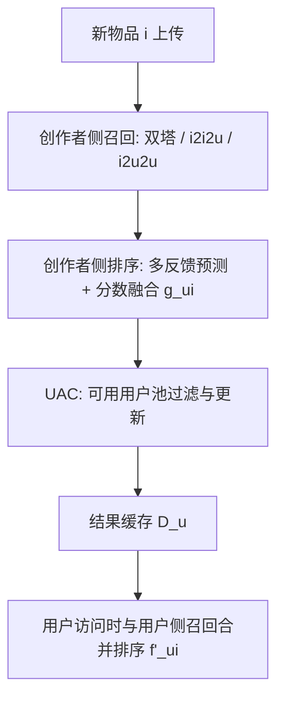
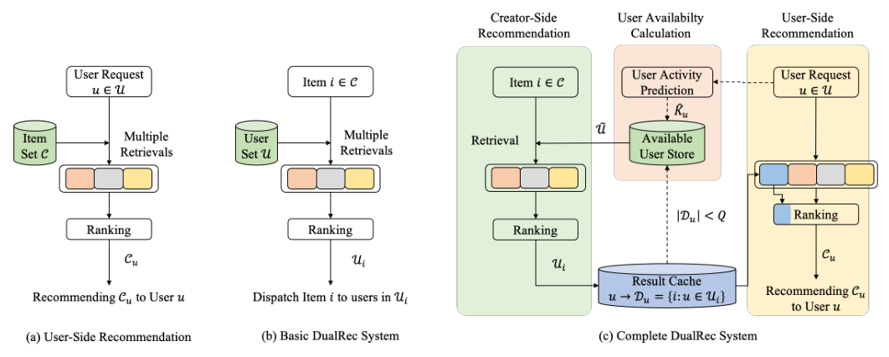

# Creator-Side Recommender System: Challenges, Designs, and Applications (创作者侧推荐系统：挑战、设计与应用)

- **会议/期刊**: WWW Companion 2025 (Industry Track)
- **作者与机构**: Xiaoshuang Chen, Yibo Wang, Yao Wang, Husheng Liu, Kaiqiao Zhan, Ben Wang (快手科技)；Kun Gai (独立)
- **推荐链路定位**: 召回 + 精排 + 重排（与用户侧推荐并行的镜像链路）
- **研究方向**: 去偏公平与工业架构 / 冷启动与长尾推荐
- **论文原文**: [https://arxiv.org/abs/2502.20497v1](https://arxiv.org/abs/2502.20497v1)
- **开源代码**: 暂未开源

## TL;DR (1分钟核心速览)

传统推荐是"为用户找物品"，导致少数爆款垄断曝光、大量创作者因缺乏正反馈而流失。本文提出镜像式的**创作者侧推荐 DualRec**：给定一个新上传物品，反向检索最合适的 $L$个用户，并指出该问题独有的**用户可达性 (user availability)** 挑战——用户可能不上线、也可能被塞入过多物品。作者用 XGBoost 预测日活 + 可用用户池$Q$ 上限约束构建 UAC 模块，并在快手（1 亿+用户、1000 万+创作者）做用户-创作者联合分流 A/B 实验，最终 21 天 DAC 提升 **2.9%**，ExpoReach-1K 累计提升约 **25%**。

## Background & Motivation (背景与核心矛盾)

- **主流范式**: 用户侧推荐以用户请求为触发，从全量物品库召回+排序返回 Top-$K$ 物品；长尾扶持工作（FairRec、Google 冷启动系统）虽给低曝光物品加曝光，但优化目标仍是**用户满意度**。
- **前人局限**: ① 用户与创作者对反馈的敏感维度不同——用户在意观看时长，而创作者看不到观看时长，只对点赞/评论有感知（图 1 显示互动显著提升后续发帖概率），因此用户侧目标无法等价刻画创作者体验；② 用户侧召回天然倾向少数高确定性物品，即便候选集被限制为新物品，新物品覆盖率依然很低（图 8）。
- **核心洞察 (Key Insight)**: 用户与物品是推荐系统的两个**对称组件**，把用户侧算法中的 user/item 互换，即可几乎零成本地得到创作者侧版本；但互换后出现用户侧不存在的"用户可达性"问题。
- **本文切入点**: 构建与用户侧完全镜像的 DualRec 链路，并额外引入 UAC 模块维护"明天会来且未被塞满"的可用用户池。

## Method (核心方法设计)

### 1. 整体框架 (Overall Architecture)

DualRec 与用户侧推荐构成一对镜像：物品上传触发请求，创作者侧召回从用户池 $\mathcal{U}$中取出候选用户，创作者侧排序预测这些用户对该物品的多类反馈并选出最终用户集$\mathcal{U}_i$；结果写入缓存$\mathcal{D}_u$，待用户真正访问时作为用户侧召回的一路候选参与统一排序，并通过加分项$\lambda g_{ui}$ 保证曝光。UAC 模块贯穿全流程：每日预测用户活跃度、维护可用用户池、在匹配后即时剔除饱和用户。

<figure class="paper-figure" markdown="span">
  <figcaption>图2：DualRec框架。</figcaption>
</figure>

### 2. 关键设计拆解 (Key Designs)

1. **镜像式召回与排序（零额外训练成本的算法复用）**：用户侧 $u2u2i$检索$\mathcal{C}^{u2u2i}_u=\{\mathbf{H}_U(u')\mid u'\in S_U(u)\}$镜像为$i2i2u$检索$\mathcal{U}^{i2i2u}_i=\{\mathbf{H}_I(i')\mid i'\in S_I(i)\}$，二者共用同一套物品相似度服务$S_I$；双塔检索仅需把物品 ANN 索引换成用户 ANN 索引，训练过程完全不变，推理时$\mathcal{U}^{\text{two-tower}}_i=\text{Top}_{u\in\mathcal{U}}\{\boldsymbol{e}_u\cdot\boldsymbol{e}_i\}$。这一对称性使 DualRec 可直接继承用户侧多年积累的召回资产。
2. **面向长尾的排序改造与分数融合**：创作者侧候选大量是缺乏样本的新物品，常规预测模型受流行度偏置影响严重。作者做两处改造：训练时**丢弃 item ID 构造增广样本**并与原样本联合训练，迫使模型从侧信息提取泛化表征；同时补充"近期交互用户""相似物品理解向量"等物品侧特征。融合分改为 $g_{ui}=\sum_{m=1}^{M}\beta_m s^m_{ui}/\theta_u$，其中$\theta_u$ 为用户平均交互率，用于惩罚"什么都点赞"的高偏置用户，使系统识别出真正感兴趣的目标人群；同时上调点赞/评论等创作者可感知反馈的权重、下调观看时长权重。
3. **UAC 用户可用性计算（本文最独特的增量）**：定义活跃状态 $a_u\in\{0,1\}$与匹配集$\mathcal{D}_u=\{i:u\in\mathcal{U}_i\}$，可用用户池为$\tilde{\mathcal{U}}=\{u\in\mathcal{U}:a_u=1,|\mathcal{D}_u|<Q\}$。$a_u$由 XGBoost 依据近 30 天活跃、星期几、累计互动等特征逐日预测；每完成一次匹配即执行$\mathcal{D}_u\leftarrow\mathcal{D}_u\cup\{i\}$，一旦$|\mathcal{D}_u|\ge Q$立即从池中剔除。最终用户侧排序对缓存物品加分：$f'_{ui}=f_{ui}+\lambda g_{ui}$（若$i\in\mathcal{D}_u$），否则$f'_{ui}=f_{ui}$。该设计把"物品找用户"从无约束分配变为**带容量约束的在线二分匹配**，避免少数用户被塞入上万条物品而绝大多数物品无人消费。

## Experimental Setup & Evaluation Protocol (实验设置与评估协议)

- **数据集与场景**: 快手短视频平台线上全量流量，1 亿+用户、1000 万+创作者、日上传 400 万+视频；DualRec 每次请求为单个物品返回 **200 个用户**，仅占 2% 总曝光，其余仍由用户侧推荐分配。
- **分流协议 (Splitting Strategy)**: 采用**用户-创作者联合分流 (user-creator co-diverted)** A/B 测试——先按比例划分互不重叠的对照组/实验组创作者，再按比例划分用户，保证实验组用户只消费实验组创作者的物品，从而避免传统 user-diverted 设置下同一物品跨组泄漏导致创作者侧效应无法测量。
- **评测指标**: 创作者侧核心指标为 **DAC**（日活跃创作者数，需长期观测）与代理指标 **ExpoReach-$E$**（新物品达到$E\in\{1K,5K,10K\}$ 曝光的创作者数量）；用户侧 DAU 与人均观看时长作为**硬约束**，所有实验均未出现下降。
- **对比基线与超参**: Base 为带新物品优先召回与排序加权的用户侧系统（思路类似 FairRec）；DualRec-v1~v5 逐版本迭代，每版以上一版为基线，实验周期 7 天，置信度 > 0.95；UAC 中 $Q=10$，双塔正样本为点赞/评论用户、负样本从$\tilde{\mathcal{U}}$ 随机采样。

## Key Experimental Results (实验关键数据)

### 1. 主实验对比 (Main Results)

| 方法（对比上一版本） | ExpoReach-1K | ExpoReach-10K |
| :--- | :---: | :---: |
| DualRec-v1 vs. Base | +11.7% | +8.4% |
| DualRec-v2 vs. v1（排序改造 SA+EF） | +4.9% | +5.4% |
| DualRec-v3 vs. v2（+ $i2i2u$ 召回） | +3.2% | +4.8% |
| DualRec-v4 vs. v3（+ $i2u2u$ 召回） | +0.59% | +0.78% |
| DualRec-v5 vs. v4（分数融合改造） | **+3.7%** | **+3.5%** |
| 最终系统 vs. Base（21 天 DAC） | — | **+2.9%** |

### 2. 消融实验 (Ablation Study)

| 配置 | AUC | 增益 |
| :--- | :---: | :---: |
| w/o SA, w/o EF | 0.901 | 0 |
| w/o SA, with EF | 0.908 | +0.7pp |
| with SA, w/o EF | 0.911 | +1.0pp |
| with SA, with EF | **0.913** | **+1.2pp** |

| UAC 组件 | 关键观测 |
| :--- | :--- |
| 去掉用户活跃预测 | 匹配用户次日实际到访命中率由 **82% 降至 49%** |
| 去掉可用用户存储 | 少数用户被匹配 50+ 甚至 10000+ 物品，大量用户零匹配 |

### 3. 关键实验发现 (Key Findings)

1. **ExpoReach 是 DAC 的可靠代理指标**：21 天实验显示 ExpoReach 每提升 1% 对应 DAC 提升约 0.13%，且 DualRec 仅分配 200 用户却带来远超 200 的后续曝光增长，说明创作者侧初始曝光"点燃"了用户侧推荐对该物品的发现，形成探索正循环。
2. **物品相似度远优于用户相似度**：$i2i2u$带来 +4.8% 的 ExpoReach-10K，而$i2u2u$仅 +0.78%；最终系统曝光占比为双塔 58.7%、$i2i2u$38.5%、$i2u2u$ 仅 2.79%，印证视频理解驱动的物品相似度对新物品更可靠。
3. **UAC 是系统生效的前提而非锦上添花**：无活跃预测时近半数匹配用户根本不上线，无容量约束时匹配分布极度长尾化，二者任一缺失都会使创作者侧分配沦为空转；分数融合中的 $\theta_u$ 惩罚还额外带来点赞率 +0.78%、关注率 +1.472%。

## Highlights & Limitations (亮点、对比与审稿批判)

- **与代表作对比 (vs. Prior Work)**: FairRec 与 Google 冷启动系统在**用户侧**框架内给长尾物品加曝光，优化目标仍是用户满意度；DualRec 则把优化目标整体切换到创作者侧，构建独立镜像链路。与常规双塔召回相比，本文的关键差异不在模型结构，而在**推理方向反转 + 容量约束匹配**这一系统级重构。
- **可迁移亮点**: ① "user/item 互换即得镜像算法"的对称性论证，可低成本迁移到商家侧、广告主侧等双边推荐场景；② 用户-创作者联合分流 A/B 协议，是任何双边市场实验中避免处理泄漏的实用范式。
- **审稿级局限批判**: ① 全文为工业系统报告，缺少离线公开数据集复现与与学术基线的定量对比，UAC 中 $Q=10$ 等超参的敏感性未做分析；② 用户活跃预测为逐日离线批处理，对突发流量或新用户冷启动的鲁棒性、以及 2% 曝光配额下的长期用户侧代价均未充分讨论。

## Rating (四维评分)

- **方法创新性 (Novelty)**: ⭐⭐⭐⭐ （镜像对称性视角简洁有力，用户可达性问题为创作者侧推荐首次系统化定义，但单点算法创新偏少）
- **评估协议与实验扎实度 (Protocol & Experiments)**: ⭐⭐⭐⭐ （用户-创作者联合分流设计严谨、21 天长期 DAC 验证充分，但缺离线公开数据与超参敏感性分析）
- **写作与数学规范度 (Clarity & Rigor)**: ⭐⭐⭐⭐ （镜像公式对照清晰、算法伪代码完整，部分符号如 $\mathcal{C}$ 兼指物品集与候选集略有歧义）
- **工业落地与复现价值 (Industrial & Practical Value)**: ⭐⭐⭐⭐⭐ （亿级用户平台全量上线、DAC +2.9%，工程路径与 UAC 实现细节可直接复用，唯代码未开源）

