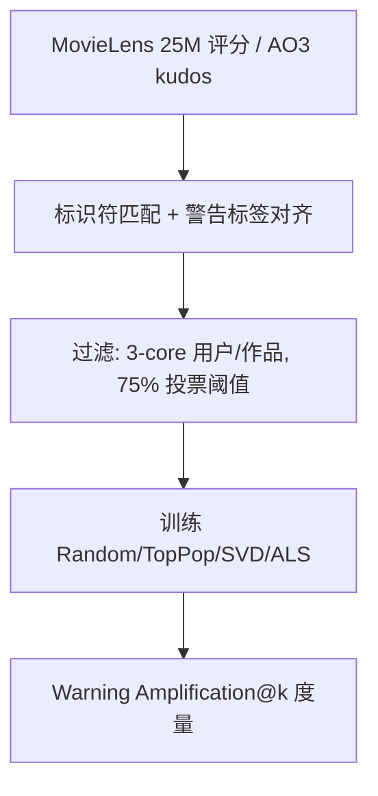

# Datasets for Navigating Sensitive Topics in Recommendation Systems (面向推荐系统敏感话题导航的数据集)

- **会议/期刊**: WWW 2025 (Companion Proceedings)
- **作者与机构**: Amelia Kovacs, Jerry Chee, Kimia Kazemian, Sarah Dean (Cornell University)
- **推荐链路定位**: 评测基准 / 数据层（服务于召回与重排的公平性评估）
- **研究方向**: 去偏公平、可信隐私与工业架构
- **论文原文**: [论文原文链接](https://arxiv.org/abs/2509.07269v1)
- **开源代码**: [开源代码仓库链接](https://github.com/sdean-group/Navigating-Sensitivity)

## TL;DR (1分钟核心速览)

推荐系统长期以参与度为目标，却缺乏带"敏感/有害内容"标签的公开基准来量化用户被暴露于触发内容的风险。本文构建两个数据集：ML-DDD（MovieLens 25M 评分 × Does the Dog Die? 社区内容警告，22.8M 交互、137 类警告）与 AO3（Archive of Our Own 同人小说 kudos 隐式交互 × Webis 触发警告语料，45.9M 交互、36 类警告），并提出 **Warning Amplification@k** 指标。在 90-10 划分、Precision/Recall/F1@k 协议下，初步实验发现个性化矩阵分解（SVD/ALS）对敏感标签的放大反而**低于** TopPop 与 Random 基线，即个性化本身并不必然放大敏感内容。

## Background & Motivation (背景与核心矛盾)

- **主流范式**: 推荐系统以参与度最大化训练，公平性研究多聚焦流行度/人口统计偏差，而"敏感或有害内容"的暴露问题主要停留在理论模型证明或假账号审计（如 YouTube 审计研究）。
- **前人局限**: ① 现有有害内容数据集（阴谋论、仇恨言论）标签多由众包生成，定义争议大且隐含"审查"导向；② 缺乏将**用户-内容偏好数据**与**社区自生成内容警告**对齐的推荐专用基准，无法定量评估个性化与敏感内容暴露的交互。
- **核心洞察 (Key Insight)**: 内容警告（trigger/content warning）是平台社区自发形成的分类体系，天然刻画"用户可能想规避的内容"，可作为用户伤害的显式代理；且警告标签与作品流行度存在系统性相关（置换检验中 70% 标签 $p<0.005$）。
- **本文切入点**: 不做新算法，而是补齐"数据基础设施"——把社区警告标签嫁接到标准偏好数据上，并给出首个放大度量与基线画像。

## Method (核心方法设计)

### 1. 整体框架 (Overall Architecture)

本文是数据集论文，核心"方法"是数据构建流水线 + 放大度量。ML-DDD 侧：通过 DDD API 用 IMDb/TMDB 标识符匹配 MovieLens 25M 电影（匹配率 52%），保留与敏感表至少 3 部作品交互的用户；警告判定采用投票阈值——$\geq 75\%$"Yes" 记为 Clear Yes，$\geq 75\%$ "No" 记为 Clear No。AO3 侧：从 Webis Trigger Warning Corpus（100 万作品、41M 标签归并为 36 类）出发，抓取公开 kudos 用户名作为隐式交互，仅保留元数据、剔除交互少于 3 的用户与作品并做用户名伪匿名化。最终在 1,000 名随机用户上训练 Random/TopPop/SVD/ALS 并计算放大分数。

### 2. 关键设计拆解 (Key Designs)

1. **双域异构数据集构建（显式 vs. 隐式）**：痛点在于敏感标签与偏好数据长期割裂。ML-DDD 提供 0.5–5 显式评分（交互密度 0.43%、警告密度 3.49%），AO3 提供 kudos 隐式正反馈（交互密度 0.012%、警告密度 5.26%），二者在稀疏度、标签密度、反馈类型上互补，使研究者能检验结论是否跨域稳健。
2. **Warning Amplification@k 指标**：直接复用参与度放大思路但换成"警告占比"。对用户 $u$与警告$w$：
$$\text{Amp}_{u,w}@k=\frac{\sum_{i\in \text{Rec}_k(u)}\mathbb{I}(w\in i)/k}{\sum_{i\in \mathcal{H}(u)}\mathbb{I}(w\in i)/|\mathcal{H}(u)|}-1$$
减 1 归一化后，$0\%$ 表示推荐与历史警告占比一致；若历史无该警告则"幻觉"插入一条以避免除零。该指标把"个体伤害"转成可聚合的逐用户分布，而非单一全局均值。
3. **评估与训练设置**：ML-DDD 用 Surprise 的 SVD，按 RMSE 调因子/学习率/正则；AO3 用 `implicit` 库 ALS，按 Recall@50 调参。放大分析用全量数据训练、对 1,000 用户生成 $k=100$ 推荐；精度评估因算力限制在 AO3 上取 10% 作品子集（3.9M 交互）。

## Experimental Setup & Evaluation Protocol (实验设置与评估协议)

- **数据集与预处理**:

| 数据集 | #Users | #Items | #Interactions | 交互密度 | 警告密度 | 反馈类型 |
| :--- | :---: | :---: | :---: | :---: | :---: | :--- |
| ML-DDD | 162,541 | 32,604 | 22,867,672 | 0.43% | 3.49% (137 类) | 显式 0.5–5 评分 |
| AO3 | 1,304,303 | 306,111 | 45,936,871 | 0.012% | 5.26% (36 类) | 隐式 kudos |

- **数据划分与防穿越 (Splitting Strategy)**: 逐用户 `90-10 比例划分`（每用户 90% 交互入训练、10% 入测试），非全局时间戳切分，存在轻度未来信息泄漏风险。
- **排名评测协议 (Ranking Protocol)**: 非标准 Full-Ranking，而是**分类式评估**——对每用户生成 $k\in\{10,50,100\}$ 条训练集未见推荐，与测试集相关项比对算 Precision/Recall/F1。相关性定义：AO3 为历史全部正交互；ML-DDD 取用户评分**前四分位**作品为相关（沿用既有做法）。SVD 另报 RMSE。
- **对比基线与超参**: Random、TopPop（非个性化）+ SVD（显式 MF）、ALS（隐式 MF）；因子数、正则、正样本权重按各自目标调优；未报告显著性检验（仅置换检验用于标签-流行度相关性）。

## Key Experimental Results (实验关键数据)

### 1. 主实验对比 (Main Results)

分类精度（节选 $k=10$，数值为原文量级）：

| 数据集 | 算法 | Precision@10 | Recall@10 | F1@10 |
| :--- | :--- | :---: | :---: | :---: |
| ML-DDD | Random | 1.00e-4 | 5.00e-4 | 1.67e-4 |
| ML-DDD | TopPop | 1.00e-4 | 5.00e-4 | 1.67e-4 |
| ML-DDD | **SVD** | **2.10e-3** | **8.48e-3** | **3.37e-3** |
| AO3 | Random | 4.64e-5 | 3.17e-4 | 8.09e-5 |
| AO3 | **TopPop** | **4.82e-4** | 1.43e-3 | **7.22e-4** |
| AO3 | ALS | 4.27e-4 | **2.13e-3** | 7.11e-4 |

放大分析（$k=100$，逐用户平均放大分数分布）：ML-DDD 中 **TopPop 放大最大、SVD 最小**；AO3 中 **Random 放大最大、ALS 最小**。SVD 在 ML-DDD 上 RMSE 为 0.7625（90-10 划分）/ 0.6733（全量训练后评估随机用户）。

### 2. 消融实验 (Ablation Study)

本文为数据集论文，无传统模块消融；其"消融"体现为标签-流行度置换检验与算法族对比：

| 分析维度 | 设置 | 关键结果 |
| :--- | :--- | :--- |
| 标签-流行度相关性 | 置换检验（Top-10 警告） | ML-DDD 70% 标签负相关；AO3 仅 50% 负相关；两数据集 70% 标签 $p<0.005$ |
| 个体 vs. 全局偏好 | 1,000 随机用户散点 | ML-DDD 57.30% 用户对含"血腥"标签作品评分更低；AO3 72.60% 用户更偏好"色情"标签作品 |
| 算法族对比 | Random/TopPop vs. SVD/ALS | 个性化 MF 放大分数系统性低于非个性化基线 |

### 3. 关键实验发现 (Key Findings)

1. **个性化不等于放大**：SVD（ML-DDD）与 ALS（AO3）的逐用户平均放大分数最低，甚至呈"去放大"；而 TopPop 在 ML-DDD 放大最大，恰因警告标签与流行度正相关（如 AO3 "porn" 置换检验差值 +34.9），流行度驱动推荐会把高警告密度作品推给所有人。
2. **全局趋势与个体偏好会背离**：ML-DDD "血腥"标签全局负相关（差值 -0.15），但仍有 57.30% 用户个体评分低于对角线；AO3 "色情"标签全局正相关（+34.9）且 72.60% 用户个体更偏好，说明仅用全局标签统计做去偏会误伤个体偏好。
3. **数据集密度决定基线行为**：ML-DDD 交互密度高（0.43%），Random 精度略胜 TopPop；AO3 极稀疏（0.012%）但警告密度高（5.26%），TopPop 精度反超 ALS，且 Random 放大最严重——说明放大结论强依赖数据密度与标签密度，跨域不可直接外推。

## Highlights & Limitations (亮点、对比与审稿批判)

- **与代表作对比 (vs. Prior Work)**: 相比阴谋论/仇恨言论数据集（标签众包、隐含审查导向），本文标签来自社区自治理机制，强调"用户自主规避"而非封禁；相比 YouTube 假账号审计类工作，本文提供可复现的离线偏好数据，使放大分析可被任意算法复用；相比 Webis Trigger Warning Corpus，本文补上了缺失的**用户交互**维度。
- **可迁移亮点**: ① "社区标签 + 标准偏好数据"的嫁接范式可迁移到电商差评、短视频不适内容等场景；② Warning Amplification@k 的"推荐占比 / 历史占比 - 1"归一化写法，可直接用于任何属性级放大审计（如性别、地域）。
- **审稿级局限批判**: ① 放大分析仅覆盖 Random/TopPop/SVD/ALS 四个弱基线，未涉及神经协同过滤或图模型，结论外推性有限；② 逐用户 90-10 随机划分存在时间穿越，且 AO3 精度评估仅用 10% 子集、ML-DDD 相关性用"前四分位"这一启发式定义，均可能影响指标绝对值；③ 警告标签存在社区投票分歧（36,080 条 Unclear），论文未建模标签不确定性。

## Rating (四维评分)

- **方法创新性 (Novelty)**: ⭐⭐⭐ （非算法创新，但"社区警告标签 × 偏好数据"的基准构建与放大指标在敏感内容方向具开创性）
- **评估协议与实验扎实度 (Protocol & Experiments)**: ⭐⭐⭐ （双域互补设计良好，但基线弱、划分有穿越、缺显著性检验，属初步分析）
- **写作与数学规范度 (Clarity & Rigor)**: ⭐⭐⭐⭐ （数据统计、阈值定义与指标公式交代清晰，附录给出完整警告类目）
- **工业落地与复现价值 (Industrial & Practical Value)**: ⭐⭐⭐⭐ （数据与代码均已开源，可直接作为多目标推荐中"伤害代理"的离线评测集）

