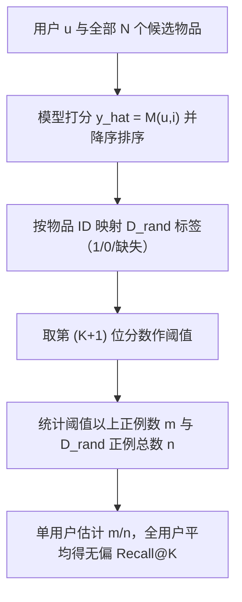

# Debias Can be Unreliable: Mitigating Bias Issue in Evaluating Debiasing Recommendation (去偏可能不可靠：缓解去偏推荐评估中的偏差问题)

- **会议/期刊**: WWW Companion 2025
- **作者与机构**: Chengbing Wang, Wentao Shi, Jizhi Zhang, Wenjie Wang, Hang Pan, Fuli Feng（中国科学技术大学、新加坡国立大学）
- **推荐链路定位**: 评测协议（服务于召回/精排去偏模型选型）
- **研究方向**: 去偏公平与工业架构
- **论文原文**: [论文原文链接](https://arxiv.org/abs/2409.04810v2)
- **开源代码**: [开源代码仓库链接](https://anonymous.4open.science/r/URE-6B64/)

## TL;DR (1分钟核心速览)

去偏推荐长期缺乏全曝光数据集 $D_{full}$，学界普遍在随机曝光数据集$D_{rand}$上沿用传统 Recall@K 评估。本文从理论上证明：$D_{rand}$上的 Recall@$\tilde{K}$只与$D_{full}$上$K=\frac{N}{N'}\tilde{K}$的大$K$值强相关，而小$K$（如 5）几乎无关，导致去偏方法排序结论失真。作者提出 URE：用全候选打分排序后第$(K+1)$位的分数作阈值，在$D_{rand}$上统计正样本占比，从而无偏估计$D_{full}$的 Recall@K。在 KuaiRec 上$\widehat{\text{Recall}}@5$ 与真值相关系数超 0.9，并重估发现部分去偏方法反而不如原始 MF。

## Background & Motivation (背景与核心矛盾)

- **主流范式**: 去偏推荐（IPS、DR、AutoDebias、DNS 等）以随机曝光数据集 $D_{rand}$ 为代理，直接套用与全曝光数据集相同的 Recall@K 公式，即"传统评估方案"。
- **前人局限**: 其一，$D_{rand}$是$D_{full}$的稀疏随机子集（$N'\ll N$），正负反馈均随机缺失，传统公式把缺失当负例，系统性低估召回；其二，随机曝光采集成本极高，样本量$N'$ 无法扩大，偏差无法靠"多采数据"缓解。
- **核心洞察 (Key Insight)**: 定理 1 证明，当 $\tilde{K}=\frac{N'}{N}K$时$\mathbb{E}[\text{Recall}@\tilde{K}]=\text{Recall}@K$，即$D_{rand}$上的小$K$只对应$D_{full}$上的大$K$。而线上用户只浏览前若干位，小$K$ 才是真正重要的指标，故传统评估在关键区间失效。
- **本文切入点**: 不再"数 $D_{rand}$里前$K$有几个正例"，而是借助模型对**全部候选物品**的打分排序，用第$(K+1)$位的分数作全局阈值，把$D_{rand}$的正例占比折算为$D_{full}$ 的 Recall@K。

## Method (核心方法设计)

### 1. 整体框架 (Overall Architecture)

URE 是一个纯评估（post-hoc）方案，不改变任何训练过程。给定待测模型 $M$，先对用户$u$的全部$N$个候选物品打分$\hat{y}=M(u,i)$并降序排列；再将$D_{rand}$中的标签（正/负/缺失）按物品 ID 映射到该排序列表上；取排序第$(K+1)$位的预测分数作为阈值，统计$D_{rand}$中打分高于该阈值的正例数$m$与$D_{rand}$正例总数$n$，得到单用户估计$\widehat{\text{Recall}}@K=m/n$，最后对所有用户取平均。核心思想是：$D_{rand}$虽缺失大量标签，但模型对全库的打分排序提供了"哪些物品会排在$K$ 之前"的完整信息，从而把缺失标签问题转化为比例估计问题。

### 2. 关键设计拆解 (Key Designs)

1. **阈值化比例估计（Threshold-based Ratio Estimator）**：传统方案在 $D_{rand}$上直接截断前$\tilde{K}$位，等价于用"子集内的局部排名"近似"全库排名"，当$N'\ll N$时局部排名与全局排名严重错位。URE 改为用全库排序的第$(K+1)$位分数作**全局阈值**$\tau_u=\hat{y}_{(K+1)}$，估计量为
$$\widehat{\text{Recall}}@K=\frac{1}{|\mathcal{U}|}\sum_{u}\frac{\sum_{i\in D_{rand}^+}\mathbb{I}[\hat{y}_{ui}>\tau_u]}{|D_{rand}^+(u)|},$$
其中分子 $m$是$D_{rand}$中排在全局前$K$位的正例数，分母$n$是$D_{rand}$正例总数。直觉上，$D_{rand}$是$D_{full}$的均匀随机抽样，故"抽样正例中落入前$K$的比例"是"全体正例中落入前$K$ 的比例"的无偏估计，缺失标签不再被误当作负例。

2. **无偏性定理（Theorem 2）**：设 $D_{full}$共$N$个正例、其中$M$个排在全局第$K+1$位之前；从$D_{full}$随机抽$N'$个样本得$n$个正例、其中$m$个在前$K$内，则$m$服从超几何分布$\binom{M}{m}\binom{N-M}{n-m}/\binom{N}{n}$，于是
$$\mathbb{E}_{S_{N'}}[\widehat{\text{Recall}}@K]=\mathbb{E}_{n}\left[\frac{M}{N}\sum_{m}\frac{\binom{M-1}{m-1}\binom{N-M}{n-m}}{\binom{N-1}{n-1}}\right]=\frac{M}{N}=\text{Recall}@K.$$
该式对任意 $K$成立，说明 URE 不依赖$K$与$N'/N$ 的比例关系，这是它相对传统方案的本质优势。

3. **训练目标、负采样与推理开销**：本文不涉及新训练目标，去偏基线均沿用各自原损失（IPS 逆倾向加权、DR 双鲁棒、AutoDebias 元学习、DNS 动态负采样）。URE 的额外开销仅为一次全库打分排序（$O(N\log N)$ 每用户），与常规 Full-Ranking 评估同阶，无额外训练成本；其代价是要求模型能对全库打分，无法用于仅输出 Top-K 的黑盒系统。

## Experimental Setup & Evaluation Protocol (实验设置与评估协议)

- **数据集与预处理**:

| 数据集 | #Users | #Items | #Interactions | 稀疏度/密度 | 特征/场景说明 |
| :--- | :---: | :---: | :---: | :---: | :--- |
| Yahoo!R3 | 15,400 | 1,000 | 311,704（偏置训练）+ 48,600（$D_{rand}$ 测试） | 约 2.0% | 无全曝光集，仅有随机曝光测试集 |
| KuaiRec | 1,411 | 3,327 | 1,934,404（偏置训练）+ 2,742,166（$D_{full}$） | 约 58.4% | 唯一公开全曝光集，可作真值基准 |

- **数据划分与防穿越 (Splitting Strategy)**: 采用"偏置训练集 + 随机曝光测试集"的划分；KuaiRec 额外提供全曝光测试集 $D_{full}$ 作为金标准，用于验证 URE 估计的无偏性，训练与测试用户/物品无穿越。
- **排名评测协议 (Ranking Protocol)**: 主指标为 Recall@5。传统方案在 $D_{rand}$上直接计算；URE 在$D_{rand}$上按上述阈值化公式估计；KuaiRec 上另报告$D_{full}$的真实 Recall@5 作为参照。所有结果在$p<0.01$ 下统计显著。
- **对比基线与超参设置**: 骨干统一为 MF，对比 IPS、DR、AutoDebias、DNS 四类代表性去偏方法；相关性分析中通过遍历 AutoDebias 超参生成多个模型实例，计算 Pearson 相关系数。

## Key Experimental Results (实验关键数据)

### 1. 主实验对比 (Main Results)

| 模型 | KuaiRec 传统 Recall@5 | KuaiRec $D_{full}$真值 | KuaiRec URE$\widehat{\text{Recall}}@5$| Yahoo!R3 传统 Recall@5 | Yahoo!R3 URE$\widehat{\text{Recall}}@5$ |
| :--- | :---: | :---: | :---: | :---: | :---: |
| MF | 0.4859 | 0.0257 | 0.0267 | 0.7085 | 0.0131 |
| IPS | 0.4889 | 0.0266 | 0.0273 | 0.6572 | 0.0095 |
| DR | 0.4849 | 0.0262 | 0.0267 | 0.7195 | 0.0075 |
| AutoDebias | 0.5181 | **0.0317** | **0.0323** | 0.8085 | **0.0550** |
| DNS | **0.5288** | 0.0237 | 0.0245 | **0.8330** | 0.0490 |

注：KuaiRec 上 URE 估计与真值误差均在 0.001 量级；传统方案数值整体高一个数量级且排序错乱（DNS 传统最高但真值仅 0.0237，低于 MF）。

### 2. 消融实验 (Ablation Study)

本文为评估方案论文，无模块消融，代之以**相关性分析**与**估计偏差分析**：

| 分析项 | 设置 | 关键结果 |
| :--- | :--- | :--- |
| 传统 Recall@$\tilde{K}$vs. 真值 Recall@K |$K=5$，$N'$变化 | 相关系数$<0.6$；$K>100$ 时才超 0.9 |
| URE $\widehat{\text{Recall}}@K$vs. 真值 Recall@K |$K=30$| 相关系数$>0.9$ |
| URE 跨 $K$一致性 | 不同$K$交叉比对 | 仅$K$相同时相关性最高，可按目标$K$ 精确选型 |
| 估计偏差 | KuaiRec 全模型 | 绝对偏差约 $10^{-3}$ 量级 |

### 3. 关键实验发现 (Key Findings)

1. **传统评估的排序结论被推翻**：KuaiRec 上传统 Recall@5 把 DNS 排第一（0.5288），但全曝光真值下 DNS 仅 0.0237，反而低于原始 MF 的 0.0257；而 URE 正确将 AutoDebias 排为最优（0.0323 vs. 真值 0.0317），说明过去基于 $D_{rand}$ 的去偏结论可能系统性失真。
2. **部分去偏方法实际负收益**：在 URE 下，Yahoo!R3 上 IPS（0.0095）与 DR（0.0075）均低于 MF（0.0131），KuaiRec 上 DNS 亦低于 MF，提示这些方法在真实全库召回上并未真正缓解偏差，甚至引入新偏差。
3. **相关性随 $K$与$N'$的定量规律**：$K<10$时传统方案与真值相关系数不足 0.6，$K>100$才超 0.9；且$K_{max}\approx\frac{N}{N'}K$随$N'$增大而下降，与定理 1 完全吻合，说明在现实可采集的$N'$ 规模下传统方案无法挽救。

## Highlights & Limitations (亮点、对比与审稿批判)

- **与代表作对比 (vs. Prior Work)**: 与 IPS/DR/AutoDebias/DNS 等"改进模型训练"的去偏工作不同，本文不设计新模型，而是质疑其**评测地基**；相较 KuaiRec 等"构建全曝光数据集"的路线，URE 无需昂贵采集即可在现有 $D_{rand}$ 上逼近金标准，二者互补而非替代。
- **可迁移亮点**: 阈值化比例估计思想可直接迁移到 NDCG、Hit Rate 等排序指标在稀疏曝光数据上的无偏估计；"用全库打分排序 + 子集标签折算"的范式也适用于离线 A/B 代理指标校准。
- **审稿级局限批判**: 其一，URE 要求模型对全库打分，对仅输出 Top-K 的工业黑盒系统或带 ANN 近似的召回链路不友好，且每用户 $O(N\log N)$ 排序在超大规模物品库上开销可观；其二，实验仅覆盖 MF 骨干与两个数据集，未验证深度模型（如 LightGCN、SASRec）及多值反馈场景，且 KuaiRec 单一全曝光集可能带来数据集特异性偏差。

## Rating (四维评分)

- **方法创新性 (Novelty)**: ⭐⭐⭐⭐ （不造模型而重构评测地基，定理 1/2 给出清晰的偏差刻画与无偏性证明，视角新颖且理论扎实）
- **评估协议与实验扎实度 (Protocol & Experiments)**: ⭐⭐⭐⭐ （KuaiRec 全曝光真值 + Yahoo!R3 双数据集验证，相关性分析与重估实验完整，但仅 MF 骨干、数据集偏少）
- **写作与数学规范度 (Clarity & Rigor)**: ⭐⭐⭐⭐ （定理陈述与超几何分布推导严谨，URE 流程图示清晰，个别符号如 $N$与$N'$ 在正文中偶有混用需留意）
- **工业落地与复现价值 (Industrial & Practical Value)**: ⭐⭐⭐⭐ （纯评估方案零训练成本、代码已开源，可直接用于去偏模型选型；但全库打分要求限制了在超大规模召回链路的直接部署）

