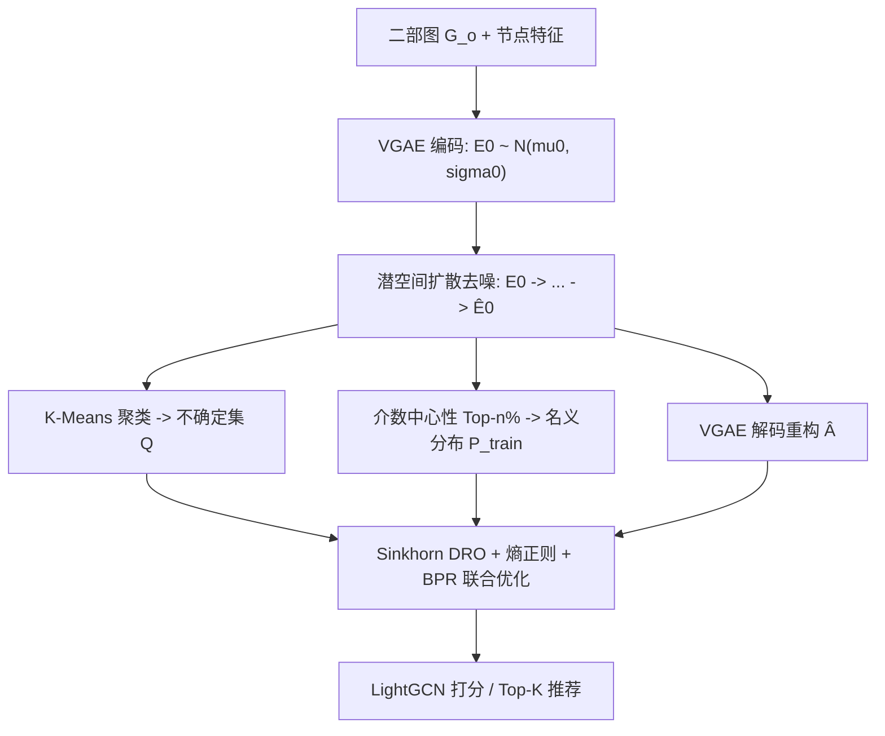
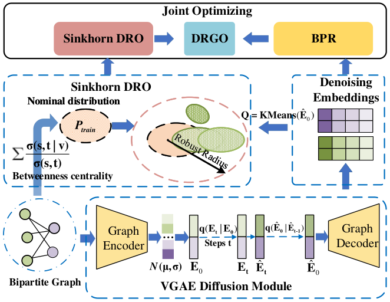

# Distributionally Robust Graph Out-of-Distribution Recommendation via Diffusion Model (基于扩散模型的分布鲁棒图 OOD 推荐)

- **会议/期刊**: WWW 2025
- **作者与机构**: Chu Zhao, Enneng Yang, Yuliang Liang, Jianzhe Zhao, Guibing Guo, Xingwei Wang（东北大学）
- **推荐链路定位**: 召回（图协同过滤表征学习）
- **研究方向**: 去偏公平与工业架构 / 图神经网络推荐
- **论文原文**: [https://arxiv.org/abs/2501.15555v1](https://arxiv.org/abs/2501.15555v1)
- **开源代码**: [https://github.com/user683/DRGO](https://github.com/user683/DRGO)

## TL;DR (1分钟核心速览)

本文指出基于分布鲁棒优化 (DRO) 的图推荐在搜索最坏情形分布时会**给噪声样本分配更高权重**，导致模型参数被噪声主导、OOD 泛化反而退化；同时 KL 散度约束在训练/测试分布无重叠时失效。作者提出 DRGO：用 VGAE+潜空间扩散对交互图去噪、以 Sinkhorn 距离替代 KL 构造不确定集、并在 DRO 目标中加入熵正则抑制极端权重。在 Food/KuaiRec/Yelp2018/Douban 四数据集、流行度/时间/曝光三类分布偏移下，Yelp2018 上 Recall@20 相对最优基线提升 55.56%，IID 下平均提升 4.72%。

## Background & Motivation (背景与核心矛盾)

- **主流范式**: 图推荐（LightGCN 系）假设训练/测试 IID；DRO 类方法（DR-GNN、PDRO）通过在散度球内优化最坏情形分布来提升 OOD 泛化，无需环境标签。
- **前人局限一**: DRO 的内层 $\sup_Q$ 会天然放大高损失样本权重，而噪声样本损失大，于是噪声分布被赋予过高权重（图 1(a)：DRO-LightGCN 给噪声组 0.60 权重，主群体仅 0.30），参数学习被噪声主导；噪声比超 20% 时 DRO-LightGCN 甚至不如 LightGCN。
- **前人局限二**: 基于 KL 散度的 DRO 假设训练与测试分布有重叠支撑，但用户行为高度随机，测试分布可能与训练分布几乎无交集，此时 KL 发散、优化失去意义。
- **核心洞察 (Key Insight)**: 噪声影响可通过加权 BPR 损失的参数方差刻画——只要噪声样本权重 $w_o^{(j)}$大于干净样本权重$w_c^{(i)}$，即便噪声占比很小，其更大方差$\sigma_o^2$ 仍会显著抬高参数估计方差。
- **本文切入点**: 在潜空间先去噪（降低噪声进入不确定集的比例），再用熵正则压制极端权重，并用 Sinkhorn 距离摆脱分布重叠假设。

## Method (核心方法设计)

### 1. 整体框架 (Overall Architecture)

输入用户-物品二部图 $\mathcal{G}_o$及节点特征，先用 VGAE 将图编码为低维高斯潜变量$E_0\sim\mathcal{N}(\mu_0,\sigma_0)$，在潜空间执行前向加噪/反向去噪得到干净嵌入$\hat{E}_0$，再由 VGAE 解码器重构邻接矩阵；随后对去噪用户嵌入做 K-Means 聚类得到不确定集$Q=\{q_1,\dots,q_k\}$，用介数中心性 Top-$n\%$节点构造名义分布$P_{train}$；最后以 Sinkhorn DRO 目标联合优化 BPR 推荐损失、熵正则与去噪损失，LightGCN 作为打分主干。

<figure class="paper-figure" markdown="span">
  <figcaption>图2：所提出的 DRGO 模型示意图。首先使用 VGAE 扩散处理二部图以获得去噪嵌入。然后，应用介数中心性和 𝑘-均值聚类来构建名义分布和不确定性集。最后，采用联合优化策略进行优化。</figcaption>
</figure>

### 2. 关键设计拆解 (Key Designs)

1. **潜空间扩散去噪模块（VGAE + Diffusion）**：交互图是离散结构无法直接喂扩散模型，故先用 VGAE 把图压到连续潜空间 $q_\psi(E_0|A,X)=\mathcal{N}(E_0|\mu_0,\sigma_0)$，再在潜空间做前向加噪$\phi$与反向去噪$\psi$，得到$\hat{E}_0$后重构$\hat{A}=\sigma(\hat{E}_0\hat{E}_0^\top)$。直觉是：噪声边在潜空间被逐步平滑，进入不确定集的噪声比例下降，从源头削弱"噪声主导最坏情形"的链条。去噪损失$\mathcal{L}_{denoising}=\mathcal{L}_{VGAE}+\mathcal{L}_{sample}$。

2. **Sinkhorn DRO + 熵正则（替代 KL 的鲁棒目标）**：Sinkhorn 距离 $W_{c,\lambda}(P,Q)=\inf_{\pi\in\Pi(P,Q)}\mathbb{E}_{(x,y)\sim\pi}[c(x,y)]+\lambda H(\pi)$ 用熵平滑的 Wasserstein 变体，即使训练/测试分布无重叠也能通过几何关系给出有限、可优化的距离，避免 KL 发散。目标为
$$\min_\theta\Big\{\sup_{Q:W_{c,\lambda}(P_{train},Q)\le\rho}\sum_{i=1}^{k}w_{q_i}\mathcal{L}_{rec}-\beta\sum_{i=1}^{k}w_{q_i}\log w_{q_i}+\mathcal{L}_{denoising}\Big\}$$
负熵项梯度 $\nabla_{w_{q_i}}(-\sum w_{q_i}\log w_{q_i})=-(\log w_{q_i}+1)$：权重越大梯度越大、被强力拉回，从而阻止噪声簇独占权重，使最坏情形优化不被离群点绑架。

3. **名义分布与不确定集构造 + 训练目标**：以介数中心性 $c_{data}(v)=\sum_{s,t\in E_{train}}\frac{\sigma(s,t|v)}{\sigma(s,t)}$排序取 Top-$n\%$节点嵌入作为名义分布（假设高中心性群体对未来未见分布影响最大）；对去噪用户嵌入 K-Means 得$k$个簇作为不确定集，把逐样本 DRO 降为簇级加权，降低优化难度。总损失即上式，推荐项用 BPR$\mathcal{L}_{rec}=\sum-\log\sigma(\hat{r}_{u,i^+}-\hat{r}_{u,i^-})$，负样本为均匀随机采样（非难负采样、非 in-batch）。理论侧给出泛化界$\hat{R}(\theta,w_{q_i})\le R(\theta,w_{q_i})+2\hat{\mathcal{R}}_n(\mathcal{F})+BW(P_{train},Q)+B\sqrt{\ln(1/\delta)/2n}$，说明最小化$W(P_{train},Q)$ 可收紧 OOD 风险。

## Experimental Setup & Evaluation Protocol (实验设置与评估协议)

- **数据集与预处理**: Food、KuaiRec、Yelp2018、Douban 四个常用数据集，沿用 DR-GNN 的预处理与划分。

| 数据集 | 偏移类型 | 场景说明 |
| :--- | :---: | :--- |
| Food | 时间偏移 | 按交互时间戳切分训练/测试，模拟兴趣漂移 |
| KuaiRec | 曝光偏移 | 测试集完全随机缺失 (MCAR)、验证集非随机缺失，考察归纳式 OOD |
| Yelp2018 | 流行度偏移 | 长尾/热门物品分布不一致 |
| Douban | 流行度偏移 | 辅助验证与噪声鲁棒性实验 |

- **数据划分与防穿越 (Splitting Strategy)**: 按偏移类型分别采用**全局时间戳切分**（Food）、**曝光缺失划分**（KuaiRec）与**流行度偏移划分**（Yelp2018/Douban），并额外报告 IID 划分结果作为对照。
- **排名评测协议 (Ranking Protocol)**: 采用 `Full-Ranking` 全库未交互物品排序，指标 Recall@{10,20} 与 NDCG@{10,20}；噪声鲁棒性实验通过将 5%/10%/15%/25% 真实边替换为人工边构造损坏图。
- **对比基线与超参设置**: 11 个基线覆盖图协同过滤（LightGCN）、对比学习（SGL/SimGCL/LightGCL/AdvInfoNCE）、不变学习（InvPref/InvCF）、扩散推荐（DDRM）、DRO（DR-GNN）与因果/增强类（CDR/AdvDrop）。关键超参：簇数 $K=5$、鲁棒半径$\rho=0.05$、名义分布 Top-$n\%=10\%$，主干为 LightGCN。

## Key Experimental Results (实验关键数据)

### 1. 主实验对比 (Main Results)

OOD 场景（表 1，节选 Recall@20 / NDCG@20）：

| 方法 | Food R@20 | Food N@20 | KuaiRec R@20 | KuaiRec N@20 | Yelp R@20 | Yelp N@20 |
| :--- | :---: | :---: | :---: | :---: | :---: | :---: |
| LightGCN (SIGIR'20) | 0.0404 | 0.0242 | 0.1120 | 0.4268 | 0.0035 | 0.0016 |
| SimGCL (WWW'22) | 0.0414 | 0.0269 | 0.1196 | 0.4446 | 0.0106 | 0.0047 |
| InvCF (WWW'23) | 0.0033 | 0.0013 | 0.1034 | 0.2193 | 0.0013 | 0.0008 |
| AdvInfoNCE (NeurIPS'23) | 0.0268 | 0.0159 | 0.1254 | 0.4305 | 0.0083 | 0.0038 |
| AdvDrop (WWW'24) | 0.0371 | 0.0237 | 0.1214 | 0.3289 | 0.0049 | 0.0024 |
| DR-GNN (WWW'24) | 0.0436 | 0.0279 | 0.1266 | 0.4556 | 0.0076 | 0.0041 |
| **DRGO (Ours)** | **0.0497** | **0.0310** | **0.1970** | **0.6367** | **0.0168** | **0.0068** |
| Improv. | +13.99% | +11.11% | +55.60% | +39.75% | +55.56% | +38.77% |

IID 场景（表 2）：DRGO 在 Food/KuaiRec/Yelp2018 上四项指标全面最优，平均提升 4.72%（如 Yelp R@20 0.1205 vs. SimGCL 0.1122，+7.39%）。

### 2. 消融实验 (Ablation Study)

| 变体 | Food R@20 | Food N@20 | Yelp R@20 | Yelp N@20 |
| :--- | :---: | :---: | :---: | :---: |
| DRGO w/o Diff.（去扩散） | 0.0448 | 0.0213 | 0.0140 | 0.0060 |
| DRGO w/o Reg.（去熵正则） | 0.0476 | 0.0281 | 0.0141 | 0.0061 |
| DRGO w/o Feat.（去节点特征） | 0.0476 | 0.0280 | 0.0151 | 0.0063 |
| LightGCL w/ DRGO | 0.0442 | 0.0253 | 0.0142 | 0.0058 |
| SimGCL w/ DRGO | **0.0500** | **0.0327** | **0.0172** | **0.0070** |
| DRGO（完整） | 0.0497 | 0.0310 | 0.0168 | 0.0068 |

### 3. 关键实验发现 (Key Findings)

1. **去扩散模块是 OOD 增益的第一来源**：移除后 Food N@20 从 0.0310 跌至 0.0213（-31.3%），Yelp R@20 从 0.0168 跌至 0.0140，说明潜空间去噪直接决定进入不确定集的噪声比例，是"噪声主导最坏情形"链条的关键断点。
2. **熵正则与去噪互补而非冗余**：单独去正则时 Food N@20 降至 0.0281、Yelp R@20 降至 0.0141，二者同时缺失的损失大于任一单项，验证"源头去噪 + 权重端抑制"双管齐下的必要性；而去特征仅小幅下降，说明节点特征是锦上添花而非主因。
3. **鲁棒性与可移植性双赢**：噪声比升至 25% 时 DRGO 性能衰减仍显著小于 LightGCN/SimGCL/DR-GNN（图 3），且把 DRGO 套到 SimGCL 主干上四项指标全面超过 LightGCN 版 DRGO（Food N@20 0.0327），表明该框架与去噪后增强策略天然契合、可跨主干迁移。

## Highlights & Limitations (亮点、对比与审稿批判)

- **与代表作对比 (vs. Prior Work)**: 相比 DR-GNN（同样用 DRO 但忽略噪声），DRGO 在 Yelp2018 上 R@20 从 0.0076 提升到 0.0168（+121%），本质差异是把"最坏情形搜索"从被噪声绑架改为先去噪再搜索；相比 DDRM 等纯扩散推荐，DRGO 把扩散限定在潜空间去噪而非生成，且与 DRO 目标耦合，故在流行度偏移下不再劣于 LightGCN；相比 KL-DRO 系（PDRO/DROS），Sinkhorn 距离解除了分布重叠假设。
- **可迁移亮点**: (1) "VGAE 压到潜空间再做扩散去噪"可低成本移植到任意离散图推荐主干，避免直接对邻接矩阵建模；(2) 负熵正则作为 DRO 内层权重的通用平滑器，可插入任何 group-weighted 鲁棒目标。
- **审稿级局限批判**: (1) 每轮训练需额外跑 VGAE 编解码 + 多步扩散 + K-Means 聚类，训练开销显著高于 LightGCN，论文未给出收敛步数与 wall-clock 对比；(2) 名义分布依赖介数中心性 Top-10% 与簇数 $K=5$、$\rho=0.05$等超参，图 4 显示 Yelp2018 对$\rho$ 较敏感，且介数中心性在稠密图上的计算复杂度未讨论；(3) 评测仅限四个中小规模学术数据集，缺少工业级全库排序与线上 A/B 验证。

## Rating (四维评分)

- **方法创新性 (Novelty)**: ⭐⭐⭐⭐ （首次把"DRO 放大噪声权重"作为显式病灶，并用潜空间扩散 + 熵正则 + Sinkhorn 三件套对症下药，配泛化界与梯度分析）
- **评估协议与实验扎实度 (Protocol & Experiments)**: ⭐⭐⭐⭐ （四数据集 × 三类分布偏移 + IID 对照 + 噪声注入曲线 + 消融与超参分析齐全，但缺显著性检验与效率对比）
- **写作与数学规范度 (Clarity & Rigor)**: ⭐⭐⭐⭐ （Sinkhorn DRO 与泛化界推导完整，符号统一；部分关键推导置于附录，正文公式密度偏高）
- **工业落地与复现价值 (Industrial & Practical Value)**: ⭐⭐⭐ （代码已开源、可插拔主干友好，但扩散 + 聚类带来的训练开销与超参敏感性对大规模线上部署构成实际门槛）

