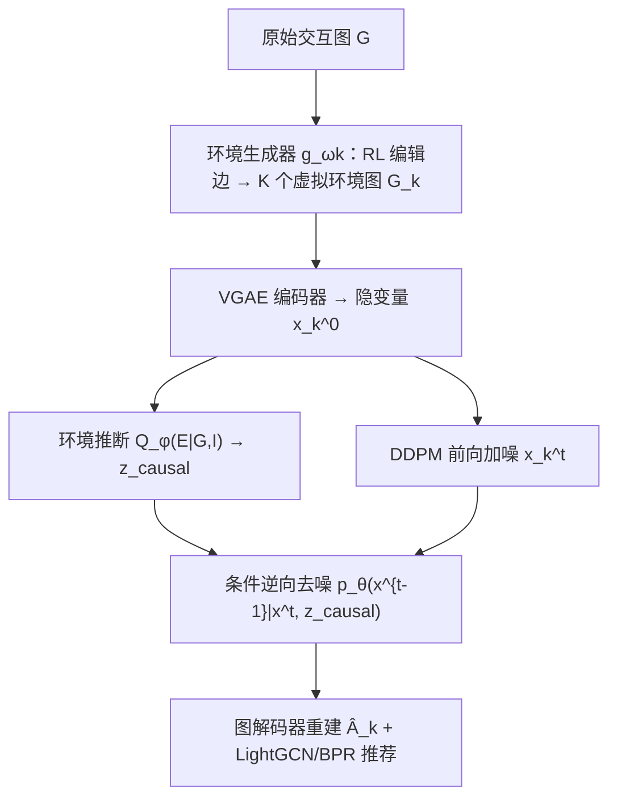
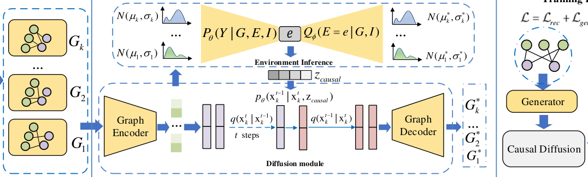

# Graph Representation Learning via Causal Diffusion for Out-of-Distribution Recommendation (基于因果扩散的分布外推荐图表征学习)

- **会议/期刊**: WWW 2025
- **作者与机构**: Chu Zhao, Enneng Yang, Yuliang Liang, Pengxiang Lan, Yuting Liu, Jianzhe Zhao, Guibing Guo, Xingwei Wang（东北大学）
- **推荐链路定位**: 召回（图协同过滤表征学习）
- **研究方向**: 去偏公平与工业架构 / 图神经网络推荐
- **论文原文**: [https://arxiv.org/abs/2408.00490v4](https://arxiv.org/abs/2408.00490v4)
- **开源代码**: [https://github.com/user683/CausalDiffRec](https://github.com/user683/CausalDiffRec)

## TL;DR (1分钟核心速览)

GNN 推荐默认训练/测试同分布，一旦环境漂移（如疫情改变商品流行度）性能骤降——LightGCN 在 Yelp2018 的 OOD 集上平均掉 29.03%。本文构建结构因果模型，指出**环境混杂因子 $E$通过后门路径$G\leftarrow E\rightarrow Y$诱导模型学到不稳定捷径**；提出 CausalDiffRec：用环境生成器造$K$个虚拟环境、变分推断近似$P(E)$ 做后门调整、再以推断出的环境分布作为扩散逆向过程的先验引导不变表征学习。在 Food/KuaiRec/Yelp2018/Douban 四数据集三类分布漂移下，相对次优基线最高提升 36.73%。

## Background & Motivation (背景与核心矛盾)

- **主流范式**: 以 LightGCN 为代表的二部图邻域聚合，配合 SGL/SimGCL/LightGCL 等图对比学习增强鲁棒性；OOD 方向则有 InvPref、COR、CausPref 等因果/不变学习方法。
- **前人局限**: ① 对比学习类方法只针对噪声与流行度偏置，面对**未知或多样**的测试分布漂移时失效；② 因果类方法（InvPref/COR/CausPref）多基于 MF 或 NeuMF，**无法直接适配图结构上的高阶邻域聚合**；③ 少数 GNN-OOD 工作（AdvDrop/DR-GNN）缺乏不变学习的理论支撑。
- **核心洞察 (Key Insight)**: 作者用 SCM 拆解数据生成过程，发现 $E\rightarrow G$与$E\rightarrow Y$构成后门路径，模型直接优化$P(Y|G)$会捕获"口罩热销$\Rightarrow$ 健身器材热销"这类**由共同环境（疫情）驱动而非真实偏好**的伪相关；环境一变即失效。
- **本文切入点**: 用 $do(G)$切断$E\rightarrow G$，通过后门调整$P_\theta(Y|do(G))=\mathbb{E}_{e\sim D_{tr}(E)}[P_\theta(Y|G,E,I)]$ 消除混杂，并把推断出的环境分布注入扩散逆向过程作为先验，逼模型只保留环境不变成分。

## Method (核心方法设计)

### 1. 整体框架 (Overall Architecture)

输入原始用户-物品二部图 $G$；**环境生成器**通过强化学习编辑边，产出$K$个差异化的虚拟环境图$\{G_k\}$；每个$G_k$经 VGAE 编码器压缩为低维隐变量$x_k^0$，一路送入**环境推断模块**（变分分布$Q_\phi(E|G,I)$采样环境伪标签$z_{causal}$），另一路在隐空间做 DDPM 前向加噪；**因果扩散**的逆向去噪以$(x_k^t, z_{causal}, t)$为条件预测噪声，重建出$x_k^{0\prime}$ 后经图解码器还原邻接矩阵；最终以 LightGCN 为骨干、BPR 损失做推荐预测，五个损失联合优化。

<figure class="paper-figure" markdown="span">
  <figcaption>图3：所提出的CausalDiffRec模型的整体框架图。</figcaption>
</figure>

### 2. 关键设计拆解 (Key Designs)

1. **环境生成器（Environment Generator）**：单一用户图只来自一个环境，无法做不变学习。作者用布尔矩阵 $B_k$编辑边$A_k=A+B_k\odot(A-A')$，因$B_k$离散不可导，改用强化学习：按 softmax 概率$h(a^k_{nm})=\frac{\exp(\theta^k_{nm})}{\sum_{m'}\exp(\theta^k_{nm'})}$采样边动作，奖励取损失倒数，并以**生成损失方差最大化**$\mathcal{L}_{generator}=\mathrm{Var}(\mathcal{L}(g_{\omega_k}(G)):1\le k\le K)$迫使$K$ 个环境彼此差异足够大——环境越分散，后门调整的期望估计越接近真实干预分布。

2. **变分环境推断 + 因果扩散（Causal Diffusion）**：$P(E)$ 不可观测，故用 ELBO 近似：
$$\log P_\theta(Y|do(G))\ge \mathcal{L}_{envInf}=\mathbb{E}_{Q_\phi(E|G,I)}[\log P_\theta(Y|G,E,I)]-D_{KL}(Q_\phi(E|G,I)\|P_\theta(E))$$
把采样得到的 $z_{causal}$作为 DDPM 逆向过程的**条件先验**，噪声预测损失改写为$\mathcal{L}_{Invsample}=\mathbb{E}_{t,x_0,\epsilon}\|\epsilon_t-\epsilon_\theta(x_k^t,z_{causal},t)\|^2$。直觉是：去噪目标在给定环境标签后被迫只重建**跨环境共享**的那部分信号，环境特异的捷径成分被当作噪声抹去，从而得到不变表征。

3. **训练目标、负采样与推理效率**：总损失 $\mathcal{L}=\mathcal{L}_{rec}+\lambda_1\mathcal{L}_{generator}+\lambda_2(\mathcal{L}_{VGAE}+\mathcal{L}_{Invsample})+\lambda_3\mathcal{L}_{envInf}$，其中$\mathcal{L}_{rec}$为 BPR，负样本采用**均匀随机负采样**（每正样本 1 负）。推理阶段丢弃生成器与环境推断，仅保留扩散采样出的用户/物品嵌入做内积打分，额外开销主要来自$T$步去噪（实验显示$T\in\{10,50,100\}$最优，$T=500$ 过拟合且训练时间显著上升）。

## Experimental Setup & Evaluation Protocol (实验设置与评估协议)

- **数据集与预处理**: 四个真实数据集，覆盖三类漂移（时间漂移 Food、曝光漂移 KuaiRec、流行度漂移 Yelp2018/Douban）：

| 数据集 | 漂移类型 | 规模/特点 | 说明 |
| :--- | :---: | :---: | :--- |
| Food | 时间漂移 | 菜谱交互，按时间切分 | 用户口味随季节/时段变化 |
| KuaiRec | 曝光漂移 | 快手**全曝光**数据集 | 可构造无偏测试集对照有偏训练集 |
| Yelp2018 | 流行度漂移 | 本地商户点评 | 构造 IID 与 OOD 两套测试集 |
| Douban | 流行度漂移 | 豆瓣多域交互 | 长尾/热门分布差异显著 |

- **数据划分与防穿越 (Splitting Strategy)**: 按各数据集特性构造 IID 与 OOD 两套测试集（时间漂移用时间切分，曝光/流行度漂移按曝光率与流行度分层构造），训练集与 OOD 测试集分布显著不同，用于检验泛化而非同分布精度。
- **排名评测协议 (Ranking Protocol)**: 采用 **Full-Ranking 全库未交互物品排序**（未采用采样排序），指标为 Recall@{10,20} 与 NDCG@{10,20}。
- **对比基线与超参设置**: 9 个基线，涵盖图协同过滤（LightGCN）、图对比学习（SGL、SimGCL、LightGCL）、因果/不变学习（InvPref、InvCF、CDR）、GNN-OOD 鲁棒方法（AdvDrop、AdvInfo、DR-GNN）；骨干统一为 LightGCN，环境数 $K$与扩散步$T$ 做网格搜索。

## Key Experimental Results (实验关键数据)

### 1. 主实验对比 (Main Results)

| 数据集 | 指标 | LightGCN | SimGCL | InvPref | AdvInfo | DR-GNN | **CausalDiffRec** | Impro. |
| :--- | :---: | :---: | :---: | :---: | :---: | :---: | :---: | :---: |
| Food | R@20 | 0.0404 | 0.0414 | 0.0294 | 0.0268 | 0.0436 | **0.0464** | 6.42% |
| Food | N@20 | 0.0242 | 0.0249 | 0.0115 | 0.0159 | 0.0279 | **0.0306** | 9.68% |
| KuaiRec | R@20 | 0.1120 | 0.1196 | 0.0478 | 0.1254 | 0.1266 | **0.1631** | 28.83% |
| KuaiRec | N@20 | 0.4268 | 0.4446 | 0.2056 | 0.4305 | 0.4556 | **0.5392** | 18.35% |
| Yelp2018 | R@10 | 0.0014 | 0.0049 | 0.0049 | 0.0047 | 0.0044 | **0.0067** | 36.73% |
| Yelp2018 | N@20 | 0.0016 | 0.0047 | 0.0049 | 0.0038 | 0.0041 | **0.0055** | 11.11% |
| Douban | R@20 | 0.0049 | 0.0167 | 0.0093 | 0.0103 | 0.0038 | **0.0197** | 17.96% |
| Douban | N@20 | 0.0019 | 0.0073 | 0.0038 | 0.0053 | 0.0015 | **0.0079** | 8.22% |

### 2. 消融实验 (Ablation Study)

| 变体 | Food R@20 | KuaiRec R@20 | Yelp2018 R@20 | Douban R@20 |
| :--- | :---: | :---: | :---: | :---: |
| LightGCN | 0.0404 | 0.1266 | 0.0035 | 0.0049 |
| w/o Gen.（去环境生成器） | 0.0259 | 0.1571 | 0.0054 | 0.0079 |
| w/o Env.（去环境推断） | 0.0144 | 0.1740 | 0.0058 | 0.0070 |
| **CausalDiffRec** | **0.0409** | **0.1631** | **0.0120** | **0.0197** |

### 3. 关键实验发现 (Key Findings)

1. **两个模块缺一不可，且存在数据集依赖**：Yelp2018 上去掉环境推断后 Recall/NDCG 分别暴跌 148.15%/126.83%（相对完整模型）；但在 Food 与 KuaiRec 上，去掉任一模块反而**低于 LightGCN**——说明这两类数据集叠加了多重偏置，单模块无法同时应对，只有"生成多环境 + 推断环境分布"协同才能解耦。
2. **流行度漂移收益最大**：Yelp2018 上 R@10 相对次优提升 36.73%，t-SNE 可视化（图 6/7）显示 CausalDiffRec 让热门与冷门物品嵌入在同一空间近乎共位，而 LightGCN 仍呈明显分层——证明不变表征确实抹平了流行度带来的环境捷径。
3. **超参呈倒 U 型**：扩散步 $T$在$\{10,50,100\}$内最优、$T=500$过拟合；环境数$K$ 从 1 增至 3–4 时性能单调上升后回落，说明虚拟环境过少不足以覆盖真实环境分布、过多则模型对伪环境过拟合。

## Highlights & Limitations (亮点、对比与审稿批判)

- **与代表作对比 (vs. Prior Work)**: 相比 InvPref/COR/CausPref 等基于 MF 的不变学习方法，本文首次把后门调整与扩散先验**嵌入图邻域聚合流程**，可直接复用 LightGCN 骨干；相比 SGL/SimGCL 的启发式图增广，本文的环境生成器由**方差最大化目标驱动**，增广具有因果语义而非随机扰动；相比 DR-GNN 的分布鲁棒优化，本文给出了"优化该目标即等价于学习环境不变表征"的理论推导。
- **可迁移亮点**: ① "变分推断环境伪标签 + 作为扩散条件先验"这一范式可迁移到序列推荐、跨域推荐中的分布漂移场景；② 用损失方差最大化驱动多视图生成，比固定增广策略更适配未知漂移类型。
- **审稿级局限批判**: ① 推理需 $T$步去噪采样，相比 LightGCN 单次前向传播延迟显著增加，论文未给出线上 QPS 级开销分析；② 环境数$K$与扩散步$T$ 均需逐数据集调参且呈倒 U 型，超参敏感度高；③ OOD 测试集为人工构造（按时间/曝光/流行度分层），与真实线上漂移的吻合度缺乏 A/B 验证。

## Rating (四维评分)

- **方法创新性 (Novelty)**: ⭐⭐⭐⭐ （SCM 定位环境混杂 + 后门调整 + 扩散先验三者串联较新颖，且附不变性理论推导）
- **评估协议与实验扎实度 (Protocol & Experiments)**: ⭐⭐⭐⭐ （四数据集三类漂移 + Full-Ranking + 9 基线较完整，但 OOD 集为人工构造、缺线上验证）
- **写作与数学规范度 (Clarity & Rigor)**: ⭐⭐⭐⭐ （SCM 图与 ELBO 推导清晰，附录含完整证明与复杂度分析；部分符号在正文与附录间略有跳转）
- **工业落地与复现价值 (Industrial & Practical Value)**: ⭐⭐⭐ （代码已开源，但扩散采样带来的推理延迟与超参敏感性对线上部署构成实际门槛）

