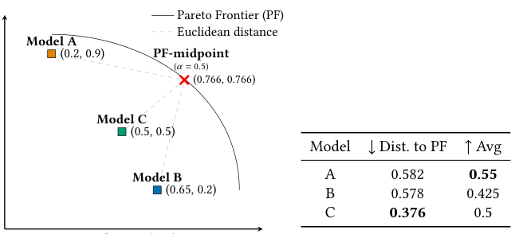
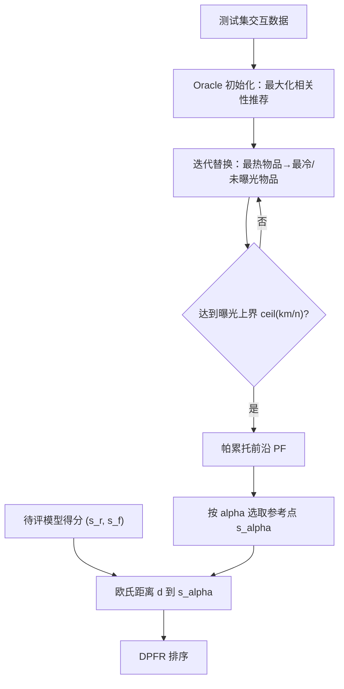

# Joint Evaluation of Fairness and Relevance in Recommender Systems with Pareto Frontier (基于帕累托前沿的推荐系统公平性与相关性联合评测)

- **会议/期刊**: WWW 2025 (Oral)
- **作者与机构**: Theresia Veronika Rampisela, Tuukka Ruotsalo, Maria Maistro, Christina Lioma（哥本哈根大学；LUT 大学）
- **推荐链路定位**: 离线评测（面向重排/精排输出的公平性-相关性联合评估）
- **研究方向**: 去偏公平、可信隐私与工业架构 / 多任务学习与列表级重排
- **论文原文**: [https://arxiv.org/abs/2502.11921v1](https://arxiv.org/abs/2502.11921v1)
- **开源代码**: [https://github.com/theresiavr/DPFR-recsys-evaluation](https://github.com/theresiavr/DPFR-recsys-evaluation)

## TL;DR (1分钟核心速览)

推荐系统同时追求相关性与物品曝光公平，但现有做法要么分别用两个指标（出现"公平最优模型"与"相关最优模型"两个冠军），要么用 ad-hoc 的联合指标（与 NDCG 等标准相关性度量脱节、彼此结论矛盾）。本文提出 DPFR：在测试集上用 Oracle2Fair 算法构造"相关性-公平性"帕累托前沿（PF），再以模型得分点到 PF 上 $\alpha$加权参考点的欧氏距离作为联合评分。在 6 个数据集、4 个推荐模型 × 3 种重排策略共 16 组配置上，DPFR 的最优模型与现有联合指标排序的 Kendall$\tau$多数$<0.9$，与简单平均法的冠军分歧最高达 58.33%，证明现有指标无法可靠代理帕累托最优解。

## Background & Motivation (背景与核心矛盾)

- **主流范式**: 相关性用 HR/MRR/P/R/MAP/NDCG 度量，物品级公平性用 Jain、Gini、Entropy、QF、FSat 度量；联合评估则依赖 IBO、MME、IAA、II-F、AI-F 等"把公平性写成相关性函数"的单一指标。
- **前人局限**: (1) 分别评测时两个维度各有冠军，无法给出联合结论；(2) 直接加权平均两指标时，二者量纲、分布、计算粒度（用户级 vs 物品曝光频次级）均不同，且无法回答"离理想平衡有多远"；(3) 现有联合指标是 ad-hoc 设计，与 NDCG 等公认相关性度量关联弱，且彼此对最优模型的判断不一致（实验中 5 个联合指标无一致结论，IBO 在 4/6 数据集上给出不同冠军）。
- **核心洞察 (Key Insight)**: 公平性无法对单个物品打标签（同一物品在不同列表中可公平也可不公平），因此多面向评测方法不适用；但"给定测试集，公平性与相关性联合可达的上界"是可经验构造的——只要沿"先最大化相关性、再在相关性约束下最大化公平性"的字典序路径替换物品，即可逼近帕累托前沿。
- **本文切入点**: 不做指标拼接，而是把联合评测转化为"模型得分点到经验帕累托前沿的距离"这一几何问题，天然规避量纲不可比问题，并给出可解释的"离最优平衡还差多远"。

<figure class="paper-figure" markdown="span">
  <figcaption>图1：（𝑥,𝑦）表示相关性与公平性得分的配对。示例：当相关性与公平性等权（𝛼=0.5）时，模型A在公平性上最佳，模型B在相关性上最佳，模型C最接近帕累托前沿（PF）中点。对相关性与公平性取平均（Avg）会错误地得出模型A在两方面均最佳的结论。注意，到PF的距离也优于其他现有的公平性与相关性度量（见§5.4）。</figcaption>
</figure>

## Method (核心方法设计)

### 1. 整体框架 (Overall Architecture)

DPFR 分三步：① 用 Oracle2Fair 在测试集上生成 PF——先由 Oracle 为每个用户推荐最多 $k=10$个测试集内相关物品（相关物品数$>k$的用户取其中曝光最少者，$<k$的用户补以全库曝光最少物品），再迭代地把"被推荐次数最多的物品"替换为"未曝光物品或最不流行物品"，每次替换后按相关性降序重排，直至任一物品被推荐次数不超过上界$\lceil km/n\rceil$；② 在 PF 上按$\alpha\in[0,1]$选取参考点；③ 计算各模型$(s_r,s_f)$ 到参考点的欧氏距离，距离最小者为联合最优。整个流程与具体推荐模型无关（model-agnostic），仅依赖测试集与所选度量对。

### 2. 关键设计拆解 (Key Designs)

1. **Oracle2Fair 前沿构造（字典序优化）**：穷举所有推荐组合不可行且无解析解，故采用"相关性优先、公平性次之"的字典序策略。初始化保证相关性上界，替换阶段每次用低曝光物品换出高曝光物品，使公平性单调不降、相关性单调不增，因而每个中间解都帕累托最优。停止条件 $\lceil km/n\rceil$ 正是"所有物品尽可能均匀曝光"时单物品曝光次数的理论上界，保证前沿覆盖到公平性端点。物理直觉：沿此路径采样即得 PF 的稠密离散近似。

2. **基于弧长的 $\alpha$参考点选取**：若按分位数取参考点，会偏向 PF 上点更密集的区域。本文改为按累积欧氏弧长定位：设$P$为 PF 点集，$x_t$为第$t$高相关性点，$lenPF(T)=\sum_{t=1}^{|T|-1} d_E(x_t,x_{t+1})$，则
$$t' = \arg\min_{j\in[1,|P|-1]} \left| lenPF(T_j) - \alpha \cdot lenPF(P) \right|$$
参考点 $s_\alpha = x_{t'}$。$\alpha=0$退化为纯相关性最优，$\alpha=1$为纯公平性最优，$\alpha=0.5$即前沿弧长中点。该设计使参考点对 PF 点密度不敏感，且$\alpha$ 提供了显式的公平-相关权衡旋钮。

3. **高效近似与训练/推理开销**：完整 PF 可达数百至数万点（Jester 上 16,202 点、耗时约 14 小时）。本文按"预期替换总数 $numRep$（各物品推荐频次超出$\lceil km/n\rceil$部分之和）除以$(p-1)$"均匀采样$p$个点（$p=3/6/12$），使近似 PF 的点在弧长上均匀分布。DPFR 本身无需训练、无负采样，开销仅为一次 PF 构造（可离线缓存）+ 每个模型一次距离计算；对比之下 MME 在 ML-20M 上单模型即需 89.13 分钟。

## Experimental Setup & Evaluation Protocol (实验设置与评估协议)

- **数据集与预处理**: 去重保留最近交互，保留交互数 $\geq 5$的用户与物品（`5-core`）；Amazon-lb/ML-* 评分阈值 3，Jester 阈值 0；Jester 额外剔除交互$>80$ 的用户以保证测试期有足够候选。

| 数据集 | #Users | #Items | #Interactions | 稀疏度 | 场景说明 |
| :--- | :---: | :---: | :---: | :---: | :--- |
| Lastfm | 1,859 | 2,823 | 71,355 | 98.64% | 音乐 |
| Amazon-lb | 1,054 | 791 | 12,397 | 98.51% | 电商 |
| QK-video | 4,656 | 6,423 | 51,777 | 99.83% | 视频分享 |
| Jester | 63,724 | 100 | 2,150,060 | 66.26% | 笑话评分 |
| ML-10M | 49,378 | 9,821 | 5,362,685 | 98.89% | 电影 |
| ML-20M | 89,917 | 16,404 | 10,588,141 | 99.28% | 电影 |

- **数据划分与防穿越**: Amazon-lb 与 ML-* 采用**全局时间戳切分** 6:2:2；无时间戳的 Lastfm/QK-video/Jester 采用同比例**随机划分**；训练/验证集物品在测试期从该用户候选中剔除，杜绝穿越。
- **排名评测协议**: 采用 **Full-Ranking 式全候选评测**（每用户从全库未交互物品中推荐 $k=10$，非采样负例）；重排阶段对每用户 top-$k'=25$ 候选重排，允许跨用户交换物品。
- **对比基线与超参**: 4 个协同过滤模型 ItemKNN、BPR、MultiVAE、NCL（RecBole 实现，300 epoch + 早停，按验证 NDCG@10 选模）× 3 种重排 GS、COMBMNZ、Borda Count（含无重排共 16 组）；相关性度量 HR/MRR/P/R/MAP/NDCG，公平性度量 Jain/QF/Gini/FSat/Ent，联合基线 IBO/MME/IAA/II-F/AI-F；DPFR 统一取欧氏距离、$\alpha=0.5$、$k=10$。

## Key Experimental Results (实验关键数据)

### 1. 主实验对比 (Main Results)

原文主结论以"最优模型一致性"与"排序相关性"呈现（非传统精度表）。下表汇总 DPFR 与各联合基线在 6 数据集上的 Kendall $\tau$ 区间（图 3 热力图）及冠军分歧率：

| 评测方法 | Lastfm $\tau$| Amazon-lb$\tau$| QK-video$\tau$| Jester$\tau$| ML-10M$\tau$| ML-20M$\tau$ | 与 DPFR 冠军一致率 |
| :--- | :---: | :---: | :---: | :---: | :---: | :---: | :---: |
| IBO | 0.00–0.90 | 0.01–0.13 | 0.03–0.12 | 0.73–0.98 | 0.67–0.98 | 0.03–0.95 | 低（4/6 数据集冠军不同） |
| MME | 0.27–0.87 | 0.80–0.90 | 0.68–0.78 | 0.52–0.72 | 0.12–0.53 | −0.18–0.30 | 中 |
| IAA | −0.11–0.75 | −0.08–0.06 | −0.60–−0.47 | 0.08–0.22 | −0.55–0.50 | −0.58–0.08 | 低（常与 Rel 冠军重合） |
| II-F | 0.18–0.87 | −0.05–0.03 | −0.62–−0.48 | −0.05–0.25 | −0.53–0.52 | −0.60–0.08 | 低 |
| AI-F | 0.58–0.98 | 0.73–0.85 | 0.47–0.73 | 0.60–0.88 | 0.03–0.87 | 0.03–0.37 | 最高（但 5/6 数据集 $\tau<0.9$） |
| **DPFR** | — | — | — | — | — | — | **基准（帕累托最优）** |

**平均法 (avg) 与 DPFR 的冠军分歧率**（12 个可用度量对）：

| 相关性度量类型 | Lastfm | Amazon-lb | QK-video | Jester | ML-10M | ML-20M | 全部 |
| :--- | :---: | :---: | :---: | :---: | :---: | :---: | :---: |
| 集合型 (P, R) | 50.00% | 0.00% | 16.67% | 16.67% | 0.00% | 0.00% | 13.89% |
| 排序型 (MAP, NDCG) | 66.67% | 0.00% | 0.00% | **83.33%** | 66.67% | 50.00% | **44.44%** |
| 全部 | **58.33%** | 0.00% | 8.33% | 50.00% | 33.33% | 25.00% | 29.17% |

### 2. 消融实验 (Ablation Study)

以"PF 点数 $p$"为消融变量，考察近似 PF 对 DPFR 结论的影响（表 3）：

| 配置 | 点数占完整 PF 比例 | 计算耗时（ML-20M） | 中点偏移 Dist. | 最小 Kendall $\tau$（6 数据集） |
| :--- | :---: | :---: | :---: | :---: |
| 完整 PF | 100% | 75.77 min | 0 | 1.00（基准） |
| Est. PF (12 pts) | 0.07–2.40% | 2.60 min | 0.00–0.02 | 0.95–1.00 |
| Est. PF (6 pts) | 0.04–1.20% | 2.54 min | 0.00–0.05 | 0.90–1.00 |
| Est. PF (3 pts) | 0.02–0.60% | 2.52 min | 0.00–0.05 | 0.75–1.00 |

### 3. 关键实验发现 (Key Findings)

1. **现有联合指标无法代理帕累托最优**：IAA 与 II-F 在 QK-video 上与 DPFR 呈负相关（$\tau\in[-0.62,-0.35]$），AI-F 虽相关性最强但 5/6 数据集$\tau<0.9$；且 5 个联合指标在 6 个数据集上从未对冠军达成一致，说明它们各自偏向公平或相关一侧（73.3% 的情况下冠军与单一维度指标重合）。
2. **简单平均法在排序型度量下失效最严重**：当相关性用 MAP/NDCG 时，平均法与 DPFR 的冠军分歧率达 44.44%（Lastfm 66.67%、Jester 83.33%），远高于集合型度量的 13.89%；原因是排序型度量对替换位置敏感、分数方差大，平均法被单侧主导。仅在相关性方差极低（Amazon-lb）或公平性方差极低（ML-*）时二者才偶然一致。
3. **前沿形状揭示"公平不必牺牲相关"**：在随机划分的 QK-video 与 Jester 上，$\{MAP,R,NDCG\}\times\{Jain,Ent,Gini\}$的 PF 逼近$(1,1)$（Gini 为$(1,0)$），即存在同时接近最大公平与最大相关的帕累托最优推荐；而时间戳划分的 ML-* 前沿更"陡"，权衡更显著——说明数据划分方式本身会改变公平-相关可达边界。

## Highlights & Limitations (亮点、对比与审稿批判)

- **与代表作对比 (vs. Prior Work)**: 与 IBO/MME/IAA/II-F/AI-F 等把公平性写成相关性函数的 ad-hoc 联合指标不同，DPFR 不修改任何度量定义，而是以经验可达的帕累托前沿为锚；与 FAIR 对比"理想公平分布"不同，DPFR 的前沿由测试集保证可达；与 [33] 的"乌托邦点"距离不同，DPFR 参考点落在经验前沿上，避免不可达理想点带来的偏差；与 [49] 用模型训练损失构造 PF 不同，DPFR 的 PF 由 ground-truth 测试集构造，model-agnostic。
- **可迁移亮点**: (1) "字典序构造 + 弧长均匀采样"可在任意二维指标对上低成本生成经验帕累托前沿，可迁移到多样性-精度、新颖性-精度等权衡评测；(2) $\alpha$ 弧长参考点选取规避了分位数对点密度敏感的缺陷，适合任何非均匀采样的前沿。
- **审稿级局限批判**: (1) 计算开销仍显著——Jester 上即使 3 点近似也需约 9 小时，且 PF 需按"数据集 × 度量对"逐一重建，无法跨数据集复用；(2) 仅验证物品级个体公平与二维权衡，未覆盖用户级/群组公平与三维以上目标，且 $\alpha=0.5$ 的默认设定缺乏任务自适应的理论依据；(3) 前沿由 Oracle2Fair 启发式逼近，作者亦承认无法验证其与理论 PF 的一致性。

## Rating (四维评分)

- **方法创新性 (Novelty)**: ⭐⭐⭐⭐ （首次将帕累托最优性从"推荐方法"转为"评测准则"，以经验可达前沿替代不可达理想点，思路干净且有理论依据）
- **评估协议与实验扎实度 (Protocol & Experiments)**: ⭐⭐⭐⭐ （6 数据集 × 4 模型 × 3 重排共 16 组配置、Kendall $\tau$ 与冠军分歧双重验证、含效率消融，但缺少用户级公平与三维目标验证）
- **写作与数学规范度 (Clarity & Rigor)**: ⭐⭐⭐⭐ （帕累托定义、弧长参考点与停止条件推导清晰，图 1 玩具示例极具说服力；Oracle2Fair 细节置于附录略增阅读成本）
- **工业落地与复现价值 (Industrial & Practical Value)**: ⭐⭐⭐⭐ （代码开源、model-agnostic、可离线缓存 PF 并以 6–12 点近似达到 $\tau\geq0.9$，适合作为公平重排上线的离线验收指标；但 PF 构建成本限制了高频迭代场景）

