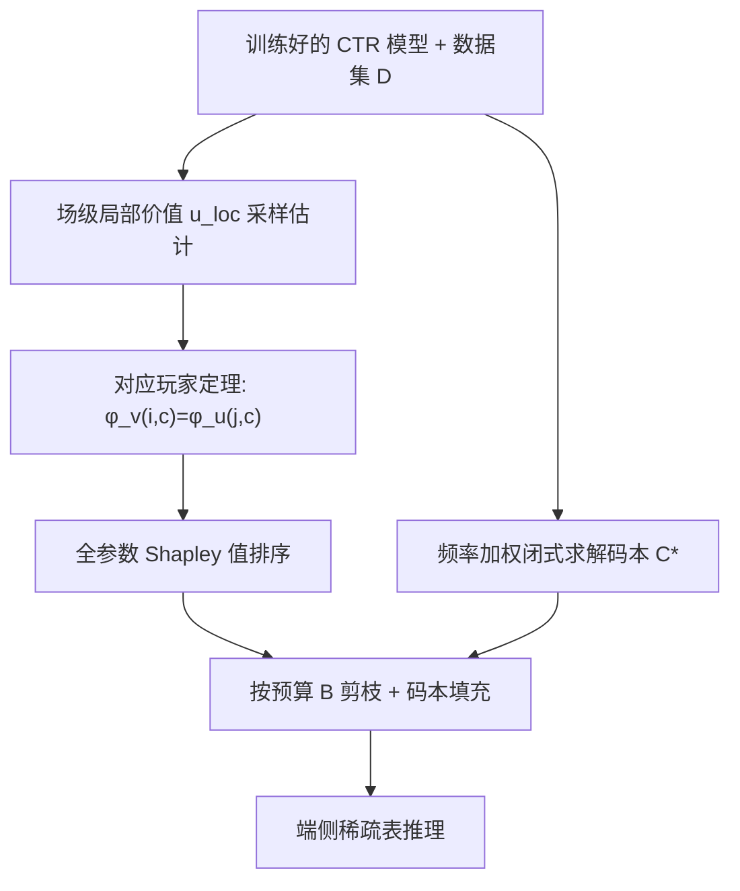
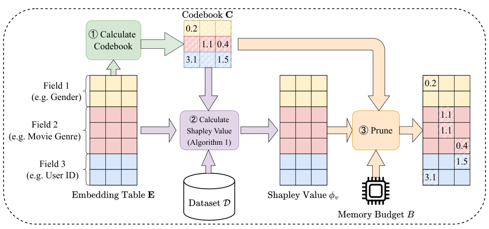

# On-device Content-based Recommendation with Single-shot Embedding Pruning: A Cooperative Game Perspective (基于合作博弈视角的单次嵌入剪枝端侧内容推荐)

- **会议/期刊**: ACM Web Conference 2025 (WWW '25)
- **作者与机构**: Hung Vinh Tran, Tong Chen, Guanhua Ye, Quoc Viet Hung Nguyen, Kai Zheng, Hongzhi Yin (The University of Queensland / BUPT / Griffith / UESTC)
- **推荐链路定位**: 精排 (CTR 预估模型压缩与端侧部署)
- **研究方向**: 去偏公平与工业架构 / CTR 预估与特征交叉
- **论文原文**: [https://arxiv.org/abs/2411.13052v2](https://arxiv.org/abs/2411.13052v2)
- **开源代码**: [https://github.com/chenxing1999/shaver](https://github.com/chenxing1999/shaver)

## TL;DR (1分钟核心速览)

针对端侧内容推荐中嵌入表存储瓶颈、且现有剪枝方法需为每个目标预算重复重训的痛点，本文提出 Shaver：将嵌入参数视为合作博弈"玩家"，用 Shapley 值量化其对任意参数子集的期望贡献，实现**单次前向即可剪枝到任意预算**；并通过"对应玩家"定理把复杂度从 $O(nd|\mathcal{D}|)$降至$O(md|\mathcal{D}|)$（$m\ll n$），再以场感知码本闭式解替代零填充。在 Criteo/Avazu/KDD 三数据集、DCN-Mix 骨干下，95% 稀疏率时 KDD AUC 达 0.7836，超越需重训的 TTRec (0.7815) 与 OptEmb (0.7826)。

## Background & Motivation (背景与核心矛盾)

- **主流范式**: 内容推荐依赖海量稀疏类别特征，嵌入表成为存储瓶颈（Meta 报告 12T 参数、96TB 内存）；现有压缩分四类——组合嵌入 (QR/TTRec)、量化 (PTQ)、NAS (OptEmb)、剪枝 (PEP/CERP)。
- **前人局限**: ① PEP、OptEmb、CERP 等需为**每个目标稀疏率**重新训练/重训，联邦学习与流式场景下设备异构、电量波动导致预算频繁变化，重复训练不可承受；② 现有单次剪枝 (MagPrune/Taylor) 以"对全参数集的贡献"排序，但剪枝后参数实际只与**子集**共存，归因目标错位；③ 零填充切断点积/逐元素乘的特征交互，信息损失严重。
- **核心洞察 (Key Insight)**: 剪枝真正该问的是"参数加入**任意子集团队**时的期望贡献"，这正是 Shapley 值的定义；且同一列上被激活特征的参数在局部价值函数下与场级玩家等价。
- **本文切入点**: 合作博弈 + 场级对应玩家定理 + 闭式码本，三者组合实现"一次归因、任意预算、免重训"。

## Method (核心方法设计)

### 1. 整体框架 (Overall Architecture)

Shaver 分三步离线完成：① 在训练+验证集上按 Algorithm 1 估计每个嵌入参数的 Shapley 值 $\phi_v(i,c)$；② 由各场特征频率加权均值闭式求解场感知码本$\mathbf{C}^*$；③ 部署时对任意预算$B$，将归因分最低的$B$个参数替换为码本占位值，得到稀疏表$\mathbf{E}_{Q,\mathbf{C}}$ 直接推理，全程无梯度回传、无重训。

<figure class="paper-figure" markdown="span">
  <figcaption>图1：Shaver 概览。我们计算占位值（码本 C），然后从给定数据集 D 计算 Shapley 值 𝜙𝑣。在任意所需内存预算 𝐵 下，我们用占位值替换归因分数最低的嵌入参数。</figcaption>
</figure>

### 2. 关键设计拆解 (Key Designs)

1. **场级对应玩家定理（复杂度从 $nd$降到$md$）**：直接 Monte Carlo 需枚举$2^{nd}$子集、每置换$nd|\mathcal{D}|$次前向，不可行。作者定义场级局部价值$u_{loc}(\mathcal{S}'|\mathbf{x},y)=L(f_{\text{w/o-}\mathcal{S}'}(\mathbf{x}),y)-L(f(\mathbf{x}),y)$，其中玩家$(j,c)$是场$j$嵌入表第$c$列的整组参数。**定理 4.3**：若$(i,c)$与$(j,c)$对应（同列且$\mathbf{x}[i]=1$），则$\phi_v^{\mathbf{x},y}(i,c)=\phi_u^{\mathbf{x},y}(j,c)$。直觉是：单样本下同列参数对损失的边际贡献完全一致，故只需对$m$个场而非$n$个特征做置换采样，KDD 上$m=11$vs$n\approx6\times10^6$，复杂度降至$O(md|\mathcal{D}|)$，且由中心极限定理估计无偏、方差$O(1/|\mathcal{D}|)$。
2. **场感知码本替代零填充**：零填充使被剪参数与所有特征交互归零，破坏点积/逐元素乘结构。作者引入 $\mathbf{C}\in\mathbb{R}^{m\times d}$，剪枝参数按所属场填$\mathbf{C}[j,c]$，并最小化期望重构误差$\mathbf{C}^*=\min_{\mathbf{C}}\mathbb{E}_{\mathbf{x}\sim\mathcal{D},|Q|=B}\|\mathbf{E}^\top\mathbf{x}-\mathbf{E}_{Q,\mathbf{C}}^\top\mathbf{x}\|_2^2$，解得频率加权闭式解$\mathbf{C}^*[j,:]=\sum_{i\in\mathcal{F}_j}p_i\mathbf{V}_j[i,:]/\sum_{i\in\mathcal{F}_j}p_i$。仅$md$ 个元素，存储开销可忽略，且高频特征已被码本"代表"，预算可让渡给低频特征。
3. **训练目标、负采样与推理效率**：Shaver 不引入新训练损失，直接复用原模型 log loss $L=-y\ln\hat{y}-(1-y)\ln(1-\hat{y})$；归因阶段仅需前向（无负采样、无梯度），码本训练期冻结。最坏情况（Criteo 全量）约 2.5 小时完成归因，而任一基线单次重训即超 1 小时（不含调参），且 Shaver 一次归因覆盖所有预算。

## Experimental Setup & Evaluation Protocol (实验设置与评估协议)

- **数据集与预处理**（低频特征替换为 OOV token）：

| 数据集 | #Instances | #Features | #Fields | 过滤/说明 |
| :--- | :---: | :---: | :---: | :--- |
| Criteo | 45,840,617 | 1,086,810 | 39 | 数值特征 $\lceil\log_2 x\rceil$ 离散化，min_count=10 |
| Avazu | 40,428,967 | 4,428,511 | 22 | 移除 id 字段，min_count=2 |
| KDD | 149,639,105 | 6,019,761 | 11 | min_count=10 |

- **数据划分与防穿越**: 随机 `8:1:1` 比例划分（train/valid/test）；归因分数用 train+valid 计算，test 仅评估。
- **排名评测协议**: CTR 场景采用 `LogLoss` 与 `AUC` 点估计（非 Full-Ranking 列表指标），AUC 差异 0.001 视为显著；稀疏率 $t=|Q|/nd$。
- **对比基线与超参设置**: 非单次组 QR/TTRec/PEP/OptEmb/CERP（$t\in\{50\%,80\%,95\%\}$），单次组 MagPrune/PTQ/Taylor（$t\in\{0.2,\dots,0.999\}$）；骨干 DeepFM 与 DCN-Mix，嵌入维度$d=16$，严格沿用 [55] 的数据划分与调参范围。

## Key Experimental Results (实验关键数据)

### 1. 主实验对比 (Main Results)

DCN-Mix 骨干，$t=95\%$（最严苛预算）：

| 数据集 | 方法 | Single-shot | AUC↑ | LogLoss↓ | #Params |
| :--- | :--- | :---: | :---: | :---: | :---: |
| Criteo | PEP | ✗ | 0.8114 | 0.4406 | 831K |
| Criteo | TTRec | ✗ | 0.8106 | 0.4414 | 870K |
| Criteo | **Shaver-Codebook** | ✓ | **0.8112** | **0.4410** | 870K |
| Avazu | PEP | ✗ | 0.7564 | 0.3938 | 3.52M |
| Avazu | OptEmb | ✗ | 0.7683 | 0.3895 | 3.43M |
| Avazu | **Shaver-Zero** | ✓ | **0.7690** | **0.3865** | 3.54M |
| KDD | TTRec | ✗ | 0.7815 | 0.1559 | 4.82M |
| KDD | OptEmb | ✗ | 0.7826 | 0.1591 | 4.80M |
| KDD | **Shaver-Codebook** | ✓ | **0.7836** | **0.1563** | 4.82M |

$t=80\%$时 Shaver-Codebook 在 KDD 达 0.7870，与$t=50\%$ 持平，显著优于 TTRec (0.7843) 与 OptEmb (0.7818)。

### 2. 消融实验 (Ablation Study)

KDD 数据集，DCN-Mix 骨干，AUC：

| 变体 | $t=50\%$|$t=80\%$|$t=95\%$ |
| :--- | :---: | :---: | :---: |
| Shaver-Zero | 0.7858 | 0.7826 | 0.7699 |
| Shaver-Codebook | **0.7870** | **0.7870** | **0.7836** |
| Shaver-Zero† (微调) | 0.7858 | 0.7826 | 0.7775 |
| Shaver-Codebook† (微调) | 0.7754 | 0.7806 | 0.7836 |

### 3. 关键实验发现 (Key Findings)

1. **码本收益随稀疏率单调放大**：KDD 上 $t=50\%$时码本仅 +0.0012，$t=95\%$ 时 +0.0137（0.7699→0.7836），说明零填充的信息损失在高稀疏下才被放大，码本正是针对该区间的补偿机制。
2. **单次剪枝可媲美甚至超越重训方法**：$t=95\%$ 时 Shaver-Codebook 在 KDD 超 TTRec +0.0021、超 OptEmb +0.0010，而后者每个预算都需完整重训，验证 Shapley 归因的排序质量足以替代迭代搜索。
3. **微调并非总有益、且存在数据泄漏风险**：KDD 上 Shaver-Codebook† 在 $t=50\%$反降至 0.7754（因归因用了验证集，微调时泄漏），而 Shaver-Zero† 在$t=95\%$ 提升 +0.0076；说明码本已吸收大部分可恢复信息，微调收益被前置归因"吃掉"。

## Highlights & Limitations (亮点、对比与审稿批判)

- **与代表作对比 (vs. Prior Work)**: 相比 PEP/CERP 的"训练中软阈值 + 重训"两阶段范式，Shaver 把预算解耦为推理期后处理；相比 SSEDS 强制同场等维约束，Shaver 允许逐参数非均匀分配；相比 MagPrune/Taylor 的"全集团队"归因，Shapley 值刻画的是"任意子集团队"的期望贡献，与剪枝语境严格对齐。
- **可迁移亮点**: ① "对应玩家"降维思路可迁移到任何**按场分组、组内单样本仅一个特征激活**的稀疏嵌入剪枝（如 DLRM 类模型）；② 频率加权闭式码本可作为通用"剪枝后占位值学习"插件，替换任意剪枝框架中的零填充。
- **审稿级局限批判**: ① 归因使用验证集导致微调时数据泄漏，KDD 上出现性能倒挂，评估协议存在瑕疵；② 仅验证 DeepFM/DCN-Mix 两类骨干与 CTR 点估计指标，未涉及列表级排序或生成式推荐；③ 码本在 Avazu+DeepFM 上反被零填充超越（作者自认原因不明），说明码本收益对数据分布敏感，缺乏理论刻画。

## Rating (四维评分)

- **方法创新性 (Novelty)**: ⭐⭐⭐⭐ （合作博弈视角切入剪枝归因错位问题，"对应玩家"定理给出严格等价性与复杂度证明，理论支撑扎实）
- **评估协议与实验扎实度 (Protocol & Experiments)**: ⭐⭐⭐⭐ （三数据集、双骨干、9 档稀疏率、单次/非单次两组基线齐全，但归因用验证集引入泄漏、缺显著性检验）
- **写作与数学规范度 (Clarity & Rigor)**: ⭐⭐⭐⭐ （价值函数、定理与闭式解推导完整，附录含合成数据验证与收敛分析；部分符号 $v/u$ 混用需对照阅读）
- **工业落地与复现价值 (Industrial & Practical Value)**: ⭐⭐⭐⭐⭐ （代码开源，Raspberry Pi/Android 实测推理 0.02–0.04s、内存随稀疏率线性下降，一次归因覆盖全预算，端侧部署价值极高）

