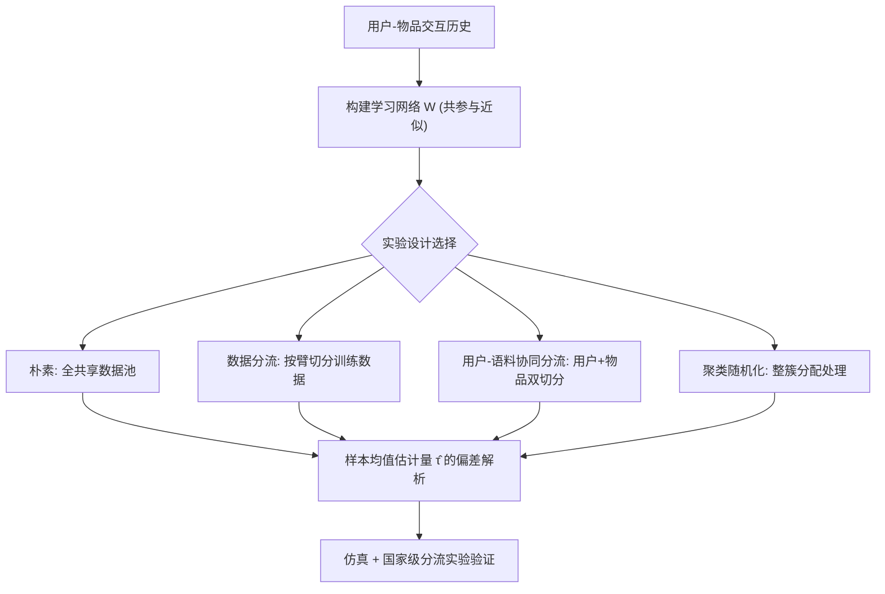

# Reducing Symbiosis Bias Through Better A/B Tests of Recommendation Algorithms (通过更优的推荐算法 A/B 测试降低共生偏差)

- **会议/期刊**: WWW 2025 (Work-in-progress)
- **作者与机构**: Jennifer Brennan, Jean Pouget-Abadie 等 (Google Research)；Yahu Cong, Yiwei Yu, David M. Holtz (UC Berkeley)
- **推荐链路定位**: 在线实验与因果评估（贯穿召回/排序全链路的 A/B 测试设计）
- **研究方向**: 去偏公平与工业架构 / 因果去偏
- **论文原文**: [https://arxiv.org/abs/2309.07107v3](https://arxiv.org/abs/2309.07107v3)
- **开源代码**: 暂未开源

## TL;DR (1分钟核心速览)

推荐算法 A/B 测试中，处理组与对照组共享同一训练数据池，导致各自性能被对手产生的数据"喂养"，违背 SUTVA 的"无隐藏处理"假设，作者将其命名为**共生偏差 (Symbiosis Bias)**。本文建立动态与均衡两套潜在结果模型，推导朴素/聚类随机化/数据分流/用户-语料协同分流四种设计下样本均值估计量的偏差解析式，并用 100 用户×1000 物品的仿真与一个 25% 国家级分流工业实验验证：朴素实验可将接受率夸大近一个数量级，聚类随机化能降偏但不引入新偏差，代价是方差增大。

## Background & Motivation (背景与核心矛盾)

- **主流范式**: 业界普遍用用户级随机化的 A/B 测试比较推荐算法，依赖 SUTVA 保证处理效应估计无偏。
- **前人局限**: 两实验组共享训练数据池时，SUTVA 的"无隐藏处理"与"无干扰"双双失效；已有数据分流方案 [Jeunen, Si] 只关注方差增大与数据低效，未系统刻画偏差来源与不对称性。
- **核心洞察 (Key Insight)**: 偏差源于"搭便车"——一个算法可免费利用对手探索产生的数据；且偏差往往**不对称**，弱算法从强对手处获益更多，导致 TTE 被系统性高估或低估。
- **本文切入点**: 不改估计量、只改实验设计，用"限制各算法可见数据池至其反事实应得范围"的统一视角，理论+仿真+真实数据三线对比三种设计。

## Method (核心方法设计)

### 1. 整体框架 (Overall Architecture)

论文不提出新推荐模型，而是构建一套**实验设计的因果分析框架**：先以时间索引的潜在结果模型形式化定义共生偏差，再退化为可解析的均衡网络模型推导各设计偏差，最后用动态仿真（100 用户、1000 物品、100 时间步、物品分批释放）与国家级分流实验交叉验证。四种设计对数据可见性的约束逐级收紧：朴素实验全共享；数据分流按用户切分训练池；用户-语料协同分流同时切分用户与物品；聚类随机化则按用户相似图聚类后整簇随机化，从源头切断跨簇干扰边。

### 2. 关键设计拆解 (Key Designs)

1. **均衡网络潜在结果模型（偏差的解析基石）**：将用户 $i$的结果写成$Y_i(\mathbf{z})=\beta_{z_i}+\delta_{z_i}M+\sum_{j}w_{ij}\gamma_{z_iz_j}$，其中$w_{ij}$为不可观测学习网络权重、$M$为语料规模、$\gamma_{z_iz_j}$为跨臂间接效应。该式把"数据共享"显式编码为$j$的处理分配对$i$ 的溢出，使各设计偏差可闭式比较——这是全文能给出可操作结论的关键抽象。

2. **三种设计的偏差闭式对比**：朴素独立分配的偏差为 $\text{Bias}_{\text{ind}}(\hat\tau)\approx\frac{1}{N}\sum_i\sum_{j\neq i}w_{ij}\frac{1}{2}(-\gamma_{11}+\gamma_{10}-\gamma_{01}+\gamma_{00})$；聚类随机化仅保留跨簇项（乘$\mathbb{I}\{C(i)\neq C(j)\}$），故簇质量高时偏差趋零；数据分流偏差为$\frac{1}{N}\sum_i\sum_{j\neq i}w_{ij}\frac{\gamma_{00}-\gamma_{11}}{2}$，但每臂仅半量数据会**引入新偏差**；协同分流再叠加语料减半项$M\frac{\delta_0-\delta_1}{2}$。直觉：聚类"删边不删数据"，分流"删数据也删信息"。

3. **训练目标、负采样与推理效率**：本文无模型训练损失；核心"目标"是样本均值估计量 $\hat\tau=\frac{\sum_i Y_i\mathbb{I}\{Z_i=1\}}{\sum_i\mathbb{I}\{Z_i=1\}}-\frac{\sum_i Y_i\mathbb{I}\{Z_i=0\}}{\sum_i\mathbb{I}\{Z_i=0\}}$ 的偏差最小化。设计优先于分析的理由：无偏估计量依赖网络效应假设且实现复杂，而设计层干预对非专家更可信、更难被"调参博弈"。

## Experimental Setup & Evaluation Protocol (实验设置与评估协议)

- **数据集与预处理**: 仿真环境（非真实数据集）参数如下；真实数据为某全球推荐系统的国家级分流实验。

| 数据集 | #Users | #Items | #Interactions/步数 | 稀疏度/密度 | 特征/场景说明 |
| :--- | :---: | :---: | :---: | :---: | :--- |
| 仿真环境 | 100 | 1,000 (每步+10) | 100 时间步 | 每用户每物品至多 1 次 | 10 维 Dirichlet 偏好/属性，含自然聚类 |
| 工业实验 | 百万级用户 | 全库 | 25% 国家分流 | — | 处理组提升新发布内容曝光 |

- **数据划分与防穿越 (Splitting Strategy)**: 仿真前 10 步全随机推荐作冷启动，之后进入实验期；工业实验采用**国家级分流**（国家作天然簇）+ 实验前后对比 (pre-post) 分析。
- **排名评测协议 (Ranking Protocol)**: 非排名指标，评估量为**接受率 (take-up rate)** 与**处理效应估计的绝对偏差**；仿真中通过"处理=对照"的朴素实验构造真实反事实接受率作为金标准。
- **对比基线与超参设置**: 四种推荐算法两两组合——Oracle、Random、Item-based CF、User-based CF；关键超参 $\gamma_{pref}=10$（控制用户偏好聚类的容易程度），并扫描处理组比例 0%–100%。

## Key Experimental Results (实验关键数据)

### 1. 主实验对比 (Main Results)

仿真中不同设计下 TTE 估计的绝对偏差（$\gamma_{pref}=10$，数值为图 2 趋势的定性归纳，原文以柱状图呈现）：

| 算法对 (处理 vs 对照) | Naive | Cluster-Rand. | Data-Diverted | User-Corpus Co-Div. |
| :--- | :---: | :---: | :---: | :---: |
| User-CF vs Item-CF | 高 | 中 | 低 | **最低** |
| Item-CF vs User-CF | 高 | 中 | 低 | **最低** |
| User-CF vs Oracle | 高 | 中 | 低 | **最低** |
| Item-CF vs Random | 高 | 中 | 低 | **最低** |

工业实验（图 4）：对照国家的实验期新内容互动增幅与其对处理国家的**暴露度呈线性正相关**，处理国家该斜率近零——直接证实数据泄漏与偏差的不对称性。

### 2. 消融实验 (Ablation Study)

以"设计维度"替代组件消融，考察处理比例与聚类质量的影响：

| 变动因素 | Naive | Cluster-Rand. | Data-Diverted | Co-Diverted |
| :--- | :---: | :---: | :---: | :---: |
| 处理比例 25%→75% | 偏差显著下降 | 偏差下降 | 偏差下降 | 偏差下降 |
| 聚类质量高 ($\gamma_{pref}$ 大) | 不变 | **偏差趋零** | 不变 | 不变 |
| 置信区间宽度 | 最窄 | **最宽** | 中 | 中 |

### 3. 关键实验发现 (Key Findings)

1. **朴素实验偏差可达一个数量级**：多数算法对下朴素设计均产生共生偏差，最严重时接受率被夸大近 10 倍，且偏差随处理比例上升而下降，印证"搭便车"机制。
2. **聚类随机化是"安全但低效"的选择**：它不引入数据/语料缩减带来的反向偏差，但置信区间明显更宽，统计功效受损；其降偏效果强依赖簇质量（跨簇 $w_{ij}\approx0$ 时偏差趋零）。
3. **协同分流降偏最强但代价最高**：同时切分用户与物品使偏差最小，却因语料减半叠加 $M(\delta_0-\delta_1)/2$ 项，在语料规模敏感的场景下可能得不偿失。

## Highlights & Limitations (亮点、对比与审稿批判)

- **与代表作对比 (vs. Prior Work)**: 相较 Musgrave 等（依赖搜索 query 分流，不适用于无显式 query 的推荐流）、Goli 等（强假设+仅稳态）、Si（需估计每物品双臂推荐概率，实践困难），本文三种设计假设最少、可用于未达均衡的系统，且首次将**聚类随机化**引入共生偏差语境。
- **可迁移亮点**: ①"设计优先于分析"的评估哲学——用数据可见性约束替代复杂去偏估计量；②共参与 (co-engagement) 指标近似不可观测学习网络，可直接复用于任何双边图平台的干扰诊断。
- **审稿级局限批判**: ①理论模型忽略异质性，仿真仅 100 用户、算法集有限，外部效度存疑；②真实数据分析为 pre-post 而非严格识别，聚类质量与降偏效果的因果关系缺乏强证据；③聚类随机化方差膨胀在低流量场景可能不可接受，论文未给出功效-偏差的定量权衡曲线。

## Rating (四维评分)

- **方法创新性 (Novelty)**: ⭐⭐⭐⭐ （首次系统命名并建模"共生偏差"，均衡网络模型给出可闭式比较的偏差解析，聚类随机化视角新颖）
- **评估协议与实验扎实度 (Protocol & Experiments)**: ⭐⭐⭐ （理论+仿真+工业数据三线互证是亮点，但仿真规模小、真实数据为 pre-post 弱识别，缺显著性检验）
- **写作与数学规范度 (Clarity & Rigor)**: ⭐⭐⭐⭐ （偏差公式推导清晰、四种设计对比直观，附录补全证明与方差讨论，符号略密）
- **工业落地与复现价值 (Industrial & Practical Value)**: ⭐⭐⭐⭐ （给出可直接落地的实验设计选型指南，国家级分流案例贴近生产，但无开源代码、聚类构图开销未量化）

