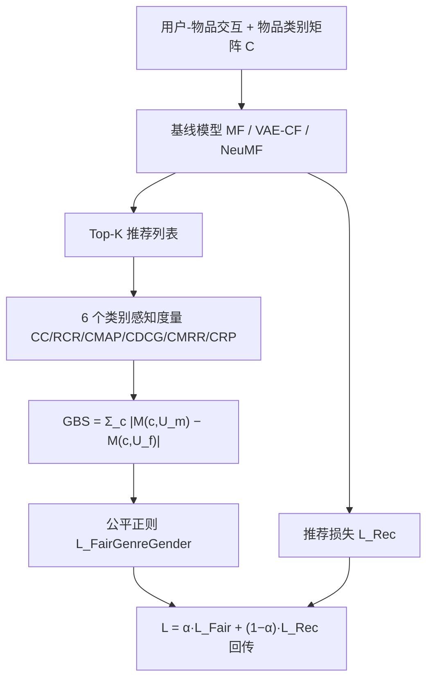

# Unmasking Gender Bias in Recommendation Systems and Enhancing Category-Aware Fairness (揭示推荐系统中的性别偏差并增强类别感知公平性)

- **会议/期刊**: WWW 2025
- **作者与机构**: Tahsin Alamgir Kheya, Mohamed Reda Bouadjenek, Sunil Aryal（Deakin University）
- **推荐链路定位**: 重排 / 训练期正则（in-processing）
- **研究方向**: 去偏公平与可信推荐
- **论文原文**: [https://arxiv.org/abs/2502.17921v1](https://arxiv.org/abs/2502.17921v1)
- **开源代码**: 暂未开源

## TL;DR (1分钟核心速览)

现有消费侧公平评估只比较男女组的 Precision/Recall 等整体指标，无法发现"指标相同但推荐内容类别分布不同"的隐性刻板印象。本文提出 6 个**类别感知**偏差度量（3 个非排序 + 3 个排序折扣 + CRP），用 GBS 聚合男女组差异，并把类别覆盖差作为可微正则项加入 MF/VAE-CF/NeuMF 训练。在 ML-100K/1M/Yelp 上，NeuMF 的偏差平均下降 77%/53%/50%，NDCG 仅小幅波动。

## Background & Motivation (背景与核心矛盾)

- **主流范式**: 消费侧公平普遍套用 Equal Opportunity / Demographic Parity，比较男女组的 Recall、Precision、NDCG 等**整体**指标是否相等。
- **前人局限**: (i) 整体指标相等 ≠ 公平——图 1 显示四个模型男女 Precision@10 几乎一致，但爱情片系统性偏向女性、动作片偏向男性；(ii) 忽略排序位置，且 MAP 类指标把多类别物品的二值相关性压平，无法刻画"某类别被压制/放大"。
- **核心洞察 (Key Insight)**: 偏差应按**物品类别 × 排序位置**粒度度量；单一指标会给出"虚假公平"（如 SM-GBiasedMF 的 GBS(CMRR) 更低，但 Romance/Sci-Fi 上仍显著偏斜）。
- **本文切入点**: 用一组互补的类别感知度量同时做"诊断"与"治疗"——把其中一个度量直接写进损失函数。

## Method (核心方法设计)

### 1. 整体框架 (Overall Architecture)

模型本身不改结构，只改**评估层**与**训练目标**。评估层：对每个类别 $c$计算 6 个度量，再按性别组求差得 GBS。训练层：取 Top-$K$推荐列表（$K=50$）的类别覆盖差作为公平损失，与各基线的原推荐损失加权求和；公平损失经 sigmoid（中心 0.5、缩放 0.1）并用当前 batch 推荐损失最大值做尺度对齐，保证两项同量级。

### 2. 关键设计拆解 (Key Designs)

1. **类别覆盖与相对类别表征（CC / RCR，非排序度量）**：痛点是整体指标看不到类别分布。CC 统计类别 $c$在 Top-$K$ 中的加权占比，RCR 再除以该类别在全库中的占比，从而区分"压制"与"放大"：
$CC(c,\mathcal{U})=\frac{1}{|\mathcal{U}|}\sum_{u_i}\frac{1}{|TopK_{u_i}|}\sum_{v_j\in TopK_{u_i}}\frac{C_{j,c}}{|C_{v_j}|}$直觉：多类别物品按$1/|C_{v_j}|$ 分摊权重，避免多标签物品重复计数。

2. **排序折扣度量（CMAP / CDCG / CMRR / CRP）**：痛点是位置信息被丢弃。四者分别用 $P(j)$累积精度、$\log(j+1)$对数折扣、$1/j$强折扣、以及只截断到$\lfloor R_c\rfloor$（$R_c$为类别$c$ 在全库的占比）的精度：
$CDCG(c,\mathcal{U})=\frac{1}{|\mathcal{U}|}\sum_{u_i}\frac{1}{|TopK_{u_i}|}\sum_{j=1}^{|TopK_{u_i}|}\frac{C_{j,c}}{|C_{v_j}|\log(j+1)}$
直觉：折扣强度不同 → 对"头部偏斜"与"长尾缺失"敏感度不同，多指标互补才能暴露隐性偏差。

3. **GBS 聚合与公平正则**：组公平定义为男女组度量值之差的类别求和，并直接作为损失：
$\mathcal{L}_{FairGenreGender}=\sum_{c\in\mathcal{C}}\left|CC(c,\mathcal{U}_m)-CC(c,\mathcal{U}_f)\right|,\quad \mathcal{L}=\alpha\mathcal{L}_{Fair}+(1-\alpha)\mathcal{L}_{Rec}$训练负采样沿用各基线原设定（MF/NeuMF 用 BPR + 负采样，VAE-CF 用多项式似然）；推理无额外开销，仅训练期多一次 Top-$K$ 可微近似。

## Experimental Setup & Evaluation Protocol (实验设置与评估协议)

- **数据集与预处理**（过滤交互 < 5 的非活跃用户，剔除性别未知用户；Yelp 的 300+ 类别归并为 21 个粗类）：

| 数据集 | #Users | #Items | #Interactions | 类别数 | 说明 |
| :--- | :---: | :---: | :---: | :---: | :--- |
| ML-100K | 943 | 1,349 | 99,287 | 18 | 电影类型 |
| ML-1M | 6,040 | 3,416 | 999,611 | 18 | 电影类型 |
| Yelp | 1,316 | 1,272 | 97,991 | 21 | 商户类别 |

- **数据划分与防穿越**: 按用户 70:10:20 划分训练/验证/测试（user-based split），非全局时间戳切分。
- **排名评测协议**: 报告 HitRatio@50 与 NDCG@50；偏差度量基于 Top-50 列表（GBS(CRP) 用 Top-$\lfloor R_c\rfloor$）。未声明全库 Full-Ranking，属固定长度列表评估。
- **对比基线与超参**: 5 个基线（UserKNN、ItemKNN、MF、VAE-CF、NeuMF）+ 2 个公平基线（BeyondParity、SM-GBiasedMF，$\lambda=20$）；早停监控 NDCG@20（delta 0.0005，patience 10）；$\alpha$ 网格 0–0.6 步长 0.1，ML-100K 取 0.4/0.3/0.2，ML-1M 取 0.6/0.2/0.4，Yelp 统一 0.3。

## Key Experimental Results (实验关键数据)

### 1. 主实验对比 (Main Results)

GBS 偏差值（越低越公平），选取 NeuMF 与 MF 为代表：

| 数据集 / 模型 | HitRatio↑ | NDCG↑ | GBS(CC)↓ | GBS(CDCG)↓ | GBS(CRP)↓ |
| :--- | :---: | :---: | :---: | :---: | :---: |
| ML-100K NeuMF | 0.9470 | 0.2402 | 0.1723 | 0.0502 | 0.1411 |
| ML-100K NeuMF-Fair | 0.9194 | 0.2305 | **0.0333** | **0.0093** | **0.0342** |
| ML-100K MF | 0.9003 | 0.1979 | 0.0288 | 0.0089 | 0.0276 |
| ML-100K MF-Fair | 0.8950 | 0.1794 | **0.0228** | **0.0085** | **0.0234** |
| ML-1M NeuMF | 0.9108 | 0.1336 | 0.3096 | 0.0835 | 0.2180 |
| ML-1M NeuMF-Fair | 0.8333 | 0.1359 | **0.1503** | **0.0436** | **0.0959** |
| Yelp NeuMF | 0.9347 | 0.1794 | 0.0592 | 0.0152 | 0.0651 |
| Yelp NeuMF-Fair | 0.8533 | 0.1124 | **0.0309** | **0.0079** | **0.0394** |

与公平基线对比（ML-100K，MF 系）：本文 MF($\alpha$=0.5) NDCG 0.1794 / GBS(CC) 0.0228，显著优于 SM-GBiasedMF（0.1230 / 0.0379）与 BeyondParity（0.0790 / 0.0528）。

### 2. 消融实验 (Ablation Study)

以 $\alpha$为消融轴（$\alpha=0$ 即原模型），ML-100K 上 GBS(CC) 与 NDCG@50 的权衡：

| 模型 | $\alpha$ | NDCG@50↑ | GBS(CC)↓ |
| :--- | :---: | :---: | :---: |
| MF | 0.0 → 0.4 | 0.1979 → 0.1794 | 0.0288 → 0.0228 |
| VAE-CF | 0.0 → 0.3 | 0.1643 → 0.1575 | 0.0187 → 0.0140 |
| NeuMF | 0.0 → 0.2 | 0.2402 → 0.2305 | 0.1723 → 0.0333 |

### 3. 关键实验发现 (Key Findings)

1. **偏差随模型表达力放大**：NeuMF 因 GMF+MLP 捕捉复杂偏好相关性，GBS(CC) 在 ML-1M 高达 0.3096，是 MF（0.1775）的 1.7 倍；而公平正则对 NeuMF 也最有效（平均降 77%/53%/50%），说明"越能拟合刻板模式，越能被正则纠正"。
2. **非排序度量系统性高估偏差、强折扣度量系统性低估**：GBS(CC)/GBS(RCR) 数值普遍最大（无位置折扣），GBS(CMRR) 因 $1/j$ 强折扣几乎最小，单一指标会误判公平程度——这正是多指标设计的实证依据。
3. **公平项兼具正则效应**：ML-1M 上 NeuMF-Fair 的 NDCG 从 0.1336 微升至 0.1359，VAE-CF 在 ML-100K 上 HitRatio 从 0.8749 升至 0.8759，说明适度 $\alpha$ 可抑制过拟合；但 Yelp 上 MF 的 HitRatio 从 0.8587 跌至 0.7500，表明小数据 + 强正则时性能代价不可忽略。

## Highlights & Limitations (亮点、对比与审稿批判)

- **与代表作对比 (vs. Prior Work)**: 相比 BeyondParity（仅约束预测分数均值差）与 SM-GBiasedMF（对抗式反事实公平），本文把公平定义下沉到**类别 × 排序**粒度，且正则项可即插即用于任意可微推荐模型；相比 Crank/preference-ratio 类工作，本文显式引入排序折扣与男女组直接对比。
- **可迁移亮点**: (i) "度量即损失"的范式——任何可微的类别级分布差异都可作正则；(ii) 用 batch 内推荐损失最大值做尺度对齐，可低成本解决多任务损失量纲失衡。
- **审稿级局限批判**: (i) 仅覆盖二元性别，未处理非二元/交叉性公平，且依赖数据集中性别标注；(ii) 公平损失需每步生成 Top-$K$近似，训练开销上升，且$\alpha$ 需逐数据集网格搜索，Yelp 上性能退化明显（HitRatio −12.7%），缺乏与重排类方法的效率对比。

## Rating (四维评分)

- **方法创新性 (Novelty)**: ⭐⭐⭐ （度量设计细致且互补，但"类别感知 + 正则化"思路本身不算全新，理论分析偏弱）
- **评估协议与实验扎实度 (Protocol & Experiments)**: ⭐⭐⭐ （3 数据集 × 7 模型 + $\alpha$ 敏感性充分，但缺 Full-Ranking 协议、缺显著性检验与方差报告）
- **写作与数学规范度 (Clarity & Rigor)**: ⭐⭐⭐⭐ （6 个度量公式定义清晰、动机例子直观，符号统一；部分度量间差异的严格论证略简）
- **工业落地与复现价值 (Industrial & Practical Value)**: ⭐⭐⭐ （正则项易插拔、推理零开销，但训练期 Top-$K$可微近似与$\alpha$ 调参成本限制直接上线，且未开源）

