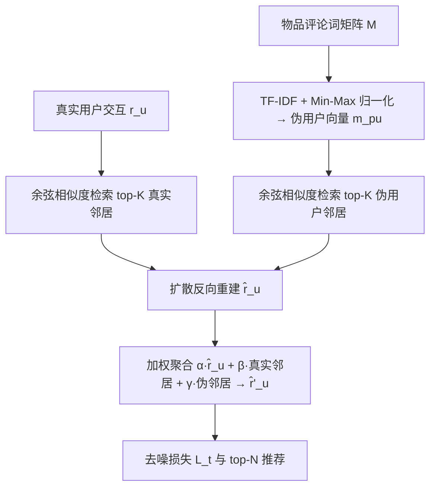
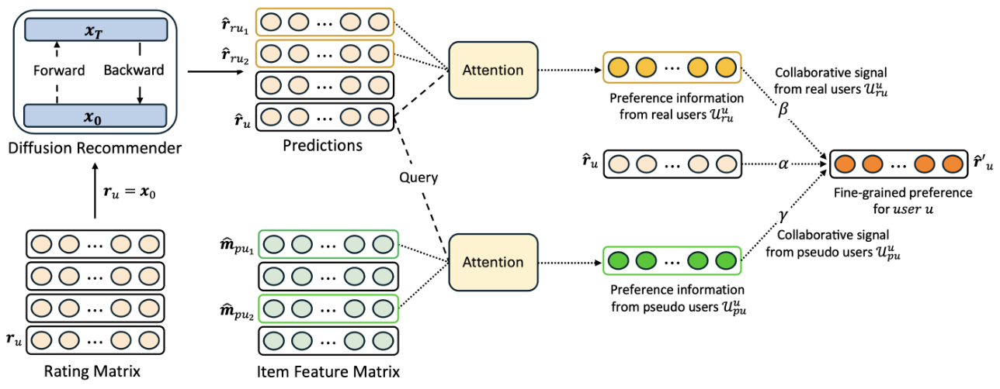

# Collaborative Diffusion Model for Recommender System (面向推荐系统的协同扩散模型)

- **会议/期刊**: WWW Companion 2025 (Short Paper)
- **作者与机构**: Gyuseok Lee, Hwanjo Yu (POSTECH); Yaochen Zhu, Jundong Li (University of Virginia); Yao Zhou (Google Inc.)
- **推荐链路定位**: 召回（生成式用户表征重建）
- **研究方向**: 生成式推荐与离散语义 ID / 协同过滤与双塔召回
- **论文原文**: [https://arxiv.org/abs/2501.18997v1](https://arxiv.org/abs/2501.18997v1)
- **开源代码**: [https://github.com/js05212/citeulike-t](https://github.com/js05212/citeulike-t)（仅数据集仓库，模型代码暂未开源）

## TL;DR (1分钟核心速览)

扩散推荐（DR）存在两难：加噪过强则个性化信息被冲毁、加噪不足则生成能力受限；且现有 DR 几乎只用用户侧交互，物品侧内容被浪费。本文提出 CDiff4Rec：把评论词当作"伪用户"（词在多个物品评论中共现即构成其交互历史），为每个真实用户检索真实邻居与伪用户邻居两组 top-$K$，在扩散反向过程的重建结果上做加权聚合。三个公开数据集上 R@20 全面超越 DiffRec/Ease/ConVAE，Yelp 上 R@10 相对 DiffRec 提升 12.3%，墙钟时间仅增 10.5%。

## Background & Motivation (背景与核心矛盾)

- **主流范式**: 以 DiffRec 为代表的 DR 把用户交互向量 $\mathbf{r}_u$当作$x_0$，前向加高斯噪、反向用 MLP 逐步去噪重建，靠生成式去噪能力对抗隐式反馈的稀疏与噪声。
- **前人局限一（噪声-个性化两难）**: 加噪步数多则 $x_0$ 被彻底破坏、个性化信号不可恢复；步数少则生成能力不足。DiffRec 只能靠调小噪声/步数折中，性能对超参高度敏感且不稳定。
- **前人局限二（物品侧信息闲置）**: DR 是纯用户导向的，评论、属性等物品内容从未进入扩散链路，无法提供互补知识。
- **核心洞察 (Key Insight)**: 评论词天然具备"跨物品共现"结构——一个词出现在多个物品的评论里，恰好等价于一个用户在多个物品上有交互。因此词可以零成本地映射为"伪用户"，直接复用隐式反馈 CF 框架，无需为内容特征设计专门损失。
- **本文切入点**: 用伪用户补齐物品侧信息，再用真实+伪两组邻居的偏好信息在扩散重建阶段做级联修正，从外部注入被噪声侵蚀的个性化信号。

## Method (核心方法设计)

### 1. 整体框架 (Overall Architecture)

三阶段闭环：(i) 由物品评论词生成伪用户交互向量；(ii) 对每个查询用户，分别从真实用户集与伪用户集中按行为相似度检索 top-$K$邻居（离线预计算并缓存）；(iii) 在扩散反向过程得到基础重建$\hat{\mathbf{r}}_u$后，将其与两组邻居的预测做加权融合得到$\hat{\mathbf{r}}'_u$，并以$\hat{\mathbf{r}}'_u$替代$\hat{\mathbf{r}}_u$ 计算去噪损失。训练与推理的扩散骨架（MLP、噪声调度）完全沿用 DiffRec，创新全部集中在"邻居构造 + 重建聚合"这一层。

<figure class="paper-figure" markdown="span">
  <figcaption>图1：所提出的面向推荐系统的协同扩散模型（CDiff4Rec）概览。</figcaption>
</figure>

### 2. 关键设计拆解 (Key Designs)

1. **伪用户生成（把内容变成协同信号）**：对词-物品计数矩阵 $\mathbf{M}$先算 TF-IDF 再 Min-Max 归一化到$[0,1]$，得到$\mathbf{m}_{p_u}\in[0,1]^{|\mathcal{I}|}$，与真实用户的二值交互向量$\mathbf{r}_{r_u}\in\{0,1\}^{|\mathcal{I}|}$ 在形式上完全同构。这样伪用户可直接喂进任意隐式反馈 CF 损失，且扩散去噪本身还能顺带滤掉 TF-IDF 向量里的弱相关噪声，形成"内容补信号、扩散去噪"的双向增益。

2. **双源 top-$K$邻居与偏好聚合（核心增量算子）**：用余弦距离$\phi$分别检索$\mathcal{U}^{r_u}_u$与$\mathcal{U}^{p_u}_u$，然后在重建层做线性融合：
$$\hat{\mathbf{r}}'_u=\alpha\hat{\mathbf{r}}_u+\beta\!\!\sum_{r_{u_i}\in\mathcal{U}^{r_u}_u}\!\! a_{r_{u_i}}\hat{\mathbf{r}}_{r_{u_i}}+\gamma\!\!\sum_{p_{u_j}\in\mathcal{U}^{p_u}_u}\!\! a_{p_{u_j}}\hat{\mathbf{m}}_{p_{u_j}},\quad \alpha+\beta+\gamma=1$$
注意力权重 $a$提供三种可选实现：均匀池化（最简）、行为相似度 softmax（复用预计算距离，最省）、参数化$QK$注意力（用级联重建$\hat{\mathbf{r}}_u$ 学关系，最强）。直觉是：邻居的预测是在不同噪声轨迹上重建出来的，相当于对同一用户偏好多视角投票，天然抑制单条轨迹的噪声放大。

3. **训练目标与推理开销**：损失仅把式 (4) 中的 $\hat{\mathbf{x}}_\theta$换成$\hat{\mathbf{r}}'_u$：
$$\mathcal{L}_t=\mathbb{E}_{q(\mathbf{x}_t|\mathbf{x}_0)}\big[C\,\|\hat{\mathbf{r}}'_u-\mathbf{r}_u\|_2^2\big]$$
无负采样（全库 softmax 式重建），邻居检索全部离线缓存，在线仅多一次 $K$ 项加权求和。实测 Yelp 墙钟时间从 37:47 增至 41:45（+10.5%），Citeulike-t 反而从 3:00:25 降至 2:55:51。

## Experimental Setup & Evaluation Protocol (实验设置与评估协议)

- **数据集与预处理**: 评分 4–5 二值化为隐式反馈；评论词作为特征集 $\mathcal{F}$。

| 数据集 | #Users | #Items | #Interactions | 稀疏度 | 场景说明 |
| :--- | :---: | :---: | :---: | :---: | :--- |
| Yelp | 26,695 | 20,220 | 942,328 | 99.83% | 本地生活商户评论 |
| Amazon-Game | 2,343 | 1,700 | 39,263 | 99.01% | 游戏类电商评论 |
| Citeulike-t | 7,947 | 25,975 | 132,275 | 99.94% | 学术文献标签/标题词 |

- **数据划分与防穿越**: 每个用户交互随机按 **80%/10%/10%** 切分为 train/validation/test（非全局时间戳切分，存在轻度未来信息泄漏风险）。
- **排名评测协议**: 报告 Recall@20 与 NDCG@20；论文未明确说明是 Full-Ranking 还是采样排序，从 DiffRec 系工作惯例推断为全库未交互物品排序，但**原文缺失该关键声明**，复现时需自行确认。
- **对比基线与超参**: 基线含传统 CF（BPRMF、LightGCN）、生成式 CF（MultiVAE、DiffRec）、邻域生成式（Ease）、内容增强生成式（ConVAE）；骨干 MLP 隐层 1,000；$\alpha,\beta,\gamma\in\{0.1,\dots,0.9\}$，$K\in\{10,20,50\}$，学习率$[5e^{-5},5e^{-4}]$；采用 paired t-test，$p\le0.05/0.005/0.0005$ 分别记 `*/**/***`。

## Key Experimental Results (实验关键数据)

### 1. 主实验对比 (Main Results)

| 数据集 | 方法 | R@20 | N@20 |
| :--- | :--- | :---: | :---: |
| Yelp | Ease (最佳基线) | 0.1099 | 0.0601 |
| Yelp | DiffRec | 0.1045 | 0.0563 |
| Yelp | **CDiff4Rec** | **0.1145** (***) | **0.0622** (*) |
| Yelp | Improv. vs Ease | +4.19% | +3.49% |
| AM-Game | DiffRec | 0.2193 | 0.1034 |
| AM-Game | ConVAE | 0.2192 | 0.0997 |
| AM-Game | **CDiff4Rec** | **0.2255** (*) | **0.1052** |
| AM-Game | Improv. vs DiffRec | +2.83% | +1.74% |
| Citeulike-t | Ease | 0.1591 | 0.0852 |
| Citeulike-t | DiffRec | 0.1491 | 0.0791 |
| Citeulike-t | **CDiff4Rec** | **0.1616** (**) | **0.0885** (***) |
| Citeulike-t | Improv. vs Ease | +1.57% | +3.87% |

### 2. 消融实验 (Ablation Study)

| 变体 | Yelp R@20 | Yelp N@20 | AM-Game R@20 | Citeulike R@20 |
| :--- | :---: | :---: | :---: | :---: |
| DiffRec (无邻居) | 0.1045 | 0.0563 | 0.2193 | 0.1491 |
| + 仅真实邻居 | 0.1090 | 0.0590 | 0.2204 | 0.1539 |
| + 仅伪用户邻居 | 0.1074 | 0.0584 | 0.2250 | 0.1605 |
| + 真实 & 伪用户 | **0.1145** | **0.0622** | **0.2255** | **0.1616** |

### 3. 关键实验发现 (Key Findings)

1. **两类邻居互补而非冗余**：Yelp 上仅真实邻居 +4.3%、仅伪邻居 +2.8%，合并后 +9.6%，增益接近两者之和，说明内容侧与行为侧提供的是正交信息；而在 Citeulike-t 上伪用户单独贡献（0.1491→0.1605，+7.6%）远大于真实邻居（+3.2%），印证了极度稀疏（99.94%）场景下内容信号比稀疏共现更可靠。
2. **超参不敏感、小 $K$即饱和**：$K=20$、伪用户数 1,000 时三数据集整体最优，$K$ 从 10 增至 50 的波动普遍在 1% 以内；伪用户数从 1,000 扩到 20,000 收益反而下降，说明高频词已覆盖主要语义，扩词表只引入噪声。
3. **精度-效率比优于 DiffRec**：Yelp 上 R@10 提升 12.3%、N@10 提升 12.1%，墙钟时间仅 +10.5%；Citeulike-t 上精度持平但训练更快收敛（3:00:25→2:55:51），说明邻居聚合起到了加速去噪收敛的隐式正则作用。

## Highlights & Limitations (亮点、对比与审稿批判)

- **与代表作对比**: 相比 DiffRec（纯用户侧、靠调噪声折中），本文不改扩散骨架而改"重建目标"，把邻居信息作为外部条件注入，工程侵入性极低；相比 Ease（闭式邻域回归、无生成能力），本文保留了扩散的去噪与生成优势；相比 ConVAE（内容仅作 VAE 输入特征），本文把内容提升为"伪用户"参与协同检索，语义层级更深。
- **可迁移亮点**: ①"把任意侧信息（词、标签、品牌、类目）映射为伪用户向量"这一 trick 可零成本接入任何隐式反馈 CF 框架，无需新损失；②在扩散/生成式模型的反向重建输出上做邻居加权融合，是一种通用的"生成+检索"混合范式，可迁移到生成式召回的后处理重打分。
- **审稿级局限批判**: ①**评估协议声明缺失**——未说明 Full-Ranking 还是采样排序，也未报告方差与多次运行结果，短论文的实验严谨度打折；②**划分方式有穿越风险**——随机 80/10/10 而非全局时间戳切分，评论词 TF-IDF 在全量物品上统计，存在轻度信息泄漏；③**伪用户构造依赖评论文本**，对无评论/纯 ID 场景（如多数工业召回日志）不可用，且 TF-IDF 词表规模与 $K$ 需逐数据集调参，泛化边界未讨论。

## Rating (四维评分)

- **方法创新性 (Novelty)**: ⭐⭐⭐⭐ （"评论词即伪用户"的视角转换简洁且有物理直觉，但本质是邻居聚合 + 内容特征的组合式创新，扩散理论层面无新推导）
- **评估协议与实验扎实度 (Protocol & Experiments)**: ⭐⭐⭐ （三数据集 + 显著性检验 + 消融 + 效率对比齐全，但划分方式与排名协议声明缺失，短论文篇幅限制明显）
- **写作与数学规范度 (Clarity & Rigor)**: ⭐⭐⭐⭐ （三阶段结构与公式链条清晰，注意力三方案对比交代到位；但式 (6) 中 $\hat{\mathbf{m}}_{p_{u_j}}$与$\hat{\mathbf{r}}_{r_{u_i}}$ 的生成方式未展开）
- **工业落地与复现价值 (Industrial & Practical Value)**: ⭐⭐⭐⭐ （离线缓存邻居、在线仅一次加权求和，+10.5% 开销换两位数 Recall 提升，性价比高；但模型代码未开源、依赖评论文本限制了直接复用）

