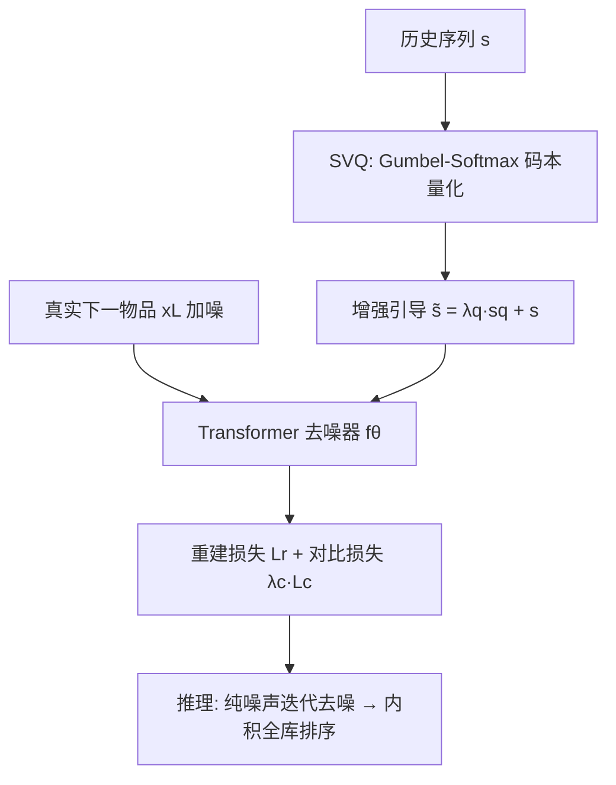
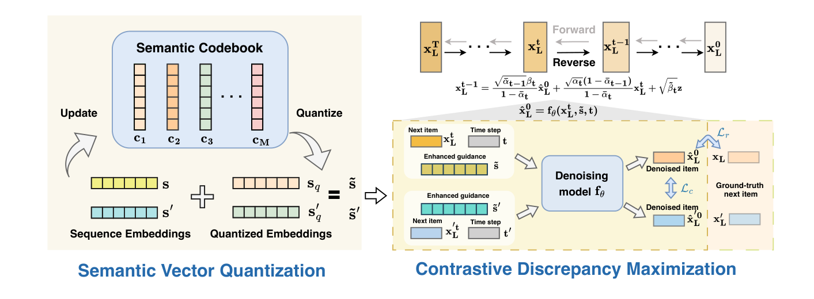

# Distinguished Quantized Guidance for Diffusion-based Sequence Recommendation (面向扩散式序列推荐的判别性量化引导)

- **会议/期刊**: WWW 2025
- **作者与机构**: Wenyu Mao, Shuchang Liu, Haoyang Liu, Haozhe Liu, Xiang Li, Lantao Hu（快手等）
- **推荐链路定位**: 端到端生成式（召回级 next-item 生成）
- **研究方向**: 生成式推荐与离散语义ID / 序列推荐
- **论文原文**: [https://arxiv.org/abs/2501.17670v2](https://arxiv.org/abs/2501.17670v2)
- **开源代码**: [https://github.com/maowenyu-11/DiQDiff](https://github.com/maowenyu-11/DiQDiff)

## TL;DR (1分钟核心速览)

扩散式序列推荐（DreamRec/DiffuRec）把用户历史序列当作去噪引导，但序列长度/内容异构且含误点击噪声，引导编码失真；同时 DDPM 易继承数据偏置，只生成头部流行物品。DiQDiff 提出语义向量量化（SVQ）用离散码本把序列映射为协同/类目语义码并与原序列融合，得到鲁棒增强引导；再用对比差异最大化（CDM）拉开不同用户去噪轨迹，抑制偏置生成。在 ML-1M/Beauty/Toys/Steam 四数据集全库排序下，Steam 上 HR@20、NDCG@20 较最强基线 DiffuRec 分别提升 9.2% 与 5.5%。

## Background & Motivation (背景与核心矛盾)

- **主流范式**: 以 DDPM 对真实下一物品嵌入加噪、再在历史序列引导下逐步去噪，用生成嵌入与全库物品内积做 top-K 推荐。
- **前人局限**: ① 引导异构且含噪——低活用户序列极稀疏（极端仅 1 条），长序列又混入误点击，序列编码歧义直接污染去噪；② 偏置生成——流行物品占据大量训练样本，去噪过程模式坍缩，不同用户生成结果趋同。
- **核心洞察 (Key Insight)**: 序列的"语义簇中心"（码本向量）比原始序列更抗稀疏与噪声；而仅靠重建损失无法迫使不同用户走向不同去噪轨迹，需显式施加轨迹间排斥。
- **本文切入点**: 用离散码本量化引导做"信息补全+噪声平滑"，再用批内对比损失把不同序列的去噪结果推开，二者互补。

## Method (核心方法设计)

### 1. 整体框架 (Overall Architecture)

输入用户序列 $s$先经物品嵌入得$\mathbf{s}\in\mathbb{R}^{(L-1)\times D}$；SVQ 用 MLP 码选择器 + Gumbel-Softmax 从码本$\mathcal{C}=\{\mathbf{c}_m\}_{m=1}^{M}$中选出语义码$\mathbf{s}_q$，按$\tilde{\mathbf{s}}=\lambda_q\mathbf{s}_q+\mathbf{s}$融合为增强引导。训练时对真实下一物品$\mathbf{x}_L$前向加噪得$\mathbf{x}_L^t$，Transformer 去噪器$f_\theta$在$\tilde{\mathbf{s}}$与时间步$t$条件下预测$\hat{\mathbf{x}}_L^0$，同时优化重建损失与 CDM 对比损失，端到端联合更新去噪器与码选择器。推理时从纯高斯噪声出发迭代去噪$T=32$步，取最终$\mathbf{x}_L^0$ 与全库物品嵌入内积排序。

<figure class="paper-figure" markdown="span">
  <figcaption>图2：DiQDiff 的框架。语义向量量化通过语义码本对序列进行量化，提取准确且稳健的引导。对比差异最大化用于最大化不同去噪轨迹之间的距离，从而为不同用户实现有区分度的物品生成。</figcaption>
</figure>

### 2. 关键设计拆解 (Key Designs)

1. **语义向量量化 SVQ（鲁棒引导提取）**：痛点是用原始稀疏/含噪序列做条件信息不足。做法是令码选择器输出 logits $\mathbf{o}=f_\varphi(\mathbf{s})$，经 Gumbel-Softmax 采样$g_m=\frac{\exp((o_m+n_m)/\tau)}{\sum_{m'}\exp((o_{m'}+n_{m'})/\tau)}$，前向取$m^*=\arg\max_m g_m$、$\mathbf{s}_q=\mathbf{c}_{m^*}$，反向借 Gumbel 梯度回传，规避 arg-min 不可导。码本按 EM 式聚类更新$\mathbf{c}'_m=\frac{1}{|S_m|}\sum_{\mathbf{s}\in S_m}\mathbf{s}$。直觉：码向量是语义簇质心，对稀疏序列补全协同/类目信号，对噪声序列起平滑作用；附录理论证明当簇规模$|S_m|$足够大时$\mathrm{Var}[\tilde{\mathbf{s}}]\le\mathrm{Var}[\mathbf{s}]$，即量化确实降方差。
2. **对比差异最大化 CDM（抑制偏置生成）**：痛点是重建损失只对齐真实物品，不约束不同用户生成结果的区分度。做法是对批内不同序列的去噪输出 $\hat{\mathbf{x}}_L^0,\hat{\mathbf{x}}_L'^0$施加$\mathcal{L}_c=\mathbb{E}\big[\log\sum_{\hat{\mathbf{x}}_L'^0\in\mathcal{B}_x}\exp(\mathrm{sim}(\hat{\mathbf{x}}_L^0,\hat{\mathbf{x}}_L'^0))\big]$，最小化即拉开余弦相似度。直觉：强制模型为不同引导学习不同去噪轨迹，防止模式坍缩到头部物品；且梯度可回传至码本，使码向量本身更具判别性（图 5 可视化佐证）。
3. **训练目标、负采样与推理效率**：总损失 $\mathcal{L}=\mathcal{L}_r+\lambda_c\mathcal{L}_c$，其中$\mathcal{L}_r=\mathbb{E}\|\mathbf{x}_L-f_\theta(\sqrt{\bar\alpha_t}\mathbf{x}_L+\sqrt{1-\bar\alpha_t}\boldsymbol{\epsilon},\tilde{\mathbf{s}},t)\|^2$。CDM 以批内其他样本为负，**无需显式负采样**。推理需$T=32$ 步迭代，单 epoch 推理耗时与 DiffuRec 相当（Steam 约 3m48s vs 3m46s），SVQ 的 MLP 开销相对 Transformer 去噪器可忽略。

## Experimental Setup & Evaluation Protocol (实验设置与评估协议)

- **数据集与预处理**: 均按时间戳排序并做 `5-core` 过滤：

| 数据集 | #Users | #Items | Avg-len | Var-len | 场景说明 |
| :--- | :---: | :---: | :---: | :---: | :--- |
| ML-1M | 6,040 | 3,416 | 165.50 | 119.59 | 电影评分，长序列 |
| Beauty | 22,363 | 12,101 | 8.53 | 190.76 | 亚马逊美妆，短序列高方差 |
| Toys | 19,412 | 11,924 | 8.63 | 274.12 | 亚马逊玩具，短序列高方差 |
| Steam | 281,428 | 13,044 | 12.40 | 116.11 | 游戏平台，最大规模 |

- **数据划分与防穿越 (Splitting Strategy)**: 按时间戳排序后采用 `Leave-One-Out`（末位为测试、倒数第二为验证），遵循 SASRec/DiffuRec 惯例。
- **排名评测协议 (Ranking Protocol)**: 生成嵌入与**全库物品**内积做无偏 `Full-Ranking`，报告 HR@{5,10,20} 与 NDCG@{5,10,20}；五次随机种子取均值，$p<0.05$ 显著性。
- **对比基线与超参设置**: 覆盖传统（GRU4Rec/SASRec/DIN/BERT4Rec）、多兴趣（ComiRec/TiMiRec/STOSA）、对比（DuoRec/CL4SRec）、生成式（ACVAE/DreamRec/DiffuRec）四类共 12 个基线。嵌入维度 $d=128$，batch 512，$T=32$，$\lambda_q,\lambda_c\in\{0.2,\dots,1.0\}$，码本$M\in\{4,8,16,32,64\}$。

## Key Experimental Results (实验关键数据)

### 1. 主实验对比 (Main Results)

| 数据集 | 指标 | SASRec | BERT4Rec | DuoRec | CL4SRec | DreamRec | DiffuRec | **DiQDiff** | Improv.% |
| :--- | :--- | :---: | :---: | :---: | :---: | :---: | :---: | :---: | :---: |
| ML-1M | H@20 | 28.32 | 29.95 | 32.97 | 31.91 | 35.84 | 35.63 | **36.10** | +0.7% |
| ML-1M | N@20 | 10.59 | 13.48 | 13.50 | 12.97 | 16.20 | 15.90 | **16.43** | +1.4% |
| Beauty | H@20 | 8.98 | 5.79 | 10.72 | 10.58 | 10.62 | 10.51 | **10.93** | +2.0% |
| Beauty | N@20 | 3.66 | 2.35 | 4.99 | 4.85 | 4.99 | 5.34 | **5.52** | +3.4% |
| Toys | H@20 | 9.23 | 4.59 | 9.81 | 10.09 | 9.68 | 9.84 | **10.28** | +1.9% |
| Toys | N@20 | 4.33 | 1.90 | 4.71 | 5.08 | 5.22 | 5.35 | **5.65** | +5.6% |
| Steam | H@20 | 13.61 | 12.73 | 15.61 | 15.06 | 15.08 | 16.09 | **17.57** | +9.2% |
| Steam | N@20 | 5.36 | 5.20 | 6.14 | 6.12 | 6.39 | 7.11 | **7.50** | +5.5% |

### 2. 消融实验 (Ablation Study)

| 数据集 | 变体 | H@10 | H@20 | N@10 | N@20 |
| :--- | :--- | :---: | :---: | :---: | :---: |
| Beauty | Base | 7.62 | 10.66 | 4.61 | 5.38 |
| Beauty | w/o SVQ | 7.62 | 10.65 | 4.67 | 5.44 |
| Beauty | w/o CDM | 7.69 | 10.77 | 4.67 | 5.44 |
| Beauty | **DiQDiff** | **7.82** | **10.93** | **4.74** | **5.52** |
| Toys | Base | 7.41 | 9.85 | 4.74 | 5.35 |
| Toys | w/o SVQ | 7.60 | 10.17 | 4.94 | 5.59 |
| Toys | w/o CDM | 7.61 | 10.03 | 4.92 | 5.53 |
| Toys | **DiQDiff** | **7.72** | **10.28** | **5.00** | **5.65** |
| Steam | Base | 10.90 | 16.75 | 5.65 | 7.12 |
| Steam | w/o SVQ | 10.91 | 16.79 | 5.67 | 7.19 |
| Steam | w/o CDM | 11.29 | 17.43 | 5.91 | 7.46 |
| Steam | **DiQDiff** | **11.41** | **17.57** | **5.98** | **7.53** |

### 3. 关键实验发现 (Key Findings)

1. **两模块互补且 CDM 贡献更大**：Steam 上单独加 SVQ 仅把 N@20 从 7.12 提到 7.19（+1.0%），单独加 CDM 提到 7.46（+4.8%），二者合并达 7.53；说明偏置生成是扩散推荐的主要瓶颈，而 SVQ 的价值更多体现在与 CDM 协同时（CDM 梯度反哺码本判别性）。
2. **量化确实降方差、抗噪抗稀疏**：附录合成数据实验（Beauty 加噪+稀疏 NS 设置）中 DiQDiff 的 N@20 达 5.34，显著高于 DiffuRec 的 4.68 与 CL4SRec 的 4.57，验证 SVQ 的方差缩减理论（$|S_m|$足够大时$\mathrm{Var}[\tilde{\mathbf{s}}]\le\mathrm{Var}[\mathbf{s}]$）在真实噪声场景生效。
3. **设计具可迁移性**：把 SVQ+CDM 移植到 SASRec/CL4SRec 上，Beauty 的 H@20 从 8.98→9.82、CL4SRec 从 10.58→10.75，说明该增强引导+判别生成思路不依赖扩散骨架，对判别式序列模型同样有效。

## Highlights & Limitations (亮点、对比与审稿批判)

- **与代表作对比 (vs. Prior Work)**: 相较 DreamRec/DiffuRec 仅用原始序列做条件、仅优化重建损失，DiQDiff 首次把"引导侧量化增强"与"生成侧对比去偏"耦合进扩散推荐；相较 TIGER 类离散语义 ID 生成式检索，本文的码本作用于**序列级引导**而非物品 ID 词表，且保留连续嵌入生成以支持全库内积检索。
- **可迁移亮点**: ① Gumbel-Softmax 软量化 + EM 码本更新可作为任意条件生成模型（VAE/Flow）的鲁棒条件编码器；② 批内轨迹排斥损失是低成本抑制模式坍缩的通用手段，无需额外负采样器。
- **审稿级局限批判**: ① 推理需 32 步迭代去噪，Steam 单 epoch 推理 3m48s，远高于 SASRec 的 34s，在线低延迟场景部署成本高，论文未给出蒸馏或步数削减方案；② 码本大小 $M$的最优点随数据集漂移（图 6），且$\lambda_q,\lambda_c$ 均呈先升后降，超参需逐数据集网格搜索，泛化调参成本未量化。

## Rating (四维评分)

- **方法创新性 (Novelty)**: ⭐⭐⭐⭐ （首次将序列级语义量化与对比去偏耦合进扩散推荐，并有方差缩减理论支撑，但单点技术均为已有组件的巧妙组合）
- **评估协议与实验扎实度 (Protocol & Experiments)**: ⭐⭐⭐⭐ （四数据集全库排序、12 基线、五次种子与显著性检验齐全，消融+合成鲁棒性+可迁移性实验完整，略欠线上 A/B）
- **写作与数学规范度 (Clarity & Rigor)**: ⭐⭐⭐⭐ （DDPM 与 SVQ 公式推导清晰、附录给出方差分析，但码本与序列同尺寸 $\mathbb{R}^{(L-1)\times D}$ 的存储开销未讨论）
- **工业落地与复现价值 (Industrial & Practical Value)**: ⭐⭐⭐⭐ （代码已开源、训练开销与 DiffuRec 持平，但 32 步迭代推理延迟是线上落地的主要障碍）

