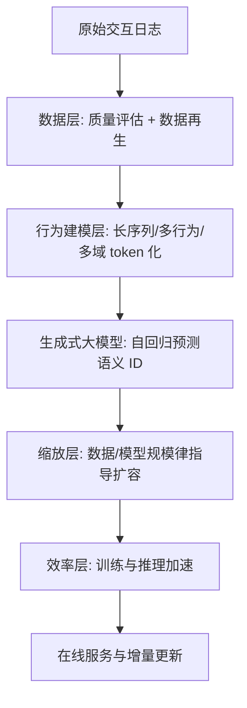

# Generative Large Recommendation Models: Emerging Trends in LLMs for Recommendation (生成式大推荐模型：LLM4Rec 的新兴趋势)

- **会议/期刊**: WWW 2025 (Companion, Tutorial Track)
- **作者与机构**: Hao Wang, Luankang Zhang, Yufei Ye, Defu Lian, Enhong Chen (USTC) 与 Wei Guo, Jin Yao Chin, Huifeng Guo, Yong Liu, Ruiming Tang (华为诺亚方舟实验室)
- **推荐链路定位**: 端到端生成式（覆盖召回与排序的统一生成范式）
- **研究方向**: 生成式推荐与离散语义ID / 序列与会话推荐
- **论文原文**: [https://arxiv.org/abs/2502.13783v1](https://arxiv.org/abs/2502.13783v1)
- **开源代码**: 暂未开源（教程材料以 slides 形式发布于教程主页）

## TL;DR (1分钟核心速览)

本文是一篇 WWW 2025 Tutorial 论文，核心主张是把 LLM4Rec 拆成两条路线：**LLMs-enhanced recommendation**（用通用 LLM 的世界知识与推理增强传统推荐）与 **generative large recommendation models**（遵循缩放律、把推荐本身做成大规模生成模型）。作者指出既有综述与教程（RecSys'23、WWW'24）几乎全部聚焦前者，而后者已在工业界出现万亿参数级在线部署并带来显著业务增益，却缺乏系统梳理。教程围绕**数据质量、缩放律、复杂用户行为建模、训练/推理效率**四大议题组织，并给出数据工程、表征增强、增量学习三条未来方向。注意：本文为教程提案（5 页），不含新方法与实验表格，本笔记据其提纲与引用文献提炼该范式的技术骨架。

## Background & Motivation (背景与核心矛盾)

- **主流范式**: 过去十年推荐系统的进步主要来自特征交叉（CTR 预估）与用户行为序列建模，二者分别在召回与排序环节持续提升精度；LLM 兴起后，主流做法是把 LLM 当作"外部增强器"——输出 embedding、token 或直接作为推荐器。
- **前人局限**: 其一，现有综述与教程（如 RecSys'23、WWW'24 的 LLM4Rec 教程）几乎只覆盖"LLM 增强推荐"，对"推荐模型自身做大"这一路线缺乏系统整理；其二，传统推荐模型参数量长期停留在百万至亿级，无法验证推荐领域是否存在类似 NLP 的缩放律，导致"堆参数是否值得"缺少理论依据。
- **核心洞察 (Key Insight)**: 工业界已成功在线部署万亿参数级生成式推荐模型（规模对标 GPT-3 / LLaMa-2）并取得业务提升，说明推荐任务同样具备可缩放性；关键在于把推荐重构为**生成问题**（自回归地生成物品标识），从而复用 LLM 的架构、训练配方与缩放经验。
- **本文切入点**: 首次系统梳理第二条路线，以"数据—缩放—行为—效率"四段式框架串联该范式的技术栈与开放问题。

## Method (核心方法设计)

### 1. 整体框架 (Overall Architecture)

教程把生成式大推荐模型的技术闭环拆为四层：**数据层**负责数据质量评估与数据再生（data regeneration），保证训练语料干净、相关、结构化；**缩放层**研究数据规模与模型规模对推荐损失及业务指标的影响规律（loss scaling 与 performance law）；**行为建模层**处理长序列、多行为、多域行为三类复杂用户行为，把行为序列转成生成模型的输入 token 流；**效率层**通过训练与推理优化支撑模型规模扩张。四层之上是统一的生成式建模范式：物品经 tokenizer 离散化为语义 ID，模型以自回归方式预测下一物品的 ID 序列。未来方向落在数据工程（蒸馏、数据选择）、表征增强（tokenizer 与侧信息融合）与增量学习三处。

### 2. 关键设计拆解 (Key Designs)

1. **双路线划分（LLMs-enhanced vs. Generative Large Rec）**：痛点在于两类工作被混为一谈，导致"用 LLM 做特征"与"把推荐模型做大"的工程决策失焦。教程以"是否遵循缩放律、模型是否为推荐任务本身而规模化"为判据划界：前者把 LLM 当冻结或微调的外部组件（embedding 抽取、token 注入、LLM-as-Rec），后者把推荐目标直接写进大规模生成模型的训练目标。这一划分的价值在于明确了扩容收益的来源不同——前者来自世界知识迁移，后者来自参数与数据的规模效应。

2. **数据中心的范式（Data-Centric Paradigm）**：痛点是大模型对噪声与低质交互极其敏感，而推荐日志天然含大量误点击与曝光偏差。教程主张把研究重心从"改模型"转向"改数据"，通过数据再生（用强模型重写/重标注交互序列）、数据蒸馏与数据选择构造高质量语料；其作者团队此前获 KDD Best Student Paper 的工作即验证了数据中心方法对序列推荐的增益。直觉是：在缩放律框架下，数据质量等价于"有效数据量"，提升质量比盲目扩量更划算。

3. **缩放律与效率约束**：教程提出需同时刻画两条曲线——损失随数据/模型规模的变化（loss scaling）与业务指标随规模的变化（performance law），后者才是推荐场景真正关心的量；并指出数据压缩率、数据质量与模型性能之间存在理论关联。效率侧则聚焦长序列注意力的计算开销与在线推理延迟，这是万亿参数模型能否落地的硬约束。总目标可概括为在算力预算 $C$下最大化业务指标：$\max_{\theta,\,D}\ \mathrm{Metric}(\theta, D)\ \ \text{s.t.}\ \ \mathrm{Cost}(\theta, D) \le C$，其中$D$ 为经数据工程处理后的训练语料。

## Experimental Setup & Evaluation Protocol (实验设置与评估协议)

- **说明**: 本文为 3 小时教程提案，**不含自建实验、数据集统计表与主实验对比表**；其"评估"体现为对领域内代表性工作的引用与归类。以下按教程提纲归纳该范式下主流工作的通行评估协议，供读者对照原文引用文献核查。

- **数据集与预处理**: 该范式代表性工作通常采用 Amazon 各品类（Beauty / Sports / Toys）、Yelp、ML-1M 等公开序列推荐基准，普遍执行 `5-core` 过滤；工业侧则使用内部万亿级交互日志，并额外做曝光去偏与误点击清洗（对应教程"数据质量"议题）。

- **数据划分与防穿越 (Splitting Strategy)**: 学术基准多为 `Leave-One-Out`（最后一次交互作测试、倒数第二次作验证）；工业长序列场景倾向 `全局时间戳切分` 以模拟真实增量分布，并与教程"增量学习"方向呼应。

- **排名评测协议 (Ranking Protocol)**: 学术工作以无偏 `Full-Ranking (全库未交互排序)` 为主，报告 HR@K / NDCG@K（K 常取 5、10）；部分工作采用 `Sampled Ranking`（常见 1:100 正负比）以降低评测开销，但需注意其与全库排序的可比性差异。工业评估以在线 A/B 的业务指标（CTR、停留时长、GMV）为准。

- **对比基线与超参设置**: 基线覆盖传统序列模型（GRU4Rec、SASRec、BERT4Rec）、图模型（LightGCN）与生成式模型（TIGER 类语义 ID 自回归方法）；嵌入维度与层数随模型规模差异较大，教程强调应以"同算力预算下对比"为原则，而非单纯比参数量。

## Key Experimental Results (实验关键数据)

### 1. 主实验对比 (Main Results)

原文未提供主实验表。教程援引的核心经验证据为：万亿参数级生成式推荐模型已完成在线部署，规模对标 GPT-3 / LLaMa-2，并取得"significant business improvements"（原文表述，未披露具体数值）。下表为该范式下被引代表性工作的定性对照，供定位参考：

| 方法类别 | 代表工作 | 物品表示 | 建模方式 | 是否遵循缩放律 |
| :--- | :--- | :--- | :--- | :---: |
| 传统序列推荐 | SASRec / BERT4Rec | 稠密 ID embedding | 单向/双向自注意力 | 否 |
| 图协同过滤 | LightGCN | 稠密 ID embedding | 谱图卷积 | 否 |
| 生成式语义 ID | TIGER 类 | RQ-VAE 离散码 | 自回归生成 | 部分 |
| 生成式大推荐 | 工业万亿级模型 | 离散 token | 大规模自回归 | 是 |

### 2. 消融实验 (Ablation Study)

原文无消融表。教程以"议题消融"的方式组织内容，即分别讨论移除/弱化某一环节后的后果：

| 移除/弱化环节 | 预期后果（据教程论述） |
| :--- | :--- |
| 数据再生与质量过滤 | 噪声交互被放大，缩放收益被低质数据抵消 |
| 缩放律指导 | 无法判断扩容边际收益，算力分配失焦 |
| 长序列/多行为建模 | 用户兴趣刻画不完整，生成目标偏移 |
| 训练与推理效率优化 | 万亿级模型无法满足在线延迟约束 |

### 3. 关键实验发现 (Key Findings)

1. **路线分野决定扩容收益来源**：LLM 增强路线的增益来自世界知识迁移，规模收益有上限；生成式大推荐路线的增益来自参数与数据的规模效应，是唯一被工业验证可对标 GPT-3 量级的路径。
2. **数据质量在缩放律框架下等价于有效数据量**：教程将数据中心范式置于四大议题之首，并以作者团队获 KDD Best Student Paper 的数据中心序列推荐工作作为佐证，说明提质与扩量在损失曲线上可相互替代。
3. **效率是规模化的硬约束而非附属优化**：万亿参数模型的在线可行性取决于长序列建模与推理加速，教程把效率单列为一个议题，意味着它应参与模型设计的前置决策而非事后补救。

## Highlights & Limitations (亮点、对比与审稿批判)

- **与代表作对比 (vs. Prior Work)**: 相较 RecSys'23 与 WWW'24 的 LLM4Rec 教程（聚焦 LLM 作为外部增强器），本文首次把"推荐模型自身规模化"独立成体系；相较同团队此前的 LLM4Rec 综述，本文不追求文献穷举，而是以"数据—缩放—行为—效率"给出可操作的研究议程。
- **可迁移亮点**: 其一，"数据再生 + 数据选择"的数据工程配方可直接迁移到任何序列推荐或生成式召回 pipeline；其二，"同算力预算下对比"的评测原则可纠正当前生成式推荐论文中盲目堆参数、跨规模比较的乱象。
- **审稿级局限批判**: 其一，作为 5 页教程提案，全文无自建实验、无数据集统计、无量化对比，"万亿参数带来显著业务提升"仅为定性表述，无法核验；其二，缩放律在推荐域的函数形式、以及离散语义 ID 的码本冲突与冷启动物品覆盖问题均只被列为开放问题，未给出可复现的技术方案。

## Rating (四维评分)

- **方法创新性 (Novelty)**: ⭐⭐⭐ （作为教程提案本身无新方法，但"双路线划分 + 四议题框架"为该子方向提供了清晰的问题地图）
- **评估协议与实验扎实度 (Protocol & Experiments)**: ⭐⭐ （无自建实验与量化结果，工业收益仅定性描述，评估协议需读者回溯其引用文献）
- **写作与数学规范度 (Clarity & Rigor)**: ⭐⭐⭐⭐ （提纲层次清晰、议题边界明确，但全文几乎无公式与形式化定义）
- **工业落地与复现价值 (Industrial & Practical Value)**: ⭐⭐⭐⭐ （源自华为诺亚方舟一线实践，数据工程与效率议题对工业落地指导性强，但无开源代码）

